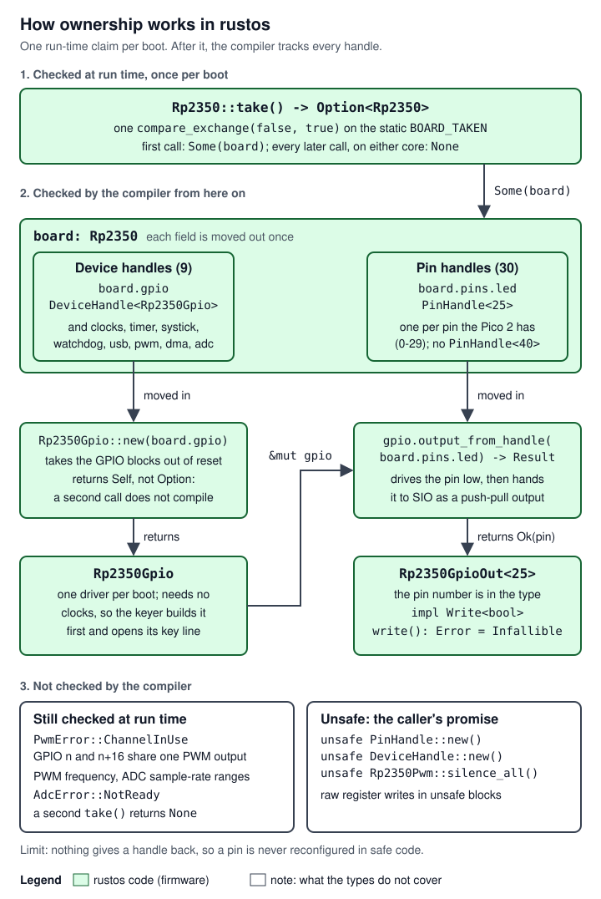

# 01 Overview

> rustos is a bare-metal Rust runtime and driver set for the Raspberry Pi Pico 2 board and its RP2350 microcontroller: no operating system and no vendor library run underneath it, and rustos itself depends on no crate outside this repository (its `Cargo.lock` lists only `api` and `pico2`); applications add their own dependencies, as the decoder firmware adds `libm` from crates.io. Robin (the project owner) started it to move hardware-ownership rules into Rust's type system wherever the language can express them, and to enforce the rest with constructors that succeed at most once per boot. The code is a two-crate Cargo workspace (`api`, the portable traits and ownership types; `firmware/pico2`, the runtime, board definition and drivers) plus an application template. The cw-message-gateway project added the clock, timer, SysTick, watchdog, USB serial, PWM, DMA and ADC drivers so that its keyer box and decoder box firmware could run on it; those two firmware images are the only users today. The repository's large `docs/` folder is mostly the design baseline of a planned flight-software system that has no code. This page is the map for a new engineer. It adapts the subsystem page shape: "How it works" covers the philosophy, the layers, the ownership model and how the processing is done (one polled loop per core, no interrupts, no heap), and "Interfaces and APIs" covers the ownership types, the board, the runtime entry points, a map of every `pico2` module and the build configuration. The traits, drivers and boot code each have their own page.

Terms used on this page, in plain words (the shared glossary is [17 Glossary][gw-17] in the cw-message-gateway handover):

- **RP2350**: the microcontroller (one chip with two Arm Cortex-M33 processor cores, 520 KB of RAM and peripheral blocks); **Pico 2**: Raspberry Pi's small board that carries it, with 4 MB of flash memory.
- **Bare metal**: the program is the only software on the chip; it sets up the hardware itself through **registers** (words at fixed memory addresses that control a peripheral).
- **GPIO**: a general-purpose pin the program drives high or low or reads; **PWM**: a hardware block that makes square waves on a pin; **ADC**: analog-to-digital converter, which measures a pin's voltage; **DMA**: a block that copies data between peripherals and memory without the processor; **USB CDC-ACM**: the USB "serial port" class that computers open without a driver install; **watchdog**: a timer that resets the chip unless the program "feeds" it in time.
- **ELF**: the executable file the linker writes; **UF2**: the file format the Pico 2's boot ROM accepts when it appears as a USB drive; **BOOTSEL**: the button that, held while plugging in USB, starts that boot-ROM drive mode.
- **CW**: Morse code sent by turning a radio's transmitter on and off; the **keyer box** is a Pico 2 that does that by closing a radio's key line, and the **decoder box** listens to a radio's audio and decodes the Morse. **PTT**: push-to-talk, the line that puts a radio into transmit.
- **SysTick**: a 24-bit down-counter inside each Cortex-M33 core; **PLL**: a circuit that multiplies the 12 MHz crystal up to a faster clock (here `clk_sys`, the processor and peripheral clock, at 150 MHz, and `clk_usb` at 48 MHz); **FPU**: the processor's floating-point unit, off at reset; **VTOR**: the core register that holds the vector table's address; **vector table**: the array of handler addresses the processor jumps through on reset, a fault or an interrupt.
- **IMAGE_DEF**: the five-word block the boot ROM looks for before it runs an image (here it declares an executable Arm image for the core's **Secure** state, one of the two security states of the Armv8-M Security Extension); **SIO**: the RP2350 block that sets and reads GPIO levels in one cycle; **VSYS**: the Pico 2's main supply input, 1.8 V to 5.5 V.

## Where it lives

All paths are at rustos master `80bf599` unless marked. Line counts are of the files at that commit.

| Path | What it holds | Lines (all files) |
|---|---|---|
| `README.md` | Purpose, philosophy, layout, build and flash notes. Parts are stale (see [Known bugs](#known-bugs-limits-and-flakes)). | 380 |
| `Cargo.toml` | The workspace: members `api` and `firmware/pico2`, default member `api`, `panic = "abort"` in both profiles ([`Cargo.toml:1-12`](https://github.com/robinonsay/rustos/blob/80bf5998a60a41b3741041062ff7e9c59caf95b2/Cargo.toml#L1-L12)). | 12 |
| `.cargo/config.toml` | One alias, `cargo pico2`; deliberately no default target ([`.cargo/config.toml:1-7`](https://github.com/robinonsay/rustos/blob/80bf5998a60a41b3741041062ff7e9c59caf95b2/.cargo/config.toml#L1-L7)). | 7 |
| `Cargo.lock` | Two packages, `api` and `pico2`, and nothing else ([`Cargo.lock:5-14`](https://github.com/robinonsay/rustos/blob/80bf5998a60a41b3741041062ff7e9c59caf95b2/Cargo.lock#L5-L14)). | 14 |
| `api/` | The portable crate: `common` (114), `device` (322), `gpio` (180), `usb` (6 files, 1,944), `lib.rs` (93). No dependencies ([`api/Cargo.toml:8`](https://github.com/robinonsay/rustos/blob/80bf5998a60a41b3741041062ff7e9c59caf95b2/api/Cargo.toml#L8)). | 2,661 |
| `firmware/pico2/` | The RP2350 crate: `lib.rs` (runtime, 518), `common/` (`board.rs` 146, `mod.rs` with `MAX_GPIO_PIN` 40, `reg.rs` 155, `reset.rs` 251), `gpio/` (907), `clocks` (553), `timer` (253), `systick` (118), `watchdog` (634), `usb/` (1,465), `pwm` (911), `dma` (295), `adc` (765), `link.ld` (195), `build.rs` (18). Depends only on `api` ([`firmware/pico2/Cargo.toml:6-7`](https://github.com/robinonsay/rustos/blob/80bf5998a60a41b3741041062ff7e9c59caf95b2/firmware/pico2/Cargo.toml#L6-L7)). | 7,232 |
| `templates/` | The cargo-generate application template for the Pico 2: `README.md`, `pico2/Cargo.toml.liquid`, `pico2/.cargo/config.toml`, `pico2/src/main.rs`, `pico2/.gitignore`. | 146 |
| `cargo-generate.toml` | Marks the repository as a cargo-generate template source with one sub-template ([`cargo-generate.toml:9-10`](https://github.com/robinonsay/rustos/blob/80bf5998a60a41b3741041062ff7e9c59caf95b2/cargo-generate.toml#L9-L10)). | 10 |
| `.vscode/settings.json` | Turns off rust-analyzer's all-targets check (its comment is stale). | 8 |
| `docs/` | Datasheets and their text extractions, two tutorials, the planned "Juno" flight-software baseline, and this handover in `docs/handover/`. See [The docs folder](#the-docs-folder). | |

There is no CI in this repository (no `.github/` directory at `80bf599`), and no `demo/` crate or `blinky.elf`/`blinky.uf2` files, although the README still describes them.

### What is code and what is only planned

**Code:** the `api` and `firmware/pico2` crates and the template. That is all of it. The README says the same in its "What is implemented and what is planned" section ([`README.md:365-367`](https://github.com/robinonsay/rustos/blob/80bf5998a60a41b3741041062ff7e9c59caf95b2/README.md#L365-L367)), although that sentence predates the DMA and ADC drivers and still names the three-crate workspace and the removed blinky demo.

**Planned only:** everything under `docs/design/`, `docs/requirements/`, `docs/test_cases/`, `docs/sdp/`, `docs/sprints/`, `docs/inspections/`, `docs/reviews/` and `docs/REVIEW.md` is the planning baseline of the "Juno FT1" flight software, a sensor-fusion flight computer for a rocket flight test with 27 planned modules (GPS, IMU, barometer, LoRa telemetry, SD logging, navigation, scheduling). None of those modules has source code here, and the `tools/*.py` scripts those documents mention are not in the repository ([`README.md:56-62`](https://github.com/robinonsay/rustos/blob/80bf5998a60a41b3741041062ff7e9c59caf95b2/README.md#L56-L62), [`README.md:369-380`](https://github.com/robinonsay/rustos/blob/80bf5998a60a41b3741041062ff7e9c59caf95b2/README.md#L369-L380)). The design index and the ICD index open with status banners that say the same: the Juno modules are planned and have no code ([`docs/design/index.md:3-7`](https://github.com/robinonsay/rustos/blob/80bf5998a60a41b3741041062ff7e9c59caf95b2/docs/design/index.md#L3-L7), [`docs/icd/index.md:3-7`](https://github.com/robinonsay/rustos/blob/80bf5998a60a41b3741041062ff7e9c59caf95b2/docs/icd/index.md#L3-L7)). Both banners are partly stale (see [Known bugs](#known-bugs-limits-and-flakes)). Do not read a Juno design document as a description of the code.

### The docs folder

| Folder or file | What it is | Relates to code? |
|---|---|---|
| `docs/*.pdf` (14 files) | Vendor documents: the RP2350 datasheet, the Pico 2 datasheet and pinout, the Pico C SDK and getting-started guides, the Armv8-M architecture reference, the Cortex-M33 technical reference and generic user guide, and datasheets for planned Juno parts (MPL3115A2 barometer as `1893_datasheet.pdf`, MPU-6000 IMU, FGPMMOPA6H GPS, RYLR896 LoRa, SD host specifications). | The RP2350, Pico 2 and Arm documents, yes |
| `docs/extracted/` (14 `.md`, about 311,000 lines) | Each PDF as text, made with `pdftotext -layout`. Each file says line art and images did not survive and that anything load-bearing must be checked against the PDF ([`docs/extracted/rp2350-datasheet.md:3`](https://github.com/robinonsay/rustos/blob/80bf5998a60a41b3741041062ff7e9c59caf95b2/docs/extracted/rp2350-datasheet.md#L3)). | Reference for citations |
| `docs/icd/rp2350/`, `docs/icd/pico2_pinout/` | Summaries of the RP2350 clocks, GPIO, UART, I2C and SPI chapters and of the Pico 2 pinout, written for the Juno FT1 plan: the RP2350 one says it captures "the FT1-relevant chapters of the RP2350 datasheet, tailored for the Juno FSW driver code" ([`docs/icd/rp2350/index.md:3-7`](https://github.com/robinonsay/rustos/blob/80bf5998a60a41b3741041062ff7e9c59caf95b2/docs/icd/rp2350/index.md#L3-L7)), and `pico2_pinout/03_ft1_assignment.md` is the Juno pin plan. | Reference only: the bare-metal tutorial lists `docs/icd/rp2350/gpio/` as a source ([`docs/tutorials/rp2350_baremetal/index.md:212`](https://github.com/robinonsay/rustos/blob/80bf5998a60a41b3741041062ff7e9c59caf95b2/docs/tutorials/rp2350_baremetal/index.md#L212)). No code cites them: the GPIO driver cites the datasheet PDF ([`firmware/pico2/src/gpio/mod.rs:67-77`](https://github.com/robinonsay/rustos/blob/80bf5998a60a41b3741041062ff7e9c59caf95b2/firmware/pico2/src/gpio/mod.rs#L67-L77)). |
| `docs/icd/` (all other folders, `avionics.md`) | Interface documents for the planned Juno GPS, IMU, barometer, LoRa and SD card. | No |
| `docs/tutorials/rp2350_baremetal/` | Nine chapters from an empty directory to a blinking LED: toolchain, linker script, memory map, boot block, vector table, reset handler, registers, GPIO. `archive/` holds a superseded revision; its README says not to follow it. | Yes, but it teaches the older three-crate layout with a `demo` crate; the README says the tree wins where they differ ([`README.md:344-349`](https://github.com/robinonsay/rustos/blob/80bf5998a60a41b3741041062ff7e9c59caf95b2/README.md#L344-L349)) |
| `docs/tutorials/nav_kalman/` | Twelve chapters of Kalman-filter mathematics for the planned navigation module. | No |
| `docs/design/`, `docs/requirements/`, `docs/test_cases/`, `docs/sdp/`, `docs/sprints/`, `docs/inspections/`, `docs/reviews/` | The Juno planning baseline (IEEE 1016 designs, requirements, test cases, development plan, sprint plans, a preliminary design review). | No |
| `docs/REVIEW.md` (12,499 lines) | Every Juno requirement and test case in one generated file. Its generator is not in the repository, so it cannot be regenerated ([`docs/REVIEW.md:1-2`](https://github.com/robinonsay/rustos/blob/80bf5998a60a41b3741041062ff7e9c59caf95b2/docs/REVIEW.md#L1-L2)). | No |
| `docs/handover/` | This handover set, pages 01 to 09; this page is the first. | |

**How the code cites a datasheet, and how to follow a citation.** Driver comments cite the datasheet by section, table and page, for example "Table 534, p504" ([`firmware/pico2/src/pwm.rs:315`](https://github.com/robinonsay/rustos/blob/80bf5998a60a41b3741041062ff7e9c59caf95b2/firmware/pico2/src/pwm.rs#L315)), "§12.6.4.2, p1100" ([`firmware/pico2/src/adc.rs:429-430`](https://github.com/robinonsay/rustos/blob/80bf5998a60a41b3741041062ff7e9c59caf95b2/firmware/pico2/src/adc.rs#L429-L430)) or an erratum, "RP2350-E12 (p1366–1367)" ([`firmware/pico2/src/usb/mod.rs:45-49`](https://github.com/robinonsay/rustos/blob/80bf5998a60a41b3741041062ff7e9c59caf95b2/firmware/pico2/src/usb/mod.rs#L45-L49)). The page is the PDF page index, which is one more than the number printed in the page's footer; each driver module says so ([`firmware/pico2/src/timer.rs:58-59`](https://github.com/robinonsay/rustos/blob/80bf5998a60a41b3741041062ff7e9c59caf95b2/firmware/pico2/src/timer.rs#L58-L59), [`firmware/pico2/src/gpio/mod.rs:69-70`](https://github.com/robinonsay/rustos/blob/80bf5998a60a41b3741041062ff7e9c59caf95b2/firmware/pico2/src/gpio/mod.rs#L69-L70)). To find a page in `docs/extracted/rp2350-datasheet.md`, search for the table or section title, or for the footer: every page of the extraction ends with a line holding the section heading and the printed page number, followed by the next page's running header `RP2350 Datasheet`. So the code's p504 is printed page 503, the block that ends with the line `7.5. Subsystem Resets ... 503`; it holds Table 534 from its title down to bit 1, and bit 0 is on the next page. Write new citations the same way (section, table, PDF page index), and check tables and figures against the PDF, because the text extraction can scramble them.

```sh
grep -n "Table 534\. " docs/extracted/rp2350-datasheet.md            # where the table starts
grep -n -E "^[0-9.]+ .* +503$" docs/extracted/rp2350-datasheet.md      # footer of printed page 503 (PDF page 504)
grep -n "12.6.4.2" docs/extracted/rp2350-datasheet.md                 # a section, in the contents and the body
```

## How it works

### Purpose and philosophy

The README states the premise: mainstream operating systems carry invariants "enforced by convention and runtime checks because their languages could not express them", and rustos uses Rust's ownership and type system to "move OS invariants to compile time wherever the language can express them". Forging a pin handle, configuring the same pin twice, and writing an error branch for an operation that cannot fail are all build errors. The invariants that are "inherently per-boot facts" (has the board been claimed, has this driver been brought up) are enforced by "runtime constructors that succeed at most once" ([`README.md:3-18`](https://github.com/robinonsay/rustos/blob/80bf5998a60a41b3741041062ff7e9c59caf95b2/README.md#L3-L18)).

Three consequences run through the whole code base:

1. **Everything is written by hand and cited.** The boot block, vector table, reset handler, linker script and every driver are in the tree, traced to datasheet sections. rustos itself depends on no crate outside its repository (the lock file lists only `api` and `pico2`, [`Cargo.lock:5-14`](https://github.com/robinonsay/rustos/blob/80bf5998a60a41b3741041062ff7e9c59caf95b2/Cargo.lock#L5-L14)) and on no external embedded crate such as `cortex-m`, `cortex-m-rt`, `rp-hal` or `embassy` ([`README.md:51-54`](https://github.com/robinonsay/rustos/blob/80bf5998a60a41b3741041062ff7e9c59caf95b2/README.md#L51-L54)). An image holds Rust's `core` library, rustos and the application's own crates. The README's "nothing outside this repository is compiled into the firmware image" dates from when the workspace built its own blinky image; it still holds for an app made from the template. The cw-message-gateway images also compile that repository's `keyer-core` ([`firmware/pico2-keyer/Cargo.toml:20`](https://github.com/robinonsay/cw-message-gateway/blob/44185fa9a00369c379d9d8af40ca307e3867e860/firmware/pico2-keyer/Cargo.toml#L20)), and the decoder image (PR #30) and the one-Pico image (PR #31) add `cw`, `decoder-core` and crates.io's `libm` 0.2.16 ([`firmware/pico2-decoder/Cargo.toml:20`](https://github.com/robinonsay/cw-message-gateway/blob/3efaf842e1aab75354e5e19d0384a703d4d786be/firmware/pico2-decoder/Cargo.toml#L20), [`firmware/pico2-decoder/Cargo.lock:30-34`](https://github.com/robinonsay/cw-message-gateway/blob/3efaf842e1aab75354e5e19d0384a703d4d786be/firmware/pico2-decoder/Cargo.lock#L30-L34)).
2. **Ownership is a value.** A pin or a peripheral is owned by whoever holds its zero-sized handle, and a handle exists once per boot (see [The ownership model](#the-ownership-model)).
3. **Portable logic is separated from registers.** The `api` crate has no register addresses and no dependencies, so it compiles and is unit-tested on an ordinary computer ([`api/src/lib.rs:19-33`](https://github.com/robinonsay/rustos/blob/80bf5998a60a41b3741041062ff7e9c59caf95b2/api/src/lib.rs#L19-L33)).

### The layers


*Figure: `api` depends on nothing and `pico2` depends only on `api`. An application drives pins and PWM tones through the `api` traits and calls `pico2`'s own methods for the clocks, timer, watchdog, USB and ADC.*

- **Applications** are binary crates outside this workspace, each with its own Cargo workspace and its own `.cargo/config.toml`: the keyer and decoder firmware in cw-message-gateway, or an app generated from `templates/pico2`. An application supplies `main`, a `#[panic_handler]`, and the `pico2::entry!` declaration.
- **`api`** is the portability boundary: traits (`ErrorType`, `Read<T>`, `Write<T>`, `Gpio`, `GpioPinIn<N>`, `GpioPinOut<N>`), the `Pull` enum, the ownership types `PinHandle<N>` and `DeviceHandle<T>`, the `define_board!` macro, and the chip-independent half of the USB serial device (descriptors, the endpoint-0 request state machine, CDC-ACM line coding, a byte ring) with 35 host unit tests and 2 doc tests. The crate's own diagram says the arrow direction "is the whole point": `api` never depends on `pico2`, so a driver for another chip can implement the same traits ([`api/src/lib.rs:35-54`](https://github.com/robinonsay/rustos/blob/80bf5998a60a41b3741041062ff7e9c59caf95b2/api/src/lib.rs#L35-L54)). Details: [03 The api crate](03-api-crate.md).
- **`pico2`** is a library with three layers in one crate ([`firmware/pico2/src/lib.rs:78-102`](https://github.com/robinonsay/rustos/blob/80bf5998a60a41b3741041062ff7e9c59caf95b2/firmware/pico2/src/lib.rs#L78-L102)): the Cortex-M runtime (vector table, reset handler, FPU enable, `VTOR`), RP2350 chip support (the boot block, register addresses, resets, and the drivers `gpio`, `clocks`, `timer`, `systick`, `watchdog`, `usb`, `pwm`, `dma`, `adc`), and Pico 2 board support (`common::board`, `MAX_GPIO_PIN`). Details: [02 Boot and runtime](02-boot-runtime.md), [04 Drivers: core](04-drivers-core.md), [05 Drivers: I/O](05-drivers-io.md).
- **Hardware**: the drivers reach the RP2350 only through volatile reads and writes at the base addresses in `RegAddr` ([`firmware/pico2/src/common/reg.rs:57`](https://github.com/robinonsay/rustos/blob/80bf5998a60a41b3741041062ff7e9c59caf95b2/firmware/pico2/src/common/reg.rs#L57)) and through the Cortex-M33's own registers.

rustos PR #6 (open, head `410dffa`, not on master) adds `api::multicore`, `pico2::multicore` (start core 1 on its own stack) and `Rp2350Usb::room()`, and a tenth device field `core1: Rp2350Core1` on the board ([`firmware/pico2/src/common/board.rs:147`](https://github.com/robinonsay/rustos/blob/410dffa091e247e6e7546c7f2ff465f0af499d5a/firmware/pico2/src/common/board.rs#L147)). See [06 Multicore](06-multicore.md).

### The ownership model



*Figure: the handle scheme's only run-time ownership check is the one `compare_exchange` inside `take()`; from there each handle is moved exactly once and the compiler rejects a second use. Range and conflict errors from PWM and ADC are still run-time checks.*

The model has four steps.

1. **One claim per boot.** `pico2::common::board` invokes `define_board!` once with the Pico 2's pins and peripherals ([`firmware/pico2/src/common/board.rs:97-146`](https://github.com/robinonsay/rustos/blob/80bf5998a60a41b3741041062ff7e9c59caf95b2/firmware/pico2/src/common/board.rs#L97-L146)). The macro generates the board type `Rp2350` and its `take()`, which flips a static `AtomicBool` with one `compare_exchange(false, true, Acquire, Acquire)`: the first caller gets `Some(Rp2350)`, every later caller, on either core, gets `None` ([`api/src/device/mod.rs:314-319`](https://github.com/robinonsay/rustos/blob/80bf5998a60a41b3741041062ff7e9c59caf95b2/api/src/device/mod.rs#L314-L319)). This is the only run-time check in the scheme.
2. **The board is a bag of handles.** `Rp2350` has a `pins: Rp2350Pins` field with one `PinHandle<N>` per pin that exists on the board (30 of them, GPIO 0 to 29), and one `DeviceHandle<T>` field per peripheral driver (9 at `80bf599`). Both handle types are zero-sized: they store nothing and moving one costs no instructions ([`api/src/device/mod.rs:23-66`](https://github.com/robinonsay/rustos/blob/80bf5998a60a41b3741041062ff7e9c59caf95b2/api/src/device/mod.rs#L23-L66), [`api/src/device/mod.rs:101-137`](https://github.com/robinonsay/rustos/blob/80bf5998a60a41b3741041062ff7e9c59caf95b2/api/src/device/mod.rs#L101-L137)). Neither is `Copy` or `Clone`.
3. **A constructor consumes a handle.** Every driver constructor takes its `DeviceHandle<Self>` by value, and every pin factory (`Gpio::output_from_handle`, `Gpio::input_from_handle`, `Rp2350Pwm::square_from_handle`, `Rp2350Adc::stream_from_handle`) takes a `PinHandle<N>` by value. Passing the field moves it out of the board, so a second use of `board.gpio` or `board.pins.led` is the compiler error "use of moved value" (E0382). That is why `Rp2350Gpio::new` returns `Self`, not `Option<Self>`: its only failure mode, a second construction, cannot compile ([`firmware/pico2/src/gpio/gpio.rs:123-139`](https://github.com/robinonsay/rustos/blob/80bf5998a60a41b3741041062ff7e9c59caf95b2/firmware/pico2/src/gpio/gpio.rs#L123-L139)).
4. **What comes out is typed.** A pin keeps its number in its type (`Rp2350GpioOut<25>`), and the GPIO pin types declare `Error = Infallible`, so their `read` and `write` have no error branch for the caller to write. Drivers that need a running clock take `&Rp2350Clocks` as a second argument (and USB also `&Rp2350Timer`), so the order "clocks first" is a type error to forget ([`firmware/pico2/src/common/board.rs:20-33`](https://github.com/robinonsay/rustos/blob/80bf5998a60a41b3741041062ff7e9c59caf95b2/firmware/pico2/src/common/board.rs#L20-L33)).

What each mechanism covers:

| Rule | How it is enforced | Where |
|---|---|---|
| A handle exists only for a pin the board has | Compile time: `Rp2350Pins` has a field only for pins 0-29, and `PinHandle`'s field is private and its `new` is `unsafe`, so safe code cannot obtain a `PinHandle<40>` | [`firmware/pico2/src/common/board.rs:99-133`](https://github.com/robinonsay/rustos/blob/80bf5998a60a41b3741041062ff7e9c59caf95b2/firmware/pico2/src/common/board.rs#L99-L133) |
| A pin is configured at most once, as one thing | Compile time: the factories take `PinHandle<N>` by value (move) | [`api/src/gpio/mod.rs:174-179`](https://github.com/robinonsay/rustos/blob/80bf5998a60a41b3741041062ff7e9c59caf95b2/api/src/gpio/mod.rs#L174-L179) |
| A driver is constructed at most once | Compile time: each `new` takes `DeviceHandle<Self>` by value | [`firmware/pico2/src/gpio/gpio.rs:132`](https://github.com/robinonsay/rustos/blob/80bf5998a60a41b3741041062ff7e9c59caf95b2/firmware/pico2/src/gpio/gpio.rs#L132) |
| Clocks before timer, SysTick, watchdog, PWM, ADC, USB; timer before USB | Compile time: those constructors take `&Rp2350Clocks` (and `&Rp2350Timer`) | [`firmware/pico2/src/usb/mod.rs:363-368`](https://github.com/robinonsay/rustos/blob/80bf5998a60a41b3741041062ff7e9c59caf95b2/firmware/pico2/src/usb/mod.rs#L363-L368) |
| Two code paths cannot drive one pin at once | Compile time: `Write::write` takes `&mut self`, and there is one pin value | [`api/src/common/mod.rs:74-91`](https://github.com/robinonsay/rustos/blob/80bf5998a60a41b3741041062ff7e9c59caf95b2/api/src/common/mod.rs#L74-L91) |
| ADC input is GPIO 26-29; DMA channel is 0-15; PWM pin exists | Compile time, at build (post-monomorphisation): `const` assertions the functions reference | [`firmware/pico2/src/adc.rs:575-580`](https://github.com/robinonsay/rustos/blob/80bf5998a60a41b3741041062ff7e9c59caf95b2/firmware/pico2/src/adc.rs#L575-L580), [`firmware/pico2/src/dma.rs:182-191`](https://github.com/robinonsay/rustos/blob/80bf5998a60a41b3741041062ff7e9c59caf95b2/firmware/pico2/src/dma.rs#L182-L191), [`firmware/pico2/src/pwm.rs:657-660`](https://github.com/robinonsay/rustos/blob/80bf5998a60a41b3741041062ff7e9c59caf95b2/firmware/pico2/src/pwm.rs#L657-L660) |
| The board is claimed once per boot | Run time: `compare_exchange` in `take()` | [`api/src/device/mod.rs:314-319`](https://github.com/robinonsay/rustos/blob/80bf5998a60a41b3741041062ff7e9c59caf95b2/api/src/device/mod.rs#L314-L319) |
| GPIO n and GPIO n+16 do not both take one PWM output; a slice's two outputs share one frequency | Run time: `PwmError::ChannelInUse`, `PwmError::SliceFrequencyConflict` | [`firmware/pico2/src/pwm.rs:548-567`](https://github.com/robinonsay/rustos/blob/80bf5998a60a41b3741041062ff7e9c59caf95b2/firmware/pico2/src/pwm.rs#L548-L567) |
| Frequency and sample rate are in range; the ADC powered up | Run time: `PwmError::FrequencyOutOfRange`, `AdcError::RateOutOfRange`, `AdcError::NotReady` | [`firmware/pico2/src/pwm.rs:538-547`](https://github.com/robinonsay/rustos/blob/80bf5998a60a41b3741041062ff7e9c59caf95b2/firmware/pico2/src/pwm.rs#L538-L547), [`firmware/pico2/src/adc.rs:393-406`](https://github.com/robinonsay/rustos/blob/80bf5998a60a41b3741041062ff7e9c59caf95b2/firmware/pico2/src/adc.rs#L393-L406) |
| Each pin number and each driver type appears once in a board | Not checked: `define_board!` emits one field per entry, so a board that lists a number or a driver type twice (`led: 25, led2: 25`) creates two handles for it in safe code. The Pico 2 board lists each once. | [`api/src/device/mod.rs:258-260`](https://github.com/robinonsay/rustos/blob/80bf5998a60a41b3741041062ff7e9c59caf95b2/api/src/device/mod.rs#L258-L260), [`api/src/device/mod.rs:275-280`](https://github.com/robinonsay/rustos/blob/80bf5998a60a41b3741041062ff7e9c59caf95b2/api/src/device/mod.rs#L275-L280) |
| Nobody forges a second handle | Contract only: `PinHandle::new` and `DeviceHandle::new` are `unsafe`, so only an `unsafe` block can call them | [`api/src/device/mod.rs:95-98`](https://github.com/robinonsay/rustos/blob/80bf5998a60a41b3741041062ff7e9c59caf95b2/api/src/device/mod.rs#L95-L98), [`api/src/device/mod.rs:159-161`](https://github.com/robinonsay/rustos/blob/80bf5998a60a41b3741041062ff7e9c59caf95b2/api/src/device/mod.rs#L159-L161) |
| A fault handler may override the owners of PWM outputs | Contract only: `unsafe fn Rp2350Pwm::silence_all()` | [`firmware/pico2/src/pwm.rs:715-721`](https://github.com/robinonsay/rustos/blob/80bf5998a60a41b3741041062ff7e9c59caf95b2/firmware/pico2/src/pwm.rs#L715-L721) |

Two limits of the model are deliberate and worth knowing on day one. First, nothing gives a handle back: a configured pin cannot be reconfigured (say, output back to input) in safe code, and dropping a GPIO output leaves the pin driving its last level ([`firmware/pico2/src/gpio/gpio.rs:212-216`](https://github.com/robinonsay/rustos/blob/80bf5998a60a41b3741041062ff7e9c59caf95b2/firmware/pico2/src/gpio/gpio.rs#L212-L216)). Second, raw register writes in `unsafe` code bypass all of it. The keyer and decoder firmware use exactly that, on purpose: both in their fault handlers (see [How it connects](#how-it-connects)), and the decoder (PR #30, not on main) also in normal operation. It drives the LED (GPIO 25) and the regulator's mode pin (GPIO 23) through their `IO_BANK0` output overrides and leaves `board.pins.led` and `board.pins.smps_ps` unused, so that the image never writes the SIO's set register, which rustos's GPIO output uses ([`firmware/pico2-decoder/src/main.rs:215-250`](https://github.com/robinonsay/cw-message-gateway/blob/3efaf842e1aab75354e5e19d0384a703d4d786be/firmware/pico2-decoder/src/main.rs#L215-L250)). rustos has no output pin type driven through the overrides (see [Work left](#work-left)).

### How the processing is done

rustos is not an operating system in the scheduler sense. It has no threads, no scheduler, no interrupt handlers and no heap; each application is one loop.

- **One thread of control per core.** `OnReset` calls the application's `main`, which never returns ([`firmware/pico2/src/lib.rs:436-445`](https://github.com/robinonsay/rustos/blob/80bf5998a60a41b3741041062ff7e9c59caf95b2/firmware/pico2/src/lib.rs#L436-L445)). `main` builds its drivers and then runs a loop that polls each one: `Rp2350Usb::poll` at least once per millisecond ([`firmware/pico2/src/usb/mod.rs:428-434`](https://github.com/robinonsay/rustos/blob/80bf5998a60a41b3741041062ff7e9c59caf95b2/firmware/pico2/src/usb/mod.rs#L428-L434)), `Rp2350AdcStream::read` often enough that the DMA ring does not lap the reader (every 240 ms at 32 kHz, [`firmware/pico2/src/adc.rs:462-465`](https://github.com/robinonsay/rustos/blob/80bf5998a60a41b3741041062ff7e9c59caf95b2/firmware/pico2/src/adc.rs#L462-L465)), `Rp2350Timer::now` for time. With rustos PR #6 (open, not on master), core 1 runs a second loop of the same kind, started by core 0 ([06 Multicore](06-multicore.md)).
- **No interrupts.** No driver enables an interrupt: DMA ([`firmware/pico2/src/dma.rs:53-55`](https://github.com/robinonsay/rustos/blob/80bf5998a60a41b3741041062ff7e9c59caf95b2/firmware/pico2/src/dma.rs#L53-L55)), ADC ([`firmware/pico2/src/adc.rs:138-139`](https://github.com/robinonsay/rustos/blob/80bf5998a60a41b3741041062ff7e9c59caf95b2/firmware/pico2/src/adc.rs#L138-L139)), PWM ([`firmware/pico2/src/pwm.rs:194-196`](https://github.com/robinonsay/rustos/blob/80bf5998a60a41b3741041062ff7e9c59caf95b2/firmware/pico2/src/pwm.rs#L194-L196)), USB ([`firmware/pico2/src/usb/mod.rs:216-217`](https://github.com/robinonsay/rustos/blob/80bf5998a60a41b3741041062ff7e9c59caf95b2/firmware/pico2/src/usb/mod.rs#L216-L217)) and SysTick, which counts with no interrupt ([`firmware/pico2/src/systick.rs:96-97`](https://github.com/robinonsay/rustos/blob/80bf5998a60a41b3741041062ff7e9c59caf95b2/firmware/pico2/src/systick.rs#L96-L97)). No code writes the interrupt controller (NVIC). The vector table is a fixed `static` in flash: slot 0 holds the stack top, slot 1 `OnReset`, slot 3 `OnHardFault`, slots 8-10 and 13 are reserved zeros, and every other slot is `DefaultHandler` ([`firmware/pico2/src/lib.rs:506-518`](https://github.com/robinonsay/rustos/blob/80bf5998a60a41b3741041062ff7e9c59caf95b2/firmware/pico2/src/lib.rs#L506-L518)). There is no API to install a handler. An exception that does arrive runs the application's safe state and spins ([`firmware/pico2/src/lib.rs:447-469`](https://github.com/robinonsay/rustos/blob/80bf5998a60a41b3741041062ff7e9c59caf95b2/firmware/pico2/src/lib.rs#L447-L469)).
- **No heap, no allocator.** `#![no_std]` links only Rust's `core` library ([`firmware/pico2/src/lib.rs:34-37`](https://github.com/robinonsay/rustos/blob/80bf5998a60a41b3741041062ff7e9c59caf95b2/firmware/pico2/src/lib.rs#L34-L37)), and no crate in the workspace defines a global allocator (not found in the code at `80bf599`). Large buffers are `static`s that the application owns, for example the decoder's 16 kB ADC ring ([`firmware/pico2-decoder/src/main.rs:64-65`](https://github.com/robinonsay/cw-message-gateway/blob/3efaf842e1aab75354e5e19d0384a703d4d786be/firmware/pico2-decoder/src/main.rs#L64-L65), PR #30).
- **Waiting is busy-waiting.** Nothing sleeps. Constructors spin while the hardware comes up (listed under [The bring-up order](#the-bring-up-order)), and `Rp2350Timer::delay_us`/`delay_ms` spin on the timer without feeding the watchdog ([`firmware/pico2/src/timer.rs:232-253`](https://github.com/robinonsay/rustos/blob/80bf5998a60a41b3741041062ff7e9c59caf95b2/firmware/pico2/src/timer.rs#L232-L253)).

The boot path and the fault handlers are on [02 Boot and runtime](02-boot-runtime.md); what a new driver must follow to fit this model (polled, no interrupt, no allocation) is on [07 Writing a driver](07-writing-a-driver.md). No work on interrupt support is in progress (see [Work left](#work-left)).

## How it connects

rustos is a library: it has no wire format of its own. What crosses its boundary is the crate API (next section), the linker script that every application links with, and the template that starts a new application. The consumers and the rustos revision each one pins are drawn in [the layers figure](#the-layers) above; the history of the rustos PRs they needed is on [08 Changes for cw-message-gateway](08-changes-for-cw-gateway.md).

| Consumer | Where | rustos revision it builds against | Drivers it uses |
|---|---|---|---|
| Keyer box firmware, on cw-message-gateway main | `firmware/pico2-keyer` | `8c91507` (master's merge of rustos #4), as a git dependency pinned by `rev` ([`firmware/pico2-keyer/Cargo.toml:30-31`](https://github.com/robinonsay/cw-message-gateway/blob/44185fa9a00369c379d9d8af40ca307e3867e860/firmware/pico2-keyer/Cargo.toml#L30-L31)) | GPIO, clocks, PWM, timer, SysTick, watchdog, USB ([`firmware/pico2-keyer/src/main.rs:174-204`](https://github.com/robinonsay/cw-message-gateway/blob/44185fa9a00369c379d9d8af40ca307e3867e860/firmware/pico2-keyer/src/main.rs#L174-L204)) |
| Decoder box firmware (cw-message-gateway PR #30, open, not on main) | `firmware/pico2-decoder` | `80bf599` (master's merge of rustos #5) ([`firmware/pico2-decoder/Cargo.toml:24-25`](https://github.com/robinonsay/cw-message-gateway/blob/3efaf842e1aab75354e5e19d0384a703d4d786be/firmware/pico2-decoder/Cargo.toml#L24-L25)) | GPIO, clocks, timer, watchdog, DMA, ADC, USB ([`firmware/pico2-decoder/src/main.rs:142-182`](https://github.com/robinonsay/cw-message-gateway/blob/3efaf842e1aab75354e5e19d0384a703d4d786be/firmware/pico2-decoder/src/main.rs#L142-L182)) |
| One-Pico keyer image, keyer on core 0 and decoder on core 1 (cw-message-gateway PR #31, draft, not on main) | `firmware/pico2-keyer` | `410dffa`, the head of rustos PR #6, to be moved to master's merge of #6 once it is merged ([`firmware/pico2-keyer/Cargo.toml:24-31`](https://github.com/robinonsay/cw-message-gateway/blob/bc5062ae4f56ae1f9949b3b067218c7e675d88f8/firmware/pico2-keyer/Cargo.toml#L24-L31)) | all ten device handles: GPIO, clocks, PWM, timer, SysTick, watchdog, USB (including `Rp2350Usb::room()`), DMA, ADC and multicore ([`firmware/pico2-keyer/src/main.rs:63-73`](https://github.com/robinonsay/cw-message-gateway/blob/bc5062ae4f56ae1f9949b3b067218c7e675d88f8/firmware/pico2-keyer/src/main.rs#L63-L73), [`firmware/pico2-keyer/src/main.rs:238-311`](https://github.com/robinonsay/cw-message-gateway/blob/bc5062ae4f56ae1f9949b3b067218c7e675d88f8/firmware/pico2-keyer/src/main.rs#L238-L311)). DMA, ADC and multicore have not run on hardware. |
| A new application | generated from `templates/pico2` | rustos's default branch, unpinned ([`templates/pico2/Cargo.toml.liquid:10-12`](https://github.com/robinonsay/rustos/blob/80bf5998a60a41b3741041062ff7e9c59caf95b2/templates/pico2/Cargo.toml.liquid#L10-L12)) | whatever it constructs |

How the cw-message-gateway firmware uses rustos, in brief (the full story is in the cw-message-gateway handover: [02 Codebase, build and CI][gw-02], [08 Keyer box: firmware and protocol][gw-08], [11 Decoder box and one-Pico image][gw-11]):

- Each firmware crate is its own Cargo workspace that builds only for the RP2350; its `.cargo/config.toml` sets the target and passes `-Tlink.ld`, which `pico2`'s build script makes findable ([`firmware/pico2-keyer/.cargo/config.toml:1-7`](https://github.com/robinonsay/cw-message-gateway/blob/44185fa9a00369c379d9d8af40ca307e3867e860/firmware/pico2-keyer/.cargo/config.toml#L1-L7)).
- It does not use picotool to make the UF2. `build.sh` builds the committed tree at a fixed path and converts the ELF with the repository's own `uf2.py`, then prints the UF2's SHA-256 ([`firmware/pico2-keyer/build.sh:24-40`](https://github.com/robinonsay/cw-message-gateway/blob/44185fa9a00369c379d9d8af40ca307e3867e860/firmware/pico2-keyer/build.sh#L24-L40)). CI publishes that file as an artifact, and the safety audit clears one exact hash before anything is flashed ([14 Audit, bench and flashing][gw-14]).
- **Moving the rustos pin is a firmware change.** The keyer's manifest records that moving the pin "can change the UF2 with no source change, since cargo mixes the commit into the crate hashes that order the code" ([`firmware/pico2-keyer/Cargo.toml:21-29`](https://github.com/robinonsay/cw-message-gateway/blob/44185fa9a00369c379d9d8af40ca307e3867e860/firmware/pico2-keyer/Cargo.toml#L21-L29)). A new UF2 needs a fresh audit and a new hash before it may be flashed.
- **Safety, never loosen:** the keyer claims GPIO before anything else and drives GP16 (key) and GP17 (PTT) low, key open, before the clocks and USB start ([`firmware/pico2-keyer/src/main.rs:13-18`](https://github.com/robinonsay/cw-message-gateway/blob/44185fa9a00369c379d9d8af40ca307e3867e860/firmware/pico2-keyer/src/main.rs#L13-L18), [`firmware/pico2-keyer/src/main.rs:174-182`](https://github.com/robinonsay/cw-message-gateway/blob/44185fa9a00369c379d9d8af40ca307e3867e860/firmware/pico2-keyer/src/main.rs#L174-L182)). Until then, and while the chip resets, the pads' reset state and the box's 4.7 kΩ pull-down resistors hold both lines low; the resistors are required because of RP2350 erratum E9, which can leave an undriven pad near 2 V even with the chip's internal pull-down on ([`docs/keyer.md:59-64`](https://github.com/robinonsay/cw-message-gateway/blob/44185fa9a00369c379d9d8af40ca307e3867e860/docs/keyer.md#L59-L64)). The keyer's `safe_state`, named in `entry!` and run by the fault handlers, opens the key and PTT with one raw register write and then calls `Rp2350Pwm::silence_all()` ([`firmware/pico2-keyer/src/main.rs:60`](https://github.com/robinonsay/cw-message-gateway/blob/44185fa9a00369c379d9d8af40ca307e3867e860/firmware/pico2-keyer/src/main.rs#L60), [`firmware/pico2-keyer/src/main.rs:246-261`](https://github.com/robinonsay/cw-message-gateway/blob/44185fa9a00369c379d9d8af40ca307e3867e860/firmware/pico2-keyer/src/main.rs#L246-L261)). The decoder image drives GP16-GP18 low first at bring-up ([`firmware/pico2-decoder/src/main.rs:142-150`](https://github.com/robinonsay/cw-message-gateway/blob/3efaf842e1aab75354e5e19d0384a703d4d786be/firmware/pico2-decoder/src/main.rs#L142-L150)) and in its `safe_state` with one store ([`firmware/pico2-decoder/src/main.rs:202-213`](https://github.com/robinonsay/cw-message-gateway/blob/3efaf842e1aab75354e5e19d0384a703d4d786be/firmware/pico2-decoder/src/main.rs#L202-L213)); it uses no PWM, so it has no `silence_all`. Those orders depend on two rustos behaviours: `Rp2350Gpio::new` needs no clocks, and `output_from_handle` drives a pin low before it enables the output ([`firmware/pico2/src/gpio/gpio.rs:438-442`](https://github.com/robinonsay/rustos/blob/80bf5998a60a41b3741041062ff7e9c59caf95b2/firmware/pico2/src/gpio/gpio.rs#L438-L442)). Do not change either.
- **The key switch inverts, never loosen:** GP16 never drives a radio's key line directly: it lights a PC817 optocoupler (or, on the NR7Y handheld route, a single transistor) whose output closes the key, so GP16 high = key closed and GP16 low or undriven = key open ([`docs/keyer.md:57-58`](https://github.com/robinonsay/cw-message-gateway/blob/44185fa9a00369c379d9d8af40ca307e3867e860/docs/keyer.md#L57-L58), [`docs/keyer.md:907-915`](https://github.com/robinonsay/cw-message-gateway/blob/44185fa9a00369c379d9d8af40ca307e3867e860/docs/keyer.md#L907-L915)). A bare GPIO must never drive a radio that keys on a low line: every safe state of the box would then key the radio (the audit's grade: NO-GO, [`docs/keyer.md:966-976`](https://github.com/robinonsay/cw-message-gateway/blob/44185fa9a00369c379d9d8af40ca307e3867e860/docs/keyer.md#L966-L976)). The canonical list of limits and gates is [13 Safety rules][gw-13].

## Interfaces and APIs

This section is complete for the ownership machinery, the board, the runtime entry points and the build configuration. The drivers are listed by constructor and in a module map, and the traits are summarised; each is documented in full on its own page.

### `api::device`: the ownership types

| Item | Signature | Meaning | Source |
|---|---|---|---|
| `PinHandle<N>` | `pub struct PinHandle<const N: usize> { _private: () }` | Ownership of physical pin `N`. Zero-sized; neither `Copy` nor `Clone`; the private field stops code outside the module from writing a literal. | [`api/src/device/mod.rs:63-66`](https://github.com/robinonsay/rustos/blob/80bf5998a60a41b3741041062ff7e9c59caf95b2/api/src/device/mod.rs#L63-L66) |
| `PinHandle::new` | `pub const unsafe fn new() -> Self` | Makes a handle without a board. The caller promises pin `N` exists and no other `PinHandle<N>` is live. Intended callers: the code `define_board!` generates, host tests, or hardware not yet described by a board. | [`api/src/device/mod.rs:81-98`](https://github.com/robinonsay/rustos/blob/80bf5998a60a41b3741041062ff7e9c59caf95b2/api/src/device/mod.rs#L81-L98) |
| `DeviceHandle<T>` | `pub struct DeviceHandle<T> { _private: PhantomData<T> }` | Ownership of the one peripheral that driver type `T` controls. Zero-sized; `DeviceHandle<Rp2350Gpio>` and `DeviceHandle<Rp2350Usb>` are unrelated types. | [`api/src/device/mod.rs:135-137`](https://github.com/robinonsay/rustos/blob/80bf5998a60a41b3741041062ff7e9c59caf95b2/api/src/device/mod.rs#L135-L137) |
| `DeviceHandle::new` | `pub const unsafe fn new() -> Self` | Makes a handle without a board; the caller promises no other `DeviceHandle<T>` is live. | [`api/src/device/mod.rs:150-161`](https://github.com/robinonsay/rustos/blob/80bf5998a60a41b3741041062ff7e9c59caf95b2/api/src/device/mod.rs#L150-L161) |
| `define_board!` | `define_board! { Board { Pins { name: N, ... } devices { name: DriverType, ... } } }` (the `devices` block is optional) | Declares a board's pins and peripherals and generates the board singleton. Exported at the `api` crate root. | [`api/src/device/mod.rs:239-250`](https://github.com/robinonsay/rustos/blob/80bf5998a60a41b3741041062ff7e9c59caf95b2/api/src/device/mod.rs#L239-L250) |

What one `define_board!` invocation expands to, in the invoking module:

| Generated item | Shape | Source |
|---|---|---|
| `static BOARD_TAKEN` | `core::sync::atomic::AtomicBool`, starts `false`, set by the first successful `take()`, never cleared | [`api/src/device/mod.rs:252-253`](https://github.com/robinonsay/rustos/blob/80bf5998a60a41b3741041062ff7e9c59caf95b2/api/src/device/mod.rs#L252-L253) |
| The pins struct | `pub struct Pins { pub name: PinHandle<N>, ... }`, one field per listed pin | [`api/src/device/mod.rs:258-260`](https://github.com/robinonsay/rustos/blob/80bf5998a60a41b3741041062ff7e9c59caf95b2/api/src/device/mod.rs#L258-L260) |
| The board struct | `pub struct Board { pub pins: Pins, pub name: DeviceHandle<DriverType>, ... }` | [`api/src/device/mod.rs:264-267`](https://github.com/robinonsay/rustos/blob/80bf5998a60a41b3741041062ff7e9c59caf95b2/api/src/device/mod.rs#L264-L267) |
| `Board::new` | private `const fn new() -> Self`; the one `unsafe` block that creates every handle | [`api/src/device/mod.rs:275-280`](https://github.com/robinonsay/rustos/blob/80bf5998a60a41b3741041062ff7e9c59caf95b2/api/src/device/mod.rs#L275-L280) |
| `Board::take` | `pub fn take() -> Option<Self>`: `BOARD_TAKEN.compare_exchange(false, true, Acquire, Acquire).ok().map(\|_\| Self::new())` | [`api/src/device/mod.rs:314-319`](https://github.com/robinonsay/rustos/blob/80bf5998a60a41b3741041062ff7e9c59caf95b2/api/src/device/mod.rs#L314-L319) |

Rules for invoking it (the macro's "Known rough edges"): the invoking module must `use core::sync::atomic::Ordering::Acquire;`, because the expansion names `Acquire` unqualified, and only one board may be declared per module, because `BOARD_TAKEN` is a fixed name ([`api/src/device/mod.rs:233-238`](https://github.com/robinonsay/rustos/blob/80bf5998a60a41b3741041062ff7e9c59caf95b2/api/src/device/mod.rs#L233-L238), [`firmware/pico2/src/common/board.rs:76-82`](https://github.com/robinonsay/rustos/blob/80bf5998a60a41b3741041062ff7e9c59caf95b2/firmware/pico2/src/common/board.rs#L76-L82)).

### `pico2::common::board`: the Pico 2

`Rp2350::take() -> Option<Rp2350>`; the board struct is `Rp2350` and its pins struct `Rp2350Pins` ([`firmware/pico2/src/common/board.rs:97-146`](https://github.com/robinonsay/rustos/blob/80bf5998a60a41b3741041062ff7e9c59caf95b2/firmware/pico2/src/common/board.rs#L97-L146)). Field names say what is safe to wire to: a `gpioN` field is a free pin on the 40-pin header; a semantic name is a pin the Pico 2 board has already wired to its own circuits ([`firmware/pico2/src/common/board.rs:48-74`](https://github.com/robinonsay/rustos/blob/80bf5998a60a41b3741041062ff7e9c59caf95b2/firmware/pico2/src/common/board.rs#L48-L74)).

| Field | GPIO | Board function |
|---|---|---|
| `gpio0` ... `gpio22` | 0-22 | Free header pins |
| `smps_ps` | 23 | Output to the regulator's power-save pin: low allows pulse-skipping at light load, high forces steady PWM mode (less ripple, useful during ADC reads). Not on the header. |
| `vbus_sense` | 24 | Input, high when USB power is present. Not on the header. |
| `led` | 25 | The on-board LED, high = lit. Not on the header. |
| `gpio26`, `gpio27`, `gpio28` | 26-28 | Header pins that are also ADC inputs 0-2 |
| `vsys_adc` | 29 | ADC input 3, wired to the board supply through a divider that reads VSYS/3. Not on the header. |

`pico2::common::MAX_GPIO_PIN = 30` records the package's pin count (the RP2350A has GPIO 0-29) ([`firmware/pico2/src/common/mod.rs:13-40`](https://github.com/robinonsay/rustos/blob/80bf5998a60a41b3741041062ff7e9c59caf95b2/firmware/pico2/src/common/mod.rs#L13-L40)).

Device fields, their drivers and constructors (all `pub fn` on the driver type; each consumes its handle):

| Field | Driver | Constructor | Needs | Returns | Source |
|---|---|---|---|---|---|
| `gpio` | `pico2::gpio::gpio::Rp2350Gpio` | `new(DeviceHandle<Rp2350Gpio>)` | nothing (no clocks) | `Self`; takes `IO_BANK0` and `PADS_BANK0` out of reset | [`firmware/pico2/src/gpio/gpio.rs:132-139`](https://github.com/robinonsay/rustos/blob/80bf5998a60a41b3741041062ff7e9c59caf95b2/firmware/pico2/src/gpio/gpio.rs#L132-L139) |
| `clocks` | `pico2::clocks::Rp2350Clocks` | `new(DeviceHandle<Rp2350Clocks>)` | nothing; its doc says call it first, it busy-waits about 6 ms for the crystal | `Self` | [`firmware/pico2/src/clocks.rs:375-386`](https://github.com/robinonsay/rustos/blob/80bf5998a60a41b3741041062ff7e9c59caf95b2/firmware/pico2/src/clocks.rs#L375-L386) |
| `timer` | `pico2::timer::Rp2350Timer` | `new(DeviceHandle<Rp2350Timer>, &Rp2350Clocks)` | clocks | `Self` | [`firmware/pico2/src/timer.rs:189`](https://github.com/robinonsay/rustos/blob/80bf5998a60a41b3741041062ff7e9c59caf95b2/firmware/pico2/src/timer.rs#L189) |
| `systick` | `pico2::systick::Rp2350SysTick` | `new(DeviceHandle<Rp2350SysTick>, &Rp2350Clocks)` | clocks | `Self` | [`firmware/pico2/src/systick.rs:100`](https://github.com/robinonsay/rustos/blob/80bf5998a60a41b3741041062ff7e9c59caf95b2/firmware/pico2/src/systick.rs#L100) |
| `watchdog` | `pico2::watchdog::Rp2350Watchdog` | `new(DeviceHandle<Rp2350Watchdog>, &Rp2350Clocks)` | clocks | `Self`; reads the reset reason, does not start the watchdog | [`firmware/pico2/src/watchdog.rs:483-490`](https://github.com/robinonsay/rustos/blob/80bf5998a60a41b3741041062ff7e9c59caf95b2/firmware/pico2/src/watchdog.rs#L483-L490) |
| `usb` | `pico2::usb::Rp2350Usb` | `new(DeviceHandle<Rp2350Usb>, &Rp2350Clocks, &Rp2350Timer, UsbDeviceConfig)` | clocks, timer; blocks about 10 ms | `Self` | [`firmware/pico2/src/usb/mod.rs:355-368`](https://github.com/robinonsay/rustos/blob/80bf5998a60a41b3741041062ff7e9c59caf95b2/firmware/pico2/src/usb/mod.rs#L355-L368) |
| `pwm` | `pico2::pwm::Rp2350Pwm` | `new(DeviceHandle<Rp2350Pwm>, &Rp2350Clocks)` | clocks | `Self` | [`firmware/pico2/src/pwm.rs:614`](https://github.com/robinonsay/rustos/blob/80bf5998a60a41b3741041062ff7e9c59caf95b2/firmware/pico2/src/pwm.rs#L614) |
| `dma` | `pico2::dma::Rp2350Dma` | `new(DeviceHandle<Rp2350Dma>)` | nothing | `Self`, holding 16 channel handles `ch0` ... `ch15: Rp2350DmaChannel<C>` | [`firmware/pico2/src/dma.rs:201-243`](https://github.com/robinonsay/rustos/blob/80bf5998a60a41b3741041062ff7e9c59caf95b2/firmware/pico2/src/dma.rs#L201-L243) |
| `adc` | `pico2::adc::Rp2350Adc` | `new(DeviceHandle<Rp2350Adc>, &Rp2350Clocks)` | clocks | `Result<Self, AdcError>`; `Err(NotReady)` if the converter never reports ready | [`firmware/pico2/src/adc.rs:436-460`](https://github.com/robinonsay/rustos/blob/80bf5998a60a41b3741041062ff7e9c59caf95b2/firmware/pico2/src/adc.rs#L436-L460) |
| `core1` (rustos PR #6 only) | `pico2::multicore::Rp2350Core1` | `new(DeviceHandle<Rp2350Core1>)` | nothing | `Self` | [`firmware/pico2/src/multicore.rs:334`](https://github.com/robinonsay/rustos/blob/410dffa091e247e6e7546c7f2ff465f0af499d5a/firmware/pico2/src/multicore.rs#L334) |

Factories that consume a pin handle:

| Function | Signature | Errors | Source |
|---|---|---|---|
| `Gpio::input_from_handle` | `fn input_from_handle<const N: usize>(&mut self, handle: PinHandle<N>, pull: Pull) -> Result<Self::Input<N>, Self::Error>` | On the RP2350, `GpioError`, which no path returns today | [`api/src/gpio/mod.rs:174`](https://github.com/robinonsay/rustos/blob/80bf5998a60a41b3741041062ff7e9c59caf95b2/api/src/gpio/mod.rs#L174) |
| `Gpio::output_from_handle` | `fn output_from_handle<const N: usize>(&mut self, handle: PinHandle<N>) -> Result<Self::Output<N>, Self::Error>`; the RP2350 driver drives the pin low before enabling it | as above | [`api/src/gpio/mod.rs:179`](https://github.com/robinonsay/rustos/blob/80bf5998a60a41b3741041062ff7e9c59caf95b2/api/src/gpio/mod.rs#L179) |
| `Rp2350Pwm::square_from_handle` | `pub fn square_from_handle<const N: usize>(&mut self, _handle: PinHandle<N>, hz: u32) -> Result<Rp2350PwmSquare<N>, PwmError>`; 50 % square wave, starts off | `FrequencyOutOfRange` (outside 100-20,000 Hz), `ChannelInUse`, `SliceFrequencyConflict`, `NoWrap` | [`firmware/pico2/src/pwm.rs:627-657`](https://github.com/robinonsay/rustos/blob/80bf5998a60a41b3741041062ff7e9c59caf95b2/firmware/pico2/src/pwm.rs#L627-L657) |
| `Rp2350Adc::stream_from_handle` | `pub fn stream_from_handle<const N: usize, const C: usize>(self, _pin: PinHandle<N>, _channel: Rp2350DmaChannel<C>, ring: &'static mut AdcRing, hz: u32) -> Result<Rp2350AdcStream, AdcError>`; consumes the ADC itself, so one stream per boot | `RateOutOfRange` (outside 1,000-480,000 Hz); `N` outside 26-29 does not build | [`firmware/pico2/src/adc.rs:462-483`](https://github.com/robinonsay/rustos/blob/80bf5998a60a41b3741041062ff7e9c59caf95b2/firmware/pico2/src/adc.rs#L462-L483) |

The frequency and rate limits are the constants `MIN_FREQUENCY_HZ`/`MAX_FREQUENCY_HZ` ([`firmware/pico2/src/pwm.rs:211-214`](https://github.com/robinonsay/rustos/blob/80bf5998a60a41b3741041062ff7e9c59caf95b2/firmware/pico2/src/pwm.rs#L211-L214)) and `MIN_RATE_HZ`/`MAX_RATE_HZ` ([`firmware/pico2/src/adc.rs:161-168`](https://github.com/robinonsay/rustos/blob/80bf5998a60a41b3741041062ff7e9c59caf95b2/firmware/pico2/src/adc.rs#L161-L168)).

### `pico2` crate root: the runtime entry points

| Item | Signature or form | What it does | Source |
|---|---|---|---|
| `entry!` | `pico2::entry!(main);` or `pico2::entry!(main, safe_state = f);` | Emits the `#[no_mangle]` symbols `__rustos_main` and `__rustos_safe_state`. Type-checks `main` against `fn() -> !` and `f` against `fn()` by coercing them to function pointers, so a wrong signature is a `mismatched types` error at the `entry!` line. The safe state runs only from `OnHardFault` and `DefaultHandler` ([`firmware/pico2/src/lib.rs:380-394`](https://github.com/robinonsay/rustos/blob/80bf5998a60a41b3741041062ff7e9c59caf95b2/firmware/pico2/src/lib.rs#L380-L394)). A panic calls the application's `#[panic_handler]` instead, which must call the safe state itself if any output drives something outside the chip; the keyer's does ([`firmware/pico2-keyer/src/main.rs:282-288`](https://github.com/robinonsay/cw-message-gateway/blob/44185fa9a00369c379d9d8af40ca307e3867e860/firmware/pico2-keyer/src/main.rs#L282-L288) in cw-message-gateway). | [`firmware/pico2/src/lib.rs:344-415`](https://github.com/robinonsay/rustos/blob/80bf5998a60a41b3741041062ff7e9c59caf95b2/firmware/pico2/src/lib.rs#L344-L415) |
| `no_safe_state` | `pub fn no_safe_state()` | The safe state `entry!(main)` names by default: does nothing. | [`firmware/pico2/src/lib.rs:417-418`](https://github.com/robinonsay/rustos/blob/80bf5998a60a41b3741041062ff7e9c59caf95b2/firmware/pico2/src/lib.rs#L417-L418) |
| `OnReset` | `pub extern "C" fn OnReset() -> !` | Reset handler: enable the FPU, set `VTOR`, copy `.data`, zero `.bss`, call `__rustos_main`. | [`firmware/pico2/src/lib.rs:436-445`](https://github.com/robinonsay/rustos/blob/80bf5998a60a41b3741041062ff7e9c59caf95b2/firmware/pico2/src/lib.rs#L436-L445) |
| `DefaultHandler` | `pub extern "C" fn DefaultHandler()` | Every unassigned exception and interrupt: calls the safe state, then spins. | [`firmware/pico2/src/lib.rs:447-457`](https://github.com/robinonsay/rustos/blob/80bf5998a60a41b3741041062ff7e9c59caf95b2/firmware/pico2/src/lib.rs#L447-L457) |
| `OnHardFault` | `pub extern "C" fn OnHardFault()` | HardFault: calls the safe state, then spins. | [`firmware/pico2/src/lib.rs:459-469`](https://github.com/robinonsay/rustos/blob/80bf5998a60a41b3741041062ff7e9c59caf95b2/firmware/pico2/src/lib.rs#L459-L469) |
| `BOOT_INFO` | `static BOOT_INFO: [u32; 5]` in `.boot_info` | The `IMAGE_DEF` block the boot ROM requires: an Arm, Secure, executable image. | [`firmware/pico2/src/lib.rs:152-160`](https://github.com/robinonsay/rustos/blob/80bf5998a60a41b3741041062ff7e9c59caf95b2/firmware/pico2/src/lib.rs#L152-L160) |
| `#[panic_handler]` | supplied by the application | rustos leaves panic policy to the app; the template spins. | [`templates/pico2/src/main.rs:26-36`](https://github.com/robinonsay/rustos/blob/80bf5998a60a41b3741041062ff7e9c59caf95b2/templates/pico2/src/main.rs#L26-L36) |

A safe-state function runs inside the fault handler, in whatever state faulted: it should only write the registers it needs, with no locks and no driver state; a fault inside it, from HardFault, locks the processor until a reset ([`firmware/pico2/src/lib.rs:380-394`](https://github.com/robinonsay/rustos/blob/80bf5998a60a41b3741041062ff7e9c59caf95b2/firmware/pico2/src/lib.rs#L380-L394)). The boot sequence and the vector table are on [02 Boot and runtime](02-boot-runtime.md).

### `pico2` module map

Every public module of the `pico2` crate at `80bf599` ([`firmware/pico2/src/lib.rs:108-117`](https://github.com/robinonsay/rustos/blob/80bf5998a60a41b3741041062ff7e9c59caf95b2/firmware/pico2/src/lib.rs#L108-L117)), with its public types and functions. Each driver is documented in full on [04 Drivers: core](04-drivers-core.md) or [05 Drivers: I/O](05-drivers-io.md); this table is the index.

| Module | Public items | Full reference |
|---|---|---|
| `common` | `MAX_GPIO_PIN` ([`firmware/pico2/src/common/mod.rs:40`](https://github.com/robinonsay/rustos/blob/80bf5998a60a41b3741041062ff7e9c59caf95b2/firmware/pico2/src/common/mod.rs#L40)); submodules `reg`, `reset`, `board` | [04](04-drivers-core.md) |
| `common::board` | `Rp2350`, `Rp2350Pins`, `Rp2350::take()` (above) | this page, [04](04-drivers-core.md) |
| `common::reg` | `RegAddr`: 19 block base addresses, from `SYSCFG` to `SIO` ([`firmware/pico2/src/common/reg.rs:57`](https://github.com/robinonsay/rustos/blob/80bf5998a60a41b3741041062ff7e9c59caf95b2/firmware/pico2/src/common/reg.rs#L57)). For drivers. | [04](04-drivers-core.md) |
| `common::reset` | `pub unsafe fn` `clr_reset_reg`, `set_reset_reg`, `wait_for_reset_done`, `is_reset_done`, `cycle_reset`, each taking a `RESETS` bit mask, which `clr_reset_reg` ANDs in, so a caller releasing a block passes the complement ([`firmware/pico2/src/common/reset.rs:129`](https://github.com/robinonsay/rustos/blob/80bf5998a60a41b3741041062ff7e9c59caf95b2/firmware/pico2/src/common/reset.rs#L129), [`firmware/pico2/src/common/reset.rs:170`](https://github.com/robinonsay/rustos/blob/80bf5998a60a41b3741041062ff7e9c59caf95b2/firmware/pico2/src/common/reset.rs#L170), [`firmware/pico2/src/common/reset.rs:200`](https://github.com/robinonsay/rustos/blob/80bf5998a60a41b3741041062ff7e9c59caf95b2/firmware/pico2/src/common/reset.rs#L200), [`firmware/pico2/src/common/reset.rs:221`](https://github.com/robinonsay/rustos/blob/80bf5998a60a41b3741041062ff7e9c59caf95b2/firmware/pico2/src/common/reset.rs#L221), [`firmware/pico2/src/common/reset.rs:245`](https://github.com/robinonsay/rustos/blob/80bf5998a60a41b3741041062ff7e9c59caf95b2/firmware/pico2/src/common/reset.rs#L245)). For drivers; `unsafe` because they write a chip-wide register, and a wrong mask releases or resets another driver's block ([`firmware/pico2/src/common/reset.rs:97-128`](https://github.com/robinonsay/rustos/blob/80bf5998a60a41b3741041062ff7e9c59caf95b2/firmware/pico2/src/common/reset.rs#L97-L128)). | [04](04-drivers-core.md) |
| `gpio::gpio` | `Rp2350Gpio` (`new`, the `Gpio` trait), `Rp2350GpioOut<N>` (`Write<bool>`), `Rp2350GpioIn<N>` (`Read<bool>`), `GpioError` ([`firmware/pico2/src/gpio/gpio.rs:46`](https://github.com/robinonsay/rustos/blob/80bf5998a60a41b3741041062ff7e9c59caf95b2/firmware/pico2/src/gpio/gpio.rs#L46), [`firmware/pico2/src/gpio/gpio.rs:105`](https://github.com/robinonsay/rustos/blob/80bf5998a60a41b3741041062ff7e9c59caf95b2/firmware/pico2/src/gpio/gpio.rs#L105), [`firmware/pico2/src/gpio/gpio.rs:217`](https://github.com/robinonsay/rustos/blob/80bf5998a60a41b3741041062ff7e9c59caf95b2/firmware/pico2/src/gpio/gpio.rs#L217), [`firmware/pico2/src/gpio/gpio.rs:228`](https://github.com/robinonsay/rustos/blob/80bf5998a60a41b3741041062ff7e9c59caf95b2/firmware/pico2/src/gpio/gpio.rs#L228)) | [05](05-drivers-io.md) |
| `clocks` | `Rp2350Clocks::new`; constants `XOSC_HZ`, `CLK_REF_HZ`, `CLK_SYS_HZ`, `CLK_PERI_HZ`, `CLK_USB_HZ`, `CLK_ADC_HZ`, `PLL_SYS_VCO_HZ`, `PLL_USB_VCO_HZ`, `PllConfig`, `PLL_SYS_CONFIG`, `PLL_USB_CONFIG` ([`firmware/pico2/src/clocks.rs:91-175`](https://github.com/robinonsay/rustos/blob/80bf5998a60a41b3741041062ff7e9c59caf95b2/firmware/pico2/src/clocks.rs#L91-L175), [`firmware/pico2/src/clocks.rs:383`](https://github.com/robinonsay/rustos/blob/80bf5998a60a41b3741041062ff7e9c59caf95b2/firmware/pico2/src/clocks.rs#L383)) | [04](04-drivers-core.md) |
| `timer` | `Rp2350Timer`: `new`, `now() -> u64` (microseconds since `new`), `elapsed_since`, `delay_us`, `delay_ms`; `TICK_CYCLES` ([`firmware/pico2/src/timer.rs:68`](https://github.com/robinonsay/rustos/blob/80bf5998a60a41b3741041062ff7e9c59caf95b2/firmware/pico2/src/timer.rs#L68), [`firmware/pico2/src/timer.rs:189-253`](https://github.com/robinonsay/rustos/blob/80bf5998a60a41b3741041062ff7e9c59caf95b2/firmware/pico2/src/timer.rs#L189-L253)) | [04](04-drivers-core.md) |
| `systick` | `Rp2350SysTick`: `new`, `cycles() -> u32` (`clk_sys` cycles modulo 2^24); `CYCLES_MASK`, `CYCLES_PER_MS` ([`firmware/pico2/src/systick.rs:79-117`](https://github.com/robinonsay/rustos/blob/80bf5998a60a41b3741041062ff7e9c59caf95b2/firmware/pico2/src/systick.rs#L79-L117)) | [04](04-drivers-core.md) |
| `watchdog` | `Rp2350Watchdog`: `new`, `reset_reason`, `reset_snapshot`, `start(timeout_us) -> u32`, `feed`, `scratch`, `set_scratch`, `time_remaining_us`, `is_running`, `force_reset`; `Scratch`, `ResetReason`, `ForcedBy`, `ChipResetCause`, `ResetSnapshot`, `MAX_TIMEOUT_US`, `SCRATCH_MARKER` ([`firmware/pico2/src/watchdog.rs:213-217`](https://github.com/robinonsay/rustos/blob/80bf5998a60a41b3741041062ff7e9c59caf95b2/firmware/pico2/src/watchdog.rs#L213-L217), [`firmware/pico2/src/watchdog.rs:357-420`](https://github.com/robinonsay/rustos/blob/80bf5998a60a41b3741041062ff7e9c59caf95b2/firmware/pico2/src/watchdog.rs#L357-L420), [`firmware/pico2/src/watchdog.rs:490-598`](https://github.com/robinonsay/rustos/blob/80bf5998a60a41b3741041062ff7e9c59caf95b2/firmware/pico2/src/watchdog.rs#L490-L598)) | [04](04-drivers-core.md) |
| `usb` | `Rp2350Usb`: `new`, `poll`, `read(&mut [u8]) -> usize`, `write(&[u8]) -> usize`, `is_configured`, `is_suspended`, `link_up`, `link_epoch`, `last_link_event`, `line_coding`, `dtr`, `rts` (and `room()` on PR #6, [`firmware/pico2/src/usb/mod.rs:490`](https://github.com/robinonsay/rustos/blob/410dffa091e247e6e7546c7f2ff465f0af499d5a/firmware/pico2/src/usb/mod.rs#L490)); `UsbDeviceConfig` (re-exported from `api`), `RX_BUFFER_SIZE` and `TX_BUFFER_SIZE` (512 bytes each), `LinkEvent`, `UsbError` ([`firmware/pico2/src/usb/mod.rs:240-298`](https://github.com/robinonsay/rustos/blob/80bf5998a60a41b3741041062ff7e9c59caf95b2/firmware/pico2/src/usb/mod.rs#L240-L298), [`firmware/pico2/src/usb/mod.rs:363-529`](https://github.com/robinonsay/rustos/blob/80bf5998a60a41b3741041062ff7e9c59caf95b2/firmware/pico2/src/usb/mod.rs#L363-L529)) | [05](05-drivers-io.md) |
| `pwm` | `Rp2350Pwm`: `new`, `square_from_handle`, `unsafe silence_all`; `Rp2350PwmSquare<N>` (`Write<bool>`, `frequency_hz`); `PwmError`, `SquareConfig`, `Channel`, `gpio_to_slice`, `gpio_to_channel`, `MIN_FREQUENCY_HZ`, `MAX_FREQUENCY_HZ` ([`firmware/pico2/src/pwm.rs:211-214`](https://github.com/robinonsay/rustos/blob/80bf5998a60a41b3741041062ff7e9c59caf95b2/firmware/pico2/src/pwm.rs#L211-L214), [`firmware/pico2/src/pwm.rs:325-347`](https://github.com/robinonsay/rustos/blob/80bf5998a60a41b3741041062ff7e9c59caf95b2/firmware/pico2/src/pwm.rs#L325-L347), [`firmware/pico2/src/pwm.rs:538`](https://github.com/robinonsay/rustos/blob/80bf5998a60a41b3741041062ff7e9c59caf95b2/firmware/pico2/src/pwm.rs#L538), [`firmware/pico2/src/pwm.rs:587-763`](https://github.com/robinonsay/rustos/blob/80bf5998a60a41b3741041062ff7e9c59caf95b2/firmware/pico2/src/pwm.rs#L587-L763)) | [05](05-drivers-io.md) |
| `dma` | `Rp2350Dma` (`new`, fields `ch0` ... `ch15`), `Rp2350DmaChannel<C>` (`number`) ([`firmware/pico2/src/dma.rs:178-243`](https://github.com/robinonsay/rustos/blob/80bf5998a60a41b3741041062ff7e9c59caf95b2/firmware/pico2/src/dma.rs#L178-L243)) | [05](05-drivers-io.md) |
| `adc` | `Rp2350Adc` (`new`, `stream_from_handle`), `Rp2350AdcStream` (`read(&mut [u16]) -> Result<usize, AdcError>`, `rate_hz`), `AdcRing`, `AdcError`, `RateConfig`; `MIN_RATE_HZ`, `MAX_RATE_HZ`, `RING_SAMPLES`, `GUARD_SAMPLES`, `SAMPLE_ERROR`, `SAMPLE_VALUE` ([`firmware/pico2/src/adc.rs:161-192`](https://github.com/robinonsay/rustos/blob/80bf5998a60a41b3741041062ff7e9c59caf95b2/firmware/pico2/src/adc.rs#L161-L192), [`firmware/pico2/src/adc.rs:393`](https://github.com/robinonsay/rustos/blob/80bf5998a60a41b3741041062ff7e9c59caf95b2/firmware/pico2/src/adc.rs#L393), [`firmware/pico2/src/adc.rs:431-483`](https://github.com/robinonsay/rustos/blob/80bf5998a60a41b3741041062ff7e9c59caf95b2/firmware/pico2/src/adc.rs#L431-L483), [`firmware/pico2/src/adc.rs:529-606`](https://github.com/robinonsay/rustos/blob/80bf5998a60a41b3741041062ff7e9c59caf95b2/firmware/pico2/src/adc.rs#L529-L606)) | [05](05-drivers-io.md) |
| `multicore` (rustos PR #6 only) | `Rp2350Core1` (`new`, `launch`), `Core1Stack<WORDS>`, `Fifo`, `FifoErrors`, `LaunchError`, `Core`, `core()` ([`firmware/pico2/src/multicore.rs:151-350`](https://github.com/robinonsay/rustos/blob/410dffa091e247e6e7546c7f2ff465f0af499d5a/firmware/pico2/src/multicore.rs#L151-L350)) | [06](06-multicore.md) |
| crate root | `entry!`, `no_safe_state`, `OnReset`, `DefaultHandler`, `OnHardFault` (above) | [02](02-boot-runtime.md) |

`usb::hw` is private ([`firmware/pico2/src/usb/mod.rs:224`](https://github.com/robinonsay/rustos/blob/80bf5998a60a41b3741041062ff7e9c59caf95b2/firmware/pico2/src/usb/mod.rs#L224)).

### The portable traits (summary)

Full reference: [03 The api crate](03-api-crate.md).

| Trait or type | Signature | Source |
|---|---|---|
| `api::common::ErrorType` | `pub trait ErrorType { type Error: core::fmt::Debug; }` | [`api/src/common/mod.rs:48-60`](https://github.com/robinonsay/rustos/blob/80bf5998a60a41b3741041062ff7e9c59caf95b2/api/src/common/mod.rs#L48-L60) |
| `api::common::Write<T>` | `pub trait Write<T>: ErrorType { fn write(&mut self, value: T) -> Result<(), Self::Error>; }` | [`api/src/common/mod.rs:74-91`](https://github.com/robinonsay/rustos/blob/80bf5998a60a41b3741041062ff7e9c59caf95b2/api/src/common/mod.rs#L74-L91) |
| `api::common::Read<T>` | `pub trait Read<T>: ErrorType { fn read(&mut self) -> Result<T, Self::Error>; }` | [`api/src/common/mod.rs:96-114`](https://github.com/robinonsay/rustos/blob/80bf5998a60a41b3741041062ff7e9c59caf95b2/api/src/common/mod.rs#L96-L114) |
| `api::gpio::Pull` | `pub enum Pull { Up, Down, None }` | [`api/src/gpio/mod.rs:64-72`](https://github.com/robinonsay/rustos/blob/80bf5998a60a41b3741041062ff7e9c59caf95b2/api/src/gpio/mod.rs#L64-L72) |
| `api::gpio::GpioPinIn<N>` | `pub trait GpioPinIn<const N: usize>: Read<bool> {}` | [`api/src/gpio/mod.rs:88`](https://github.com/robinonsay/rustos/blob/80bf5998a60a41b3741041062ff7e9c59caf95b2/api/src/gpio/mod.rs#L88) |
| `api::gpio::GpioPinOut<N>` | `pub trait GpioPinOut<const N: usize>: Write<bool> {}` | [`api/src/gpio/mod.rs:108`](https://github.com/robinonsay/rustos/blob/80bf5998a60a41b3741041062ff7e9c59caf95b2/api/src/gpio/mod.rs#L108) |
| `api::gpio::Gpio` | `pub trait Gpio: ErrorType { type Input<const N: usize>: GpioPinIn<N>; type Output<const N: usize>: GpioPinOut<N>; ... }` | [`api/src/gpio/mod.rs:165-180`](https://github.com/robinonsay/rustos/blob/80bf5998a60a41b3741041062ff7e9c59caf95b2/api/src/gpio/mod.rs#L165-L180) |
| `api::usb` | modules `setup`, `descriptor`, `cdc_acm`, `control`, `ring` | [`api/src/usb/mod.rs:98-102`](https://github.com/robinonsay/rustos/blob/80bf5998a60a41b3741041062ff7e9c59caf95b2/api/src/usb/mod.rs#L98-L102) |

A trait's methods are callable only where the trait is imported, so an application needs `use api::common::Write;` (and `Read`, `api::gpio::Gpio`) next to the `pico2` types ([`api/src/gpio/mod.rs:27-31`](https://github.com/robinonsay/rustos/blob/80bf5998a60a41b3741041062ff7e9c59caf95b2/api/src/gpio/mod.rs#L27-L31)).

### Build configuration

| File and key | Value at `80bf599` | Effect | Source |
|---|---|---|---|
| `Cargo.toml` `[workspace] members` | `["api", "firmware/pico2"]` | the two crates | [`Cargo.toml:3`](https://github.com/robinonsay/rustos/blob/80bf5998a60a41b3741041062ff7e9c59caf95b2/Cargo.toml#L3) |
| `Cargo.toml` `default-members` | `["api"]` | a plain `cargo build` or `cargo test` at the root builds and tests only `api`, for the computer you are on | [`Cargo.toml:4-7`](https://github.com/robinonsay/rustos/blob/80bf5998a60a41b3741041062ff7e9c59caf95b2/Cargo.toml#L4-L7) |
| `Cargo.toml` `[profile.dev]`, `[profile.release]` `panic` | `"abort"` | there is no unwinder | [`Cargo.toml:9-12`](https://github.com/robinonsay/rustos/blob/80bf5998a60a41b3741041062ff7e9c59caf95b2/Cargo.toml#L9-L12) |
| `.cargo/config.toml` `[alias] pico2` | `build -p pico2 --target thumbv8m.main-none-eabihf` | `cargo pico2` builds the `pico2` library for the chip (a library: nothing is linked) | [`.cargo/config.toml:6-7`](https://github.com/robinonsay/rustos/blob/80bf5998a60a41b3741041062ff7e9c59caf95b2/.cargo/config.toml#L6-L7) |
| `firmware/pico2/build.rs` | prints `cargo:rustc-link-search=<crate dir>` and `cargo:rerun-if-changed=link.ld` | lets an application's `-Tlink.ld` find `link.ld` in the `pico2` crate, also when `pico2` is a git dependency | [`firmware/pico2/build.rs:14-18`](https://github.com/robinonsay/rustos/blob/80bf5998a60a41b3741041062ff7e9c59caf95b2/firmware/pico2/build.rs#L14-L18) |
| `firmware/pico2/link.ld` `MEMORY` | `FLASH` at `0x10000000`, 4M; `RAM` at `0x20000000`, 520K | where every section goes; see [02](02-boot-runtime.md) | [`firmware/pico2/link.ld:16-25`](https://github.com/robinonsay/rustos/blob/80bf5998a60a41b3741041062ff7e9c59caf95b2/firmware/pico2/link.ld#L16-L25) |
| `cargo-generate.toml` `[template] sub_templates` | `["templates/pico2"]` | `cargo generate --git <repo>` offers the Pico 2 template | [`cargo-generate.toml:9-10`](https://github.com/robinonsay/rustos/blob/80bf5998a60a41b3741041062ff7e9c59caf95b2/cargo-generate.toml#L9-L10) |
| `templates/pico2/.cargo/config.toml` `[build] target` | `thumbv8m.main-none-eabihf` | the app builds for the RP2350's Cortex-M33 (Armv8-M Mainline, no OS, hardware floating point) | [`templates/pico2/.cargo/config.toml:4-5`](https://github.com/robinonsay/rustos/blob/80bf5998a60a41b3741041062ff7e9c59caf95b2/templates/pico2/.cargo/config.toml#L4-L5) |
| same file, `rustflags` | `-C link-arg=-Tlink.ld`, `-C link-arg=--print-memory-usage`, `-C link-arg=-Map=firmware.map` | link with rustos's script, print flash and RAM use, write a link map | [`templates/pico2/.cargo/config.toml:7-12`](https://github.com/robinonsay/rustos/blob/80bf5998a60a41b3741041062ff7e9c59caf95b2/templates/pico2/.cargo/config.toml#L7-L12) |
| same file, `runner` | `picotool load -u -x -t elf` | `cargo run` loads the ELF onto a board in BOOTSEL mode and starts it | [`templates/pico2/.cargo/config.toml:13`](https://github.com/robinonsay/rustos/blob/80bf5998a60a41b3741041062ff7e9c59caf95b2/templates/pico2/.cargo/config.toml#L13) |
| `templates/pico2/Cargo.toml.liquid` | `name = "{{project-name}}"`, empty `[workspace]`, `api` and `pico2` as git dependencies with no `rev`, `panic = "abort"` | the generated app's manifest | [`templates/pico2/Cargo.toml.liquid:1-18`](https://github.com/robinonsay/rustos/blob/80bf5998a60a41b3741041062ff7e9c59caf95b2/templates/pico2/Cargo.toml.liquid#L1-L18) |

The template's manifest is named `Cargo.toml.liquid` and never `Cargo.toml`: Cargo reads every `Cargo.toml` in a git dependency's repository, and a `{{project-name}}` placeholder there put an error line into the build output of every crate depending on rustos. cargo-generate (0.23.4 or later) removes the suffix ([`templates/README.md:8-9`](https://github.com/robinonsay/rustos/blob/80bf5998a60a41b3741041062ff7e9c59caf95b2/templates/README.md#L8-L9), [`templates/README.md:31-35`](https://github.com/robinonsay/rustos/blob/80bf5998a60a41b3741041062ff7e9c59caf95b2/templates/README.md#L31-L35)). This was rustos #4.

## Algorithms and processing

### The once-per-boot claim

`take()` is one atomic read-modify-write, not a load followed by a store ([`api/src/device/mod.rs:286-319`](https://github.com/robinonsay/rustos/blob/80bf5998a60a41b3741041062ff7e9c59caf95b2/api/src/device/mod.rs#L286-L319)):

1. `BOARD_TAKEN.compare_exchange(false, true, Acquire, Acquire)` reads the flag and, only if it is `false`, writes `true`, as one indivisible step. The RP2350 has two cores, and an interrupt can run between two instructions, so a separate load and store would let two callers both see `false`.
2. `Ok(false)` (the first caller) maps to `Some(Self::new())`, which builds every zero-sized handle; `Err(true)` (every other caller) maps to `None`.
3. `Acquire` keeps later memory accesses from being reordered before the claim. The doc notes the once-only property would hold even with `Relaxed`, because the handles store nothing; `Acquire` is "the conservative floor".

There is no way to release the board: the flag is never cleared, and only a reset starts a new boot.

### Move tracking

Nothing happens at run time after `take()`. Each handle is a zero-sized value, so moving it into a constructor compiles to no instructions; the compiler's move check is the whole mechanism. The struct's fields can be moved out one by one (a partial move), which is why `Rp2350Gpio::new(board.gpio)` followed by `gpio.output_from_handle(board.pins.led)` compiles, and a second `board.gpio` does not.

### The bring-up order

The references in the constructor signatures force a partial order, and the drivers' docs add the rest:

1. `Rp2350::take()`.
2. `Rp2350Gpio::new(board.gpio)` may come before the clocks. The cw-message-gateway firmware does this on purpose so that its key line is driven open first (see [How it connects](#how-it-connects)), even though the clocks driver's doc says to call it before any other driver ([`firmware/pico2/src/clocks.rs:378-382`](https://github.com/robinonsay/rustos/blob/80bf5998a60a41b3741041062ff7e9c59caf95b2/firmware/pico2/src/clocks.rs#L378-L382)). Its constructor takes no `&Rp2350Clocks` ([`firmware/pico2/src/gpio/gpio.rs:132`](https://github.com/robinonsay/rustos/blob/80bf5998a60a41b3741041062ff7e9c59caf95b2/firmware/pico2/src/gpio/gpio.rs#L132)) and only releases `IO_BANK0` and `PADS_BANK0` from reset ([`firmware/pico2/src/gpio/gpio.rs:134-137`](https://github.com/robinonsay/rustos/blob/80bf5998a60a41b3741041062ff7e9c59caf95b2/firmware/pico2/src/gpio/gpio.rs#L134-L137)). `Rp2350Clocks::new`'s doc still assumes that no pin is configured yet, "so every pin is still a high-impedance input" while it waits for the crystal ([`firmware/pico2/src/clocks.rs:380-382`](https://github.com/robinonsay/rustos/blob/80bf5998a60a41b3741041062ff7e9c59caf95b2/firmware/pico2/src/clocks.rs#L380-L382)); in the keyer, GP16 and GP17 are already driven low by then ([`firmware/pico2-keyer/src/main.rs:176-188`](https://github.com/robinonsay/cw-message-gateway/blob/44185fa9a00369c379d9d8af40ca307e3867e860/firmware/pico2-keyer/src/main.rs#L176-L188)), which is the safe direction.
3. `Rp2350Clocks::new(board.clocks)`: the crystal, both PLLs, `clk_sys` at 150 MHz and `clk_usb` at 48 MHz ([`firmware/pico2/src/clocks.rs:179-180`](https://github.com/robinonsay/rustos/blob/80bf5998a60a41b3741041062ff7e9c59caf95b2/firmware/pico2/src/clocks.rs#L179-L180)).
4. Timer, SysTick, watchdog and PWM, each with `&clocks`.
5. `Rp2350Dma::new(board.dma)` (no prerequisites; [`firmware/pico2/src/dma.rs:243`](https://github.com/robinonsay/rustos/blob/80bf5998a60a41b3741041062ff7e9c59caf95b2/firmware/pico2/src/dma.rs#L243)), then the ADC stream: `Rp2350Adc::new(board.adc, &clocks)?.stream_from_handle(pin, dma.chN, ring, hz)`, which consumes the ADC, the DMA channel and the `&'static mut AdcRing` ([`firmware/pico2/src/adc.rs:477-483`](https://github.com/robinonsay/rustos/blob/80bf5998a60a41b3741041062ff7e9c59caf95b2/firmware/pico2/src/adc.rs#L477-L483)). The DMA driver must exist first because the stream takes one of its channels.
6. USB with `&clocks` and `&timer`. Its constructor blocks about 10 ms, so a watchdog that is already running needs a longer timeout ([`firmware/pico2/src/usb/mod.rs:52-54`](https://github.com/robinonsay/rustos/blob/80bf5998a60a41b3741041062ff7e9c59caf95b2/firmware/pico2/src/usb/mod.rs#L52-L54)). `square_from_handle` can busy-wait up to 10 ms at 100 Hz for a new PWM slice's first wrap ([`firmware/pico2/src/pwm.rs:633-638`](https://github.com/robinonsay/rustos/blob/80bf5998a60a41b3741041062ff7e9c59caf95b2/firmware/pico2/src/pwm.rs#L633-L638)).

When to start the watchdog is the application's choice. The keyer starts it last, after USB ([`firmware/pico2-keyer/src/main.rs:204-216`](https://github.com/robinonsay/cw-message-gateway/blob/44185fa9a00369c379d9d8af40ca307e3867e860/firmware/pico2-keyer/src/main.rs#L204-L216)); the decoder (PR #30) starts it before DMA, ADC and USB, so that a stall there resets the box ([`firmware/pico2-decoder/src/main.rs:168-182`](https://github.com/robinonsay/cw-message-gateway/blob/3efaf842e1aab75354e5e19d0384a703d4d786be/firmware/pico2-decoder/src/main.rs#L168-L182)). Either way, its timeout must cover every wait that follows it.

### From power-on to `main`

The boot ROM finds the `IMAGE_DEF` block (`BOOT_INFO`) in the first 4 kB of flash, takes the stack pointer and reset address from the vector table at the start of flash, and enters `OnReset`, which enables the FPU, points `VTOR` at the table, copies `.data`, zeroes `.bss` and calls `main` through `__rustos_main` ([`firmware/pico2/src/lib.rs:56-76`](https://github.com/robinonsay/rustos/blob/80bf5998a60a41b3741041062ff7e9c59caf95b2/firmware/pico2/src/lib.rs#L56-L76)). Full detail: [02 Boot and runtime](02-boot-runtime.md).

### From source to a running board

1. `cargo build --release` in an application compiles the app, `api` and `pico2` for `thumbv8m.main-none-eabihf`.
2. `pico2`'s build script adds its directory to the linker search path; the app's `-Tlink.ld` resolves to rustos's linker script ([`firmware/pico2/build.rs:1-13`](https://github.com/robinonsay/rustos/blob/80bf5998a60a41b3741041062ff7e9c59caf95b2/firmware/pico2/build.rs#L1-L13)).
3. The linker writes an ELF at `target/thumbv8m.main-none-eabihf/release/<app name>` and, with the template's flags, prints flash and RAM use and writes `firmware.map`.
4. Either `cargo run --release` hands the ELF to picotool (`picotool load -u -x -t elf`), or the ELF is converted to a UF2 and copied onto the board's boot-ROM drive. The README's conversion is `picotool uf2 convert <file>.elf <file>.uf2 --family rp2350-arm-s`; picotool picks the file type by extension, so copy the ELF to a `.elf` name first ([`README.md:310-324`](https://github.com/robinonsay/rustos/blob/80bf5998a60a41b3741041062ff7e9c59caf95b2/README.md#L310-L324)). The family `rp2350-arm-s` matches `BOOT_INFO`'s Arm, Secure image type.

## Programming against it

### Start an application from the template

Prerequisites (from the README, with the versions it says were verified): Rust through rustup (`rustc 1.98.0`), the target (`rustup target add thumbv8m.main-none-eabihf`), picotool for flashing (v2.3.0), and cargo-generate 0.23.4 or later ([`README.md:270-284`](https://github.com/robinonsay/rustos/blob/80bf5998a60a41b3741041062ff7e9c59caf95b2/README.md#L270-L284), [`templates/README.md:8-9`](https://github.com/robinonsay/rustos/blob/80bf5998a60a41b3741041062ff7e9c59caf95b2/templates/README.md#L8-L9)). rustos has no `rust-toolchain.toml`. Its consumers pin their compiler: the keyer and decoder firmware use Rust 1.97.0 ([`firmware/pico2-keyer/rust-toolchain.toml:1-7`](https://github.com/robinonsay/cw-message-gateway/blob/44185fa9a00369c379d9d8af40ca307e3867e860/firmware/pico2-keyer/rust-toolchain.toml#L1-L7) in cw-message-gateway; the decoder's is the same at PR #30), because "a different compiler is a different firmware".

```sh
cargo install cargo-generate
cargo generate --git https://github.com/robinonsay/rustos templates/pico2   # asks for a project name
cd <project-name>
cargo build --release          # prints the memory report; writes firmware.map
# Hold BOOTSEL while plugging the Pico 2 in, then:
cargo run --release            # picotool load -u -x -t elf <ELF>: load and start
```

The template's comment offers a second way: "put the board in BOOTSEL mode, or have picotool reboot a running image" ([`templates/pico2/src/main.rs:8-9`](https://github.com/robinonsay/rustos/blob/80bf5998a60a41b3741041062ff7e9c59caf95b2/templates/pico2/src/main.rs#L8-L9)). picotool reboots a running board through a USB reset interface that Raspberry Pi's C SDK adds to its own USB stack. A rustos program has no such interface: the generated blinky does not start USB at all, and rustos's USB device has its two CDC interfaces and nothing else ([`api/src/usb/descriptor.rs:52-57`](https://github.com/robinonsay/rustos/blob/80bf5998a60a41b3741041062ff7e9c59caf95b2/api/src/usb/descriptor.rs#L52-L57)). That route was not tried for this page, so plan on BOOTSEL. To flash by drag and drop instead:

```sh
cp target/thumbv8m.main-none-eabihf/release/<project-name> app.elf
picotool uf2 convert app.elf app.uf2 --family rp2350-arm-s
# BOOTSEL + plug in, then copy app.uf2 onto the drive that appears
```

The generated `src/main.rs` shows the whole pattern ([`templates/pico2/src/main.rs:15-52`](https://github.com/robinonsay/rustos/blob/80bf5998a60a41b3741041062ff7e9c59caf95b2/templates/pico2/src/main.rs#L15-L52)): `#![no_std]`, `#![no_main]`, a `#[panic_handler]`, `pico2::entry!(main)`, then `take()`, `Rp2350Gpio::new(board.gpio)`, `output_from_handle(board.pins.led)` and a loop of `led.write(..)`.

### A fuller program: clocks, timer and a USB serial echo

This combines the template with the USB module's own usage example ([`firmware/pico2/src/usb/mod.rs:12-34`](https://github.com/robinonsay/rustos/blob/80bf5998a60a41b3741041062ff7e9c59caf95b2/firmware/pico2/src/usb/mod.rs#L12-L34)). The vendor and product IDs are that example's; use IDs you are entitled to ([`api/src/usb/descriptor.rs:76-83`](https://github.com/robinonsay/rustos/blob/80bf5998a60a41b3741041062ff7e9c59caf95b2/api/src/usb/descriptor.rs#L76-L83)).

```rust
#![no_std]
#![no_main]

use core::panic::PanicInfo;

use api::common::Write;              // brings Write<bool>::write into scope for the LED
use api::gpio::Gpio;                 // brings output_from_handle into scope
use pico2::clocks::Rp2350Clocks;
use pico2::common::board::Rp2350;
use pico2::gpio::gpio::Rp2350Gpio;
use pico2::timer::Rp2350Timer;
use pico2::usb::{Rp2350Usb, UsbDeviceConfig};

#[panic_handler]
fn panic(_info: &PanicInfo) -> ! {
    loop {}  // this app drives nothing outside the chip; if yours does, see the next section
}

pico2::entry!(main);

fn main() -> ! {
    let board = Rp2350::take().unwrap();             // once per boot
    let mut gpio = Rp2350Gpio::new(board.gpio);      // no clocks needed
    let mut led = gpio.output_from_handle(board.pins.led).unwrap(); // starts low
    let clocks = Rp2350Clocks::new(board.clocks);
    let timer = Rp2350Timer::new(board.timer, &clocks);
    let mut usb = Rp2350Usb::new(board.usb, &clocks, &timer, UsbDeviceConfig {
        vendor_id: 0x2e8a,
        product_id: 0x000a,
        device_release: 0x0100,
        manufacturer: "Example",
        product: "Example serial",
        serial_number: "0001",
    });
    let mut buf = [0u8; 64];
    loop {
        usb.poll();                                   // at least once per millisecond
        let n = usb.read(&mut buf);                   // inherent method: bytes, never blocks
        let _ = usb.write(&buf[..n]);                 // may accept fewer bytes than offered
        let _ = led.write(usb.is_configured());       // Result<(), Infallible>
    }
}
```

`Rp2350Usb` has inherent `read(&mut self, &mut [u8]) -> usize` and `write(&mut self, &[u8]) -> usize` methods, which Rust picks over the byte-at-a-time `Read<u8>`/`Write<u8>` trait methods ([`firmware/pico2/src/usb/mod.rs:453-485`](https://github.com/robinonsay/rustos/blob/80bf5998a60a41b3741041062ff7e9c59caf95b2/firmware/pico2/src/usb/mod.rs#L453-L485), [`firmware/pico2/src/usb/mod.rs:1066-1097`](https://github.com/robinonsay/rustos/blob/80bf5998a60a41b3741041062ff7e9c59caf95b2/firmware/pico2/src/usb/mod.rs#L1066-L1097)). The USB driver itself is described on [05 Drivers: I/O](05-drivers-io.md).

### A safe state for outputs that drive hardware

If any pin drives something outside the chip (a relay, a transmitter's key line), name a safe-state function in `entry!` and call it from the panic handler too. rustos calls it from `OnHardFault` and `DefaultHandler` only; a panic goes to the application's own handler ([`firmware/pico2/src/lib.rs:380-394`](https://github.com/robinonsay/rustos/blob/80bf5998a60a41b3741041062ff7e9c59caf95b2/firmware/pico2/src/lib.rs#L380-L394), [02 Boot and runtime](02-boot-runtime.md)). This is the keyer's pattern ([`firmware/pico2-keyer/src/main.rs:60`](https://github.com/robinonsay/cw-message-gateway/blob/44185fa9a00369c379d9d8af40ca307e3867e860/firmware/pico2-keyer/src/main.rs#L60), [`firmware/pico2-keyer/src/main.rs:246-261`](https://github.com/robinonsay/cw-message-gateway/blob/44185fa9a00369c379d9d8af40ca307e3867e860/firmware/pico2-keyer/src/main.rs#L246-L261), [`firmware/pico2-keyer/src/main.rs:282-288`](https://github.com/robinonsay/cw-message-gateway/blob/44185fa9a00369c379d9d8af40ca307e3867e860/firmware/pico2-keyer/src/main.rs#L282-L288) in cw-message-gateway):

```rust
pico2::entry!(main, safe_state = outputs_off);

/// Runs inside a fault handler: one raw store, no driver, no lock.
fn outputs_off() {
    // SIO GPIO_OUT_CLR (0xd000_0000 + 0x020): drive GP16 low if it is an output.
    const SIO_GPIO_OUT_CLR: *mut u32 = 0xd000_0020 as *mut u32;
    unsafe { SIO_GPIO_OUT_CLR.write_volatile(1 << 16) };
}

#[panic_handler]
fn panic(_info: &core::panic::PanicInfo) -> ! {
    outputs_off();                                    // rustos does not do this for you
    loop {
        core::hint::spin_loop();
    }
}
```

The function must do no more than write the registers it needs: it runs in whatever state faulted, and a fault inside it, from HardFault, locks the processor until a reset ([`firmware/pico2/src/lib.rs:389-394`](https://github.com/robinonsay/rustos/blob/80bf5998a60a41b3741041062ff7e9c59caf95b2/firmware/pico2/src/lib.rs#L389-L394)). Start the watchdog so that the spin ends in a reset.

### What the compiler rejects

Each line below fails to build, which is the point of the model:

```rust
let board = Rp2350::take().unwrap();
let mut gpio = Rp2350Gpio::new(board.gpio);
let led = gpio.output_from_handle(board.pins.led).unwrap();

let again = gpio.input_from_handle(board.pins.led, Pull::None);
//          error[E0382]: use of moved value: `board.pins.led`
let gpio2 = Rp2350Gpio::new(board.gpio);
//          error[E0382]: use of moved value: `board.gpio`
let timer = Rp2350Timer::new(board.timer);
//          error[E0061]: this function takes 2 arguments but 1 argument was supplied
let pin40 = board.pins.gpio40;
//          error[E0609]: no field `gpio40` on type `Rp2350Pins`
let stream = adc.stream_from_handle(board.pins.gpio16, dma.ch0, ring, 32_000);
//          build error: the const assertion `AdcPin::<16>::VALID` fails (N must be 26-29)
```

The last kind (a failed `const` assertion inside a generic function) is reported when the crate is built, because it is evaluated per instantiation; do not rely on `cargo check` or the editor to show it. A second `Rp2350::take()` compiles, and returns `None` at run time.

### Commands inside the rustos workspace

```sh
cargo test             # api's 35 unit tests and 2 doc tests, on this computer (default member: api)
cargo build            # api only, for this computer
cargo pico2            # the pico2 library for the RP2350 (alias in .cargo/config.toml)
cargo pico2 --release
```

Nothing in the workspace links a firmware image (there is no binary crate any more); to check that a change links and runs, build an application against your checkout (next).

### Building an application against a local rustos checkout

Add a patch section to the application's `Cargo.toml` ([`templates/README.md:37-46`](https://github.com/robinonsay/rustos/blob/80bf5998a60a41b3741041062ff7e9c59caf95b2/templates/README.md#L37-L46)):

```toml
[patch."https://github.com/robinonsay/rustos"]
api   = { path = "../rustos/api" }
pico2 = { path = "../rustos/firmware/pico2" }
```

For the cw-message-gateway firmware, do not edit their pins to try a change on hardware: their images are flashed only after the safety audit clears an exact hash ([14 Audit, bench and flashing][gw-14]).

## Changing it

| To change | Touch | Then |
|---|---|---|
| Add a peripheral driver | A new module under `firmware/pico2/src/` (declare it in `lib.rs`, [`firmware/pico2/src/lib.rs:108-117`](https://github.com/robinonsay/rustos/blob/80bf5998a60a41b3741041062ff7e9c59caf95b2/firmware/pico2/src/lib.rs#L108-L117)); a driver struct with a private field and `pub fn new(_handle: DeviceHandle<Self>, ...)`; a `name: DriverType` line in the board's `devices` block ([`firmware/pico2/src/common/board.rs:134-144`](https://github.com/robinonsay/rustos/blob/80bf5998a60a41b3741041062ff7e9c59caf95b2/firmware/pico2/src/common/board.rs#L134-L144)). Take `&Rp2350Clocks` if it needs a clock. Cite the datasheet section, table and page for every register. | Step by step: [07 Writing a driver](07-writing-a-driver.md). Put chip-independent logic in `api` and unit-test it on the host, as `api::usb` does. |
| Add a board (another RP2350 board, or the 48-GPIO RP2350B) | A new module with its own `define_board!` invocation and `use core::sync::atomic::Ordering::Acquire;`; one board per module. List each GPIO number and each driver type exactly once: the macro does not check, and a duplicate creates two handles. `MAX_GPIO_PIN` is a Pico 2 package fact ([`firmware/pico2/src/common/mod.rs:38-40`](https://github.com/robinonsay/rustos/blob/80bf5998a60a41b3741041062ff7e9c59caf95b2/firmware/pico2/src/common/mod.rs#L38-L40)). | Check every driver that asserts against `MAX_GPIO_PIN` or assumes the Pico 2's wiring (`led`, `vsys_adc`). |
| Change an `api` trait | `api/src/common/mod.rs`, `api/src/gpio/mod.rs` | Every implementation in `pico2` and every application changes with it. Run `cargo test` and `cargo pico2`. |
| Change the ownership machinery | `api/src/device/mod.rs` | Keep: the `unsafe` on both `new` constructors, the private board constructor, by-value handle parameters, and the atomic `compare_exchange`. Without any one of them, the guarantees on this page stop holding. |
| Change the template | `templates/pico2/` | Keep the manifest named `Cargo.toml.liquid` (rustos #4). Generate an app and build it. |

**Before you open a rustos PR.** There is no CI here. Run, by hand:

- `cargo test`: `api`'s unit tests and doc tests.
- `cargo pico2`: builds the firmware crate for the chip, and in doing so evaluates its 91 module-level `const _: () = assert!(..)` checks (register offsets, PLL and clock settings, ring and rate arithmetic, in `adc`, `clocks`, `dma`, `pwm`, `systick`, `timer`, `usb` and `watchdog`). Those are the `pico2` crate's tests.
- A build of at least one application against your checkout, with the `[patch]` section above. `link.ld`'s five `ASSERT`s (vector table placement and alignment, `IMAGE_DEF` placement, stack headroom) run only when an application links ([`firmware/pico2/link.ld:186-195`](https://github.com/robinonsay/rustos/blob/80bf5998a60a41b3741041062ff7e9c59caf95b2/firmware/pico2/link.ld#L186-L195)).
- For anything the keyer uses, a local build of the keyer image against your checkout (the same `[patch]` section, never flashed), then its `check_faults.py` on the ELF, as cw-message-gateway's CI does: it checks in the machine code that the first store in each fault and panic handler opens the key and the PTT ([`.github/workflows/ci.yml:182-186`](https://github.com/robinonsay/cw-message-gateway/blob/44185fa9a00369c379d9d8af40ca307e3867e860/.github/workflows/ci.yml#L182-L186)). The decoder image has the same kind of check, `check_pins.py`.
- Build with the consumers' pinned compiler too, `cargo +1.97.0 pico2`, so that a change does not use a feature newer than the audited firmware's toolchain.

Do not mix a `cargo fmt --all` into a functional PR: `cargo fmt --check` reports changes in 19 files today ([09 Work left and known issues](09-work-left-known-issues.md)). Update the module docs and the README if behaviour or layout changes.

**What a rustos change means downstream.** cw-message-gateway pins rustos by commit, so a rustos merge changes nothing there until someone moves the pin. Moving the pin is a firmware change even with no source change (see [How it connects](#how-it-connects)): the new UF2 goes through the safety audit and gets a new hash before anything is flashed. Never weaken a rustos behaviour the keyer's safety relies on: GPIO usable before the clocks ([`firmware/pico2/src/gpio/gpio.rs:132-139`](https://github.com/robinonsay/rustos/blob/80bf5998a60a41b3741041062ff7e9c59caf95b2/firmware/pico2/src/gpio/gpio.rs#L132-L139)), outputs driven low before they are enabled ([`firmware/pico2/src/gpio/gpio.rs:438-442`](https://github.com/robinonsay/rustos/blob/80bf5998a60a41b3741041062ff7e9c59caf95b2/firmware/pico2/src/gpio/gpio.rs#L438-L442)), `silence_all()` writing nothing while PWM is in reset ([`firmware/pico2/src/pwm.rs:709-713`](https://github.com/robinonsay/rustos/blob/80bf5998a60a41b3741041062ff7e9c59caf95b2/firmware/pico2/src/pwm.rs#L709-L713)), the timer not paused by a debugger ([`firmware/pico2/src/timer.rs:42-56`](https://github.com/robinonsay/rustos/blob/80bf5998a60a41b3741041062ff7e9c59caf95b2/firmware/pico2/src/timer.rs#L42-L56)), the fault handlers calling the safe state first ([`firmware/pico2/src/lib.rs:447-469`](https://github.com/robinonsay/rustos/blob/80bf5998a60a41b3741041062ff7e9c59caf95b2/firmware/pico2/src/lib.rs#L447-L469)). The full list of never-loosen limits and gates is [13 Safety rules][gw-13]; the rustos changes made for the gateway are on [08 Changes for cw-message-gateway](08-changes-for-cw-gateway.md).

## Known bugs, limits and flakes

The repository's own README and several doc comments still describe the layout before Robin moved the demo out (commits `8502402` "Move demo app out" and `c54d35a` "Fix build", 2026-08-30). Facts at `80bf599`:

| Stale statement | Where | What is true |
|---|---|---|
| The workspace has a `demo/` binary crate whose `src/main.rs` "is the whole pattern", its ELF is `release/demo`, and `blinky.elf`/`blinky.uf2` sit at the root, "verified byte-identical" | [`README.md:64-77`](https://github.com/robinonsay/rustos/blob/80bf5998a60a41b3741041062ff7e9c59caf95b2/README.md#L64-L77), [`README.md:137-144`](https://github.com/robinonsay/rustos/blob/80bf5998a60a41b3741041062ff7e9c59caf95b2/README.md#L137-L144), [`README.md:238-264`](https://github.com/robinonsay/rustos/blob/80bf5998a60a41b3741041062ff7e9c59caf95b2/README.md#L238-L264), [`README.md:315-324`](https://github.com/robinonsay/rustos/blob/80bf5998a60a41b3741041062ff7e9c59caf95b2/README.md#L315-L324), [`README.md:326-328`](https://github.com/robinonsay/rustos/blob/80bf5998a60a41b3741041062ff7e9c59caf95b2/README.md#L326-L328) | `demo/` was deleted in `8502402`; no `blinky.*` file was ever committed (they match `.gitignore`'s `*.elf`, `*.uf2`, [`.gitignore:4-6`](https://github.com/robinonsay/rustos/blob/80bf5998a60a41b3741041062ff7e9c59caf95b2/.gitignore#L4-L6)). The template's `src/main.rs` is the blinky now. |
| `cargo build --release` builds the firmware image because `.cargo/config.toml` sets the target, with a memory report "attributed to `demo`" | [`README.md:286-306`](https://github.com/robinonsay/rustos/blob/80bf5998a60a41b3741041062ff7e9c59caf95b2/README.md#L286-L306) | `.cargo/config.toml` deliberately sets no target ([`.cargo/config.toml:1-5`](https://github.com/robinonsay/rustos/blob/80bf5998a60a41b3741041062ff7e9c59caf95b2/.cargo/config.toml#L1-L5)); a root `cargo build` builds `api` for the host. Images are built in an application. |
| `cargo xtest` runs the host tests, and there are none | [`README.md:330-338`](https://github.com/robinonsay/rustos/blob/80bf5998a60a41b3741041062ff7e9c59caf95b2/README.md#L330-L338) | There is no `xtest` alias. Plain `cargo test` runs `api`'s 35 unit tests (the `#[cfg(test)]` modules in `api/src/usb/`) and the 2 doc examples in [`api/src/usb/mod.rs:119-150`](https://github.com/robinonsay/rustos/blob/80bf5998a60a41b3741041062ff7e9c59caf95b2/api/src/usb/mod.rs#L119-L150). |
| "Implemented today" lists drivers without DMA and ADC, plus "the blinky demo" | [`README.md:365-367`](https://github.com/robinonsay/rustos/blob/80bf5998a60a41b3741041062ff7e9c59caf95b2/README.md#L365-L367) | DMA and ADC are implemented (rustos #5); the demo is gone. |
| Doc comments point at `demo/src/main.rs` or "the `demo` crate" | [`api/src/lib.rs:51-54`](https://github.com/robinonsay/rustos/blob/80bf5998a60a41b3741041062ff7e9c59caf95b2/api/src/lib.rs#L51-L54), [`api/src/gpio/mod.rs:31`](https://github.com/robinonsay/rustos/blob/80bf5998a60a41b3741041062ff7e9c59caf95b2/api/src/gpio/mod.rs#L31), [`firmware/pico2/src/lib.rs:11`](https://github.com/robinonsay/rustos/blob/80bf5998a60a41b3741041062ff7e9c59caf95b2/firmware/pico2/src/lib.rs#L11), [`firmware/pico2/src/lib.rs:99-102`](https://github.com/robinonsay/rustos/blob/80bf5998a60a41b3741041062ff7e9c59caf95b2/firmware/pico2/src/lib.rs#L99-L102), [`firmware/pico2/src/gpio/gpio.rs:28-30`](https://github.com/robinonsay/rustos/blob/80bf5998a60a41b3741041062ff7e9c59caf95b2/firmware/pico2/src/gpio/gpio.rs#L28-L30), [`firmware/pico2/build.rs:9-10`](https://github.com/robinonsay/rustos/blob/80bf5998a60a41b3741041062ff7e9c59caf95b2/firmware/pico2/build.rs#L9-L10) | Read "the template's `src/main.rs`" or "the application". |
| The workspace defaults to the chip target and tests run with `cargo xtest` | [`.vscode/settings.json:2-6`](https://github.com/robinonsay/rustos/blob/80bf5998a60a41b3741041062ff7e9c59caf95b2/.vscode/settings.json#L2-L6) | The setting itself is still useful; the comment is stale. |
| The bare-metal tutorial builds a three-crate workspace with `demo`, a `[build] target` and an `xtest` alias with a hard-coded macOS host triple, and lists a `Block` trait in `api` | [`docs/tutorials/rp2350_baremetal/index.md:21-33`](https://github.com/robinonsay/rustos/blob/80bf5998a60a41b3741041062ff7e9c59caf95b2/docs/tutorials/rp2350_baremetal/index.md#L21-L33), [`docs/tutorials/rp2350_baremetal/01_setup_and_workspace.md:241-262`](https://github.com/robinonsay/rustos/blob/80bf5998a60a41b3741041062ff7e9c59caf95b2/docs/tutorials/rp2350_baremetal/01_setup_and_workspace.md#L241-L262) | That was the layout when it was written; `api` has no `Block` trait. The README says the tree wins ([`README.md:347-349`](https://github.com/robinonsay/rustos/blob/80bf5998a60a41b3741041062ff7e9c59caf95b2/README.md#L347-L349)). |
| "In this workspace `.cargo/config.toml` supplies both" the target and `-Tlink.ld`; "the workspace's `.cargo/config.toml` passes `-C link-arg=-Tlink.ld` to every link" | [`firmware/pico2/src/lib.rs:40-46`](https://github.com/robinonsay/rustos/blob/80bf5998a60a41b3741041062ff7e9c59caf95b2/firmware/pico2/src/lib.rs#L40-L46), [`firmware/pico2/build.rs:5-8`](https://github.com/robinonsay/rustos/blob/80bf5998a60a41b3741041062ff7e9c59caf95b2/firmware/pico2/build.rs#L5-L8) | The application's `.cargo/config.toml` supplies the target and `-Tlink.ld`; the workspace's sets neither ([`.cargo/config.toml:1-7`](https://github.com/robinonsay/rustos/blob/80bf5998a60a41b3741041062ff7e9c59caf95b2/.cargo/config.toml#L1-L7)). |
| "Put the board in BOOTSEL mode, or have picotool reboot a running image" | [`templates/pico2/src/main.rs:8-9`](https://github.com/robinonsay/rustos/blob/80bf5998a60a41b3741041062ff7e9c59caf95b2/templates/pico2/src/main.rs#L8-L9) | A rustos image has no picotool reset interface; use BOOTSEL (see [Programming against it](#programming-against-it)). |
| The GPIO driver and the tutorial cite `docs/icd/rp2350/` and `docs/icd/pico2_pinout/`; only those ICDs "relate to implemented code" | [`README.md:359-361`](https://github.com/robinonsay/rustos/blob/80bf5998a60a41b3741041062ff7e9c59caf95b2/README.md#L359-L361), [`docs/icd/index.md:3-5`](https://github.com/robinonsay/rustos/blob/80bf5998a60a41b3741041062ff7e9c59caf95b2/docs/icd/index.md#L3-L5) | No code cites them; only the tutorial index lists `docs/icd/rp2350/gpio/` as a source (see [The docs folder](#the-docs-folder)). |
| The implemented code is "the `api`/`firmware/pico2`/`demo` workspace" | [`docs/design/index.md:3-7`](https://github.com/robinonsay/rustos/blob/80bf5998a60a41b3741041062ff7e9c59caf95b2/docs/design/index.md#L3-L7) | The workspace is `api` and `firmware/pico2`; `demo` was removed in `8502402`. The rest of the banner (no Juno module is implemented) is true. |

Limits in the code (by design or known, each documented where it lives):

- **The GPIO pin types' pin-number assertion is inert.** `Rp2350GpioOut<N>::_VALID` and `Rp2350GpioIn<N>::_VALID` are never referenced, so a build with `N = 50` compiles; the real guard is that the board only has handles for 0-29 ([`firmware/pico2/src/gpio/gpio.rs:233-239`](https://github.com/robinonsay/rustos/blob/80bf5998a60a41b3741041062ff7e9c59caf95b2/firmware/pico2/src/gpio/gpio.rs#L233-L239), [`firmware/pico2/src/common/mod.rs:29-35`](https://github.com/robinonsay/rustos/blob/80bf5998a60a41b3741041062ff7e9c59caf95b2/firmware/pico2/src/common/mod.rs#L29-L35)). The DMA, ADC and PWM assertions are referenced and do work.
- **`GpioError::PinOOB` is unreachable** from safe code; it is kept for a future path that takes a run-time pin number ([`firmware/pico2/src/gpio/gpio.rs:45-75`](https://github.com/robinonsay/rustos/blob/80bf5998a60a41b3741041062ff7e9c59caf95b2/firmware/pico2/src/gpio/gpio.rs#L45-L75)).
- **No release or reconfiguration of a pin or driver** in safe code ([`firmware/pico2/src/gpio/gpio.rs:212-216`](https://github.com/robinonsay/rustos/blob/80bf5998a60a41b3741041062ff7e9c59caf95b2/firmware/pico2/src/gpio/gpio.rs#L212-L216)).
- **`define_board!` rough edges:** the `Acquire` import, and one board per module ([`api/src/device/mod.rs:233-238`](https://github.com/robinonsay/rustos/blob/80bf5998a60a41b3741041062ff7e9c59caf95b2/api/src/device/mod.rs#L233-L238)).
- **`define_board!` does not reject a duplicated pin number or device type**: it emits one field per entry ([`api/src/device/mod.rs:258-260`](https://github.com/robinonsay/rustos/blob/80bf5998a60a41b3741041062ff7e9c59caf95b2/api/src/device/mod.rs#L258-L260), [`api/src/device/mod.rs:275-280`](https://github.com/robinonsay/rustos/blob/80bf5998a60a41b3741041062ff7e9c59caf95b2/api/src/device/mod.rs#L275-L280)), so a duplicate would give two handles to one pin or peripheral. The Pico 2 board lists each once ([`firmware/pico2/src/common/board.rs:97-146`](https://github.com/robinonsay/rustos/blob/80bf5998a60a41b3741041062ff7e9c59caf95b2/firmware/pico2/src/common/board.rs#L97-L146)), so nothing is affected today. See [09](09-work-left-known-issues.md) K10.
- **The USB SETUP parsers were never audited for implicit panics** (the safety audit's report, §1, a project file). A panic there would let a computer on the USB cable reset the keyer box. See [09](09-work-left-known-issues.md) K3.
- **`cargo fmt --check` and clippy are not clean** at `80bf599`: rustfmt reports changes in 19 files, and `pico2` has 13 clippy warnings by the PR descriptions. Do not mix a `cargo fmt --all` into a functional PR. See [09](09-work-left-known-issues.md) K4 and K5.
- **Unbounded waits.** `Rp2350Clocks::new` waits forever if the crystal never starts ([`firmware/pico2/src/clocks.rs:379-382`](https://github.com/robinonsay/rustos/blob/80bf5998a60a41b3741041062ff7e9c59caf95b2/firmware/pico2/src/clocks.rs#L379-L382)), and so do the reset-done waits and the ADC stream's `Drop`. See [09](09-work-left-known-issues.md) K6.
- **A generated application follows rustos's default branch** ([`templates/pico2/Cargo.toml.liquid:10-12`](https://github.com/robinonsay/rustos/blob/80bf5998a60a41b3741041062ff7e9c59caf95b2/templates/pico2/Cargo.toml.liquid#L10-L12), [`templates/README.md:39`](https://github.com/robinonsay/rustos/blob/80bf5998a60a41b3741041062ff7e9c59caf95b2/templates/README.md#L39)): its `Cargo.lock` records the commit it resolved, and `cargo update` moves it. Pin a `rev` for anything that must rebuild identically.
- **No CI**, so nothing checks a rustos PR automatically.
- **Hardware status.** One rustos-based image has run on a real Pico 2: the keyer box build `eef8c126`, which pins rustos `c985211` (its `api` and `pico2` sources equal those of `8c91507`, the commit main pins now). With nothing wired to a radio, it enumerated over USB and `hfnode keyer check` reported its limits and build id (project file `bench/quansheng.md`, stage 2). That exercised the boot code and the GPIO, clocks, timer, SysTick, watchdog, USB and PWM drivers at bring-up; it did not settle the points the code marks "Unverified on hardware" (listed in [09](09-work-left-known-issues.md) K2). No record shows the DMA and ADC drivers (rustos #5) or multicore (rustos #6, "Untested on hardware" in its description) running on a chip. Treat them as untested. Detail: [09 Work left and known issues](09-work-left-known-issues.md).

No flaky tests are known in rustos: `api`'s unit and doc tests are deterministic, and `pico2`'s checks are compile-time.

## Work left

- **rustos PR #6** (open, head `410dffa`): multicore and `Rp2350Usb::room()`. The one-Pico keyer image (cw-message-gateway PR #31) is pinned to that head and is to be re-pinned to master's merge of #6 once it is merged, which produces a new UF2 that needs a fresh audit and a new hash ([`firmware/pico2-keyer/Cargo.toml:24-31`](https://github.com/robinonsay/cw-message-gateway/blob/bc5062ae4f56ae1f9949b3b067218c7e675d88f8/firmware/pico2-keyer/Cargo.toml#L24-L31)). See [06 Multicore](06-multicore.md).
- **Bring the README, doc comments, `.vscode` comment and tutorial up to date** with the template-based layout (the table above).
- **Add CI** (at least `cargo test` and `cargo pico2`, and a template app build).
- **Run the DMA, ADC and multicore code on hardware**, through the cw-message-gateway bench and audit process for anything that can key a radio.
- **Drivers and features rustos does not have**: UART, SPI, I2C and PIO drivers, interrupt handlers (every vector except reset and HardFault goes to `DefaultHandler`, [`firmware/pico2/src/lib.rs:447-457`](https://github.com/robinonsay/rustos/blob/80bf5998a60a41b3741041062ff7e9c59caf95b2/firmware/pico2/src/lib.rs#L447-L457)), and a board for the 48-GPIO RP2350B. No work on them is in progress. See [09](09-work-left-known-issues.md) W9.
- **An output pin type driven through the pad's output override** (`OUTOVER`), so that the decoder image need not bypass the board to drive its LED and regulator pin without the SIO set register (see [The ownership model](#the-ownership-model)). Not started.
- **Smaller items on [09](09-work-left-known-issues.md)**: W6 (settle an uncited claim in `common/reset.rs`), W7 (an optional DMA channel security setting in rustos; PR #31 currently writes that register itself), W10 (no licence file, a diverged `cwht/develop` branch, no toolchain file).
- **The Juno flight software** (everything under `docs/design/` and its siblings) is unimplemented; no work on it is in progress in this project.

The full list, with what each item waits on: [09 Work left and known issues](09-work-left-known-issues.md) and, for the gateway side, [16 Work left and known bugs][gw-16].

## Sources

- rustos at `80bf599` (master): `README.md`, `Cargo.toml`, `Cargo.lock`, `.cargo/config.toml`, `.gitignore`, `.vscode/settings.json`, `cargo-generate.toml`, `api/Cargo.toml`, `api/src/lib.rs`, `api/src/common/mod.rs`, `api/src/device/mod.rs`, `api/src/gpio/mod.rs`, `api/src/usb/mod.rs`, `api/src/usb/descriptor.rs` (parts), `firmware/pico2/Cargo.toml`, `firmware/pico2/build.rs`, `firmware/pico2/link.ld` (memory map), `firmware/pico2/src/lib.rs`, `firmware/pico2/src/common/board.rs`, `firmware/pico2/src/common/mod.rs`, `firmware/pico2/src/common/reg.rs` (`RegAddr`), `firmware/pico2/src/common/reset.rs` (public functions), `firmware/pico2/link.ld` (`ASSERT`s), `firmware/pico2/src/gpio/mod.rs` (datasheet sources), the public items, interrupt notes and constructors of `gpio/gpio.rs`, `clocks.rs`, `timer.rs`, `systick.rs`, `watchdog.rs`, `usb/mod.rs`, `pwm.rs`, `dma.rs`, `adc.rs`, all of `templates/`, the `docs/` file list and index files (`docs/design/index.md`, `docs/icd/index.md`, `docs/icd/rp2350/index.md`, the tutorial indexes, a `git grep` for ICD citations in the code, the head of `docs/REVIEW.md`, the headers of `docs/extracted/*.md`), and `git log`.
- rustos PR #6 at `410dffa`: `git diff 80bf599 410dffa` (README, `api/src/lib.rs`, `firmware/pico2/src/lib.rs`, `board.rs`), `firmware/pico2/src/multicore.rs` (signatures).
- cw-message-gateway at `44185fa` (main): `firmware/pico2-keyer/Cargo.toml`, `.cargo/config.toml`, `build.sh`, `src/main.rs` (bring-up and safe state), `rust-toolchain.toml`, `check_faults.py` (header), `.github/workflows/ci.yml` (firmware job), `docs/keyer.md` (wiring, NR7Y key switch, the direct-wire NO-GO); at `3efaf84` (PR #30): `firmware/pico2-decoder/Cargo.toml`, `Cargo.lock`, `rust-toolchain.toml`, `src/main.rs`, `crates/cw/Cargo.toml`, `crates/decoder-core/Cargo.toml`; at `bc5062a` (PR #31): `firmware/pico2-keyer/Cargo.toml`, `Cargo.lock`, `src/main.rs`, `src/core1.rs` (imports); `git show eef8c12:firmware/pico2-keyer/Cargo.toml` and `git diff c985211 8c91507 -- api firmware` (empty).
- Project files: `handover/outline.md`, `bench/quansheng.md` (stage 2 status only), the Pico 2 datasheet text (`docs/extracted/pico-2-datasheet.md`, VSYS). Sibling pages [02](02-boot-runtime.md) and [09](09-work-left-known-issues.md) for the items this page summarises. Project memory notes: `MEMORY.md`, `rustos-template-cargo-error.md`, `pico-decoder-prs.md`, `flash-files.md` (checked against the code above).

[gw-02]: https://github.com/robinonsay/cw-message-gateway/blob/claude/handover-docs-us00cn/docs/handover/02-codebase-build-ci.md
[gw-08]: https://github.com/robinonsay/cw-message-gateway/blob/claude/handover-docs-us00cn/docs/handover/08-keyer-box-firmware.md
[gw-11]: https://github.com/robinonsay/cw-message-gateway/blob/claude/handover-docs-us00cn/docs/handover/11-decoder-box-one-pico.md
[gw-13]: https://github.com/robinonsay/cw-message-gateway/blob/claude/handover-docs-us00cn/docs/handover/13-safety-rules.md
[gw-14]: https://github.com/robinonsay/cw-message-gateway/blob/claude/handover-docs-us00cn/docs/handover/14-audit-bench-flashing.md
[gw-16]: https://github.com/robinonsay/cw-message-gateway/blob/claude/handover-docs-us00cn/docs/handover/16-work-left-known-bugs.md
[gw-17]: https://github.com/robinonsay/cw-message-gateway/blob/claude/handover-docs-us00cn/docs/handover/17-glossary.md
