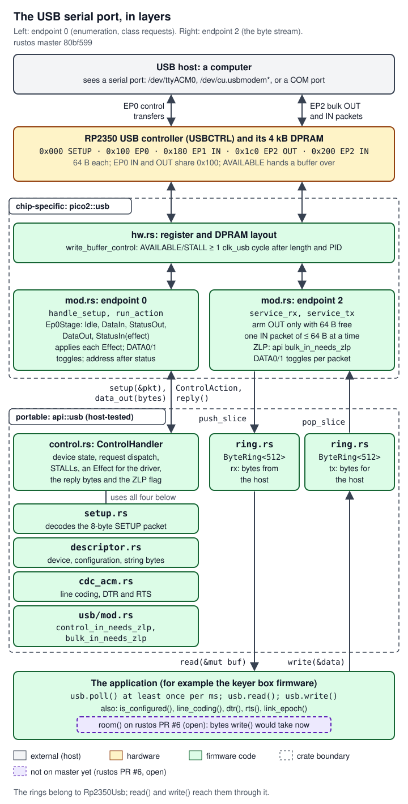
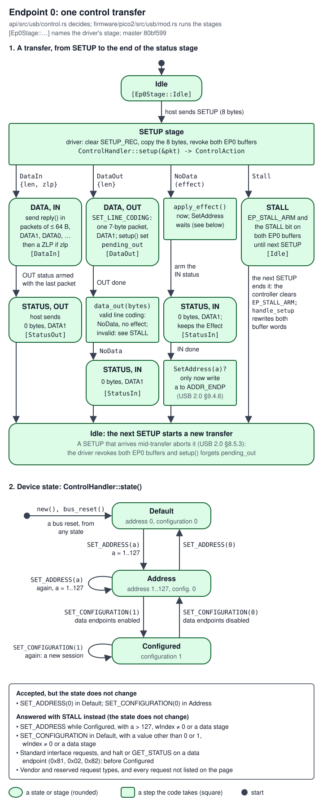

# 05 Drivers: GPIO, USB, PWM, ADC, DMA

> The input and output drivers of rustos's `pico2` crate, in `firmware/pico2/src/` at master `80bf599`. `Rp2350Gpio` makes a pin a push-pull output or an input with a pull resistor. `Rp2350Usb` is a polled USB serial port (CDC-ACM) that never waits for the host and counts every loss of the link. `Rp2350Pwm` plays a fixed-frequency square wave on a pin and switches it on and off only at whole cycles. `Rp2350Adc` samples one analog pin at a fixed rate, and a channel from `Rp2350Dma` copies each sample into a 16 kB ring in RAM that the application reads at its own pace. The GPIO driver came before the cw-message-gateway work; the others were written for it. The keyer box firmware uses GPIO, USB and PWM; the decoder box (gateway PR #30, open, not on main) uses GPIO, USB, ADC and DMA; the one-Pico keyer image (gateway PR #31, draft, not on main) uses all five. rustos PR #6 (open, not on master) adds `Rp2350Usb::room()`. USB, GPIO and PWM bring-up have run on a real Pico 2; a tone, `silence_all`, the ADC, DMA and `room()` have not.

Terms used on this page, in plain words (the shared glossary is the [cw-message-gateway glossary](https://github.com/robinonsay/cw-message-gateway/blob/claude/handover-docs-us00cn/docs/handover/17-glossary.md)):

- **GPIO** (general-purpose input/output): a pin that software drives high or low, or reads. On the RP2350 three hardware blocks make one pin work: `IO_BANK0` chooses which internal peripheral drives it (the **function select**, `FUNCSEL`), `PADS_BANK0` sets the **pad** (the pin's electrical driver and input buffer), and **SIO** (single-cycle I/O) holds the level software writes and the level it reads.
- **Pull-up, pull-down**: a weak resistor inside the pad that holds an undriven pin high or low. **Push-pull output**: the pad drives both levels. **IE** (input enable) powers the pad's input buffer; **OD** (output disable) cuts its driver. **ISO**: the pad's isolation latch, which freezes the pad's state until software clears it. **Schmitt trigger**: hysteresis on the input buffer, so a slowly changing or noisy level does not make the input chatter.
- **Erratum RP2350-E9**: a defect in this chip. A pad with its input buffer on, its output off and its voltage between the logic levels leaks current and settles near 2.2 V, and the internal pull-down is too weak to pull it low.
- **USB terms**: **CDC-ACM** is the USB class for a serial port, which hosts support without a special driver. An **endpoint** is a numbered channel on the device; endpoint 0 (**EP0**) carries **control requests**, each starting with an 8-byte **SETUP** packet. **Enumeration** is the host reading the device's descriptors and configuring it. **Bulk** endpoints carry the data. **DPRAM** is the USB controller's 4 kB dual-port RAM that holds the packet buffers. The device answers **NAK** for "not now, try again" and **STALL** for "refused". A **ZLP** is a zero-length packet that ends a transfer. **Suspend**: the host stops sending start-of-frame packets for 3 ms. **PHY**: the transceiver that drives and senses the two USB wires. **SIE** (serial interface engine): the part of the controller that sends and receives packets. **Full-speed**: USB at 12 Mbit/s, the speed of the RP2350's USB device ([`docs/extracted/rp2350-datasheet.md:85836`](https://github.com/robinonsay/rustos/blob/80bf5998a60a41b3741041062ff7e9c59caf95b2/docs/extracted/rp2350-datasheet.md#L85836)). **Data toggle**: each data packet's ID alternates between DATA0 and DATA1, so that a receiver can recognise a packet sent again after a lost acknowledgement.
- **Power rails**: **VBUS** is the 5 V on the USB cable; **VSYS** is the Pico 2's main input rail (VBUS or an external supply); the **SMPS** (switched-mode power supply) is the board's regulator that turns VSYS into the chip's 3.3 V ([`firmware/pico2/src/common/board.rs:57-63`](https://github.com/robinonsay/rustos/blob/80bf5998a60a41b3741041062ff7e9c59caf95b2/firmware/pico2/src/common/board.rs#L57-L63)).
- **Buses and security**: peripherals sit on two buses. **APB** (Advanced Peripheral Bus, from `0x4000_0000`) is the slower one: a read costs at least three `clk_sys` cycles and a write four. **AHB** (Advanced High-performance Bus, from `0x5000_0000`, where the DMA and USB controllers are) completes an access in one cycle ([`firmware/pico2/src/common/reg.rs:23-26`](https://github.com/robinonsay/rustos/blob/80bf5998a60a41b3741041062ff7e9c59caf95b2/firmware/pico2/src/common/reg.rs#L23-L26)). Every access also carries an Arm TrustZone **security state** (**Secure** or **Non-secure**) and a **privilege level** (**Privileged** or **Unprivileged**); a block can demand a minimum, and an access below it is refused, which the processor takes as a **bus fault** (an exception). The cw-message-gateway glossary explains these too, along with `SECCFG`, the MPU and UF2.
- **UF2**: the firmware file format the Pico 2's boot ROM accepts when it appears as a USB drive. **Delta-sigma** (of a fractional divider): the divider alternates between two whole divisions so that the average is the fractional ratio.
- **PWM** (pulse-width modulation): a counter compared with a threshold. A **slice** is one counter with a clock **divider**, a **wrap** value `TOP` and two outputs (channels A and B), each with a **compare value** `CC`. The output is high while the counter is below `CC`.
- **ADC** (analog-to-digital converter): measures a voltage as a 12-bit number. **FIFO**: a small first-in, first-out queue of results. **DMA** (direct memory access): a hardware channel that copies data without the processor. **DREQ** (data request): the signal a peripheral uses to pace a DMA channel. A **ring buffer** is an array written round and round.
- **Keyer box**: the cw-message-gateway Pico 2 that keys a radio. It closes the radio's **key line** (Morse code, **CW**), holds its **PTT** (push-to-talk) line, or plays an audio tone into an FM radio's microphone (**MCW**). The **decoder box** listens to the radio's audio and decodes Morse.

What has run on hardware, from the project's records (the full table and its evidence are on [08 Changes made for cw-message-gateway](08-changes-for-cw-gateway.md)): the keyer box image enumerated on USB and exchanged serial lines, drove its GPIO outputs and read its GPIO input, and got past PWM bring-up (inferred: `square_from_handle` returned `Ok` before USB started). A tone actually playing, `silence_all` in a real fault, the ADC, DMA and `room()` have never run on a chip.

## Where it lives

All at rustos master `80bf599` unless marked. Line counts are of the files at that commit.

| Path | What it holds | Lines |
|---|---|---|
| [`firmware/pico2/src/gpio/mod.rs`](https://github.com/robinonsay/rustos/blob/80bf5998a60a41b3741041062ff7e9c59caf95b2/firmware/pico2/src/gpio/mod.rs) | Register layouts, `pub(crate)`: `GpioRegs`, `IoBank` (`IO_BANK0`), `PadsBank` (`PADS_BANK0`) and the private `Sio`. The PWM and ADC drivers reuse `IoBank` and `PadsBank`. | 446 |
| [`firmware/pico2/src/gpio/gpio.rs`](https://github.com/robinonsay/rustos/blob/80bf5998a60a41b3741041062ff7e9c59caf95b2/firmware/pico2/src/gpio/gpio.rs) | `Rp2350Gpio`, the pin types `Rp2350GpioOut<N>` and `Rp2350GpioIn<N>`, `GpioError`, and the two configuration sequences | 461 |
| [`firmware/pico2/src/usb/mod.rs`](https://github.com/robinonsay/rustos/blob/80bf5998a60a41b3741041062ff7e9c59caf95b2/firmware/pico2/src/usb/mod.rs) | `Rp2350Usb`, `LinkEvent`, `UsbError`, the buffer sizes; the endpoint-0 stages and the link tracking | 1097 (1112 on PR #6) |
| [`firmware/pico2/src/usb/hw.rs`](https://github.com/robinonsay/rustos/blob/80bf5998a60a41b3741041062ff7e9c59caf95b2/firmware/pico2/src/usb/hw.rs) | The USB controller's register and DPRAM layouts, their bit constants, and `write_buffer_control` | 368 |
| [`firmware/pico2/src/pwm.rs`](https://github.com/robinonsay/rustos/blob/80bf5998a60a41b3741041062ff7e9c59caf95b2/firmware/pico2/src/pwm.rs) | `Rp2350Pwm`, `Rp2350PwmSquare<N>`, `SquareConfig`, `PwmError`, the pin-to-slice map | 911 |
| [`firmware/pico2/src/adc.rs`](https://github.com/robinonsay/rustos/blob/80bf5998a60a41b3741041062ff7e9c59caf95b2/firmware/pico2/src/adc.rs) | `Rp2350Adc`, `Rp2350AdcStream`, `AdcRing`, `RateConfig`, `AdcError` | 765 |
| [`firmware/pico2/src/dma.rs`](https://github.com/robinonsay/rustos/blob/80bf5998a60a41b3741041062ff7e9c59caf95b2/firmware/pico2/src/dma.rs) | `Rp2350Dma`, `Rp2350DmaChannel<C>`, the channel register layout and `abort` | 295 |
| [`api/src/gpio/mod.rs`](https://github.com/robinonsay/rustos/blob/80bf5998a60a41b3741041062ff7e9c59caf95b2/api/src/gpio/mod.rs) | The portable GPIO traits `Gpio`, `GpioPinIn`, `GpioPinOut` and the `Pull` enum | 180 |
| [`api/src/common/mod.rs`](https://github.com/robinonsay/rustos/blob/80bf5998a60a41b3741041062ff7e9c59caf95b2/api/src/common/mod.rs) | `ErrorType`, `Read<T>`, `Write<T>`, which the GPIO, PWM and USB drivers implement (the ADC and DMA drivers do not) | 114 |
| `api/src/usb/` | The chip-independent USB logic the driver calls: [`setup.rs`](https://github.com/robinonsay/rustos/blob/80bf5998a60a41b3741041062ff7e9c59caf95b2/api/src/usb/setup.rs), [`descriptor.rs`](https://github.com/robinonsay/rustos/blob/80bf5998a60a41b3741041062ff7e9c59caf95b2/api/src/usb/descriptor.rs), [`control.rs`](https://github.com/robinonsay/rustos/blob/80bf5998a60a41b3741041062ff7e9c59caf95b2/api/src/usb/control.rs), [`cdc_acm.rs`](https://github.com/robinonsay/rustos/blob/80bf5998a60a41b3741041062ff7e9c59caf95b2/api/src/usb/cdc_acm.rs), [`ring.rs`](https://github.com/robinonsay/rustos/blob/80bf5998a60a41b3741041062ff7e9c59caf95b2/api/src/usb/ring.rs), [`mod.rs`](https://github.com/robinonsay/rustos/blob/80bf5998a60a41b3741041062ff7e9c59caf95b2/api/src/usb/mod.rs) ([03 The api crate](03-api-crate.md)) | 242, 365, 803, 208, 146, 180 |
| [`firmware/pico2/src/common/reset.rs`](https://github.com/robinonsay/rustos/blob/80bf5998a60a41b3741041062ff7e9c59caf95b2/firmware/pico2/src/common/reset.rs) | `clr_reset_reg`, `wait_for_reset_done`, `is_reset_done`, `cycle_reset`, which every constructor here calls ([04 Drivers: core](04-drivers-core.md)) | 251 |
| [`firmware/pico2/src/clocks.rs:427-443`](https://github.com/robinonsay/rustos/blob/80bf5998a60a41b3741041062ff7e9c59caf95b2/firmware/pico2/src/clocks.rs#L427-L443) | `start_clk_adc`, the ADC's clock, started by `Rp2350Adc::new` | 553 |
| [`firmware/pico2/src/lib.rs:108-117`](https://github.com/robinonsay/rustos/blob/80bf5998a60a41b3741041062ff7e9c59caf95b2/firmware/pico2/src/lib.rs#L108-L117) | The module declarations `gpio`, `usb`, `pwm`, `dma`, `adc` | 518 |

Which rustos commit each gateway firmware image builds against:

- The keyer box on cw-message-gateway `main` pins rustos `8c91507` ([`firmware/pico2-keyer/Cargo.toml:30-31`](https://github.com/robinonsay/cw-message-gateway/blob/44185fa9a00369c379d9d8af40ca307e3867e860/firmware/pico2-keyer/Cargo.toml#L30-L31)). `git diff --stat 8c91507 80bf599 -- firmware/pico2/src api/src` lists only `adc.rs`, `dma.rs`, `clocks.rs`, `common/board.rs`, `common/reg.rs` and `lib.rs`, so its GPIO, USB and PWM code is exactly master's.
- The decoder box (gateway PR #30, open, not on main) pins master `80bf599` ([`firmware/pico2-decoder/Cargo.toml:21-25`](https://github.com/robinonsay/cw-message-gateway/blob/3efaf842e1aab75354e5e19d0384a703d4d786be/firmware/pico2-decoder/Cargo.toml#L21-L25)).
- The one-Pico keyer image (gateway PR #31, draft, not on main) pins rustos PR #6's head `410dffa` ([`firmware/pico2-keyer/Cargo.toml:24-31`](https://github.com/robinonsay/cw-message-gateway/blob/bc5062ae4f56ae1f9949b3b067218c7e675d88f8/firmware/pico2-keyer/Cargo.toml#L24-L31)).

## How it works

### Bring-up: what each constructor needs

Every driver here is made from a `DeviceHandle` that the board hands out once per boot (`Rp2350::take()`, [04 Drivers: core](04-drivers-core.md)), so each constructor runs at most once. Drivers whose arithmetic depends on a clock frequency take `&Rp2350Clocks` as proof that the clock tree is running; USB also takes `&Rp2350Timer` for a delay.

| Constructor | Also needs | Reset handling | Waits | Can fail |
|---|---|---|---|---|
| `Rp2350Gpio::new(DeviceHandle<Rp2350Gpio>)` ([`firmware/pico2/src/gpio/gpio.rs:132-139`](https://github.com/robinonsay/rustos/blob/80bf5998a60a41b3741041062ff7e9c59caf95b2/firmware/pico2/src/gpio/gpio.rs#L132-L139)) | nothing | releases `IO_BANK0` (bit 6) and `PADS_BANK0` (bit 9); never asserts them | `wait_for_reset_done`, not bounded | no |
| `Rp2350Pwm::new(DeviceHandle<Rp2350Pwm>, &Rp2350Clocks)` ([`firmware/pico2/src/pwm.rs:614-625`](https://github.com/robinonsay/rustos/blob/80bf5998a60a41b3741041062ff7e9c59caf95b2/firmware/pico2/src/pwm.rs#L614-L625)) | clocks | releases `IO_BANK0`/`PADS_BANK0`, sets stale PWM pins to the null function, then a full reset cycle of `PWM` (bit 16) | reset done | no |
| `Rp2350Usb::new(DeviceHandle<Rp2350Usb>, &Rp2350Clocks, &Rp2350Timer, UsbDeviceConfig)` ([`firmware/pico2/src/usb/mod.rs:363-424`](https://github.com/robinonsay/rustos/blob/80bf5998a60a41b3741041062ff7e9c59caf95b2/firmware/pico2/src/usb/mod.rs#L363-L424)) | clocks, timer | full reset cycle of `USBCTRL` (bit 28) | 10 ms with the pull-up off | no |
| `Rp2350Dma::new(DeviceHandle<Rp2350Dma>)` ([`firmware/pico2/src/dma.rs:243-263`](https://github.com/robinonsay/rustos/blob/80bf5998a60a41b3741041062ff7e9c59caf95b2/firmware/pico2/src/dma.rs#L243-L263)) | nothing | full reset cycle of `DMA` (bit 2) | reset done | no |
| `Rp2350Adc::new(DeviceHandle<Rp2350Adc>, &Rp2350Clocks)` ([`firmware/pico2/src/adc.rs:444-460`](https://github.com/robinonsay/rustos/blob/80bf5998a60a41b3741041062ff7e9c59caf95b2/firmware/pico2/src/adc.rs#L444-L460)) | clocks | releases `IO_BANK0`/`PADS_BANK0`, starts `clk_adc`, full reset cycle of `ADC` (bit 0) | up to 100 000 reads of `CS` for `READY` | `AdcError::NotReady` |

`cycle_reset` asserts and releases a block and waits for `RESET_DONE` ([`firmware/pico2/src/common/reset.rs:245-251`](https://github.com/robinonsay/rustos/blob/80bf5998a60a41b3741041062ff7e9c59caf95b2/firmware/pico2/src/common/reset.rs#L245-L251)); the wait has no bound ([`firmware/pico2/src/common/reset.rs:200-209`](https://github.com/robinonsay/rustos/blob/80bf5998a60a41b3741041062ff7e9c59caf95b2/firmware/pico2/src/common/reset.rs#L200-L209)). A full reset cycle in each constructor means a driver starts from the datasheet's reset values even after a debugger's warm reset, which restarts the processors but not the peripherals. The GPIO blocks are only ever released, never reset, because a reset would disturb pins another driver already owns ([`firmware/pico2/src/pwm.rs:180-196`](https://github.com/robinonsay/rustos/blob/80bf5998a60a41b3741041062ff7e9c59caf95b2/firmware/pico2/src/pwm.rs#L180-L196)).

`Rp2350Gpio::new` needs no clocks, so a safety-critical application can configure its outputs before anything else. The keyer box does exactly that: key and PTT outputs, then clocks, PWM, timer, USB, and the watchdog last ([`firmware/pico2-keyer/src/main.rs:174-216`](https://github.com/robinonsay/cw-message-gateway/blob/44185fa9a00369c379d9d8af40ca307e3867e860/firmware/pico2-keyer/src/main.rs#L174-L216)).

### GPIO: one pin, three blocks

A pin works only when the GPIO blocks are out of reset (`RESETS`) and all three are set up, and none of them reports an error when a step is skipped ([`firmware/pico2/src/gpio/gpio.rs:1-26`](https://github.com/robinonsay/rustos/blob/80bf5998a60a41b3741041062ff7e9c59caf95b2/firmware/pico2/src/gpio/gpio.rs#L1-L26)). `IO_BANK0`'s `GPIOn_CTRL` register picks the source with `FUNCSEL` (bits 4:0; 4 = PWM, 5 = SIO, 0x1f = null, its reset value) and has four override fields that rustos always writes as 0, "normal" ([`firmware/pico2/src/gpio/mod.rs:116-145`](https://github.com/robinonsay/rustos/blob/80bf5998a60a41b3741041062ff7e9c59caf95b2/firmware/pico2/src/gpio/mod.rs#L116-L145)). The pad register in `PADS_BANK0` holds the electrical settings; its reset value is `0x116`: isolated, pulled down, input buffer off, 4 mA, Schmitt trigger on ([`firmware/pico2/src/gpio/mod.rs:244-277`](https://github.com/robinonsay/rustos/blob/80bf5998a60a41b3741041062ff7e9c59caf95b2/firmware/pico2/src/gpio/mod.rs#L244-L277)). SIO has separate set, clear and XOR registers for the output level and the output enable, so one store changes one pin with no read-modify-write ([`firmware/pico2/src/gpio/mod.rs:316-446`](https://github.com/robinonsay/rustos/blob/80bf5998a60a41b3741041062ff7e9c59caf95b2/firmware/pico2/src/gpio/mod.rs#L316-L446)).

`GPIOn_CTRL`, reset `0x1f` ([`firmware/pico2/src/gpio/mod.rs:116-127`](https://github.com/robinonsay/rustos/blob/80bf5998a60a41b3741041062ff7e9c59caf95b2/firmware/pico2/src/gpio/mod.rs#L116-L127)):

| Bits | Field | Values | What rustos writes |
|---|---|---|---|
| 29:28 | `IRQOVER` | 0 normal, 1 invert, 2 force low, 3 force high | 0 |
| 17:16 | `INOVER` | the same, on the input to the peripheral | 0 |
| 15:14 | `OEOVER` | 0 normal, 1 invert, 2 disable output, 3 enable output | 0 (outside the driver, the decoder box of gateway PR #30 sets 3 on GP23 and GP25; see the known bugs) |
| 13:12 | `OUTOVER` | 0 normal, 1 invert, 2 drive low, 3 drive high | 0 (outside the driver, the keyer's fault path sets 2 on GP18, and the decoder box of PR #30 sets 2 or 3 on GP23 and GP25) |
| 4:0 | `FUNCSEL` | 4 PWM, 5 SIO, `0x1f` null | 5 (GPIO), 4 (PWM), `0x1f` (ADC, and stale PWM pins) |

The pad register `PADS_BANK0` `GPIOn`, reset `0x116`: `ISO` bit 8 (reset 1), `OD` bit 7 (0), `IE` bit 6 (0), `DRIVE` bits 5:4 (1, 4 mA; 0 to 3 are 2, 4, 8 and 12 mA), `PUE` bit 3 (0), `PDE` bit 2 (1), `SCHMITT` bit 1 (1), `SLEWFAST` bit 0 (0) ([`firmware/pico2/src/gpio/mod.rs:244-258`](https://github.com/robinonsay/rustos/blob/80bf5998a60a41b3741041062ff7e9c59caf95b2/firmware/pico2/src/gpio/mod.rs#L244-L258)).


*Figure: the signal path through one pin. Notice that ISO is cleared last and that the internal pull-down is not enough on its own (E9), which is why the keyer box's GP16 (key) and GP17 (PTT) each have an external 4.7 kΩ to ground; the ADC pins, GPIO26-29, have none. Wiring from cw-message-gateway `docs/keyer.md`, "Wiring the box" ([`docs/keyer.md:48-54`](https://github.com/robinonsay/cw-message-gateway/blob/44185fa9a00369c379d9d8af40ca307e3867e860/docs/keyer.md#L48-L54), [`docs/keyer.md:574-578`](https://github.com/robinonsay/cw-message-gateway/blob/44185fa9a00369c379d9d8af40ca307e3867e860/docs/keyer.md#L574-L578), and the transistor and MOSFET switches at [`docs/keyer.md:1000-1046`](https://github.com/robinonsay/cw-message-gateway/blob/44185fa9a00369c379d9d8af40ca307e3867e860/docs/keyer.md#L1000-L1046)).*

**The isolation latch.** Every pad comes out of a power-on reset isolated (`ISO` = 1), with its latches at their reset values: output off, input off, pulled down. The latches themselves are reset by a power-on, brown-out, `RUN`, SW-DP `CDBGRSTREQ` or rescue reset, and "reset to the reset value of the signal being isolated" ([`docs/extracted/rp2350-datasheet.md:43494-43512`](https://github.com/robinonsay/rustos/blob/80bf5998a60a41b3741041062ff7e9c59caf95b2/docs/extracted/rp2350-datasheet.md#L43494-L43512)). While `ISO` = 1 the latch holds the output enable, output level and pulls the pad had when it was isolated, and "Once software has finished setting up the IO muxing for a given pad, and the peripheral which is to be muxed in, the ISO bit should be cleared" (datasheet §9.7, [`docs/extracted/rp2350-datasheet.md:43482-43486`](https://github.com/robinonsay/rustos/blob/80bf5998a60a41b3741041062ff7e9c59caf95b2/docs/extracted/rp2350-datasheet.md#L43482-L43486)). Every rustos path that gives a pin to a peripheral (GPIO, PWM, ADC) therefore writes the pad and `FUNCSEL` first and clears `ISO` last, so the pin goes from its latched state straight to its configured state. A reset of the pad registers through `RESETS` does not set `ISO` again, and leaves an isolated pad as it is ([`docs/extracted/rp2350-datasheet.md:43517-43519`](https://github.com/robinonsay/rustos/blob/80bf5998a60a41b3741041062ff7e9c59caf95b2/docs/extracted/rp2350-datasheet.md#L43517-L43519)). What a watchdog reset leaves on each pin is described on [04 Drivers: core](04-drivers-core.md); it has not been checked on hardware ([`firmware/pico2/src/watchdog.rs:151-183`](https://github.com/robinonsay/rustos/blob/80bf5998a60a41b3741041062ff7e9c59caf95b2/firmware/pico2/src/watchdog.rs#L151-L183)).

**An output** (`output_from_handle`, [`firmware/pico2/src/gpio/gpio.rs:418-461`](https://github.com/robinonsay/rustos/blob/80bf5998a60a41b3741041062ff7e9c59caf95b2/firmware/pico2/src/gpio/gpio.rs#L418-L461)): SIO `GPIO_OUT_CLR` (level low), then `GPIO_OE_SET` (driver on), then the pad (`OD` cleared, `IE` set, everything else kept), then `FUNCSEL` = 5, then `ISO` cleared. The level is low before the driver is enabled, so the pin never drives high on the way ([`firmware/pico2/src/gpio/gpio.rs:438-442`](https://github.com/robinonsay/rustos/blob/80bf5998a60a41b3741041062ff7e9c59caf95b2/firmware/pico2/src/gpio/gpio.rs#L438-L442)). The pulls are not touched, so the reset pull-down stays on under a driven output. `Write<bool>` then writes `1 << N` to `GPIO_OUT_SET` for `true` or `GPIO_OUT_CLR` for `false`: it chooses the register rather than the data, because writing 0 to a set register does nothing ([`firmware/pico2/src/gpio/gpio.rs:293-319`](https://github.com/robinonsay/rustos/blob/80bf5998a60a41b3741041062ff7e9c59caf95b2/firmware/pico2/src/gpio/gpio.rs#L293-L319)).

**An input** (`input_from_handle`, [`firmware/pico2/src/gpio/gpio.rs:347-416`](https://github.com/robinonsay/rustos/blob/80bf5998a60a41b3741041062ff7e9c59caf95b2/firmware/pico2/src/gpio/gpio.rs#L347-L416)): `GPIO_OE_CLR` first, then the pad (`OD` set, `IE` set, and both pull bits written for the chosen `Pull`: `Up` sets `PUE` and clears `PDE`, `Down` the reverse, `None` clears both), then `FUNCSEL` = 5, then `ISO` cleared. `Read<bool>` reads SIO `GPIO_IN`, the level actually on the pad, which needs `IE` ([`firmware/pico2/src/gpio/gpio.rs:321-342`](https://github.com/robinonsay/rustos/blob/80bf5998a60a41b3741041062ff7e9c59caf95b2/firmware/pico2/src/gpio/gpio.rs#L321-L342)).

**Erratum E9 and the external pull-down.** With `IE` = 1, the output off and the pad between the logic levels, "the pad can source current ... typically around 120μA. This leakage will hold the pad at around 2.2 V", and "the pad pull-down (if enabled) is significantly weaker than the leakage current in this state" ([`docs/extracted/rp2350-datasheet.md:102113-102121`](https://github.com/robinonsay/rustos/blob/80bf5998a60a41b3741041062ff7e9c59caf95b2/docs/extracted/rp2350-datasheet.md#L102113-L102121)). Pulling low through 8.2 kΩ or less overcomes it ([`docs/extracted/rp2350-datasheet.md:102123-102125`](https://github.com/robinonsay/rustos/blob/80bf5998a60a41b3741041062ff7e9c59caf95b2/docs/extracted/rp2350-datasheet.md#L102123-L102125)), and the erratum does not affect a pad straight after a power-on or `RUN` reset, because `IE` is clear then ([`docs/extracted/rp2350-datasheet.md:102160-102162`](https://github.com/robinonsay/rustos/blob/80bf5998a60a41b3741041062ff7e9c59caf95b2/docs/extracted/rp2350-datasheet.md#L102160-L102162)). The keyer box therefore has a 4.7 kΩ resistor from the key pin GP16, and another from the PTT pin GP17, to ground. **This resistor is required and must never be removed** ([`docs/keyer.md:59-65`](https://github.com/robinonsay/cw-message-gateway/blob/44185fa9a00369c379d9d8af40ca307e3867e860/docs/keyer.md#L59-L65), [`docs/keyer.md:591-593`](https://github.com/robinonsay/cw-message-gateway/blob/44185fa9a00369c379d9d8af40ca307e3867e860/docs/keyer.md#L591-L593); the canonical list of such rules is cw-message-gateway's [13 Safety rules](https://github.com/robinonsay/cw-message-gateway/blob/claude/handover-docs-us00cn/docs/handover/13-safety-rules.md)). The GPIO driver itself does nothing about E9: its input path sets `IE` with every `Pull`, including `Pull::Down` (see [Known bugs, limits and flakes](#known-bugs-limits-and-flakes)).

**The inverting key switch.** The keyer box's safe state is its key pin driven low, so the pin never drives a radio's key line directly: an optocoupler or a transistor turns "pin low or undriven" into "line open". A bare Pico 2 pin wired to a radio that keys when its line is pulled low would key the radio in every safe state; the audit graded that NO-GO ([`docs/keyer.md:966-976`](https://github.com/robinonsay/cw-message-gateway/blob/44185fa9a00369c379d9d8af40ca307e3867e860/docs/keyer.md#L966-L976)). **Never wire a bare GPIO to a key or PTT line that keys on low.**

### The USB serial port

The driver is the hardware half of a split. The chip-independent logic (descriptors, the endpoint-0 request state machine, CDC-ACM line coding, the ZLP rule and the byte rings) lives in `api::usb` and is host-tested; `Rp2350Usb` moves packets between the controller's DPRAM and that logic and applies the effects it asks for ([`firmware/pico2/src/usb/mod.rs:1-8`](https://github.com/robinonsay/rustos/blob/80bf5998a60a41b3741041062ff7e9c59caf95b2/firmware/pico2/src/usb/mod.rs#L1-L8)). [03 The api crate](03-api-crate.md) describes the logic; this section describes the hardware half.



*Figure (from page 03): this page's `usb/mod.rs` and `usb/hw.rs` are the pico2 layer; the `api::usb` modules above it are host-tested.*

**Controller set-up** ([`firmware/pico2/src/usb/mod.rs:36-94`](https://github.com/robinonsay/rustos/blob/80bf5998a60a41b3741041062ff7e9c59caf95b2/firmware/pico2/src/usb/mod.rs#L36-L94), code at [`firmware/pico2/src/usb/mod.rs:369-406`](https://github.com/robinonsay/rustos/blob/80bf5998a60a41b3741041062ff7e9c59caf95b2/firmware/pico2/src/usb/mod.rs#L369-L406)):

1. Reset cycle `USBCTRL`.
2. Zero all 4 kB of DPRAM with 32-bit writes; a reset does not clear it.
3. `USB_MUXING` = `TO_PHY | SOFTCON`, the on-chip PHY. `SOFTCON` has no description in the datasheet and is set because the datasheet's own example sets it; unverified on hardware ([`firmware/pico2/src/usb/hw.rs:167-172`](https://github.com/robinonsay/rustos/blob/80bf5998a60a41b3741041062ff7e9c59caf95b2/firmware/pico2/src/usb/hw.rs#L167-L172)).
4. `USB_PWR`: force VBUS detect, value first, then the override enable. The Pico 2 senses VBUS on GPIO24, but GPIO24 has no "USB VBUS DET" function (its F10 is "USB OVCUR DET", [`docs/extracted/rp2350-datasheet.md:43158`](https://github.com/robinonsay/rustos/blob/80bf5998a60a41b3741041062ff7e9c59caf95b2/docs/extracted/rp2350-datasheet.md#L43158)), so the controller cannot see it.
5. `MAIN_CTRL` = `CONTROLLER_EN`, which also clears `PHY_ISO`; "you must clear the MAIN_CTRL.PHY_ISO bit at startup" ([`docs/extracted/rp2350-datasheet.md:85879-85882`](https://github.com/robinonsay/rustos/blob/80bf5998a60a41b3741041062ff7e9c59caf95b2/docs/extracted/rp2350-datasheet.md#L85879-L85882)).
6. `SIE_CTRL` = `EP0_INT_1BUF`, which also clears `PULLDOWN_EN` (a host-mode setting that resets to 1 on the RP2350).
7. `INTE` = 0, `ADDR_ENDP` = 0: no interrupts, address 0.
8. Wait `DISCONNECT_MS` = 10 ms with the pull-up off, so the host sees a disconnect and enumerates afresh ([`firmware/pico2/src/usb/mod.rs:260`](https://github.com/robinonsay/rustos/blob/80bf5998a60a41b3741041062ff7e9c59caf95b2/firmware/pico2/src/usb/mod.rs#L260)). The length is a choice, unverified on hardware.
9. Set `SIE_CTRL.PULLUP_EN` through the atomic set alias: the host sees a full-speed device.

`LINESTATE_TUNING` stays at its reset value, as the datasheet recommends ([`firmware/pico2/src/usb/mod.rs:91-94`](https://github.com/robinonsay/rustos/blob/80bf5998a60a41b3741041062ff7e9c59caf95b2/firmware/pico2/src/usb/mod.rs#L91-L94)). Two compile-time checks keep `clk_usb` at 48 MHz and `clk_sys` at least 1.1 times `clk_usb`, which erratum RP2350-E12 needs so that `SETUP_REC` and other flags are not lost ([`firmware/pico2/src/usb/mod.rs:271-272`](https://github.com/robinonsay/rustos/blob/80bf5998a60a41b3741041062ff7e9c59caf95b2/firmware/pico2/src/usb/mod.rs#L271-L272)).

**The DPRAM** is 4 kB at `0x5010_0000`, byte-addressable and without the atomic set and clear aliases ([`docs/extracted/rp2350-datasheet.md:86094-86104`](https://github.com/robinonsay/rustos/blob/80bf5998a60a41b3741041062ff7e9c59caf95b2/docs/extracted/rp2350-datasheet.md#L86094-L86104)). The driver's layout ([`firmware/pico2/src/usb/hw.rs:223-255`](https://github.com/robinonsay/rustos/blob/80bf5998a60a41b3741041062ff7e9c59caf95b2/firmware/pico2/src/usb/hw.rs#L223-L255)):

| Offset | Field | Use |
|---|---|---|
| `0x000` | `setup_packet: [u8; 8]` | the last SETUP packet |
| `0x008` | `ep_ctrl: [InOut; 15]` | endpoint control words for EP1-EP15 (EP0 has none) |
| `0x080` | `buf_ctrl: [InOut; 16]` | buffer control words, IN and OUT, for EP0-EP15 |
| `0x100` | `ep0_buf: [u8; 64]` | EP0, shared by both directions |
| `0x140` | `_ep0_buf1: [u8; 64]` | EP0's second buffer, used only if EP0 were double-buffered; reserved |
| `0x180` | `ep1_in_buf: [u8; 64]` | EP1 IN (notifications), never armed |
| `0x1c0` | `ep2_out_buf: [u8; 64]` | EP2 OUT, bytes from the host |
| `0x200` | `ep2_in_buf: [u8; 64]` | EP2 IN, bytes to the host |
| `0x240`-`0xfff` | unused | |

Two rules for anyone who adds a buffer ([`firmware/pico2/src/usb/hw.rs:200-221`](https://github.com/robinonsay/rustos/blob/80bf5998a60a41b3741041062ff7e9c59caf95b2/firmware/pico2/src/usb/hw.rs#L200-L221)): each buffer must be 64-byte aligned, because the controller ignores the low six bits of a buffer offset; and the controller writes a buffer control word back as a 16-bit store to the half that belongs to the buffer, so the driver's whole 32-bit writes are safe only while every endpoint is single-buffered, as now.

**Endpoints** ([`firmware/pico2/src/usb/mod.rs:96-126`](https://github.com/robinonsay/rustos/blob/80bf5998a60a41b3741041062ff7e9c59caf95b2/firmware/pico2/src/usb/mod.rs#L96-L126)): EP0 control; EP1 IN (`0x81`) interrupt, for CDC notifications, never armed so it always NAKs; EP2 OUT (`0x02`) and EP2 IN (`0x82`) bulk, 64-byte packets. All are single-buffered. Software hands a buffer to the controller by writing its buffer control word with `AVAILABLE` set; the controller clears `AVAILABLE` and sets the endpoint's bit in `BUFF_STATUS` when the transaction is done. The controller does not track data toggles (DATA0/DATA1), so the driver does ([`firmware/pico2/src/usb/mod.rs:128-142`](https://github.com/robinonsay/rustos/blob/80bf5998a60a41b3741041062ff7e9c59caf95b2/firmware/pico2/src/usb/mod.rs#L128-L142); the rules are under [USB: one poll](#usb-one-poll)).


*Figure: the hardware side of `Rp2350Usb`. Notice that the controller sets an endpoint's `BUFF_STATUS` bit before it writes the length and PID back and clears `AVAILABLE`, so the driver takes a completion only once `AVAILABLE` reads 0, and that each poll handles completed buffers before a new SETUP.*

**Polling, not interrupts.** `poll()` must run at least once per millisecond: the address from SET_ADDRESS can only be applied after its status stage, which only `poll` notices, and each direction of EP2 moves at most one 64-byte packet per poll, so 1 kHz polling gives at least 64 kB/s each way ([`firmware/pico2/src/usb/mod.rs:196-222`](https://github.com/robinonsay/rustos/blob/80bf5998a60a41b3741041062ff7e9c59caf95b2/firmware/pico2/src/usb/mod.rs#L196-L222)). The controller's interrupt is never enabled. Nothing in `poll`, `read` or `write` waits for the host; the only wait is a bounded spin for `EP_ABORT_DONE`, run only while handling SET_CONFIGURATION, a halt or SET_INTERFACE.

**The byte streams.** Received bytes go into a 512-byte ring (`RX_BUFFER_SIZE`); EP2 OUT is armed only while at least 64 bytes are free, so when the application stops reading, the controller NAKs the host and nothing is dropped ([`firmware/pico2/src/usb/mod.rs:247-251`](https://github.com/robinonsay/rustos/blob/80bf5998a60a41b3741041062ff7e9c59caf95b2/firmware/pico2/src/usb/mod.rs#L247-L251), [`firmware/pico2/src/usb/mod.rs:722-741`](https://github.com/robinonsay/rustos/blob/80bf5998a60a41b3741041062ff7e9c59caf95b2/firmware/pico2/src/usb/mod.rs#L722-L741)). `write` queues into another 512-byte ring (`TX_BUFFER_SIZE`) and returns how many bytes it took, which can be fewer than offered, and 0 while the device is not configured ([`firmware/pico2/src/usb/mod.rs:461-480`](https://github.com/robinonsay/rustos/blob/80bf5998a60a41b3741041062ff7e9c59caf95b2/firmware/pico2/src/usb/mod.rs#L461-L480)). When the queue empties right after a full 64-byte packet, a zero-length packet follows so the host's read completes ([`firmware/pico2/src/usb/mod.rs:711-719`](https://github.com/robinonsay/rustos/blob/80bf5998a60a41b3741041062ff7e9c59caf95b2/firmware/pico2/src/usb/mod.rs#L711-L719), [`api/src/usb/mod.rs:151-153`](https://github.com/robinonsay/rustos/blob/80bf5998a60a41b3741041062ff7e9c59caf95b2/api/src/usb/mod.rs#L151-L153)).

**The link-lost indicator.** `link_epoch()` is a wrapping count of link-lost events: bus reset, suspend, disconnect and deconfiguration ([`firmware/pico2/src/usb/mod.rs:164-194`](https://github.com/robinonsay/rustos/blob/80bf5998a60a41b3741041062ff7e9c59caf95b2/firmware/pico2/src/usb/mod.rs#L164-L194), [`firmware/pico2/src/usb/mod.rs:501-509`](https://github.com/robinonsay/rustos/blob/80bf5998a60a41b3741041062ff7e9c59caf95b2/firmware/pico2/src/usb/mod.rs#L501-L509)). An application compares it with the value it saw last; any difference means whoever was on the other end may have gone, even if the link is back. The first enumeration advances it too, because every attach starts with a bus reset. Without VBUS detection an unplugged cable looks exactly like a suspend ("Without VBUS detection, it is impossible to tell the difference between being disconnected and suspended", [`docs/extracted/rp2350-datasheet.md:86575-86577`](https://github.com/robinonsay/rustos/blob/80bf5998a60a41b3741041062ff7e9c59caf95b2/docs/extracted/rp2350-datasheet.md#L86575-L86577)), so a Pico 2 that stays powered through VSYS reports an unplug as `LinkEvent::Suspended`; a USB-powered board, such as the keyer box, simply loses power when unplugged ([`firmware/pico2/src/usb/mod.rs:178-189`](https://github.com/robinonsay/rustos/blob/80bf5998a60a41b3741041062ff7e9c59caf95b2/firmware/pico2/src/usb/mod.rs#L178-L189)). Whether `LinkEvent::Disconnected` ever happens with VBUS forced is unverified.

**`room()` (rustos PR #6, open, not on master).** `pub fn room(&self) -> usize` returns how many bytes `write` would take now: the transmit ring's free space, or 0 while not configured. The contract: "a write of at most this many bytes, with no other write before it, is taken whole. A poll in between only adds room, as packets leave, unless it ends the session, and then the write takes nothing" ([`firmware/pico2/src/usb/mod.rs:482-495`](https://github.com/robinonsay/rustos/blob/410dffa091e247e6e7546c7f2ff465f0af499d5a/firmware/pico2/src/usb/mod.rs#L482-L495)). The one-Pico keyer (gateway PR #31, draft, not on main) uses it to forward a decoder line only when the line and a whole keyer reply after it both fit ([`crates/keyer-core/src/control.rs:641`](https://github.com/robinonsay/cw-message-gateway/blob/bc5062ae4f56ae1f9949b3b067218c7e675d88f8/crates/keyer-core/src/control.rs#L641)), so a keyer reply is never cut short.

### PWM: a square wave switched on whole cycles

Twelve slices, each a 16-bit counter with an 8.4 fractional divider, a `TOP` and two channels with their own `CC` ([`firmware/pico2/src/pwm.rs:19-36`](https://github.com/robinonsay/rustos/blob/80bf5998a60a41b3741041062ff7e9c59caf95b2/firmware/pico2/src/pwm.rs#L19-L36)). For GPIO0-31 the slice is (*gpio* / 2) mod 8, even pins are channel A and odd pins channel B, and GPIO*n* and GPIO*n*+16 are the same output ([`firmware/pico2/src/pwm.rs:38-57`](https://github.com/robinonsay/rustos/blob/80bf5998a60a41b3741041062ff7e9c59caf95b2/firmware/pico2/src/pwm.rs#L38-L57)). The driver makes only one kind of output: a 50 % square wave of a fixed frequency from 100 Hz to 20 kHz, switched on and off with `Write<bool>`.


*Figure: the keyer box's 700 Hz tone on GP18. Notice that a write takes effect only at the next wrap, and that "off" is CC = 0 on a running slice, never a stopped slice.*

**On and off.** With `TOP` + 1 = 2*h* counts per period and `CC` = *h*, the pin is high for *h* counts and low for *h*: an exact 50 % square wave. `CC` = 0 gives "the output signal is always low" ([`docs/extracted/rp2350-datasheet.md:81174`](https://github.com/robinonsay/rustos/blob/80bf5998a60a41b3741041062ff7e9c59caf95b2/docs/extracted/rp2350-datasheet.md#L81174)). The hardware keeps two copies of `CC` and `TOP` and loads the one the output uses "at the instant the counter wraps" ([`docs/extracted/rp2350-datasheet.md:81267-81270`](https://github.com/robinonsay/rustos/blob/80bf5998a60a41b3741041062ff7e9c59caf95b2/docs/extracted/rp2350-datasheet.md#L81267-L81270)), so a write takes effect at the next wrap, up to one period later. A tone therefore always starts with a whole high half-period and stops after a whole low half-period, with no short pulse at either end, and a keyed element lasts a whole number of periods, 1.43 ms each at 700 Hz ([`firmware/pico2/src/pwm.rs:93-107`](https://github.com/robinonsay/rustos/blob/80bf5998a60a41b3741041062ff7e9c59caf95b2/firmware/pico2/src/pwm.rs#L93-L107)).

**Off is `CC` = 0 with the slice running, never a stopped slice.** The counter only moves while the slice is enabled, so a slice stopped in the high half of a period holds its pin high ([`firmware/pico2/src/pwm.rs:154-163`](https://github.com/robinonsay/rustos/blob/80bf5998a60a41b3741041062ff7e9c59caf95b2/firmware/pico2/src/pwm.rs#L154-L163)). `write(false)`, dropping an `Rp2350PwmSquare`, and `Rp2350Pwm::silence_all` all store `CC` = 0 and leave the slice running. **Never-loosen:** never turn a tone off by stopping its slice.

**Safe start** ([`firmware/pico2/src/pwm.rs:109-152`](https://github.com/robinonsay/rustos/blob/80bf5998a60a41b3741041062ff7e9c59caf95b2/firmware/pico2/src/pwm.rs#L109-L152)). For the first pin on a slice, `start_slice` stops the slice, programs `DIV` and `TOP`, writes `CC` = 0 for both channels and `CTR` = 0, starts it and waits for the first wrap, so that the copies the output uses are known to hold `CC` = 0. The wait gives up after at least two periods with `PwmError::NoWrap`, stops the slice again and never connects the pin ([`firmware/pico2/src/pwm.rs:822-853`](https://github.com/robinonsay/rustos/blob/80bf5998a60a41b3741041062ff7e9c59caf95b2/firmware/pico2/src/pwm.rs#L822-L853)). Only then is the pin routed: pad `OD` cleared and `IE` set, `FUNCSEL` = 4, `ISO` cleared last ([`firmware/pico2/src/pwm.rs:891-911`](https://github.com/robinonsay/rustos/blob/80bf5998a60a41b3741041062ff7e9c59caf95b2/firmware/pico2/src/pwm.rs#L891-L911)). The pin is low from the moment it is connected.

**A warm reset can leave a tone playing.** A debugger's processor-only reset keeps `IO_BANK0` and `PADS_BANK0`, so a pin the last run gave to the PWM still has `FUNCSEL` = 4 and keeps playing. `Rp2350Pwm::new` therefore first sets every bonded-out pin whose `FUNCSEL` is 4 back to the null function (0x1f, high impedance), and only then resets the PWM block ([`firmware/pico2/src/pwm.rs:139-152`](https://github.com/robinonsay/rustos/blob/80bf5998a60a41b3741041062ff7e9c59caf95b2/firmware/pico2/src/pwm.rs#L139-L152), [`firmware/pico2/src/pwm.rs:863-873`](https://github.com/robinonsay/rustos/blob/80bf5998a60a41b3741041062ff7e9c59caf95b2/firmware/pico2/src/pwm.rs#L863-L873)).

**Two pins on one slice** share `DIV` and `TOP`, so the second must ask for the same configuration or gets `SliceFrequencyConflict`; their compare values share one 32-bit `CC` register, and each pin writes only its own half through the atomic set and clear aliases, one store with no read-modify-write ([`firmware/pico2/src/pwm.rs:165-178`](https://github.com/robinonsay/rustos/blob/80bf5998a60a41b3741041062ff7e9c59caf95b2/firmware/pico2/src/pwm.rs#L165-L178)).

**`silence_all`** is `pub unsafe fn silence_all()`, for panic and fault handlers that hold none of the pin objects and in which `Drop` does not run. It writes `u32::MAX` to the clear alias of every slice's `CC`, so every channel goes low at its next wrap, within one period (10 ms at 100 Hz). If the PWM block is still in reset (`RESET_DONE` bit 16 clear), it writes nothing: the datasheet does not say what a write to a block held in reset does ([`firmware/pico2/src/pwm.rs:697-728`](https://github.com/robinonsay/rustos/blob/80bf5998a60a41b3741041062ff7e9c59caf95b2/firmware/pico2/src/pwm.rs#L697-L728)). Its documentation says to open any key or PTT line first and call it second. **Never-loosen:** keep the `RESET_DONE` guard, and keep `silence_all` after the key and PTT in every safe state.

### ADC to RAM through a DMA ring

The ADC is a 12-bit converter (9.2 effective bits) on its own 48 MHz clock, `clk_adc`; one conversion takes 96 cycles, 2 µs ([`firmware/pico2/src/adc.rs:31-48`](https://github.com/robinonsay/rustos/blob/80bf5998a60a41b3741041062ff7e9c59caf95b2/firmware/pico2/src/adc.rs#L31-L48)). In free-running mode (`CS.START_MANY`) a pacing divider starts a conversion every 1 + `INT` + `FRAC`/256 cycles, and each result goes into an eight-entry FIFO. At 32 kHz eight entries last 250 µs, far too little to poll beside USB, so a DMA channel moves each result into a 16 kB ring of 8192 samples (256 ms at 32 kHz) and the application reads the ring at its own pace.

**The clock.** `Rp2350Adc::new` first starts `clk_adc` as `PLL_USB` ÷ 1, through the same aux-only switch as `clk_usb` (`start_clk_adc`, [`firmware/pico2/src/clocks.rs:427-443`](https://github.com/robinonsay/rustos/blob/80bf5998a60a41b3741041062ff7e9c59caf95b2/firmware/pico2/src/clocks.rs#L427-L443)). That has to come before any ADC register access: the code's reading of the datasheet is that the ADC's registers time out on the bus while `clk_adc` is stopped ([`firmware/pico2/src/adc.rs:117-121`](https://github.com/robinonsay/rustos/blob/80bf5998a60a41b3741041062ff7e9c59caf95b2/firmware/pico2/src/adc.rs#L117-L121)). The clock's two gates are on out of reset and nothing in rustos clears them. [04 Drivers: core](04-drivers-core.md) describes the clock tree.


*Figure: the pipeline and the ring. Notice that nothing counts the channel's laps: an overrun is found from a sample sitting in a slot that should still hold the sentinel 0xFFFF.*

**The pin.** "When using an ADC input shared with a GPIO pin, always disable the pin's digital functions by setting IE low and OD high" ([`docs/extracted/rp2350-datasheet.md:80260-80261`](https://github.com/robinonsay/rustos/blob/80bf5998a60a41b3741041062ff7e9c59caf95b2/docs/extracted/rp2350-datasheet.md#L80260-L80261)). On the RP2350 this also avoids E9: an audio input biased at mid-supply sits in the region where an enabled input buffer leaks. `stream_from_handle` sets `FUNCSEL` to null, clears `IE` and both pulls (the reset pull-down, 36-113 kΩ, would pull a biased input off its midpoint), sets `OD`, and clears `ISO` last ([`firmware/pico2/src/adc.rs:90-113`](https://github.com/robinonsay/rustos/blob/80bf5998a60a41b3741041062ff7e9c59caf95b2/firmware/pico2/src/adc.rs#L90-L113), [`firmware/pico2/src/adc.rs:754-765`](https://github.com/robinonsay/rustos/blob/80bf5998a60a41b3741041062ff7e9c59caf95b2/firmware/pico2/src/adc.rs#L754-L765)). Only GPIO26-29 are ADC inputs on the Pico 2's RP2350A; any other pin number is a build error ([`firmware/pico2/src/adc.rs:576-580`](https://github.com/robinonsay/rustos/blob/80bf5998a60a41b3741041062ff7e9c59caf95b2/firmware/pico2/src/adc.rs#L576-L580)). GPIO29 is the board's VSYS/3 divider ([`firmware/pico2/src/common/board.rs:65-74`](https://github.com/robinonsay/rustos/blob/80bf5998a60a41b3741041062ff7e9c59caf95b2/firmware/pico2/src/common/board.rs#L65-L74)).

**The endless ring.** The channel reads the FIFO register without incrementing, writes halfwords to the ring, and is paced by `DREQ_ADC` (48). `TRANS_COUNT` is mode `ENDLESS` (0xf) with a count of 1, so the count never decrements and the channel never stops ("triggering a channel with a mode of 0xf and a count of 0x0 will result in the channel halting immediately", [`docs/extracted/rp2350-datasheet.md:82537-82538`](https://github.com/robinonsay/rustos/blob/80bf5998a60a41b3741041062ff7e9c59caf95b2/docs/extracted/rp2350-datasheet.md#L82537-L82538)). `RING_SEL` = write and `RING_SIZE` = 14 make the hardware change only the low 14 bits of the write address, so it wraps every 16 kB; that needs the ring aligned to 16 kB, which `AdcRing`'s `#[repr(C, align(16384))]` guarantees ([`firmware/pico2/src/adc.rs:50-60`](https://github.com/robinonsay/rustos/blob/80bf5998a60a41b3741041062ff7e9c59caf95b2/firmware/pico2/src/adc.rs#L50-L60), [`firmware/pico2/src/adc.rs:528-531`](https://github.com/robinonsay/rustos/blob/80bf5998a60a41b3741041062ff7e9c59caf95b2/firmware/pico2/src/adc.rs#L528-L531)). `WRITE_ADDR` "updates automatically each time a write completes", so every slot before it holds a sample ([`firmware/pico2/src/adc.rs:62-68`](https://github.com/robinonsay/rustos/blob/80bf5998a60a41b3741041062ff7e9c59caf95b2/firmware/pico2/src/adc.rs#L62-L68)).

**Finding an overrun without a lap count.** Every slot is set to the sentinel `0xffff` before the channel starts and again as soon as its sample is read. The converter never writes `0xffff` (bits 14:12 of a FIFO entry are reserved), so a slot ahead of the channel still holds the sentinel unless the channel has gone a whole ring past the reader. `read` looks at the slot `GUARD_SAMPLES` (512) ahead of `WRITE_ADDR`, so the channel moving a few samples between two reads cannot look like an overrun; it reports `Overrun` once reading lags by 8192 − 512 = 7680 samples, 240 ms at 32 kHz ([`firmware/pico2/src/adc.rs:70-88`](https://github.com/robinonsay/rustos/blob/80bf5998a60a41b3741041062ff7e9c59caf95b2/firmware/pico2/src/adc.rs#L70-L88)). The ring logic was checked in a model of the DMA writing between and during every step of the reader, "400 seeds x 20000 reads: no false overrun, none missed, every sample returned once and in order", says the commit message of `5123db5`, which ends "Untested on hardware". The model is not in the repository.

**Supply noise.** Driving GPIO23 (`smps_ps`) high puts the Pico 2's regulator into PWM mode, which "can greatly reduce the inherent ripple of the SMPS at light load, and therefore the ripple on the ADC supply" (Pico 2 datasheet §5.3). The ADC driver leaves that to the application ([`firmware/pico2/src/adc.rs:133-136`](https://github.com/robinonsay/rustos/blob/80bf5998a60a41b3741041062ff7e9c59caf95b2/firmware/pico2/src/adc.rs#L133-L136)); the decoder box image (gateway PR #30, open, not on main) drives it high ([`firmware/pico2-decoder/src/main.rs:151`](https://github.com/robinonsay/cw-message-gateway/blob/3efaf842e1aab75354e5e19d0384a703d4d786be/firmware/pico2-decoder/src/main.rs#L151)).

### DMA: sixteen channels as owned tokens

`Rp2350Dma::new` resets the DMA block and hands out sixteen zero-sized tokens, `ch0` to `ch15`, each `Rp2350DmaChannel<C>`; a driver that takes a token owns that channel ([`firmware/pico2/src/dma.rs:1-27`](https://github.com/robinonsay/rustos/blob/80bf5998a60a41b3741041062ff7e9c59caf95b2/firmware/pico2/src/dma.rs#L1-L27), [`firmware/pico2/src/dma.rs:178-263`](https://github.com/robinonsay/rustos/blob/80bf5998a60a41b3741041062ff7e9c59caf95b2/firmware/pico2/src/dma.rs#L178-L263)). The module programs nothing itself. The ADC driver is the only user. Outside `pico2` a token can only be handed to a driver or asked its `number()`: the channel register layout, `dma()`, the `CTRL` constants and `abort` are all `pub(crate)` ([`firmware/pico2/src/dma.rs:71-163`](https://github.com/robinonsay/rustos/blob/80bf5998a60a41b3741041062ff7e9c59caf95b2/firmware/pico2/src/dma.rs#L71-L163), [`firmware/pico2/src/dma.rs:286`](https://github.com/robinonsay/rustos/blob/80bf5998a60a41b3741041062ff7e9c59caf95b2/firmware/pico2/src/dma.rs#L286)), so a new DMA job is a new module inside `firmware/pico2/src/` ([07 Writing a driver](07-writing-a-driver.md)), or raw register writes like the one-Pico image's `SECCFG` write below. Two channels must never share a DREQ; owning tokens is half of that rule, and the ADC handing out at most one stream per boot is the other half ([`firmware/pico2/src/adc.rs:423-433`](https://github.com/robinonsay/rustos/blob/80bf5998a60a41b3741041062ff7e9c59caf95b2/firmware/pico2/src/adc.rs#L423-L433)).

**The security question.** Every DMA channel resets Secure and Privileged (`SECCFG_CHn` S = 1, P = 1), and rustos leaves them so ([`firmware/pico2/src/dma.rs:42-51`](https://github.com/robinonsay/rustos/blob/80bf5998a60a41b3741041062ff7e9c59caf95b2/firmware/pico2/src/dma.rs#L42-L51)). A channel's level is also "the minimum security level required to read or write this channel's registers"; the `SECCFG` register "will also lock automatically upon a successful write to one of the channel's control registers", and only a full reset of the DMA block clears the lock ([`docs/extracted/rp2350-datasheet.md:82894-82944`](https://github.com/robinonsay/rustos/blob/80bf5998a60a41b3741041062ff7e9c59caf95b2/docs/extracted/rp2350-datasheet.md#L82894-L82944), Table 1183 at [`docs/extracted/rp2350-datasheet.md:85522-85550`](https://github.com/robinonsay/rustos/blob/80bf5998a60a41b3741041062ff7e9c59caf95b2/docs/extracted/rp2350-datasheet.md#L85522-L85550)). The one-Pico keyer image (gateway PR #31, draft, not on main) runs the decoder on core 1, unprivileged, and core 1 reads channel 0's `CTRL_TRIG` and `WRITE_ADDR` on every `read`. Left at Secure Privileged, that read would bus-fault. rustos has no API for a channel's level, so the image writes `SECCFG_CH0` itself, at `0x5000_0480`: Secure Unprivileged, then the same with `LOCK`, then reads it back and starts no decoder unless it reads `0b110`. It does this after `Rp2350Dma::new` has reset the block and before `stream_from_handle` first writes the channel ([`firmware/pico2-keyer/src/core1.rs:74-82`](https://github.com/robinonsay/cw-message-gateway/blob/bc5062ae4f56ae1f9949b3b067218c7e675d88f8/firmware/pico2-keyer/src/core1.rs#L74-L82), [`firmware/pico2-keyer/src/core1.rs:104-136`](https://github.com/robinonsay/cw-message-gateway/blob/bc5062ae4f56ae1f9949b3b067218c7e675d88f8/firmware/pico2-keyer/src/core1.rs#L104-L136)). A rustos option for this is optional later work (item W7 on [09 Work left and known issues](09-work-left-known-issues.md)).

## How it connects

**Inside rustos.** Who uses what, from the modules' `use` lines:

| Caller | Uses | Why | Source |
|---|---|---|---|
| every constructor here | `common::reset` (`clr_reset_reg`, `wait_for_reset_done`, `cycle_reset`, `is_reset_done`) and `common::reg::RegAddr` | release or reset its block; the base addresses | [`firmware/pico2/src/gpio/gpio.rs:37-43`](https://github.com/robinonsay/rustos/blob/80bf5998a60a41b3741041062ff7e9c59caf95b2/firmware/pico2/src/gpio/gpio.rs#L37-L43), [`firmware/pico2/src/usb/mod.rs:243`](https://github.com/robinonsay/rustos/blob/80bf5998a60a41b3741041062ff7e9c59caf95b2/firmware/pico2/src/usb/mod.rs#L243), [`firmware/pico2/src/adc.rs:149-150`](https://github.com/robinonsay/rustos/blob/80bf5998a60a41b3741041062ff7e9c59caf95b2/firmware/pico2/src/adc.rs#L149-L150), [`firmware/pico2/src/pwm.rs:201-208`](https://github.com/robinonsay/rustos/blob/80bf5998a60a41b3741041062ff7e9c59caf95b2/firmware/pico2/src/pwm.rs#L201-L208), [`firmware/pico2/src/dma.rs:60-63`](https://github.com/robinonsay/rustos/blob/80bf5998a60a41b3741041062ff7e9c59caf95b2/firmware/pico2/src/dma.rs#L60-L63) |
| `pwm.rs`, `adc.rs` | `gpio::{IoBank, PadsBank}` (the `pub(crate)` layouts) | route their pin: pad bits, `FUNCSEL`, `ISO` | [`firmware/pico2/src/pwm.rs:208`](https://github.com/robinonsay/rustos/blob/80bf5998a60a41b3741041062ff7e9c59caf95b2/firmware/pico2/src/pwm.rs#L208), [`firmware/pico2/src/adc.rs:156`](https://github.com/robinonsay/rustos/blob/80bf5998a60a41b3741041062ff7e9c59caf95b2/firmware/pico2/src/adc.rs#L156) |
| `adc.rs` | `dma::{dma(), Channel, CTRL_* constants, MODE_ENDLESS, DREQ_ADC, abort, Rp2350DmaChannel}` | program, start and stop its channel | [`firmware/pico2/src/adc.rs:151-155`](https://github.com/robinonsay/rustos/blob/80bf5998a60a41b3741041062ff7e9c59caf95b2/firmware/pico2/src/adc.rs#L151-L155) |
| `adc.rs`, `pwm.rs`, `usb/mod.rs` | `clocks::{start_clk_adc, CLK_ADC_HZ}`, `CLK_SYS_HZ`, `CLK_USB_HZ`; `&Rp2350Clocks` as proof the clock tree runs | start `clk_adc`; frequency arithmetic and its `const` checks | [`firmware/pico2/src/adc.rs:148`](https://github.com/robinonsay/rustos/blob/80bf5998a60a41b3741041062ff7e9c59caf95b2/firmware/pico2/src/adc.rs#L148), [`firmware/pico2/src/pwm.rs:204`](https://github.com/robinonsay/rustos/blob/80bf5998a60a41b3741041062ff7e9c59caf95b2/firmware/pico2/src/pwm.rs#L204), [`firmware/pico2/src/usb/mod.rs:242`](https://github.com/robinonsay/rustos/blob/80bf5998a60a41b3741041062ff7e9c59caf95b2/firmware/pico2/src/usb/mod.rs#L242) |
| `usb/mod.rs` | `api::usb` (`setup`, `descriptor`, `control`, `cdc_acm`, `ring`, `bulk_in_needs_zlp`) | the chip-independent protocol logic | [`firmware/pico2/src/usb/mod.rs:226-240`](https://github.com/robinonsay/rustos/blob/80bf5998a60a41b3741041062ff7e9c59caf95b2/firmware/pico2/src/usb/mod.rs#L226-L240) |
| `usb/mod.rs` | `timer::Rp2350Timer::delay_ms` | the 10 ms disconnect in `new` | [`firmware/pico2/src/usb/mod.rs:244`](https://github.com/robinonsay/rustos/blob/80bf5998a60a41b3741041062ff7e9c59caf95b2/firmware/pico2/src/usb/mod.rs#L244), [`firmware/pico2/src/usb/mod.rs:403`](https://github.com/robinonsay/rustos/blob/80bf5998a60a41b3741041062ff7e9c59caf95b2/firmware/pico2/src/usb/mod.rs#L403) |
| `common/board.rs` | every driver type here | `define_board!` creates the one `DeviceHandle` per driver and the `PinHandle`s that the constructors consume | [`firmware/pico2/src/common/board.rs:97-146`](https://github.com/robinonsay/rustos/blob/80bf5998a60a41b3741041062ff7e9c59caf95b2/firmware/pico2/src/common/board.rs#L97-L146) |


*Figure (from page 08): which firmware image uses which driver. This page's five drivers are the GPIO, USB, PWM, ADC and DMA rows.*

**Outside rustos.** Apart from rustos's own template (`templates/pico2`, a GPIO blinky: [`templates/pico2/src/main.rs:42-50`](https://github.com/robinonsay/rustos/blob/80bf5998a60a41b3741041062ff7e9c59caf95b2/templates/pico2/src/main.rs#L42-L50)), the drivers' users are cw-message-gateway's three Pico 2 firmware images. The gateway's handover pages describe them: the keyer box on [08 Keyer box: firmware and protocol](https://github.com/robinonsay/cw-message-gateway/blob/claude/handover-docs-us00cn/docs/handover/08-keyer-box-firmware.md), and the decoder box and the one-Pico image on [11 Decoder box and the one-Pico image](https://github.com/robinonsay/cw-message-gateway/blob/claude/handover-docs-us00cn/docs/handover/11-decoder-box-one-pico.md). What each image does with these drivers:

| Driver | Keyer box (gateway `main`) | Decoder box (PR #30, open) | One-Pico keyer (PR #31, draft) |
|---|---|---|---|
| GPIO | GP16 key and GP17 PTT outputs first, GP25 LED, GP19 PTT-line input with `Pull::Up` ([`firmware/pico2-keyer/src/main.rs:179-186`](https://github.com/robinonsay/cw-message-gateway/blob/44185fa9a00369c379d9d8af40ca307e3867e860/firmware/pico2-keyer/src/main.rs#L179-L186)) | GP16-GP18 outputs, driven low first and never written again ([`firmware/pico2-decoder/src/main.rs:145-150`](https://github.com/robinonsay/cw-message-gateway/blob/3efaf842e1aab75354e5e19d0384a703d4d786be/firmware/pico2-decoder/src/main.rs#L145-L150)); GP23 and GP25 driven through their own output overrides, outside the driver, so no code in the image uses `GPIO_OUT_SET` ([`firmware/pico2-decoder/src/main.rs:215-251`](https://github.com/robinonsay/cw-message-gateway/blob/3efaf842e1aab75354e5e19d0384a703d4d786be/firmware/pico2-decoder/src/main.rs#L215-L251)) | as the keyer box ([`firmware/pico2-keyer/src/main.rs:243-251`](https://github.com/robinonsay/cw-message-gateway/blob/bc5062ae4f56ae1f9949b3b067218c7e675d88f8/firmware/pico2-keyer/src/main.rs#L243-L251)) |
| USB | VID:PID `2E8A:0009`, product name from keyer-core ([`firmware/pico2-keyer/src/main.rs:86-93`](https://github.com/robinonsay/cw-message-gateway/blob/44185fa9a00369c379d9d8af40ca307e3867e860/firmware/pico2-keyer/src/main.rs#L86-L93)); `new` at [`firmware/pico2-keyer/src/main.rs:204`](https://github.com/robinonsay/cw-message-gateway/blob/44185fa9a00369c379d9d8af40ca307e3867e860/firmware/pico2-keyer/src/main.rs#L204); poll, read, write and `link_epoch` behind keyer-core's hardware trait ([`firmware/pico2-keyer/src/main.rs:132-146`](https://github.com/robinonsay/cw-message-gateway/blob/44185fa9a00369c379d9d8af40ca307e3867e860/firmware/pico2-keyer/src/main.rs#L132-L146)) | [`firmware/pico2-decoder/src/main.rs:182`](https://github.com/robinonsay/cw-message-gateway/blob/3efaf842e1aab75354e5e19d0384a703d4d786be/firmware/pico2-decoder/src/main.rs#L182) | [`firmware/pico2-keyer/src/main.rs:273`](https://github.com/robinonsay/cw-message-gateway/blob/bc5062ae4f56ae1f9949b3b067218c7e675d88f8/firmware/pico2-keyer/src/main.rs#L273), plus `room()` ([`firmware/pico2-keyer/src/main.rs:197-199`](https://github.com/robinonsay/cw-message-gateway/blob/bc5062ae4f56ae1f9949b3b067218c7e675d88f8/firmware/pico2-keyer/src/main.rs#L197-L199)) |
| PWM | GP18, 700 Hz, slice 1 channel A ([`firmware/pico2-keyer/src/main.rs:65-77`](https://github.com/robinonsay/cw-message-gateway/blob/44185fa9a00369c379d9d8af40ca307e3867e860/firmware/pico2-keyer/src/main.rs#L65-L77), [`firmware/pico2-keyer/src/main.rs:190-192`](https://github.com/robinonsay/cw-message-gateway/blob/44185fa9a00369c379d9d8af40ca307e3867e860/firmware/pico2-keyer/src/main.rs#L190-L192)); `silence_all` in the safe state ([`firmware/pico2-keyer/src/main.rs:246-252`](https://github.com/robinonsay/cw-message-gateway/blob/44185fa9a00369c379d9d8af40ca307e3867e860/firmware/pico2-keyer/src/main.rs#L246-L252)) | not used | [`firmware/pico2-keyer/src/main.rs:256`](https://github.com/robinonsay/cw-message-gateway/blob/bc5062ae4f56ae1f9949b3b067218c7e675d88f8/firmware/pico2-keyer/src/main.rs#L256); `silence_all` at [`firmware/pico2-keyer/src/main.rs:352`](https://github.com/robinonsay/cw-message-gateway/blob/bc5062ae4f56ae1f9949b3b067218c7e675d88f8/firmware/pico2-keyer/src/main.rs#L352) |
| ADC, DMA | not used | GP26 at 32 kHz on `ch0` ([`firmware/pico2-decoder/src/main.rs:170-179`](https://github.com/robinonsay/cw-message-gateway/blob/3efaf842e1aab75354e5e19d0384a703d4d786be/firmware/pico2-decoder/src/main.rs#L170-L179); `ADC_RATE` at [`crates/decoder-core/src/lib.rs:40`](https://github.com/robinonsay/cw-message-gateway/blob/3efaf842e1aab75354e5e19d0384a703d4d786be/crates/decoder-core/src/lib.rs#L40)) | set up by core 0 with the `SECCFG` write, read by core 1 ([`firmware/pico2-keyer/src/main.rs:291-294`](https://github.com/robinonsay/cw-message-gateway/blob/bc5062ae4f56ae1f9949b3b067218c7e675d88f8/firmware/pico2-keyer/src/main.rs#L291-L294), [`firmware/pico2-keyer/src/core1.rs:88-102`](https://github.com/robinonsay/cw-message-gateway/blob/bc5062ae4f56ae1f9949b3b067218c7e675d88f8/firmware/pico2-keyer/src/core1.rs#L88-L102), [`firmware/pico2-keyer/src/core1.rs:221-222`](https://github.com/robinonsay/cw-message-gateway/blob/bc5062ae4f56ae1f9949b3b067218c7e675d88f8/firmware/pico2-keyer/src/core1.rs#L221-L222)) |

What the keyer's safety leans on from these drivers (each is a rule in cw-message-gateway's [13 Safety rules](https://github.com/robinonsay/cw-message-gateway/blob/claude/handover-docs-us00cn/docs/handover/13-safety-rules.md); never loosen any of them):

1. **The key line is open at power-up.** `Rp2350Gpio::new` needs no clocks and `output_from_handle` writes the level low before it enables the driver, so the keyer drives GP16 and GP17 low before anything else runs ([`firmware/pico2-keyer/src/main.rs:177-182`](https://github.com/robinonsay/cw-message-gateway/blob/44185fa9a00369c379d9d8af40ca307e3867e860/firmware/pico2-keyer/src/main.rs#L177-L182), [`firmware/pico2/src/gpio/gpio.rs:438-442`](https://github.com/robinonsay/rustos/blob/80bf5998a60a41b3741041062ff7e9c59caf95b2/firmware/pico2/src/gpio/gpio.rs#L438-L442)). Until then, and through a reset, the pads' reset pull-down and the required external 4.7 kΩ pull-downs hold both lines low. What a watchdog reset leaves on a configured pin is rustos's reading of the datasheet and has not been checked on hardware ([`firmware/pico2/src/watchdog.rs:151-183`](https://github.com/robinonsay/rustos/blob/80bf5998a60a41b3741041062ff7e9c59caf95b2/firmware/pico2/src/watchdog.rs#L151-L183)); the external pull-downs hold each line low whenever its pin is undriven.
2. **The key line is open in a fault.** The keyer's `safe_state` opens key and PTT with one store to SIO `GPIO_OUT_CLR` (`0xd000_0020`), then calls `silence_all`, then holds GP18 low through its `OUTOVER` field; the panic handler and rustos's fault handlers run it ([`firmware/pico2-keyer/src/main.rs:236-288`](https://github.com/robinonsay/cw-message-gateway/blob/44185fa9a00369c379d9d8af40ca307e3867e860/firmware/pico2-keyer/src/main.rs#L236-L288)). `check_faults.py` checks in the built image that the first store of each handler opens key and PTT ([08 Changes made for cw-message-gateway](08-changes-for-cw-gateway.md) describes it).
3. **The key line is open when the host goes silent.** keyer-core treats any change of `link_epoch()` as a lost link: it ends the run and clears its buffers ([`crates/keyer-core/src/control.rs:379-386`](https://github.com/robinonsay/cw-message-gateway/blob/44185fa9a00369c379d9d8af40ca307e3867e860/crates/keyer-core/src/control.rs#L379-L386)). The box's link timeout, 2 s, is in keyer-core ([`crates/keyer-core/src/lib.rs:59-60`](https://github.com/robinonsay/cw-message-gateway/blob/44185fa9a00369c379d9d8af40ca307e3867e860/crates/keyer-core/src/lib.rs#L59-L60)).
4. **Nothing here may block.** The keyer's control loop feeds a 500 ms hardware watchdog ([`crates/keyer-core/src/lib.rs:61-62`](https://github.com/robinonsay/cw-message-gateway/blob/44185fa9a00369c379d9d8af40ca307e3867e860/crates/keyer-core/src/lib.rs#L61-L62)). `poll`, `read`, `write` and `Write<bool>` on a pin never wait. `Rp2350Usb::new` waits 10 ms, so the keyer starts the watchdog after it ([`firmware/pico2-keyer/src/main.rs:202-216`](https://github.com/robinonsay/cw-message-gateway/blob/44185fa9a00369c379d9d8af40ca307e3867e860/firmware/pico2-keyer/src/main.rs#L202-L216)); `square_from_handle` waits for the first wrap, up to one period (the code bounds it by 65 536 × `DIV` cycles: 10 ms at 100 Hz, 1.5 ms at 700 Hz, [`firmware/pico2/src/pwm.rs:122-124`](https://github.com/robinonsay/rustos/blob/80bf5998a60a41b3741041062ff7e9c59caf95b2/firmware/pico2/src/pwm.rs#L122-L124)). If the slice never wraps, it gives up with `NoWrap` only after 2·(cycles per period + 1) reads of `INTR` ([`firmware/pico2/src/pwm.rs:840-847`](https://github.com/robinonsay/rustos/blob/80bf5998a60a41b3741041062ff7e9c59caf95b2/firmware/pico2/src/pwm.rs#L840-L847)), and each read of this APB register takes at least three `clk_sys` cycles ([`firmware/pico2/src/common/reg.rs:23-24`](https://github.com/robinonsay/rustos/blob/80bf5998a60a41b3741041062ff7e9c59caf95b2/firmware/pico2/src/common/reg.rs#L23-L24)): at least about 60 ms at 100 Hz and 8.6 ms at 700 Hz (computed for this page from the code's formula). The keyer runs it before the watchdog starts, too ([`firmware/pico2-keyer/src/main.rs:190-216`](https://github.com/robinonsay/cw-message-gateway/blob/44185fa9a00369c379d9d8af40ca307e3867e860/firmware/pico2-keyer/src/main.rs#L190-L216)).

The box limits themselves (key-down, run, PTT, duty and the others) live in keyer-core, not in rustos; see [13 Safety rules](https://github.com/robinonsay/cw-message-gateway/blob/claude/handover-docs-us00cn/docs/handover/13-safety-rules.md).

## Interfaces and APIs

### `api::gpio` and `api::common` (portable)

| Item | Signature | Notes | Source |
|---|---|---|---|
| `Pull` | `pub enum Pull { Up, Down, None }` | Required argument for an input; the doc explains how to choose ("Button to ground" → `Up`; "Button to VCC" → `Down`) | [`api/src/gpio/mod.rs:35-72`](https://github.com/robinonsay/rustos/blob/80bf5998a60a41b3741041062ff7e9c59caf95b2/api/src/gpio/mod.rs#L35-L72) |
| `GpioPinIn<const N>` | `pub trait GpioPinIn<const N: usize>: Read<bool> {}` | Marker trait: an input on pin `N` | [`api/src/gpio/mod.rs:88`](https://github.com/robinonsay/rustos/blob/80bf5998a60a41b3741041062ff7e9c59caf95b2/api/src/gpio/mod.rs#L88) |
| `GpioPinOut<const N>` | `pub trait GpioPinOut<const N: usize>: Write<bool> {}` | Marker trait: a push-pull output on pin `N`. Reading back an output is left to a driver that also implements `Read<bool>`; rustos's does not | [`api/src/gpio/mod.rs:102-108`](https://github.com/robinonsay/rustos/blob/80bf5998a60a41b3741041062ff7e9c59caf95b2/api/src/gpio/mod.rs#L102-L108) |
| `Gpio` | `pub trait Gpio: ErrorType { type Input<const N: usize>: GpioPinIn<N>; type Output<const N: usize>: GpioPinOut<N>; fn input_from_handle<const N: usize>(&mut self, handle: PinHandle<N>, pull: Pull) -> Result<Self::Input<N>, Self::Error>; fn output_from_handle<const N: usize>(&mut self, handle: PinHandle<N>) -> Result<Self::Output<N>, Self::Error>; }` | Consumes the pin handle, so a pin is configured once | [`api/src/gpio/mod.rs:165-180`](https://github.com/robinonsay/rustos/blob/80bf5998a60a41b3741041062ff7e9c59caf95b2/api/src/gpio/mod.rs#L165-L180) |
| `ErrorType`, `Write<T>`, `Read<T>` | `type Error: Debug`; `fn write(&mut self, value: T) -> Result<(), Self::Error>`; `fn read(&mut self) -> Result<T, Self::Error>` | A trait method is callable only with the trait in scope (`use api::common::Write;`) | [`api/src/common/mod.rs:48-114`](https://github.com/robinonsay/rustos/blob/80bf5998a60a41b3741041062ff7e9c59caf95b2/api/src/common/mod.rs#L48-L114) |

### `pico2::gpio::gpio`

| Item | Signature | Units, errors, behaviour | Source |
|---|---|---|---|
| `GpioError` | `pub enum GpioError { PinOOB { pin: usize, count: usize } }` | Never returned by any safe path; kept for a future runtime pin number. Hand-written `Debug` | [`firmware/pico2/src/gpio/gpio.rs:45-87`](https://github.com/robinonsay/rustos/blob/80bf5998a60a41b3741041062ff7e9c59caf95b2/firmware/pico2/src/gpio/gpio.rs#L45-L87) |
| `Rp2350Gpio` | `pub struct Rp2350Gpio { _private: () }` | Zero-sized; one per boot | [`firmware/pico2/src/gpio/gpio.rs:105-108`](https://github.com/robinonsay/rustos/blob/80bf5998a60a41b3741041062ff7e9c59caf95b2/firmware/pico2/src/gpio/gpio.rs#L105-L108) |
| `Rp2350Gpio::new` | `pub fn new(_handle: DeviceHandle<Rp2350Gpio>) -> Self` | Releases `IO_BANK0` and `PADS_BANK0`; waits, unbounded | [`firmware/pico2/src/gpio/gpio.rs:132-139`](https://github.com/robinonsay/rustos/blob/80bf5998a60a41b3741041062ff7e9c59caf95b2/firmware/pico2/src/gpio/gpio.rs#L132-L139) |
| `impl Gpio for Rp2350Gpio` | `type Input<const N> = Rp2350GpioIn<N>`, `type Output<const N> = Rp2350GpioOut<N>` | Both methods always return `Ok` | [`firmware/pico2/src/gpio/gpio.rs:151-164`](https://github.com/robinonsay/rustos/blob/80bf5998a60a41b3741041062ff7e9c59caf95b2/firmware/pico2/src/gpio/gpio.rs#L151-L164) |
| `impl ErrorType for Rp2350Gpio` | `type Error = GpioError` | | [`firmware/pico2/src/gpio/gpio.rs:180-183`](https://github.com/robinonsay/rustos/blob/80bf5998a60a41b3741041062ff7e9c59caf95b2/firmware/pico2/src/gpio/gpio.rs#L180-L183) |
| `Rp2350GpioOut<const N>` | `pub struct Rp2350GpioOut<const N: usize> { _private: () }` | Zero-sized. No way to release the pin; dropping it leaves the pin driven at its last level | [`firmware/pico2/src/gpio/gpio.rs:185-220`](https://github.com/robinonsay/rustos/blob/80bf5998a60a41b3741041062ff7e9c59caf95b2/firmware/pico2/src/gpio/gpio.rs#L185-L220) |
| `Rp2350GpioIn<const N>` | `pub struct Rp2350GpioIn<const N: usize> { _private: () }` | Zero-sized | [`firmware/pico2/src/gpio/gpio.rs:222-231`](https://github.com/robinonsay/rustos/blob/80bf5998a60a41b3741041062ff7e9c59caf95b2/firmware/pico2/src/gpio/gpio.rs#L222-L231) |
| `impl ErrorType` for both pin types | `type Error = core::convert::Infallible` | Writing and reading cannot fail | [`firmware/pico2/src/gpio/gpio.rs:283-291`](https://github.com/robinonsay/rustos/blob/80bf5998a60a41b3741041062ff7e9c59caf95b2/firmware/pico2/src/gpio/gpio.rs#L283-L291) |
| `impl Write<bool> for Rp2350GpioOut<N>` | `fn write(&mut self, value: bool) -> Result<(), Infallible>` | `true` → `GPIO_OUT_SET`, `false` → `GPIO_OUT_CLR`, one store of `1 << N` | [`firmware/pico2/src/gpio/gpio.rs:293-319`](https://github.com/robinonsay/rustos/blob/80bf5998a60a41b3741041062ff7e9c59caf95b2/firmware/pico2/src/gpio/gpio.rs#L293-L319) |
| `impl Read<bool> for Rp2350GpioIn<N>` | `fn read(&mut self) -> Result<bool, Infallible>` | Bit `N` of `GPIO_IN`, the level on the pad | [`firmware/pico2/src/gpio/gpio.rs:321-342`](https://github.com/robinonsay/rustos/blob/80bf5998a60a41b3741041062ff7e9c59caf95b2/firmware/pico2/src/gpio/gpio.rs#L321-L342) |
| Marker impls | `GpioPinIn<N> for Rp2350GpioIn<N>`, `GpioPinOut<N> for Rp2350GpioOut<N>` | | [`firmware/pico2/src/gpio/gpio.rs:344-345`](https://github.com/robinonsay/rustos/blob/80bf5998a60a41b3741041062ff7e9c59caf95b2/firmware/pico2/src/gpio/gpio.rs#L344-L345) |

The register layouts in `pico2::gpio` are `pub(crate)`, for the PWM and ADC drivers ([`firmware/pico2/src/gpio/mod.rs:79-446`](https://github.com/robinonsay/rustos/blob/80bf5998a60a41b3741041062ff7e9c59caf95b2/firmware/pico2/src/gpio/mod.rs#L79-L446)):

| Item | Base address | Fields used here | Source |
|---|---|---|---|
| `IoBank` | `0x4002_8000` | `gpio: [GpioRegs; 48]` (`status`, `ctrl`), `irqsummary`, `intr` | [`firmware/pico2/src/gpio/mod.rs:156-210`](https://github.com/robinonsay/rustos/blob/80bf5998a60a41b3741041062ff7e9c59caf95b2/firmware/pico2/src/gpio/mod.rs#L156-L210) |
| `PadsBank` | `0x4003_8000` | `voltage_select`, `pads: [u32; 48]` (index by GPIO number; offset `0x04` + 4*n*), `swclk`, `swd` | [`firmware/pico2/src/gpio/mod.rs:226-287`](https://github.com/robinonsay/rustos/blob/80bf5998a60a41b3741041062ff7e9c59caf95b2/firmware/pico2/src/gpio/mod.rs#L226-L287) |
| `Sio` (private) | `0xd000_0000` | `gpio_in` `0x004`, `gpio_out` `0x010`, `gpio_out_set` `0x018`, `gpio_out_clr` `0x020`, `gpio_out_xor` `0x028`, `gpio_oe` `0x030`, `gpio_oe_set` `0x038`, `gpio_oe_clr` `0x040`, `gpio_oe_xor` `0x048` | [`firmware/pico2/src/gpio/mod.rs:316-446`](https://github.com/robinonsay/rustos/blob/80bf5998a60a41b3741041062ff7e9c59caf95b2/firmware/pico2/src/gpio/mod.rs#L316-L446) |

### `pico2::usb`

| Item | Signature | Units, errors, behaviour | Source |
|---|---|---|---|
| `RX_BUFFER_SIZE` | `pub const RX_BUFFER_SIZE: usize = 512` | bytes buffered from the host | [`firmware/pico2/src/usb/mod.rs:247-251`](https://github.com/robinonsay/rustos/blob/80bf5998a60a41b3741041062ff7e9c59caf95b2/firmware/pico2/src/usb/mod.rs#L247-L251) |
| `TX_BUFFER_SIZE` | `pub const TX_BUFFER_SIZE: usize = 512` | bytes `write` can queue | [`firmware/pico2/src/usb/mod.rs:253-254`](https://github.com/robinonsay/rustos/blob/80bf5998a60a41b3741041062ff7e9c59caf95b2/firmware/pico2/src/usb/mod.rs#L253-L254) |
| `UsbDeviceConfig` | `pub struct UsbDeviceConfig { pub vendor_id: u16, pub product_id: u16, pub device_release: u16, pub manufacturer: &'static str, pub product: &'static str, pub serial_number: &'static str }` | Re-exported from `api::usb::descriptor`; `device_release` is BCD (`0x0100` = 1.00); `manufacturer`, `product` and `serial_number` are each truncated to 126 UTF-16 code units (`MAX_STRING_UNITS`, [`api/src/usb/descriptor.rs:70-72`](https://github.com/robinonsay/rustos/blob/80bf5998a60a41b3741041062ff7e9c59caf95b2/api/src/usb/descriptor.rs#L70-L72), [`api/src/usb/descriptor.rs:93-100`](https://github.com/robinonsay/rustos/blob/80bf5998a60a41b3741041062ff7e9c59caf95b2/api/src/usb/descriptor.rs#L93-L100)) | [`firmware/pico2/src/usb/mod.rs:238-240`](https://github.com/robinonsay/rustos/blob/80bf5998a60a41b3741041062ff7e9c59caf95b2/firmware/pico2/src/usb/mod.rs#L238-L240), [`api/src/usb/descriptor.rs:85-101`](https://github.com/robinonsay/rustos/blob/80bf5998a60a41b3741041062ff7e9c59caf95b2/api/src/usb/descriptor.rs#L85-L101) |
| `LinkEvent` | `pub enum LinkEvent { BusReset, Suspended, Disconnected, Deconfigured }` | `Suspended` also covers an unplugged cable | [`firmware/pico2/src/usb/mod.rs:278-294`](https://github.com/robinonsay/rustos/blob/80bf5998a60a41b3741041062ff7e9c59caf95b2/firmware/pico2/src/usb/mod.rs#L278-L294) |
| `UsbError` | `pub enum UsbError { WouldBlock, NotConfigured }` | Only from the byte-at-a-time traits | [`firmware/pico2/src/usb/mod.rs:296-304`](https://github.com/robinonsay/rustos/blob/80bf5998a60a41b3741041062ff7e9c59caf95b2/firmware/pico2/src/usb/mod.rs#L296-L304) |
| `Rp2350Usb` | `pub struct Rp2350Usb { /* private */ }` | | [`firmware/pico2/src/usb/mod.rs:325-350`](https://github.com/robinonsay/rustos/blob/80bf5998a60a41b3741041062ff7e9c59caf95b2/firmware/pico2/src/usb/mod.rs#L325-L350) |
| `new` | `pub fn new(_handle: DeviceHandle<Rp2350Usb>, _clocks: &Rp2350Clocks, timer: &Rp2350Timer, config: UsbDeviceConfig) -> Self` | Blocks about 10 ms; returns with the pull-up on | [`firmware/pico2/src/usb/mod.rs:352-424`](https://github.com/robinonsay/rustos/blob/80bf5998a60a41b3741041062ff7e9c59caf95b2/firmware/pico2/src/usb/mod.rs#L352-L424) |
| `poll` | `pub fn poll(&mut self)` | At least once per millisecond; never waits for the host | [`firmware/pico2/src/usb/mod.rs:428-449`](https://github.com/robinonsay/rustos/blob/80bf5998a60a41b3741041062ff7e9c59caf95b2/firmware/pico2/src/usb/mod.rs#L428-L449) |
| `read` | `pub fn read(&mut self, buf: &mut [u8]) -> usize` | Bytes copied; 0 if none. Never blocks | [`firmware/pico2/src/usb/mod.rs:451-459`](https://github.com/robinonsay/rustos/blob/80bf5998a60a41b3741041062ff7e9c59caf95b2/firmware/pico2/src/usb/mod.rs#L451-L459) |
| `write` | `pub fn write(&mut self, data: &[u8]) -> usize` | Bytes accepted, possibly fewer than offered; 0 while not configured. Never blocks | [`firmware/pico2/src/usb/mod.rs:461-480`](https://github.com/robinonsay/rustos/blob/80bf5998a60a41b3741041062ff7e9c59caf95b2/firmware/pico2/src/usb/mod.rs#L461-L480) |
| `room` (PR #6, open, not on master) | `pub fn room(&self) -> usize` | Bytes `write` would take now; 0 while not configured | [`firmware/pico2/src/usb/mod.rs:482-495`](https://github.com/robinonsay/rustos/blob/410dffa091e247e6e7546c7f2ff465f0af499d5a/firmware/pico2/src/usb/mod.rs#L482-L495) |
| `is_configured` | `pub fn is_configured(&self) -> bool` | After SET_CONFIGURATION(1); stays true while suspended | [`firmware/pico2/src/usb/mod.rs:482-487`](https://github.com/robinonsay/rustos/blob/80bf5998a60a41b3741041062ff7e9c59caf95b2/firmware/pico2/src/usb/mod.rs#L482-L487) |
| `is_suspended` | `pub fn is_suspended(&self) -> bool` | No start-of-frame for 3 ms | [`firmware/pico2/src/usb/mod.rs:489-493`](https://github.com/robinonsay/rustos/blob/80bf5998a60a41b3741041062ff7e9c59caf95b2/firmware/pico2/src/usb/mod.rs#L489-L493) |
| `link_up` | `pub fn link_up(&self) -> bool` | Configured and not suspended | [`firmware/pico2/src/usb/mod.rs:495-499`](https://github.com/robinonsay/rustos/blob/80bf5998a60a41b3741041062ff7e9c59caf95b2/firmware/pico2/src/usb/mod.rs#L495-L499) |
| `link_epoch` | `pub fn link_epoch(&self) -> u32` | Wrapping count of `LinkEvent`s since `new` | [`firmware/pico2/src/usb/mod.rs:501-509`](https://github.com/robinonsay/rustos/blob/80bf5998a60a41b3741041062ff7e9c59caf95b2/firmware/pico2/src/usb/mod.rs#L501-L509) |
| `last_link_event` | `pub fn last_link_event(&self) -> Option<LinkEvent>` | | [`firmware/pico2/src/usb/mod.rs:511-514`](https://github.com/robinonsay/rustos/blob/80bf5998a60a41b3741041062ff7e9c59caf95b2/firmware/pico2/src/usb/mod.rs#L511-L514) |
| `line_coding` | `pub fn line_coding(&self) -> LineCoding` | Baud rate and framing the host set; information only. `LineCoding::DEFAULT`, 115200 baud 8N1, until the host sets one | [`firmware/pico2/src/usb/mod.rs:516-520`](https://github.com/robinonsay/rustos/blob/80bf5998a60a41b3741041062ff7e9c59caf95b2/firmware/pico2/src/usb/mod.rs#L516-L520), [`api/src/usb/cdc_acm.rs:76-86`](https://github.com/robinonsay/rustos/blob/80bf5998a60a41b3741041062ff7e9c59caf95b2/api/src/usb/cdc_acm.rs#L76-L86) (the type), [`api/src/usb/cdc_acm.rs:91-99`](https://github.com/robinonsay/rustos/blob/80bf5998a60a41b3741041062ff7e9c59caf95b2/api/src/usb/cdc_acm.rs#L91-L99) (the default) |
| `dtr`, `rts` | `pub fn dtr(&self) -> bool`, `pub fn rts(&self) -> bool` | As last set by the host; information only | [`firmware/pico2/src/usb/mod.rs:522-531`](https://github.com/robinonsay/rustos/blob/80bf5998a60a41b3741041062ff7e9c59caf95b2/firmware/pico2/src/usb/mod.rs#L522-L531) |
| `impl ErrorType`, `Read<u8>`, `Write<u8>` | `type Error = UsbError`; `fn read(&mut self) -> Result<u8, UsbError>`; `fn write(&mut self, byte: u8) -> Result<(), UsbError>` | One byte at a time. `usb.read(&mut buf)` names the inherent slice method; reach these as `Read::read(&mut usb)` | [`firmware/pico2/src/usb/mod.rs:1060-1097`](https://github.com/robinonsay/rustos/blob/80bf5998a60a41b3741041062ff7e9c59caf95b2/firmware/pico2/src/usb/mod.rs#L1060-L1097) |

The `api::usb::descriptor` constants the driver relies on: `EP0_MAX_PACKET` = 64, `BULK_MAX_PACKET` = 64, `NOTIFY_MAX_PACKET` = 16, `EP_NOTIFY_IN` = `0x81`, `EP_DATA_OUT` = `0x02`, `EP_DATA_IN` = `0x82`, `INTERFACE_COMM` = 0, `INTERFACE_DATA` = 1 ([`api/src/usb/descriptor.rs:33-55`](https://github.com/robinonsay/rustos/blob/80bf5998a60a41b3741041062ff7e9c59caf95b2/api/src/usb/descriptor.rs#L33-L55)).

Private items in `usb/hw.rs` that a maintainer changes with the driver:

| Item | Value or signature | Source |
|---|---|---|
| `UsbRegs` at `0x5011_0000` | offsets checked by `const` asserts (`main_ctrl` `0x040`, `sie_ctrl` `0x04c`, `sie_status` `0x050`, `buff_status` `0x058`, `ep_abort` `0x060`, `ep_stall_arm` `0x068`, `usb_muxing` `0x074`, `usb_pwr` `0x078`, `intr` `0x08c`, `inte` `0x090`) | [`firmware/pico2/src/usb/hw.rs:20-99`](https://github.com/robinonsay/rustos/blob/80bf5998a60a41b3741041062ff7e9c59caf95b2/firmware/pico2/src/usb/hw.rs#L20-L99) |
| `regs()`, `regs_set()` (+`0x2000`), `regs_clr()` (+`0x3000`) | the clear alias is also used for every write-1-to-clear flag, as the datasheet's example does; unverified on hardware | [`firmware/pico2/src/usb/hw.rs:100-122`](https://github.com/robinonsay/rustos/blob/80bf5998a60a41b3741041062ff7e9c59caf95b2/firmware/pico2/src/usb/hw.rs#L100-L122) |
| `MAIN_CTRL_CONTROLLER_EN` bit 0, `MAIN_CTRL_PHY_ISO` bit 2; `SIE_CTRL_EP0_INT_1BUF` bit 29, `SIE_CTRL_PULLUP_EN` bit 16, `SIE_CTRL_PULLDOWN_EN` bit 15 | | [`firmware/pico2/src/usb/hw.rs:125-141`](https://github.com/robinonsay/rustos/blob/80bf5998a60a41b3741041062ff7e9c59caf95b2/firmware/pico2/src/usb/hw.rs#L125-L141) |
| `SIE_BUS_RESET` bit 19, `SIE_SETUP_REC` bit 17, `SIE_CONNECTED` bit 16, `SIE_SUSPENDED` bit 4; `INTR_DEV_SUSPEND` bit 14, `INTR_DEV_CONN_DIS` bit 13 | | [`firmware/pico2/src/usb/hw.rs:145-163`](https://github.com/robinonsay/rustos/blob/80bf5998a60a41b3741041062ff7e9c59caf95b2/firmware/pico2/src/usb/hw.rs#L145-L163) |
| `buff_bit(n, is_in)` | `2n` for IN, `2n + 1` for OUT, in `BUFF_STATUS` and `EP_ABORT` | [`firmware/pico2/src/usb/hw.rs:184-186`](https://github.com/robinonsay/rustos/blob/80bf5998a60a41b3741041062ff7e9c59caf95b2/firmware/pico2/src/usb/hw.rs#L184-L186) |
| `Dpram` at `0x5010_0000` | the layout table above | [`firmware/pico2/src/usb/hw.rs:223-255`](https://github.com/robinonsay/rustos/blob/80bf5998a60a41b3741041062ff7e9c59caf95b2/firmware/pico2/src/usb/hw.rs#L223-L255) |
| Endpoint control: `EP_CTRL_ENABLE` bit 31, `EP_CTRL_INT_PER_BUFFER` bit 29, type at bit 26 (bulk 2, interrupt 3) | | [`firmware/pico2/src/usb/hw.rs:265-275`](https://github.com/robinonsay/rustos/blob/80bf5998a60a41b3741041062ff7e9c59caf95b2/firmware/pico2/src/usb/hw.rs#L265-L275) |
| Buffer control: `BC_FULL` bit 15, `BC_DATA1` bit 13, `BC_STALL` bit 11, `BC_AVAILABLE` bit 10, `BC_LEN_MASK` `0x3ff` | | [`firmware/pico2/src/usb/hw.rs:283-293`](https://github.com/robinonsay/rustos/blob/80bf5998a60a41b3741041062ff7e9c59caf95b2/firmware/pico2/src/usb/hw.rs#L283-L293) |
| `AVAILABLE_DELAY_NOPS` | `2 * ceil(CLK_SYS_HZ / CLK_USB_HZ)` = 8 | [`firmware/pico2/src/usb/hw.rs:295-302`](https://github.com/robinonsay/rustos/blob/80bf5998a60a41b3741041062ff7e9c59caf95b2/firmware/pico2/src/usb/hw.rs#L295-L302) |
| `write_buffer_control` | `pub(super) unsafe fn write_buffer_control(reg: *mut u32, value: u32)` | [`firmware/pico2/src/usb/hw.rs:304-344`](https://github.com/robinonsay/rustos/blob/80bf5998a60a41b3741041062ff7e9c59caf95b2/firmware/pico2/src/usb/hw.rs#L304-L344) |
| `copy_to_dpram`, `copy_from_dpram` | volatile byte copies | [`firmware/pico2/src/usb/hw.rs:346-368`](https://github.com/robinonsay/rustos/blob/80bf5998a60a41b3741041062ff7e9c59caf95b2/firmware/pico2/src/usb/hw.rs#L346-L368) |

### `pico2::pwm`

| Item | Signature | Units, errors, behaviour | Source |
|---|---|---|---|
| `MIN_FREQUENCY_HZ`, `MAX_FREQUENCY_HZ` | `pub const MIN_FREQUENCY_HZ: u32 = 100`, `pub const MAX_FREQUENCY_HZ: u32 = 20_000` | hertz, inclusive | [`firmware/pico2/src/pwm.rs:209-214`](https://github.com/robinonsay/rustos/blob/80bf5998a60a41b3741041062ff7e9c59caf95b2/firmware/pico2/src/pwm.rs#L209-L214) |
| `Channel` | `pub enum Channel { A = 0, B = 1 }` | | [`firmware/pico2/src/pwm.rs:321-330`](https://github.com/robinonsay/rustos/blob/80bf5998a60a41b3741041062ff7e9c59caf95b2/firmware/pico2/src/pwm.rs#L321-L330) |
| `gpio_to_slice` | `pub const fn gpio_to_slice(gpio: usize) -> usize` | 0-31: (gpio / 2) mod 8; 32-47: slices 8-11 | [`firmware/pico2/src/pwm.rs:332-343`](https://github.com/robinonsay/rustos/blob/80bf5998a60a41b3741041062ff7e9c59caf95b2/firmware/pico2/src/pwm.rs#L332-L343) |
| `gpio_to_channel` | `pub const fn gpio_to_channel(gpio: usize) -> Channel` | even A, odd B; checked against Table 1129 at compile time | [`firmware/pico2/src/pwm.rs:345-381`](https://github.com/robinonsay/rustos/blob/80bf5998a60a41b3741041062ff7e9c59caf95b2/firmware/pico2/src/pwm.rs#L345-L381) |
| `SquareConfig` | `pub struct SquareConfig { pub div_int: u8, pub div_frac: u8, pub top: u16 }` | `div_frac` in sixteenths | [`firmware/pico2/src/pwm.rs:394-406`](https://github.com/robinonsay/rustos/blob/80bf5998a60a41b3741041062ff7e9c59caf95b2/firmware/pico2/src/pwm.rs#L394-L406) |
| `SquareConfig::for_frequency` | `pub const fn for_frequency(clk_hz: u32, hz: u32) -> Option<Self>` | `None` outside 100-20 000 Hz or if no divider fits | [`firmware/pico2/src/pwm.rs:408-442`](https://github.com/robinonsay/rustos/blob/80bf5998a60a41b3741041062ff7e9c59caf95b2/firmware/pico2/src/pwm.rs#L408-L442) |
| `divider_sixteenths`, `period_counts`, `compare_level`, `period_sixteenths` | `pub const fn ...(&self) -> u32` (`compare_level` returns `u16`) | 16·`DIV_INT` + `DIV_FRAC`; `TOP` + 1; period / 2; (`TOP` + 1)·divider | [`firmware/pico2/src/pwm.rs:444-464`](https://github.com/robinonsay/rustos/blob/80bf5998a60a41b3741041062ff7e9c59caf95b2/firmware/pico2/src/pwm.rs#L444-L464) |
| `SquareConfig::frequency_hz` | `pub const fn frequency_hz(&self, clk_hz: u32) -> u32` | rounded to the nearest hertz | [`firmware/pico2/src/pwm.rs:466-472`](https://github.com/robinonsay/rustos/blob/80bf5998a60a41b3741041062ff7e9c59caf95b2/firmware/pico2/src/pwm.rs#L466-L472) |
| `PwmError` | `pub enum PwmError { FrequencyOutOfRange { hz: u32, min: u32, max: u32 }, ChannelInUse { slice: usize, channel: Channel }, SliceFrequencyConflict { slice: usize, running_hz: u32, requested_hz: u32 }, NoWrap { slice: usize } }` | In every case the handle is consumed and the pin is left unconnected | [`firmware/pico2/src/pwm.rs:533-577`](https://github.com/robinonsay/rustos/blob/80bf5998a60a41b3741041062ff7e9c59caf95b2/firmware/pico2/src/pwm.rs#L533-L577) |
| `Rp2350Pwm` | `pub struct Rp2350Pwm { /* claimed: u32, running: [Option<SquareConfig>; 12] */ }` | Records which outputs are taken and each running slice's period | [`firmware/pico2/src/pwm.rs:579-593`](https://github.com/robinonsay/rustos/blob/80bf5998a60a41b3741041062ff7e9c59caf95b2/firmware/pico2/src/pwm.rs#L579-L593) |
| `Rp2350Pwm::new` | `pub fn new(_handle: DeviceHandle<Rp2350Pwm>, _clocks: &Rp2350Clocks) -> Self` | Disconnects stale PWM pins, then resets PWM | [`firmware/pico2/src/pwm.rs:597-625`](https://github.com/robinonsay/rustos/blob/80bf5998a60a41b3741041062ff7e9c59caf95b2/firmware/pico2/src/pwm.rs#L597-L625) |
| `square_from_handle` | `pub fn square_from_handle<const N: usize>(&mut self, _handle: PinHandle<N>, hz: u32) -> Result<Rp2350PwmSquare<N>, PwmError>` | Off (low) on return. First pin on a slice waits up to one period (10 ms at 100 Hz); if the slice never wraps, `NoWrap` comes only after at least about 60 ms at 100 Hz (see [How it connects](#how-it-connects), item 4). `N` ≥ 30 is a build error | [`firmware/pico2/src/pwm.rs:627-693`](https://github.com/robinonsay/rustos/blob/80bf5998a60a41b3741041062ff7e9c59caf95b2/firmware/pico2/src/pwm.rs#L627-L693) |
| `silence_all` | `pub unsafe fn silence_all()` | `CC` = 0 on every slice; writes nothing while PWM is in reset. Safety: only where no owner runs again | [`firmware/pico2/src/pwm.rs:697-728`](https://github.com/robinonsay/rustos/blob/80bf5998a60a41b3741041062ff7e9c59caf95b2/firmware/pico2/src/pwm.rs#L697-L728) |
| `impl ErrorType for Rp2350Pwm` | `type Error = PwmError` | | [`firmware/pico2/src/pwm.rs:731-734`](https://github.com/robinonsay/rustos/blob/80bf5998a60a41b3741041062ff7e9c59caf95b2/firmware/pico2/src/pwm.rs#L731-L734) |
| `Rp2350PwmSquare<const N>` | `pub struct Rp2350PwmSquare<const N: usize> { config: SquareConfig }` | | [`firmware/pico2/src/pwm.rs:736-751`](https://github.com/robinonsay/rustos/blob/80bf5998a60a41b3741041062ff7e9c59caf95b2/firmware/pico2/src/pwm.rs#L736-L751) |
| `Rp2350PwmSquare::frequency_hz` | `pub fn frequency_hz(&self) -> u32` | within 134 ppm of the request; within 20 ppm from 300 to 3000 Hz | [`firmware/pico2/src/pwm.rs:759-765`](https://github.com/robinonsay/rustos/blob/80bf5998a60a41b3741041062ff7e9c59caf95b2/firmware/pico2/src/pwm.rs#L759-L765) |
| `impl ErrorType for Rp2350PwmSquare<N>` | `type Error = core::convert::Infallible` | switching cannot fail | [`firmware/pico2/src/pwm.rs:768-772`](https://github.com/robinonsay/rustos/blob/80bf5998a60a41b3741041062ff7e9c59caf95b2/firmware/pico2/src/pwm.rs#L768-L772) |
| `impl Write<bool>` | `fn write(&mut self, value: bool) -> Result<(), Infallible>` | `true`: 50 % square wave; `false`: `CC` = 0. Takes effect at the next wrap | [`firmware/pico2/src/pwm.rs:768-804`](https://github.com/robinonsay/rustos/blob/80bf5998a60a41b3741041062ff7e9c59caf95b2/firmware/pico2/src/pwm.rs#L768-L804) |
| `impl Drop` | `fn drop(&mut self)` | `write(false)`: the tone stops, the pin stays low, the slice runs | [`firmware/pico2/src/pwm.rs:806-811`](https://github.com/robinonsay/rustos/blob/80bf5998a60a41b3741041062ff7e9c59caf95b2/firmware/pico2/src/pwm.rs#L806-L811) |

Private constants: the block at `0x400a_8000` with 12 slices of `csr`, `div`, `ctr`, `cc`, `top` and `intr` at `0x0f4` ([`firmware/pico2/src/pwm.rs:216-268`](https://github.com/robinonsay/rustos/blob/80bf5998a60a41b3741041062ff7e9c59caf95b2/firmware/pico2/src/pwm.rs#L216-L268)); `CSR_EN`, `DIV_INT_SHIFT` = 4, `CC_B_SHIFT` = 16, `FUNCSEL_PWM` = 4, `GPIO_CTRL_NULL` = `0x1f`, `RESET_PWM` = bit 16 ([`firmware/pico2/src/pwm.rs:286-319`](https://github.com/robinonsay/rustos/blob/80bf5998a60a41b3741041062ff7e9c59caf95b2/firmware/pico2/src/pwm.rs#L286-L319)); `DIV_MIN` = 16, `DIV_MAX` = 4095 (in sixteenths), `MAX_HALF_PERIOD` = 32 768 ([`firmware/pico2/src/pwm.rs:383-392`](https://github.com/robinonsay/rustos/blob/80bf5998a60a41b3741041062ff7e9c59caf95b2/firmware/pico2/src/pwm.rs#L383-L392)).

### `pico2::adc`

| Item | Signature | Units, errors, behaviour | Source |
|---|---|---|---|
| `MIN_RATE_HZ`, `MAX_RATE_HZ` | `pub const MIN_RATE_HZ: u32 = 1_000`, `pub const MAX_RATE_HZ: u32 = 480_000` | samples per second | [`firmware/pico2/src/adc.rs:158-168`](https://github.com/robinonsay/rustos/blob/80bf5998a60a41b3741041062ff7e9c59caf95b2/firmware/pico2/src/adc.rs#L158-L168) |
| `RING_SAMPLES` | `pub const RING_SAMPLES: usize = 8192` | samples in an `AdcRing` (16 kB) | [`firmware/pico2/src/adc.rs:170-171`](https://github.com/robinonsay/rustos/blob/80bf5998a60a41b3741041062ff7e9c59caf95b2/firmware/pico2/src/adc.rs#L170-L171) |
| `GUARD_SAMPLES` | `pub const GUARD_SAMPLES: usize = 512` | 16 ms at 32 kHz, 1.07 ms at 480 kHz | [`firmware/pico2/src/adc.rs:176-182`](https://github.com/robinonsay/rustos/blob/80bf5998a60a41b3741041062ff7e9c59caf95b2/firmware/pico2/src/adc.rs#L176-L182) |
| `SAMPLE_ERROR` | `pub const SAMPLE_ERROR: u16 = 1 << 15` | the conversion failed: keep the sample's place in time, not its value | [`firmware/pico2/src/adc.rs:184-188`](https://github.com/robinonsay/rustos/blob/80bf5998a60a41b3741041062ff7e9c59caf95b2/firmware/pico2/src/adc.rs#L184-L188) |
| `SAMPLE_VALUE` | `pub const SAMPLE_VALUE: u16 = 0x0fff` | 0 for 0 V to 4095 for `ADC_AVDD` | [`firmware/pico2/src/adc.rs:190-192`](https://github.com/robinonsay/rustos/blob/80bf5998a60a41b3741041062ff7e9c59caf95b2/firmware/pico2/src/adc.rs#L190-L192) |
| `RateConfig` | `pub struct RateConfig { pub div_int: u16, pub div_frac: u8 }` | `div_frac` in 256ths | [`firmware/pico2/src/adc.rs:298-307`](https://github.com/robinonsay/rustos/blob/80bf5998a60a41b3741041062ff7e9c59caf95b2/firmware/pico2/src/adc.rs#L298-L307) |
| `RateConfig::for_rate` | `pub const fn for_rate(clk_hz: u32, hz: u32) -> Option<Self>` | `None` outside 1-480 kHz | [`firmware/pico2/src/adc.rs:310-332`](https://github.com/robinonsay/rustos/blob/80bf5998a60a41b3741041062ff7e9c59caf95b2/firmware/pico2/src/adc.rs#L310-L332) |
| `period_256ths`, `rate_hz` | `pub const fn period_256ths(&self) -> u32`, `pub const fn rate_hz(&self, clk_hz: u32) -> u32` | 256·(`INT` + 1) + `FRAC`; the average rate, rounded | [`firmware/pico2/src/adc.rs:334-345`](https://github.com/robinonsay/rustos/blob/80bf5998a60a41b3741041062ff7e9c59caf95b2/firmware/pico2/src/adc.rs#L334-L345) |
| `AdcError` | `pub enum AdcError { NotReady, RateOutOfRange { hz: u32, min: u32, max: u32 }, Overrun, FifoOverflow, DmaError }` | see the variants' docs | [`firmware/pico2/src/adc.rs:391-421`](https://github.com/robinonsay/rustos/blob/80bf5998a60a41b3741041062ff7e9c59caf95b2/firmware/pico2/src/adc.rs#L391-L421) |
| `Rp2350Adc` | `pub struct Rp2350Adc { _private: () }` | the factory for the one stream | [`firmware/pico2/src/adc.rs:423-433`](https://github.com/robinonsay/rustos/blob/80bf5998a60a41b3741041062ff7e9c59caf95b2/firmware/pico2/src/adc.rs#L423-L433) |
| `Rp2350Adc::new` | `pub fn new(_handle: DeviceHandle<Rp2350Adc>, _clocks: &Rp2350Clocks) -> Result<Self, AdcError>` | `NotReady` if `CS.READY` never rises | [`firmware/pico2/src/adc.rs:436-460`](https://github.com/robinonsay/rustos/blob/80bf5998a60a41b3741041062ff7e9c59caf95b2/firmware/pico2/src/adc.rs#L436-L460) |
| `stream_from_handle` | `pub fn stream_from_handle<const N: usize, const C: usize>(self, _pin: PinHandle<N>, _channel: Rp2350DmaChannel<C>, ring: &'static mut AdcRing, hz: u32) -> Result<Rp2350AdcStream, AdcError>` | `N` must be 26-29 and `C` < 16 (build errors). Only error: `RateOutOfRange`, found before any write. Everything passed in is consumed, even on error | [`firmware/pico2/src/adc.rs:462-518`](https://github.com/robinonsay/rustos/blob/80bf5998a60a41b3741041062ff7e9c59caf95b2/firmware/pico2/src/adc.rs#L462-L518) |
| `AdcRing` | `#[repr(C, align(16384))] pub struct AdcRing { samples: [u16; 8192] }` | make one `static mut`; zeroed, so it lives in `.bss` | [`firmware/pico2/src/adc.rs:520-531`](https://github.com/robinonsay/rustos/blob/80bf5998a60a41b3741041062ff7e9c59caf95b2/firmware/pico2/src/adc.rs#L520-L531) |
| `AdcRing::new`, `Default` | `pub const fn new() -> Self` | | [`firmware/pico2/src/adc.rs:536-550`](https://github.com/robinonsay/rustos/blob/80bf5998a60a41b3741041062ff7e9c59caf95b2/firmware/pico2/src/adc.rs#L536-L550) |
| `Rp2350AdcStream` | `pub struct Rp2350AdcStream { /* ring: *mut u16, read, channel, rate, halted */ }` | | [`firmware/pico2/src/adc.rs:552-570`](https://github.com/robinonsay/rustos/blob/80bf5998a60a41b3741041062ff7e9c59caf95b2/firmware/pico2/src/adc.rs#L552-L570) |
| `Rp2350AdcStream::rate_hz` | `pub fn rate_hz(&self) -> u32` | exactly 32 000 for 32 kHz | [`firmware/pico2/src/adc.rs:583-588`](https://github.com/robinonsay/rustos/blob/80bf5998a60a41b3741041062ff7e9c59caf95b2/firmware/pico2/src/adc.rs#L583-L588) |
| `Rp2350AdcStream::read` | `pub fn read(&mut self, out: &mut [u16]) -> Result<usize, AdcError>` | Never waits. `DmaError`, `FifoOverflow` (reported once; the ring is untouched), `Overrun` (the ring is cleared, reading restarts from now) | [`firmware/pico2/src/adc.rs:590-637`](https://github.com/robinonsay/rustos/blob/80bf5998a60a41b3741041062ff7e9c59caf95b2/firmware/pico2/src/adc.rs#L590-L637) |
| `impl Drop for Rp2350AdcStream` | `fn drop(&mut self)` | stops the converter, aborts the channel, drains the FIFO, powers the ADC down; two unbounded waits: `CS.READY` here ([`firmware/pico2/src/adc.rs:682`](https://github.com/robinonsay/rustos/blob/80bf5998a60a41b3741041062ff7e9c59caf95b2/firmware/pico2/src/adc.rs#L682)) and `CHAN_ABORT` inside `dma::abort` ([`firmware/pico2/src/dma.rs:293`](https://github.com/robinonsay/rustos/blob/80bf5998a60a41b3741041062ff7e9c59caf95b2/firmware/pico2/src/dma.rs#L293)) | [`firmware/pico2/src/adc.rs:669-689`](https://github.com/robinonsay/rustos/blob/80bf5998a60a41b3741041062ff7e9c59caf95b2/firmware/pico2/src/adc.rs#L669-L689) |

Private items in `adc.rs` that a maintainer changes with the driver ([`firmware/pico2/src/adc.rs:207-295`](https://github.com/robinonsay/rustos/blob/80bf5998a60a41b3741041062ff7e9c59caf95b2/firmware/pico2/src/adc.rs#L207-L295)):

| Item | Value or fields | Source |
|---|---|---|
| `Adc` at `0x400a_0000` | `cs`, `_result`, `fcs`, `fifo`, `div`; offsets checked by `const` asserts | [`firmware/pico2/src/adc.rs:207-235`](https://github.com/robinonsay/rustos/blob/80bf5998a60a41b3741041062ff7e9c59caf95b2/firmware/pico2/src/adc.rs#L207-L235) |
| `CS` (`0x00`) | `EN` bit 0, `START_MANY` bit 3, `READY` bit 8 (read-only), `AINSEL` bits 15:12, `RROBIN` bits 24:16 (never set) | [`firmware/pico2/src/adc.rs:210-211`](https://github.com/robinonsay/rustos/blob/80bf5998a60a41b3741041062ff7e9c59caf95b2/firmware/pico2/src/adc.rs#L210-L211), [`firmware/pico2/src/adc.rs:237-246`](https://github.com/robinonsay/rustos/blob/80bf5998a60a41b3741041062ff7e9c59caf95b2/firmware/pico2/src/adc.rs#L237-L246) |
| `RESULT` (`0x04`) | not used | [`firmware/pico2/src/adc.rs:213-214`](https://github.com/robinonsay/rustos/blob/80bf5998a60a41b3741041062ff7e9c59caf95b2/firmware/pico2/src/adc.rs#L213-L214) |
| `FCS` (`0x08`) | `EN` 0, `SHIFT` 1 (left clear: 12-bit results), `ERR` 2, `DREQ_EN` 3, `EMPTY` 8 (read-only), `UNDER` 10 and `OVER` 11 (write 1 to clear), `THRESH` 27:24 | [`firmware/pico2/src/adc.rs:215-218`](https://github.com/robinonsay/rustos/blob/80bf5998a60a41b3741041062ff7e9c59caf95b2/firmware/pico2/src/adc.rs#L215-L218), [`firmware/pico2/src/adc.rs:248-264`](https://github.com/robinonsay/rustos/blob/80bf5998a60a41b3741041062ff7e9c59caf95b2/firmware/pico2/src/adc.rs#L248-L264) |
| `FIFO` (`0x0c`) | `VAL` 11:0, `ERR` 15, bits 14:12 reserved; the DMA's 16-bit read returns bits 15:0 | [`firmware/pico2/src/adc.rs:219-222`](https://github.com/robinonsay/rustos/blob/80bf5998a60a41b3741041062ff7e9c59caf95b2/firmware/pico2/src/adc.rs#L219-L222), [`firmware/pico2/src/adc.rs:184-197`](https://github.com/robinonsay/rustos/blob/80bf5998a60a41b3741041062ff7e9c59caf95b2/firmware/pico2/src/adc.rs#L184-L197) |
| `DIV` (`0x10`) | `INT` 23:8, `FRAC` 7:0; "The divider is reset when either of these fields are written" | [`firmware/pico2/src/adc.rs:223-225`](https://github.com/robinonsay/rustos/blob/80bf5998a60a41b3741041062ff7e9c59caf95b2/firmware/pico2/src/adc.rs#L223-L225) |
| `FCS_STREAM` | `EN \| ERR \| DREQ_EN \| THRESH 1` | [`firmware/pico2/src/adc.rs:266-269`](https://github.com/robinonsay/rustos/blob/80bf5998a60a41b3741041062ff7e9c59caf95b2/firmware/pico2/src/adc.rs#L266-L269) |
| `GPIO_CTRL_NULL`, `PAD_*` | `0x1f`; pad `ISO` bit 8, `OD` 7, `IE` 6, `PUE` 3, `PDE` 2 | [`firmware/pico2/src/adc.rs:271-283`](https://github.com/robinonsay/rustos/blob/80bf5998a60a41b3741041062ff7e9c59caf95b2/firmware/pico2/src/adc.rs#L271-L283) |
| `RESET_ADC`, `RESET_IO_PADS` | bit 0; bits 6 and 9 | [`firmware/pico2/src/adc.rs:285-289`](https://github.com/robinonsay/rustos/blob/80bf5998a60a41b3741041062ff7e9c59caf95b2/firmware/pico2/src/adc.rs#L285-L289) |
| `READY_POLLS` | 100 000 reads of `CS`, over 1 ms | [`firmware/pico2/src/adc.rs:291-295`](https://github.com/robinonsay/rustos/blob/80bf5998a60a41b3741041062ff7e9c59caf95b2/firmware/pico2/src/adc.rs#L291-L295) |
| `RING_SIZE_LOG2`, `SENTINEL` | 14; `0xffff` | [`firmware/pico2/src/adc.rs:173-174`](https://github.com/robinonsay/rustos/blob/80bf5998a60a41b3741041062ff7e9c59caf95b2/firmware/pico2/src/adc.rs#L173-L174), [`firmware/pico2/src/adc.rs:194-197`](https://github.com/robinonsay/rustos/blob/80bf5998a60a41b3741041062ff7e9c59caf95b2/firmware/pico2/src/adc.rs#L194-L197) |
| `AdcPin::<N>::VALID` | `assert!(N >= 26 && N <= 29)`, referenced by `stream_from_handle` so that it is evaluated | [`firmware/pico2/src/adc.rs:572-580`](https://github.com/robinonsay/rustos/blob/80bf5998a60a41b3741041062ff7e9c59caf95b2/firmware/pico2/src/adc.rs#L572-L580) |
| Helpers | `write_index`, `resync`, `start_channel`, `drain_fifo`, `connect_pin` | [`firmware/pico2/src/adc.rs:639-648`](https://github.com/robinonsay/rustos/blob/80bf5998a60a41b3741041062ff7e9c59caf95b2/firmware/pico2/src/adc.rs#L639-L648), [`firmware/pico2/src/adc.rs:650-667`](https://github.com/robinonsay/rustos/blob/80bf5998a60a41b3741041062ff7e9c59caf95b2/firmware/pico2/src/adc.rs#L650-L667), [`firmware/pico2/src/adc.rs:691-725`](https://github.com/robinonsay/rustos/blob/80bf5998a60a41b3741041062ff7e9c59caf95b2/firmware/pico2/src/adc.rs#L691-L725), [`firmware/pico2/src/adc.rs:736-745`](https://github.com/robinonsay/rustos/blob/80bf5998a60a41b3741041062ff7e9c59caf95b2/firmware/pico2/src/adc.rs#L736-L745), [`firmware/pico2/src/adc.rs:747-765`](https://github.com/robinonsay/rustos/blob/80bf5998a60a41b3741041062ff7e9c59caf95b2/firmware/pico2/src/adc.rs#L747-L765) |

### `pico2::dma`

| Item | Signature | Notes | Source |
|---|---|---|---|
| `Rp2350DmaChannel<const C>` | `pub struct Rp2350DmaChannel<const C: usize> { /* private */ }` | zero-sized token for channel `C`; `C` < 16 is checked where a driver takes it | [`firmware/pico2/src/dma.rs:168-191`](https://github.com/robinonsay/rustos/blob/80bf5998a60a41b3741041062ff7e9c59caf95b2/firmware/pico2/src/dma.rs#L168-L191) |
| `Rp2350DmaChannel::number` | `pub const fn number(&self) -> usize` | returns `C` | [`firmware/pico2/src/dma.rs:187-191`](https://github.com/robinonsay/rustos/blob/80bf5998a60a41b3741041062ff7e9c59caf95b2/firmware/pico2/src/dma.rs#L187-L191) |
| `Rp2350Dma` | `pub struct Rp2350Dma { pub ch0: Rp2350DmaChannel<0>, ..., pub ch15: Rp2350DmaChannel<15> }` | move a field out to give a driver its channel | [`firmware/pico2/src/dma.rs:197-234`](https://github.com/robinonsay/rustos/blob/80bf5998a60a41b3741041062ff7e9c59caf95b2/firmware/pico2/src/dma.rs#L197-L234) |
| `Rp2350Dma::new` | `pub fn new(_handle: DeviceHandle<Rp2350Dma>) -> Self` | full reset cycle; every channel stopped, every `SECCFG` lock clear | [`firmware/pico2/src/dma.rs:236-263`](https://github.com/robinonsay/rustos/blob/80bf5998a60a41b3741041062ff7e9c59caf95b2/firmware/pico2/src/dma.rs#L236-L263) |
| `abort` (crate-private) | `pub(crate) unsafe fn abort(ch: usize)` | the abort sequence with the RP2350-E5 workaround; unbounded wait | [`firmware/pico2/src/dma.rs:265-295`](https://github.com/robinonsay/rustos/blob/80bf5998a60a41b3741041062ff7e9c59caf95b2/firmware/pico2/src/dma.rs#L265-L295) |
| Channel layout (crate-private) | `Channel { read_addr, write_addr, trans_count, ctrl_trig, al1_ctrl, ... }`, `0x40` bytes; `Dma` at `0x5000_0000`, `chan_abort` at `0x464` | | [`firmware/pico2/src/dma.rs:60-118`](https://github.com/robinonsay/rustos/blob/80bf5998a60a41b3741041062ff7e9c59caf95b2/firmware/pico2/src/dma.rs#L60-L118) |
| `CTRL` fields (crate-private) | `EN` bit 0, `DATA_SIZE` at bit 2 (halfword 1), `INCR_WRITE` bit 6, `RING_SIZE` at bit 8, `RING_SEL` bit 12, `CHAIN_TO` at bit 13, `TREQ_SEL` at bit 17, `AHB_ERROR` bit 31; `TRANS_COUNT` mode at bit 28, `MODE_ENDLESS` = 0xf; `DREQ_ADC` = 48 | | [`firmware/pico2/src/dma.rs:120-166`](https://github.com/robinonsay/rustos/blob/80bf5998a60a41b3741041062ff7e9c59caf95b2/firmware/pico2/src/dma.rs#L120-L166) |

### Derives

`LinkEvent`, `UsbError`, `UsbDeviceConfig`, `Channel`, `SquareConfig`, `PwmError`, `RateConfig` and `AdcError` derive `Clone, Copy, Debug, PartialEq, Eq` ([`firmware/pico2/src/usb/mod.rs:280`](https://github.com/robinonsay/rustos/blob/80bf5998a60a41b3741041062ff7e9c59caf95b2/firmware/pico2/src/usb/mod.rs#L280), [`firmware/pico2/src/usb/mod.rs:297`](https://github.com/robinonsay/rustos/blob/80bf5998a60a41b3741041062ff7e9c59caf95b2/firmware/pico2/src/usb/mod.rs#L297), [`api/src/usb/descriptor.rs:84`](https://github.com/robinonsay/rustos/blob/80bf5998a60a41b3741041062ff7e9c59caf95b2/api/src/usb/descriptor.rs#L84), [`firmware/pico2/src/pwm.rs:324`](https://github.com/robinonsay/rustos/blob/80bf5998a60a41b3741041062ff7e9c59caf95b2/firmware/pico2/src/pwm.rs#L324), [`firmware/pico2/src/pwm.rs:397`](https://github.com/robinonsay/rustos/blob/80bf5998a60a41b3741041062ff7e9c59caf95b2/firmware/pico2/src/pwm.rs#L397), [`firmware/pico2/src/pwm.rs:537`](https://github.com/robinonsay/rustos/blob/80bf5998a60a41b3741041062ff7e9c59caf95b2/firmware/pico2/src/pwm.rs#L537), [`firmware/pico2/src/adc.rs:301`](https://github.com/robinonsay/rustos/blob/80bf5998a60a41b3741041062ff7e9c59caf95b2/firmware/pico2/src/adc.rs#L301), [`firmware/pico2/src/adc.rs:392`](https://github.com/robinonsay/rustos/blob/80bf5998a60a41b3741041062ff7e9c59caf95b2/firmware/pico2/src/adc.rs#L392)), and so does the `LineCoding` that `line_coding()` returns ([`api/src/usb/cdc_acm.rs:76`](https://github.com/robinonsay/rustos/blob/80bf5998a60a41b3741041062ff7e9c59caf95b2/api/src/usb/cdc_acm.rs#L76)). `GpioError` has only a hand-written `Debug` ([`firmware/pico2/src/gpio/gpio.rs:77-87`](https://github.com/robinonsay/rustos/blob/80bf5998a60a41b3741041062ff7e9c59caf95b2/firmware/pico2/src/gpio/gpio.rs#L77-L87)). `Pull`, every driver struct, every pin type, `AdcRing`, `Rp2350AdcStream` and the DMA tokens derive nothing, so none can be copied, compared with `==` or printed with `{:?}` (`Pull`: item K10 on [09 Work left and known issues](09-work-left-known-issues.md)). `unwrap()` needs only the error type to be `Debug`, which every error type here is, `Infallible` included.

## Algorithms and processing

### GPIO: the configuration order

Both paths write in the same order: SIO, pad, `FUNCSEL`, `ISO`. The order is the safety property. On a pad that is still isolated (`ISO` = 1, as after a power-on reset), every intermediate state of SIO, the pad and `FUNCSEL` is hidden behind the latch, and the pin moves straight to the final state when `ISO` is cleared. On a pad whose `ISO` is already 0 the intermediate states do reach the pin: after a debugger's warm reset ([`firmware/pico2/src/pwm.rs:139-147`](https://github.com/robinonsay/rustos/blob/80bf5998a60a41b3741041062ff7e9c59caf95b2/firmware/pico2/src/pwm.rs#L139-L147)), after a reset of the pad registers through `RESETS`, which does not set `ISO` again ([`docs/extracted/rp2350-datasheet.md:43517-43519`](https://github.com/robinonsay/rustos/blob/80bf5998a60a41b3741041062ff7e9c59caf95b2/docs/extracted/rp2350-datasheet.md#L43517-L43519)), and after a watchdog reset as rustos reads the datasheet ([`firmware/pico2/src/watchdog.rs:157-176`](https://github.com/robinonsay/rustos/blob/80bf5998a60a41b3741041062ff7e9c59caf95b2/firmware/pico2/src/watchdog.rs#L157-L176), not checked on hardware). There the order still prevents a high glitch: for an output the level is cleared before the output enable is set, and `FUNCSEL` selects SIO only after both ([`firmware/pico2/src/gpio/gpio.rs:438-454`](https://github.com/robinonsay/rustos/blob/80bf5998a60a41b3741041062ff7e9c59caf95b2/firmware/pico2/src/gpio/gpio.rs#L438-L454)), so the final state is "driven low" and the pin never drives high on the way. The pad is read, modified and written back, so `DRIVE`, `SCHMITT` and (for outputs) the pulls keep their values; a whole-register write could clear `ISO` early or drop `DRIVE` to 2 mA ([`firmware/pico2/src/gpio/mod.rs:259-275`](https://github.com/robinonsay/rustos/blob/80bf5998a60a41b3741041062ff7e9c59caf95b2/firmware/pico2/src/gpio/mod.rs#L259-L275)).

### USB: one poll

`poll()` ([`firmware/pico2/src/usb/mod.rs:434-449`](https://github.com/robinonsay/rustos/blob/80bf5998a60a41b3741041062ff7e9c59caf95b2/firmware/pico2/src/usb/mod.rs#L434-L449)) does, in order:

1. **Track the bus state** (`track_bus_state`, [`firmware/pico2/src/usb/mod.rs:540-584`](https://github.com/robinonsay/rustos/blob/80bf5998a60a41b3741041062ff7e9c59caf95b2/firmware/pico2/src/usb/mod.rs#L540-L584)). Read the `INTR` change latches for suspend and connect, acknowledge them by writing `SIE_STATUS` through the clear alias *before* sampling the levels (a change after the sample sets them again), then compare the levels with the last poll. A level change, or a latch that is newly set while the level looks unchanged (a suspend and resume, or a disconnect and reconnect, between two polls), is a link event. A latch counts only on a new rising edge, so if the acknowledge did not work on real hardware, the cost is at most one extra event.
2. **Bus reset** if `SIE_STATUS.BUS_RESET`: clear it, address 0, clear EP0 stall, zero the endpoint and buffer control words, clear `EP_ABORT`, `EP_ABORT_DONE` and `BUFF_STATUS`, reset the control logic, empty both rings, and count `LinkEvent::BusReset` ([`firmware/pico2/src/usb/mod.rs:586-618`](https://github.com/robinonsay/rustos/blob/80bf5998a60a41b3741041062ff7e9c59caf95b2/firmware/pico2/src/usb/mod.rs#L586-L618)).
3. **Completed buffers** (`handle_buffers`, [`firmware/pico2/src/usb/mod.rs:654-687`](https://github.com/robinonsay/rustos/blob/80bf5998a60a41b3741041062ff7e9c59caf95b2/firmware/pico2/src/usb/mod.rs#L654-L687)), before any new SETUP, because they belong to the transfer it may replace. For each set bit of `BUFF_STATUS`, `take_completion` reads the buffer control word and takes the completion only once `AVAILABLE` reads 0; the datasheet sets the `BUFF_STATUS` bit before it writes the length and PID back ([`docs/extracted/rp2350-datasheet.md:86513-86519`](https://github.com/robinonsay/rustos/blob/80bf5998a60a41b3741041062ff7e9c59caf95b2/docs/extracted/rp2350-datasheet.md#L86513-L86519)), so a fast processor can see the bit first. Until then the bit stays set and the next poll looks again ([`firmware/pico2/src/usb/mod.rs:631-652`](https://github.com/robinonsay/rustos/blob/80bf5998a60a41b3741041062ff7e9c59caf95b2/firmware/pico2/src/usb/mod.rs#L631-L652)). A bit for a buffer the driver did not arm is stale and only cleared. EP0 IN is handled before EP0 OUT, the order in which they complete.
4. **SETUP** if `SIE_STATUS.SETUP_REC`: clear the flag *before* reading the 8 bytes, so a newer SETUP during the read is seen next poll; revoke both EP0 buffers; hand the packet to `ControlHandler::setup` and run the action it returns ([`firmware/pico2/src/usb/mod.rs:886-908`](https://github.com/robinonsay/rustos/blob/80bf5998a60a41b3741041062ff7e9c59caf95b2/firmware/pico2/src/usb/mod.rs#L886-L908)).
5. **Arm EP2 OUT** if configured, not halted, not armed, and at least 64 bytes free in the receive ring ([`firmware/pico2/src/usb/mod.rs:722-741`](https://github.com/robinonsay/rustos/blob/80bf5998a60a41b3741041062ff7e9c59caf95b2/firmware/pico2/src/usb/mod.rs#L722-L741)).
6. **Arm EP2 IN** with the pending packet (a ZLP or a packet re-armed after a toggle reset) or the next up to 64 bytes from the transmit ring ([`firmware/pico2/src/usb/mod.rs:743-771`](https://github.com/robinonsay/rustos/blob/80bf5998a60a41b3741041062ff7e9c59caf95b2/firmware/pico2/src/usb/mod.rs#L743-L771)).

Data also moves between polls: `write` arms EP2 IN at once if it is idle, and `read` re-arms EP2 OUT as soon as it frees room for a whole packet ([`firmware/pico2/src/usb/mod.rs:451-480`](https://github.com/robinonsay/rustos/blob/80bf5998a60a41b3741041062ff7e9c59caf95b2/firmware/pico2/src/usb/mod.rs#L451-L480)).

**Data toggles.** The controller takes each packet's PID from the buffer control word and does not track toggles, so the driver keeps them ([`firmware/pico2/src/usb/mod.rs:128-142`](https://github.com/robinonsay/rustos/blob/80bf5998a60a41b3741041062ff7e9c59caf95b2/firmware/pico2/src/usb/mod.rs#L128-L142)):

- EP0: the first data packet after a SETUP is DATA1, alternating after that; every status packet is DATA1.
- EP2 IN and OUT: DATA0 after SET_CONFIGURATION, after CLEAR_FEATURE(ENDPOINT_HALT) and after SET_INTERFACE (`reset_endpoint`, [`firmware/pico2/src/usb/mod.rs:844-883`](https://github.com/robinonsay/rustos/blob/80bf5998a60a41b3741041062ff7e9c59caf95b2/firmware/pico2/src/usb/mod.rs#L844-L883)), alternating per completed packet.
- An EP2 IN packet that was armed but not yet sent when the toggle is reset is re-armed as DATA0, not lost.
- An OUT packet whose PID does not match the buffer control word is rejected by the controller (`SIE_STATUS.DATA_SEQ_ERROR`).

### USB: the endpoint-0 stages



*Figure (from page 03): the stages in the table below, labelled with the driver's `Ep0Stage` names in brackets.*

`Ep0Stage` ([`firmware/pico2/src/usb/mod.rs:306-323`](https://github.com/robinonsay/rustos/blob/80bf5998a60a41b3741041062ff7e9c59caf95b2/firmware/pico2/src/usb/mod.rs#L306-L323)) tracks one control transfer:

| Stage | Armed | Next |
|---|---|---|
| `Idle` | nothing | a SETUP |
| `DataIn { sent, len, zlp, data1 }` | one IN data packet | IN complete: arm the next chunk; with the last one, also arm the OUT status packet → `StatusOut` |
| `StatusOut { in_done }` | the last IN packet and the zero-length OUT status packet together | OUT complete → `Idle` (an IN packet still armed is revoked) |
| `DataOut { len }` | one OUT data packet (only SET_LINE_CODING, 7 bytes) | OUT complete: hand the data to `ControlHandler::data_out` |
| `StatusIn(effect)` | the zero-length IN status packet, DATA1 | IN complete: apply a `SetAddress` effect now, at the old address's status stage → `Idle` |

Arming the OUT status packet with the last IN packet saves one round trip per request under polling and answers a host that moves to the status stage early ([`firmware/pico2/src/usb/mod.rs:144-162`](https://github.com/robinonsay/rustos/blob/80bf5998a60a41b3741041062ff7e9c59caf95b2/firmware/pico2/src/usb/mod.rs#L144-L162), [`firmware/pico2/src/usb/mod.rs:937-968`](https://github.com/robinonsay/rustos/blob/80bf5998a60a41b3741041062ff7e9c59caf95b2/firmware/pico2/src/usb/mod.rs#L937-L968)). The address is written to `ADDR_ENDP` only after the status stage completes ([`firmware/pico2/src/usb/mod.rs:993-1010`](https://github.com/robinonsay/rustos/blob/80bf5998a60a41b3741041062ff7e9c59caf95b2/firmware/pico2/src/usb/mod.rs#L993-L1010)). A `Stall` action arms `EP_STALL_ARM` and the `STALL` bit in both EP0 buffer words; the controller clears `EP_STALL_ARM` on the next SETUP ([`firmware/pico2/src/usb/mod.rs:982-991`](https://github.com/robinonsay/rustos/blob/80bf5998a60a41b3741041062ff7e9c59caf95b2/firmware/pico2/src/usb/mod.rs#L982-L991)). `apply_effect` turns `ConfigurationChanged`, `EndpointHalt` and `InterfaceReset` into endpoint enables, disables and toggle resets, and counts `LinkEvent::Deconfigured` when a configuration is left ([`firmware/pico2/src/usb/mod.rs:1034-1058`](https://github.com/robinonsay/rustos/blob/80bf5998a60a41b3741041062ff7e9c59caf95b2/firmware/pico2/src/usb/mod.rs#L1034-L1058)).

### USB: writing a buffer control word

The DPRAM is shared between `clk_sys` (150 MHz) and `clk_usb` (48 MHz), so the controller could see `AVAILABLE` paired with an old length or PID. The datasheet's procedure is to write the word without `AVAILABLE`, wait at least one `clk_usb` cycle, then set it ([`docs/extracted/rp2350-datasheet.md:86117-86131`](https://github.com/robinonsay/rustos/blob/80bf5998a60a41b3741041062ff7e9c59caf95b2/docs/extracted/rp2350-datasheet.md#L86117-L86131)). `write_buffer_control` writes the value with `AVAILABLE` and `STALL` masked, runs `dsb` and `AVAILABLE_DELAY_NOPS` = 8 `nop`s (twice the 4 cycles needed, because a Cortex-M33 can dual-issue `nop`s), then writes the full value. The RP2350 also has a hardware double-read fix enabled by default; the driver does both ([`firmware/pico2/src/usb/hw.rs:295-344`](https://github.com/robinonsay/rustos/blob/80bf5998a60a41b3741041062ff7e9c59caf95b2/firmware/pico2/src/usb/hw.rs#L295-L344)).

### USB: taking a buffer back

To rewrite the control words of an endpoint whose buffer is still `AVAILABLE` (on SET_CONFIGURATION, a halt change or SET_INTERFACE), `abort_begin` sets its `EP_ABORT` bit and spins until `EP_ABORT_DONE` or `ABORT_SPIN_LIMIT` = `CLK_SYS_HZ / 20_000` = 7500 iterations (about 0.15-0.5 ms), then handles any completion that landed before the abort, because the host saw it acknowledged. `abort_end` clears `BUFF_STATUS`, `EP_ABORT` and `EP_ABORT_DONE` for those endpoints ([`firmware/pico2/src/usb/mod.rs:262-267`](https://github.com/robinonsay/rustos/blob/80bf5998a60a41b3741041062ff7e9c59caf95b2/firmware/pico2/src/usb/mod.rs#L262-L267), [`firmware/pico2/src/usb/mod.rs:773-801`](https://github.com/robinonsay/rustos/blob/80bf5998a60a41b3741041062ff7e9c59caf95b2/firmware/pico2/src/usb/mod.rs#L773-L801)). If the spin runs out, the driver carries on; that path is unverified on hardware.

### PWM: choosing the divider and `TOP`

`SquareConfig::for_frequency` works in sixteenths of a `clk_sys` cycle. A period of 2*h* counts at *d* sixteenths per count lasts 2*h*·*d*/16 cycles, so *h*·*d*·*hz* should equal 8·`clk_hz` ([`firmware/pico2/src/pwm.rs:414-442`](https://github.com/robinonsay/rustos/blob/80bf5998a60a41b3741041062ff7e9c59caf95b2/firmware/pico2/src/pwm.rs#L414-L442)):

1. `target` = 8·`clk_hz`.
2. *d* = 2·`target` / (65 537·*hz*) + 1, the smallest divider for which the nearest *h* still fits `TOP` = 2*h* − 1 ≤ `0xffff`; at least 16 (`DIV` = 1.0); `None` above 4095.
3. *h* = (2·`target` + *hz*·*d*) / (2·*hz*·*d*), the nearest whole number of counts, halves rounded up.
4. `DIV_INT` = *d* / 16, `DIV_FRAC` = *d* mod 16, `TOP` = 2*h* − 1. The "on" compare value is *h*.

The smallest divider gives the most counts per period, so the error is at most 1/(2*h*) of the request: at most 134 ppm over 100 Hz-20 kHz and at most 20 ppm from 300 to 3000 Hz. A `const` block checks every one of the 19 901 integer frequencies at build time ([`firmware/pico2/src/pwm.rs:488-529`](https://github.com/robinonsay/rustos/blob/80bf5998a60a41b3741041062ff7e9c59caf95b2/firmware/pico2/src/pwm.rs#L488-L529)). Worked values at `clk_sys` = 150 MHz:

| Request | *d* | `DIV` | `TOP` | Period | Produced |
|---|---|---|---|---|---|
| 100 Hz | 367 | 22 + 15/16 | 65 395 | 10.0 ms | 99.9986 Hz (−14 ppm) |
| 700 Hz | 53 | 3 + 5/16 | 64 689 | 1.43 ms | 700.0003 Hz (checked by a `const` assert) |
| 2952 Hz | 16 | 1 | 50 813 | 0.339 ms | 2951.94 Hz (−19.5 ppm, the worst tone case) |
| 20 000 Hz | 16 | 1 | 7499 | 0.05 ms | 20 000 Hz |

(The 700 Hz row is asserted in the code; the others were computed from the same formula for this page.) Below about 2.3 kHz the divider usually has a fraction ([`firmware/pico2/src/pwm.rs:83-84`](https://github.com/robinonsay/rustos/blob/80bf5998a60a41b3741041062ff7e9c59caf95b2/firmware/pico2/src/pwm.rs#L83-L84)), though not always: 1150 Hz gives *d* = 32, `DIV` = 2 exactly, by the formula above (computed for this page); the fractional divider is first-order delta-sigma, so an edge may sit about one `clk_sys` cycle (6.7 ns) from its ideal place, "far below anything audible" ([`firmware/pico2/src/pwm.rs:83-91`](https://github.com/robinonsay/rustos/blob/80bf5998a60a41b3741041062ff7e9c59caf95b2/firmware/pico2/src/pwm.rs#L83-L91)). That bound is the code's reasoning, not a datasheet figure.

### PWM: starting a slice, switching, silencing

- **`start_slice`** ([`firmware/pico2/src/pwm.rs:822-853`](https://github.com/robinonsay/rustos/blob/80bf5998a60a41b3741041062ff7e9c59caf95b2/firmware/pico2/src/pwm.rs#L822-L853)): `CSR` = 0 (stopped, free-running), `DIV`, `TOP`, `CC` = 0, `CTR` = 0, clear the slice's bit in `INTR`, `CSR` = `EN`, then read `INTR` up to 2·(`period_sixteenths`/16 + 1) times. Each read takes at least one cycle, so that spans at least two periods. Wrap seen: `true`. Otherwise: `CSR` = 0 again (safe, because no pin owns an output of the slice yet) and `false`, which becomes `NoWrap`.
- **`write(true)`** stores `compare_level() << shift` (shift 0 for A, 16 for B) to the set alias of `CC`; **`write(false)`** stores `0xffff << shift` to the clear alias ([`firmware/pico2/src/pwm.rs:788-803`](https://github.com/robinonsay/rustos/blob/80bf5998a60a41b3741041062ff7e9c59caf95b2/firmware/pico2/src/pwm.rs#L788-L803)). A single set is enough because that half only ever holds 0 or the level, and a tone that is already on never passes through 0, which a clear followed by a set could if a wrap fell between them.
- **`silence_all`**: if `is_reset_done(RESET_PWM)` is false, return; else write `u32::MAX` to the clear alias of `CC` for slices 0-11 ([`firmware/pico2/src/pwm.rs:721-728`](https://github.com/robinonsay/rustos/blob/80bf5998a60a41b3741041062ff7e9c59caf95b2/firmware/pico2/src/pwm.rs#L721-L728), [`firmware/pico2/src/common/reset.rs:211-228`](https://github.com/robinonsay/rustos/blob/80bf5998a60a41b3741041062ff7e9c59caf95b2/firmware/pico2/src/common/reset.rs#L211-L228)).

### ADC: the pacing divider

`RateConfig::for_rate` ([`firmware/pico2/src/adc.rs:319-332`](https://github.com/robinonsay/rustos/blob/80bf5998a60a41b3741041062ff7e9c59caf95b2/firmware/pico2/src/adc.rs#L319-L332)): *p* = round(256·`clk_hz` / *hz*), the period in 256ths of a `clk_adc` cycle; `INT` = *p* / 256 − 1, rejected below 96 (a conversion takes 96 cycles) or above 65 535; `FRAC` = *p* mod 256. Compile-time checks ([`firmware/pico2/src/adc.rs:353-377`](https://github.com/robinonsay/rustos/blob/80bf5998a60a41b3741041062ff7e9c59caf95b2/firmware/pico2/src/adc.rs#L353-L377)):

| Rate | `INT` | `FRAC` | Period |
|---|---|---|---|
| 480 kHz (`MAX_RATE_HZ`) | 99 | 0 | 100 cycles |
| 32 kHz (the decoder) | 1499 | 0 | exactly 1500 cycles |
| 44.1 kHz | 1087 | 111 | 1088.434 cycles, reports 44 100 Hz |
| 1 kHz (`MIN_RATE_HZ`) | 47 999 | 0 | 48 000 cycles |

### ADC: starting the stream

`stream_from_handle` ([`firmware/pico2/src/adc.rs:477-518`](https://github.com/robinonsay/rustos/blob/80bf5998a60a41b3741041062ff7e9c59caf95b2/firmware/pico2/src/adc.rs#L477-L518)), after the rate check:

1. `connect_pin(N)`: `FUNCSEL` null; pad `IE`, `PUE`, `PDE` cleared and `OD` set; `ISO` cleared last.
2. `CS` = `EN | AINSEL (N − 26)`: free-running still off, input selected.
3. `DIV` from `RateConfig`.
4. `FCS` = `EN | ERR | DREQ_EN | THRESH 1`, and clear the sticky `OVER` and `UNDER` flags ([`firmware/pico2/src/adc.rs:266-269`](https://github.com/robinonsay/rustos/blob/80bf5998a60a41b3741041062ff7e9c59caf95b2/firmware/pico2/src/adc.rs#L266-L269)).
5. Drain stale results from the FIFO.
6. Fill all 8192 ring slots with the sentinel `0xffff`.
7. `start_channel`: `READ_ADDR` = the FIFO, `WRITE_ADDR` = the ring, `TRANS_COUNT` = `ENDLESS << 28 | 1`, then `CTRL_TRIG` = `EN`, halfword, `INCR_WRITE`, `RING_SIZE` 14, `RING_SEL` write, `CHAIN_TO` itself (no chaining), `TREQ_SEL` 48. The `CTRL_TRIG` write starts the channel ([`firmware/pico2/src/adc.rs:691-725`](https://github.com/robinonsay/rustos/blob/80bf5998a60a41b3741041062ff7e9c59caf95b2/firmware/pico2/src/adc.rs#L691-L725)).
8. Set `CS.START_MANY`: "start the DMA channel first, then the ADC conversion via CS.START_MANY" ([`docs/extracted/rp2350-datasheet.md:80550`](https://github.com/robinonsay/rustos/blob/80bf5998a60a41b3741041062ff7e9c59caf95b2/docs/extracted/rp2350-datasheet.md#L80550)).

### ADC: `read` and `resync`

`read(out)` ([`firmware/pico2/src/adc.rs:606-637`](https://github.com/robinonsay/rustos/blob/80bf5998a60a41b3741041062ff7e9c59caf95b2/firmware/pico2/src/adc.rs#L606-L637)) never waits and checks, in order:

1. Halted already, or the channel's `CTRL_TRIG.AHB_ERROR` set: mark halted, return `DmaError` (and on every later call).
2. `FCS.OVER` set: clear it, return `FifoOverflow`. Results were lost before the DMA took them; the ring is untouched.
3. *w* = the ring index of `WRITE_ADDR`, read before an `Acquire` fence so no slot is read before it ([`firmware/pico2/src/adc.rs:639-648`](https://github.com/robinonsay/rustos/blob/80bf5998a60a41b3741041062ff7e9c59caf95b2/firmware/pico2/src/adc.rs#L639-L648)). If slot (*w* + 512) mod 8192 is not the sentinel, `resync` and return `Overrun`.
4. Copy *n* = min(distance(*read*, *w*), `out.len()`) samples, oldest first, writing the sentinel into each slot after reading it; return `Ok(n)`.

`resync` ([`firmware/pico2/src/adc.rs:650-667`](https://github.com/robinonsay/rustos/blob/80bf5998a60a41b3741041062ff7e9c59caf95b2/firmware/pico2/src/adc.rs#L650-L667)) loops: *from* = the current write index; set slots *from* + 512 through *from* + 8191 (mod 8192) to the sentinel, leaving alone the 512 the channel may write meanwhile; if the channel has moved fewer than 512 slots since, set *read* = *from* and return, else clear again. Clearing about 8000 slots takes tens of µs at 150 MHz, far less than the 16 ms the guard covers at 32 kHz ([`firmware/pico2/src/adc.rs:176-182`](https://github.com/robinonsay/rustos/blob/80bf5998a60a41b3741041062ff7e9c59caf95b2/firmware/pico2/src/adc.rs#L176-L182)).

At 32 kHz the ring holds 256 ms; `Overrun` comes after a 240 ms lag. The decoder's control loop must call `read` at least that often; the gateway's 500 ms keyer watchdog is a separate limit.

### ADC: stopping

`Drop` ([`firmware/pico2/src/adc.rs:669-689`](https://github.com/robinonsay/rustos/blob/80bf5998a60a41b3741041062ff7e9c59caf95b2/firmware/pico2/src/adc.rs#L669-L689)): clear `CS.START_MANY`; wait for `CS.READY` (at most 96 `clk_adc` cycles, not bounded in code); `dma::abort` the channel; drain the FIFO; `FCS` = `OVER | UNDER` (clears the flags, turns the FIFO and its DREQ off); `CS` = 0 (ADC off). The ring keeps its contents.

### DMA: aborting a channel

`abort(ch)` ([`firmware/pico2/src/dma.rs:265-295`](https://github.com/robinonsay/rustos/blob/80bf5998a60a41b3741041062ff7e9c59caf95b2/firmware/pico2/src/dma.rs#L265-L295)) follows the datasheet's abort sequence ([`docs/extracted/rp2350-datasheet.md:83193`](https://github.com/robinonsay/rustos/blob/80bf5998a60a41b3741041062ff7e9c59caf95b2/docs/extracted/rp2350-datasheet.md#L83193)) with the workaround for erratum RP2350-E5, which concerns aborting a channel that chains ([`docs/extracted/rp2350-datasheet.md:102022-102030`](https://github.com/robinonsay/rustos/blob/80bf5998a60a41b3741041062ff7e9c59caf95b2/docs/extracted/rp2350-datasheet.md#L102022-L102030)):

1. Clear `EN` through the non-trigger alias `AL1_CTRL`, so the write cannot start anything.
2. Write the channel's bit to `CHAN_ABORT`.
3. Poll `CHAN_ABORT` until the bit reads 0. The wait is for transfers already in flight, "generally ... only a few cycles", and is not bounded.

## Programming against it

All examples assume these imports. A trait method is only callable with its trait in scope ([`firmware/pico2/src/gpio/gpio.rs:28-33`](https://github.com/robinonsay/rustos/blob/80bf5998a60a41b3741041062ff7e9c59caf95b2/firmware/pico2/src/gpio/gpio.rs#L28-L33)); the paths are those of the template ([`templates/pico2/src/main.rs:21-24`](https://github.com/robinonsay/rustos/blob/80bf5998a60a41b3741041062ff7e9c59caf95b2/templates/pico2/src/main.rs#L21-L24)) and the ADC module's example ([`firmware/pico2/src/adc.rs:8-11`](https://github.com/robinonsay/rustos/blob/80bf5998a60a41b3741041062ff7e9c59caf95b2/firmware/pico2/src/adc.rs#L8-L11)):

```rust
use api::common::{Read, Write};
use api::gpio::{Gpio, Pull};
use pico2::common::board::Rp2350;
use pico2::gpio::gpio::Rp2350Gpio;
use pico2::clocks::Rp2350Clocks;
use pico2::timer::Rp2350Timer;
use pico2::usb::{Rp2350Usb, UsbDeviceConfig};
use pico2::pwm::Rp2350Pwm;
use pico2::dma::Rp2350Dma;
use pico2::adc::{AdcError, AdcRing, Rp2350Adc, SAMPLE_ERROR, SAMPLE_VALUE};
```

The pins with a board function are named for it, not `gpioN`: `smps_ps` (GPIO23), `vbus_sense` (24), `led` (25) and `vsys_adc` (29) ([`firmware/pico2/src/common/board.rs:65-70`](https://github.com/robinonsay/rustos/blob/80bf5998a60a41b3741041062ff7e9c59caf95b2/firmware/pico2/src/common/board.rs#L65-L70), [`firmware/pico2/src/common/board.rs:126-132`](https://github.com/robinonsay/rustos/blob/80bf5998a60a41b3741041062ff7e9c59caf95b2/firmware/pico2/src/common/board.rs#L126-L132)); [04 Drivers: core](04-drivers-core.md) lists every field. The application template is described on [01 Overview](01-overview.md) and [02 Boot and runtime](02-boot-runtime.md). It builds an ELF, which `cargo run --release` loads with picotool ([`templates/pico2/.cargo/config.toml:13`](https://github.com/robinonsay/rustos/blob/80bf5998a60a41b3741041062ff7e9c59caf95b2/templates/pico2/.cargo/config.toml#L13)); a UF2 for drag-and-drop comes from `picotool uf2 convert` ([01 Overview](01-overview.md)).

### Outputs and an input

```rust
let board = Rp2350::take().unwrap();
let mut gpio = Rp2350Gpio::new(board.gpio);            // no clocks needed: do this first
let mut key = gpio.output_from_handle(board.pins.gpio16).unwrap(); // driven low already
let mut button = gpio.input_from_handle(board.pins.gpio19, Pull::Up).unwrap();
let mut led = gpio.output_from_handle(board.pins.led).unwrap();

let _ = led.write(true);
let pressed = !button.read().unwrap_or(true);          // button to ground reads low when pressed
```

- Pick `Pull::Up` for a switch to ground, `Pull::None` when an external resistor or another chip defines the level. Avoid relying on `Pull::Down` with a floating input: with `IE` on, E9 can hold the pin near 2.2 V and read it high. Fit an external pull-down of 8.2 kΩ or less instead ([`docs/extracted/rp2350-datasheet.md:102179-102186`](https://github.com/robinonsay/rustos/blob/80bf5998a60a41b3741041062ff7e9c59caf95b2/docs/extracted/rp2350-datasheet.md#L102179-L102186)).
- The pin object cannot be given back. Configure each pin once, for the life of the boot.
- `Rp2350GpioOut` has no `Read`; to read back an output's actual level, add a `Read<bool>` implementation (see [Changing it](#changing-it)).

### A USB serial port

```rust
let clocks = Rp2350Clocks::new(board.clocks);
let timer = Rp2350Timer::new(board.timer, &clocks);
let mut usb = Rp2350Usb::new(board.usb, &clocks, &timer, UsbDeviceConfig {
    vendor_id: 0x2e8a, product_id: 0x000a, device_release: 0x0100,
    manufacturer: "Example", product: "Example serial", serial_number: "0001",
});                                                    // blocks about 10 ms
let mut seen = usb.link_epoch();
let mut buf = [0u8; 64];
loop {
    usb.poll();                                        // at least once per millisecond
    if usb.link_epoch() != seen {
        seen = usb.link_epoch();
        // the host may have gone: drop session state, stop anything it started
    }
    // PR #6 only (room() is not on master): read only what can be echoed whole
    let max = usb.room().min(buf.len());
    let n = usb.read(&mut buf[..max]);
    let sent = usb.write(&buf[..n]);
    debug_assert_eq!(sent, n);                         // room() promised it
}
```

This is the module's own example ([`firmware/pico2/src/usb/mod.rs:10-34`](https://github.com/robinonsay/rustos/blob/80bf5998a60a41b3741041062ff7e9c59caf95b2/firmware/pico2/src/usb/mod.rs#L10-L34)) with `room()` added, so that no byte already read is dropped; on master, without PR #6, `write` returns how much it took and the caller keeps the rest. Start a watchdog after `Rp2350Usb::new`, or with a timeout longer than 10 ms.

**Never give another device the keyer box's USB product string `PICO2-KEYER`** (`keyer_core::NAME`, [`crates/keyer-core/src/lib.rs:28-29`](https://github.com/robinonsay/cw-message-gateway/blob/44185fa9a00369c379d9d8af40ca307e3867e860/crates/keyer-core/src/lib.rs#L28-L29)). hfnode treats a serial port as the keyer box only by that product name ([`crates/hfnode/src/keyer.rs:370-374`](https://github.com/robinonsay/cw-message-gateway/blob/44185fa9a00369c379d9d8af40ca307e3867e860/crates/hfnode/src/keyer.rs#L370-L374)), and checks it before every open, because opening anything else, such as an IC-7300's port, may key that radio ([`crates/hfnode/src/keyer/link.rs:29-31`](https://github.com/robinonsay/cw-message-gateway/blob/44185fa9a00369c379d9d8af40ca307e3867e860/crates/hfnode/src/keyer/link.rs#L29-L31), [`crates/hfnode/src/keyer/link.rs:93-94`](https://github.com/robinonsay/cw-message-gateway/blob/44185fa9a00369c379d9d8af40ca307e3867e860/crates/hfnode/src/keyer/link.rs#L93-L94)). The box's VID:PID `2E8A:0009` is the Pico SDK's own pair for a USB serial port and does not identify the box ([`firmware/pico2-keyer/src/main.rs:83-93`](https://github.com/robinonsay/cw-message-gateway/blob/44185fa9a00369c379d9d8af40ca307e3867e860/firmware/pico2-keyer/src/main.rs#L83-L93)).

### A tone, and turning it off in a fault

```rust
let mut pwm = Rp2350Pwm::new(board.pwm, &clocks);
let mut tone = pwm.square_from_handle(board.pins.gpio18, 700).unwrap(); // off, waits <= 1 period
let _ = tone.write(true);                              // on from the next wrap
// ...
let _ = tone.write(false);                             // off from the next wrap; slice keeps running
```

In a panic or fault handler, where no `Rp2350PwmSquare` can be reached and `Drop` does not run, open every key or PTT line first, with one raw store, and only then call `unsafe { Rp2350Pwm::silence_all() }`. The keyer's `safe_state` is the model to copy ([`firmware/pico2-keyer/src/main.rs:236-277`](https://github.com/robinonsay/cw-message-gateway/blob/44185fa9a00369c379d9d8af40ca307e3867e860/firmware/pico2-keyer/src/main.rs#L236-L277)). Name it in `entry!(main, safe_state = f)` so that rustos's fault handlers call it; they are the only callers, `OnHardFault` and `DefaultHandler` ([`firmware/pico2/src/lib.rs:380-387`](https://github.com/robinonsay/rustos/blob/80bf5998a60a41b3741041062ff7e9c59caf95b2/firmware/pico2/src/lib.rs#L380-L387); [02 Boot and runtime](02-boot-runtime.md)). rustos supplies no `#[panic_handler]`: every application writes its own, and the template's only spins ([`templates/pico2/src/main.rs:26-36`](https://github.com/robinonsay/rustos/blob/80bf5998a60a41b3741041062ff7e9c59caf95b2/templates/pico2/src/main.rs#L26-L36)), so a panic handler must call the same safe state first, as the keyer's does ([`firmware/pico2-keyer/src/main.rs:279-288`](https://github.com/robinonsay/cw-message-gateway/blob/44185fa9a00369c379d9d8af40ca307e3867e860/firmware/pico2-keyer/src/main.rs#L279-L288)). `silence_all` stops a tone only at the slice's next wrap, up to one period later, so the keyer also forces GP18 low at once through its `OUTOVER` field ([`firmware/pico2-keyer/src/main.rs:263-277`](https://github.com/robinonsay/cw-message-gateway/blob/44185fa9a00369c379d9d8af40ca307e3867e860/firmware/pico2-keyer/src/main.rs#L263-L277)).

Configure PWM pins before starting a watchdog, or give the watchdog a longer timeout: the first pin on a slice waits up to one period (10 ms at 100 Hz) for the first wrap, and if the slice never wraps it gives up with `NoWrap` only after at least about 60 ms at 100 Hz (item 4 under [How it connects](#how-it-connects)).

Error cases to handle: `FrequencyOutOfRange` (100-20 000 Hz only), `ChannelInUse` (GPIO*n* and GPIO*n*+16 are one output), `SliceFrequencyConflict` (the other channel of the slice runs at a different period), `NoWrap` (the slice never wrapped, for example because `clk_sys` does not reach the PWM block).

### An audio stream

```rust
static mut RING: AdcRing = AdcRing::new();             // 16 kB in .bss, aligned to 16 kB

let dma = Rp2350Dma::new(board.dma);                   // resets the DMA block
let adc = Rp2350Adc::new(board.adc, &clocks).unwrap(); // clk_adc on, ADC reset and powered
let ring = unsafe { &mut *(&raw mut RING) };            // the only reference ever made
let mut audio = adc.stream_from_handle(board.pins.gpio26, dma.ch0, ring, 32_000).unwrap();
let mut block = [0u16; 64];
loop {
    match audio.read(&mut block) {
        Ok(n) => for &s in &block[..n] {
            if s & SAMPLE_ERROR != 0 { /* keep the slot in time, discard the value */ }
            let v = s & SAMPLE_VALUE;                  // 0..=4095
        },
        Err(AdcError::Overrun) => { /* fell 240 ms behind: samples lost, reading restarts now */ }
        Err(AdcError::FifoOverflow) => { /* some conversions lost before the DMA; ring still good */ }
        Err(AdcError::DmaError) => { /* the channel halted: no more samples this boot */ }
        Err(_) => {}
    }
}
```

This follows the module's example ([`firmware/pico2/src/adc.rs:5-29`](https://github.com/robinonsay/rustos/blob/80bf5998a60a41b3741041062ff7e9c59caf95b2/firmware/pico2/src/adc.rs#L5-L29)) and the decoder box (gateway PR #30, open, not on main; [`firmware/pico2-decoder/src/main.rs:170-179`](https://github.com/robinonsay/cw-message-gateway/blob/3efaf842e1aab75354e5e19d0384a703d4d786be/firmware/pico2-decoder/src/main.rs#L170-L179)). Read at least every 240 ms at 32 kHz (every 7680 samples at any rate). A stream to be read from unprivileged code needs its channel's security level lowered before `stream_from_handle`; rustos has no API for that, so copy the one-Pico image's sequence (gateway PR #31, draft, not on main; [`firmware/pico2-keyer/src/core1.rs:104-136`](https://github.com/robinonsay/cw-message-gateway/blob/bc5062ae4f56ae1f9949b3b067218c7e675d88f8/firmware/pico2-keyer/src/core1.rs#L104-L136)), which only works straight after `Rp2350Dma::new`.

**With two cores** (rustos PR #6, open, not on master), construct every driver here on core 0 before core 1 starts: the reset helpers change `RESETS` with a plain read-modify-write that the other core could interleave ([`firmware/pico2/src/common/reset.rs:116-123`](https://github.com/robinonsay/rustos/blob/80bf5998a60a41b3741041062ff7e9c59caf95b2/firmware/pico2/src/common/reset.rs#L116-L123)). Keep `Rp2350Usb` on one core; its byte rings are not synchronised ([`api/src/usb/ring.rs:18-19`](https://github.com/robinonsay/rustos/blob/80bf5998a60a41b3741041062ff7e9c59caf95b2/api/src/usb/ring.rs#L18-L19)). `Rp2350AdcStream` holds a raw pointer to the ring, so it is neither `Send` nor `Sync` ([`firmware/pico2/src/adc.rs:552-570`](https://github.com/robinonsay/rustos/blob/80bf5998a60a41b3741041062ff7e9c59caf95b2/firmware/pico2/src/adc.rs#L552-L570)); the one-Pico image (gateway PR #31, draft, not on main) builds it on core 0 and hands it to core 1 through a `static mut` written before the launch ([`firmware/pico2-keyer/src/core1.rs:138-164`](https://github.com/robinonsay/cw-message-gateway/blob/bc5062ae4f56ae1f9949b3b067218c7e675d88f8/firmware/pico2-keyer/src/core1.rs#L138-L164)). See [06 Multicore](06-multicore.md).

## Changing it

**Where.** Each driver is one module; the register layouts used by more than one driver are in `gpio/mod.rs`. `firmware/pico2` has no unit tests. Its checks are `const` assertions that fail the build: the USB register and DPRAM offsets ([`firmware/pico2/src/usb/hw.rs:90-99`](https://github.com/robinonsay/rustos/blob/80bf5998a60a41b3741041062ff7e9c59caf95b2/firmware/pico2/src/usb/hw.rs#L90-L99), [`firmware/pico2/src/usb/hw.rs:246-255`](https://github.com/robinonsay/rustos/blob/80bf5998a60a41b3741041062ff7e9c59caf95b2/firmware/pico2/src/usb/hw.rs#L246-L255)), the USB clock relations ([`firmware/pico2/src/usb/mod.rs:271-276`](https://github.com/robinonsay/rustos/blob/80bf5998a60a41b3741041062ff7e9c59caf95b2/firmware/pico2/src/usb/mod.rs#L271-L276)), the PWM pin table ([`firmware/pico2/src/pwm.rs:355-381`](https://github.com/robinonsay/rustos/blob/80bf5998a60a41b3741041062ff7e9c59caf95b2/firmware/pico2/src/pwm.rs#L355-L381)) and frequency accuracy ([`firmware/pico2/src/pwm.rs:496-529`](https://github.com/robinonsay/rustos/blob/80bf5998a60a41b3741041062ff7e9c59caf95b2/firmware/pico2/src/pwm.rs#L496-L529)), the ADC divider examples and ring sizes ([`firmware/pico2/src/adc.rs:199-203`](https://github.com/robinonsay/rustos/blob/80bf5998a60a41b3741041062ff7e9c59caf95b2/firmware/pico2/src/adc.rs#L199-L203), [`firmware/pico2/src/adc.rs:353-387`](https://github.com/robinonsay/rustos/blob/80bf5998a60a41b3741041062ff7e9c59caf95b2/firmware/pico2/src/adc.rs#L353-L387), [`firmware/pico2/src/adc.rs:533-534`](https://github.com/robinonsay/rustos/blob/80bf5998a60a41b3741041062ff7e9c59caf95b2/firmware/pico2/src/adc.rs#L533-L534)), and the DMA layout ([`firmware/pico2/src/dma.rs:109-112`](https://github.com/robinonsay/rustos/blob/80bf5998a60a41b3741041062ff7e9c59caf95b2/firmware/pico2/src/dma.rs#L109-L112)). Keep them passing, and add one for any new arithmetic. USB protocol changes belong in `api::usb`, where `cargo test` runs them on the development machine ([03 The api crate](03-api-crate.md)). The build commands and the checklist for a driver change are on [07 Writing a driver](07-writing-a-driver.md); rustos has no CI.

**Common changes.**

| Change | What to touch |
|---|---|
| Read back an output's level | Add `impl<const N: usize> Read<bool> for Rp2350GpioOut<N>` reading `GPIO_IN`; the output path already sets `IE`. |
| Release a pin, change drive strength, slew or pulls on an output | New methods on the pin types; keep the SIO → pad → `FUNCSEL` → `ISO` order and the read-modify-write of the pad. |
| A pull-down input that works under E9 | Clear `IE` while idle and set it only around a read, as the erratum's workaround says ([`docs/extracted/rp2350-datasheet.md:102179-102183`](https://github.com/robinonsay/rustos/blob/80bf5998a60a41b3741041062ff7e9c59caf95b2/docs/extracted/rp2350-datasheet.md#L102179-L102183)). |
| Another PWM frequency range or duty cycle | `MIN_FREQUENCY_HZ`, `MAX_FREQUENCY_HZ`, `for_frequency` and the `const` accuracy check; `write(true)`'s single-set-store argument assumes the half holds only 0 or one level. |
| USB buffer sizes | `RX_BUFFER_SIZE` and `TX_BUFFER_SIZE` ([`firmware/pico2/src/usb/mod.rs:247-254`](https://github.com/robinonsay/rustos/blob/80bf5998a60a41b3741041062ff7e9c59caf95b2/firmware/pico2/src/usb/mod.rs#L247-L254)). Keep `RX_BUFFER_SIZE` at least `BULK_MAX_PACKET` (64): EP2 OUT is armed only while a whole packet fits, and no `const` check enforces it ([`firmware/pico2/src/usb/mod.rs:722-741`](https://github.com/robinonsay/rustos/blob/80bf5998a60a41b3741041062ff7e9c59caf95b2/firmware/pico2/src/usb/mod.rs#L722-L741)). Each ring is an inline `ByteRing<N>` inside `Rp2350Usb`, so it costs *N* bytes of RAM ([`firmware/pico2/src/usb/mod.rs:325-330`](https://github.com/robinonsay/rustos/blob/80bf5998a60a41b3741041062ff7e9c59caf95b2/firmware/pico2/src/usb/mod.rs#L325-L330)). |
| Another endpoint or interface | A 64-byte-aligned buffer in `Dpram` with its offset assert ([`firmware/pico2/src/usb/hw.rs:200-255`](https://github.com/robinonsay/rustos/blob/80bf5998a60a41b3741041062ff7e9c59caf95b2/firmware/pico2/src/usb/hw.rs#L200-L255)); enable, disable and reset it in `enable_data_endpoints`, `disable_data_endpoints` and `reset_endpoint` ([`firmware/pico2/src/usb/mod.rs:803-883`](https://github.com/robinonsay/rustos/blob/80bf5998a60a41b3741041062ff7e9c59caf95b2/firmware/pico2/src/usb/mod.rs#L803-L883)); dispatch its completion in `handle_buffers` ([`firmware/pico2/src/usb/mod.rs:654-687`](https://github.com/robinonsay/rustos/blob/80bf5998a60a41b3741041062ff7e9c59caf95b2/firmware/pico2/src/usb/mod.rs#L654-L687)) and clear it in `bus_reset` ([`firmware/pico2/src/usb/mod.rs:586-618`](https://github.com/robinonsay/rustos/blob/80bf5998a60a41b3741041062ff7e9c59caf95b2/firmware/pico2/src/usb/mod.rs#L586-L618)). The descriptors and their constants go in `api/src/usb/descriptor.rs`, with host tests ([03 The api crate](03-api-crate.md)). |
| Interrupt-driven USB | Today `INTE` = 0 and there is no handler ([`firmware/pico2/src/usb/mod.rs:196-222`](https://github.com/robinonsay/rustos/blob/80bf5998a60a41b3741041062ff7e9c59caf95b2/firmware/pico2/src/usb/mod.rs#L196-L222)). `ByteRing` is not synchronised ([`api/src/usb/ring.rs:18-19`](https://github.com/robinonsay/rustos/blob/80bf5998a60a41b3741041062ff7e9c59caf95b2/api/src/usb/ring.rs#L18-L19)), so the rings would need a critical section between the handler and `read`/`write`. |
| ADC rate range | `MIN_RATE_HZ` and `MAX_RATE_HZ` ([`firmware/pico2/src/adc.rs:158-168`](https://github.com/robinonsay/rustos/blob/80bf5998a60a41b3741041062ff7e9c59caf95b2/firmware/pico2/src/adc.rs#L158-L168)) and the divider asserts ([`firmware/pico2/src/adc.rs:353-377`](https://github.com/robinonsay/rustos/blob/80bf5998a60a41b3741041062ff7e9c59caf95b2/firmware/pico2/src/adc.rs#L353-L377)). The maximum is bound by the 96-cycle conversion; `GUARD_SAMPLES` is sized for the clearing time at `MAX_RATE_HZ` ([`firmware/pico2/src/adc.rs:176-182`](https://github.com/robinonsay/rustos/blob/80bf5998a60a41b3741041062ff7e9c59caf95b2/firmware/pico2/src/adc.rs#L176-L182)). |
| ADC ring size | Change together: `RING_SAMPLES` and `RING_SIZE_LOG2` ([`firmware/pico2/src/adc.rs:170-174`](https://github.com/robinonsay/rustos/blob/80bf5998a60a41b3741041062ff7e9c59caf95b2/firmware/pico2/src/adc.rs#L170-L174)), the literal `align(16384)` on `AdcRing` ([`firmware/pico2/src/adc.rs:528`](https://github.com/robinonsay/rustos/blob/80bf5998a60a41b3741041062ff7e9c59caf95b2/firmware/pico2/src/adc.rs#L528)), and the asserts ([`firmware/pico2/src/adc.rs:199-203`](https://github.com/robinonsay/rustos/blob/80bf5998a60a41b3741041062ff7e9c59caf95b2/firmware/pico2/src/adc.rs#L199-L203), [`firmware/pico2/src/adc.rs:533-534`](https://github.com/robinonsay/rustos/blob/80bf5998a60a41b3741041062ff7e9c59caf95b2/firmware/pico2/src/adc.rs#L533-L534)); keep `GUARD_SAMPLES` < `RING_SAMPLES` / 2. A DMA ring can be 2 to 32 768 bytes. The overrun lag, `RING_SAMPLES` − `GUARD_SAMPLES`, changes with it. |
| Several ADC inputs | `CS.RROBIN` is never set, and only one stream per boot can exist, because one DREQ may pace only one channel ([`firmware/pico2/src/adc.rs:423-433`](https://github.com/robinonsay/rustos/blob/80bf5998a60a41b3741041062ff7e9c59caf95b2/firmware/pico2/src/adc.rs#L423-L433)). |
| Another DMA user | A new module inside `firmware/pico2/src/` that takes an `Rp2350DmaChannel<C>` by value: the channel registers, the `CTRL` constants and `abort` are crate-private, so an application crate cannot program a channel ([07 Writing a driver](07-writing-a-driver.md)). Never pace two channels with one DREQ. |
| DMA channel security | A method on the channel token that writes `SECCFG_CHn` before the first channel write (item W7 on [09 Work left and known issues](09-work-left-known-issues.md)). |

After any of these, keep the `const` asserts passing (see **Where.** above). `firmware/pico2` has no host tests, so a change is only proved on a chip, and only with Robin's go and the audit's bench steps (cw-message-gateway's [14 Audit, bench and flashing](https://github.com/robinonsay/cw-message-gateway/blob/claude/handover-docs-us00cn/docs/handover/14-audit-bench-flashing.md)).

**Never change, never loosen** (these are rules on cw-message-gateway's [13 Safety rules](https://github.com/robinonsay/cw-message-gateway/blob/claude/handover-docs-us00cn/docs/handover/13-safety-rules.md)):

- `Rp2350Gpio::new` needing no clocks, and `output_from_handle` writing the level low before the output enable ([`firmware/pico2/src/gpio/gpio.rs:438-442`](https://github.com/robinonsay/rustos/blob/80bf5998a60a41b3741041062ff7e9c59caf95b2/firmware/pico2/src/gpio/gpio.rs#L438-L442)).
- `ISO` cleared last in every path that hands a pin to a peripheral.
- PWM off by `CC` = 0 with the slice running; `Drop` turning the tone off; `silence_all`'s `RESET_DONE` guard; `Rp2350Pwm::new` disconnecting stale PWM pins before the reset ([`firmware/pico2/src/pwm.rs:154-163`](https://github.com/robinonsay/rustos/blob/80bf5998a60a41b3741041062ff7e9c59caf95b2/firmware/pico2/src/pwm.rs#L154-L163), [`firmware/pico2/src/pwm.rs:697-728`](https://github.com/robinonsay/rustos/blob/80bf5998a60a41b3741041062ff7e9c59caf95b2/firmware/pico2/src/pwm.rs#L697-L728), [`firmware/pico2/src/pwm.rs:806-811`](https://github.com/robinonsay/rustos/blob/80bf5998a60a41b3741041062ff7e9c59caf95b2/firmware/pico2/src/pwm.rs#L806-L811)).
- `poll`, `read`, `write` and pin writes never blocking.
- On the keyer box hardware: the required 4.7 kΩ pull-downs on GP16 and GP17, and an inverting switch between every pin and the radio ([`docs/keyer.md:59-65`](https://github.com/robinonsay/cw-message-gateway/blob/44185fa9a00369c379d9d8af40ca307e3867e860/docs/keyer.md#L59-L65), [`docs/keyer.md:966-976`](https://github.com/robinonsay/cw-message-gateway/blob/44185fa9a00369c379d9d8af40ca307e3867e860/docs/keyer.md#L966-L976)).

**What a change costs downstream.** cw-message-gateway pins rustos by commit. Moving that pin, even with no source change in the gateway, can change the UF2, and a new UF2 needs a fresh safety audit and a new hash before it is flashed ([`firmware/pico2-keyer/Cargo.toml:21-29`](https://github.com/robinonsay/cw-message-gateway/blob/44185fa9a00369c379d9d8af40ca307e3867e860/firmware/pico2-keyer/Cargo.toml#L21-L29); cw-message-gateway's [14 Audit, bench and flashing](https://github.com/robinonsay/cw-message-gateway/blob/claude/handover-docs-us00cn/docs/handover/14-audit-bench-flashing.md)). [08 Changes made for cw-message-gateway](08-changes-for-cw-gateway.md) explains the pin. A rustos PR that touches any of the never-change items above goes to the safety audit before Robin merges it: rustos #2's description records that "The hardware-safety audit found no blocker", and rustos #3 supplied what the audit's keyer-box review asked for ([08 Changes made for cw-message-gateway](08-changes-for-cw-gateway.md)). Page [07 Writing a driver](07-writing-a-driver.md), in its section "Changing it", says the same: do not weaken an off path.

## Known bugs, limits and flakes

**GPIO**

- **`Pull::Down` is unreliable on an undriven input (E9)** (K12). The input path sets `IE` with every pull ([`firmware/pico2/src/gpio/gpio.rs:388-403`](https://github.com/robinonsay/rustos/blob/80bf5998a60a41b3741041062ff7e9c59caf95b2/firmware/pico2/src/gpio/gpio.rs#L388-L403)), and E9 lists "Relying on the internal pull-down resistor" as an affected circuit ([`docs/extracted/rp2350-datasheet.md:102152-102155`](https://github.com/robinonsay/rustos/blob/80bf5998a60a41b3741041062ff7e9c59caf95b2/docs/extracted/rp2350-datasheet.md#L102152-L102155)). A floating input with `Pull::Down` can sit near 2.2 V and read high. The `Pull` documentation recommends `Pull::Down` for a button to VCC without mentioning this ([`api/src/gpio/mod.rs:52-54`](https://github.com/robinonsay/rustos/blob/80bf5998a60a41b3741041062ff7e9c59caf95b2/api/src/gpio/mod.rs#L52-L54)), and the GPIO driver's documentation never mentions E9. The keyer reads GP19 with `Pull::Up`, which E9 does not affect ([`docs/extracted/rp2350-datasheet.md:102130-102131`](https://github.com/robinonsay/rustos/blob/80bf5998a60a41b3741041062ff7e9c59caf95b2/docs/extracted/rp2350-datasheet.md#L102130-L102131)).
- **Outputs keep the internal pull-down on** (K13), and drive strength (4 mA), slew (slow) and Schmitt stay at reset values; none can be set ([`firmware/pico2/src/gpio/gpio.rs:443-451`](https://github.com/robinonsay/rustos/blob/80bf5998a60a41b3741041062ff7e9c59caf95b2/firmware/pico2/src/gpio/gpio.rs#L443-L451)).
- **No way to release or reconfigure a pin** (K13), no interrupts, no access to GPIO32-47 or the `_hi` SIO registers ([`firmware/pico2/src/gpio/gpio.rs:212-216`](https://github.com/robinonsay/rustos/blob/80bf5998a60a41b3741041062ff7e9c59caf95b2/firmware/pico2/src/gpio/gpio.rs#L212-L216)).
- **An output cannot be read back** (K13). `Rp2350GpioOut` implements only `Write<bool>`. The output path's documentation says it sets `IE` "so [`Read::read`] can report the level actually on the pad" ([`firmware/pico2/src/gpio/gpio.rs:425-427`](https://github.com/robinonsay/rustos/blob/80bf5998a60a41b3741041062ff7e9c59caf95b2/firmware/pico2/src/gpio/gpio.rs#L425-L427)), but no `Read` exists for that type.
- **The `_VALID` assertions are inert** (K9): unreferenced associated consts are never evaluated, as the code itself says; the real bound is that the board only creates handles for pins 0-29 ([`firmware/pico2/src/gpio/gpio.rs:233-239`](https://github.com/robinonsay/rustos/blob/80bf5998a60a41b3741041062ff7e9c59caf95b2/firmware/pico2/src/gpio/gpio.rs#L233-L239)).
- **The `FUNCSEL` slot list in the comments is not the RP2350's** (K17). It names "0 JTAG ... 9 XIP, 10 USB" ([`firmware/pico2/src/gpio/mod.rs:129-132`](https://github.com/robinonsay/rustos/blob/80bf5998a60a41b3741041062ff7e9c59caf95b2/firmware/pico2/src/gpio/mod.rs#L129-L132)); the datasheet's function table (Table 644) has HSTX in F0 (GPIO12-19 only) rather than JTAG, QMI, trace and clock functions in F9 rather than XIP, and a second UART function in F11 that the list leaves out ([`docs/extracted/rp2350-datasheet.md:43097-43140`](https://github.com/robinonsay/rustos/blob/80bf5998a60a41b3741041062ff7e9c59caf95b2/docs/extracted/rp2350-datasheet.md#L43097-L43140)). The values the code uses (4 PWM, 5 SIO, 0x1f null) are right.
- **Stale references to a `demo` crate** (W5) in the GPIO docs ([`firmware/pico2/src/gpio/gpio.rs:28-30`](https://github.com/robinonsay/rustos/blob/80bf5998a60a41b3741041062ff7e9c59caf95b2/firmware/pico2/src/gpio/gpio.rs#L28-L30), [`api/src/gpio/mod.rs:31`](https://github.com/robinonsay/rustos/blob/80bf5998a60a41b3741041062ff7e9c59caf95b2/api/src/gpio/mod.rs#L31)); the blinky is now `templates/pico2/src/main.rs` (listed on [09 Work left and known issues](09-work-left-known-issues.md)).
- **"p26" where the PDF page is p27** (K17): the atomic-alias section is cited by its printed page, against the crate's rule of PDF page indices ([`firmware/pico2/src/gpio/mod.rs:51`](https://github.com/robinonsay/rustos/blob/80bf5998a60a41b3741041062ff7e9c59caf95b2/firmware/pico2/src/gpio/mod.rs#L51)).
- **No API drives a pin through its overrides**, or touches a pin without its handle, so the gateway images write these registers directly, and a rustos change to how they are used must keep all three working:
  - the keyer's `safe_state` writes SIO `GPIO_OUT_CLR` and GP18's `OUTOVER` ([`firmware/pico2-keyer/src/main.rs:246-277`](https://github.com/robinonsay/cw-message-gateway/blob/44185fa9a00369c379d9d8af40ca307e3867e860/firmware/pico2-keyer/src/main.rs#L246-L277));
  - the decoder box (gateway PR #30, open, not on main) drives GP23 and GP25 through `OUTOVER` and `OEOVER` without the GPIO driver ([`firmware/pico2-decoder/src/main.rs:215-251`](https://github.com/robinonsay/cw-message-gateway/blob/3efaf842e1aab75354e5e19d0384a703d4d786be/firmware/pico2-decoder/src/main.rs#L215-L251));
  - the one-Pico image (gateway PR #31, draft, not on main) writes DMA channel 0's `SECCFG` ([`firmware/pico2-keyer/src/core1.rs:128-136`](https://github.com/robinonsay/cw-message-gateway/blob/bc5062ae4f56ae1f9949b3b067218c7e675d88f8/firmware/pico2-keyer/src/core1.rs#L128-L136)).

**USB**

- **Unverified on hardware** (K2): the clear alias for write-1-to-clear flags ([`firmware/pico2/src/usb/hw.rs:110-122`](https://github.com/robinonsay/rustos/blob/80bf5998a60a41b3741041062ff7e9c59caf95b2/firmware/pico2/src/usb/hw.rs#L110-L122)), `SOFTCON` ([`firmware/pico2/src/usb/hw.rs:168-172`](https://github.com/robinonsay/rustos/blob/80bf5998a60a41b3741041062ff7e9c59caf95b2/firmware/pico2/src/usb/hw.rs#L168-L172)), whether `CONNECTED` ever falls with VBUS forced, the 10 ms disconnect length, and the path where the `EP_ABORT_DONE` spin runs out.
- **An unplug looks like a suspend** without VBUS detection (K14); a board powered through VSYS that must tell them apart can read `vbus_sense` (GPIO24) with the GPIO driver ([`firmware/pico2/src/usb/mod.rs:178-189`](https://github.com/robinonsay/rustos/blob/80bf5998a60a41b3741041062ff7e9c59caf95b2/firmware/pico2/src/usb/mod.rs#L178-L189)).
- **A residual stale-IN hazard** (K2), inherent to polling: a stale IN buffer still armed when a new SETUP arrives can go out as the first data packet of the new request before the next poll revokes it. It only arises if the host abandons a transfer mid-way ([`firmware/pico2/src/usb/mod.rs:155-158`](https://github.com/robinonsay/rustos/blob/80bf5998a60a41b3741041062ff7e9c59caf95b2/firmware/pico2/src/usb/mod.rs#L155-L158)).
- **No suspend current reduction** (K14), which a USB-compliant bus-powered device would do ([`firmware/pico2/src/usb/mod.rs:216-219`](https://github.com/robinonsay/rustos/blob/80bf5998a60a41b3741041062ff7e9c59caf95b2/firmware/pico2/src/usb/mod.rs#L216-L219)).
- **Only one data path of 64 bytes per poll each way**; slower polling than 1 kHz makes the host retry and can fail enumeration.
- Hosts tested: macOS only, in the keyer box run ([09 Work left and known issues](09-work-left-known-issues.md)).

**PWM**

- **A tone playing and `silence_all` have never run on a chip** (W4); nor have the scope checks that PR #2's description recommends (on and off at 100 Hz and 20 kHz, a watchdog reset with a tone on).
- **Square waves only**: 50 % duty, 100 Hz to 20 kHz, no phase-correct mode, no interrupts, no way to stop a slice or change a running frequency.
- **Three PWM docs say "within two periods"** (K17) where the code waits at least two periods before `NoWrap` ([`firmware/pico2/src/pwm.rs:568`](https://github.com/robinonsay/rustos/blob/80bf5998a60a41b3741041062ff7e9c59caf95b2/firmware/pico2/src/pwm.rs#L568), [`firmware/pico2/src/pwm.rs:651-652`](https://github.com/robinonsay/rustos/blob/80bf5998a60a41b3741041062ff7e9c59caf95b2/firmware/pico2/src/pwm.rs#L651-L652), [`firmware/pico2/src/pwm.rs:815-816`](https://github.com/robinonsay/rustos/blob/80bf5998a60a41b3741041062ff7e9c59caf95b2/firmware/pico2/src/pwm.rs#L815-L816); the loop at [`firmware/pico2/src/pwm.rs:840-847`](https://github.com/robinonsay/rustos/blob/80bf5998a60a41b3741041062ff7e9c59caf95b2/firmware/pico2/src/pwm.rs#L840-L847)).
- The fractional-divider jitter bound (about one `clk_sys` cycle) is the code's reasoning about a first-order modulator; the datasheet does not give it ([`firmware/pico2/src/pwm.rs:83-91`](https://github.com/robinonsay/rustos/blob/80bf5998a60a41b3741041062ff7e9c59caf95b2/firmware/pico2/src/pwm.rs#L83-L91)).

**ADC and DMA**

- **Never run on hardware** (W4), including the overrun recovery. The ring logic's model check is described only in commit `5123db5`'s message.
- **Unbounded waits** (K6) in `Drop` (for `CS.READY`) and in `dma::abort` (for `CHAN_ABORT`), both documented; `Rp2350Adc::new` is bounded by `READY_POLLS`.
- **`Rp2350Adc::new` consumes the handle even when it fails** with `NotReady` (K14), so there is no retry in the same boot; the ADC is left powered.
- **One stream per boot** (K14), one pin, no round-robin over several inputs, no DMA interrupts. Dropping the stream does not give back the pin, the channel or the ring.
- **No API for a DMA channel's security level** (W7; see [The security question](#dma-sixteen-channels-as-owned-tokens)).
- **A sentence in the ring documentation is looser than the code** (K14, W5). After an overrun "no slot ahead of the channel keeps a sample" ([`firmware/pico2/src/adc.rs:82-86`](https://github.com/robinonsay/rustos/blob/80bf5998a60a41b3741041062ff7e9c59caf95b2/firmware/pico2/src/adc.rs#L82-L86)): the 512 guard slots that `resync` leaves alone can still hold old samples. This is harmless, because `read` stops at `WRITE_ADDR` and the guard check looks 512 slots past it, beyond that window.

## Work left

1. **Merge rustos PR #6** (`room()` and multicore). Then the one-Pico keyer image re-pins to master's merge, which makes a new UF2 that needs a fresh audit ([09 Work left and known issues](09-work-left-known-issues.md), item W1). Waits on Robin (the project owner).
2. **Hardware checks** (W4, W15) that have never run: a tone on a scope at 100 Hz, 700 Hz and 20 kHz, switching only at wraps; `silence_all` from a real fault; the ADC stream and its overrun recovery; `room()`; USB suspend, and unplug detection on a VSYS-powered board (`link_epoch` moving on an unplug); pad state after a watchdog reset. Each needs Robin's go and the audit's bench steps (cw-message-gateway's [14 Audit, bench and flashing](https://github.com/robinonsay/cw-message-gateway/blob/claude/handover-docs-us00cn/docs/handover/14-audit-bench-flashing.md)).
3. **Optional: a DMA channel security option** in rustos, so the one-Pico image need not write `SECCFG` itself (item W7). Not needed now; any change to that path is a change to an audited image.
4. **GPIO and ADC gaps** (W13): E9 handling or a documented warning for `Pull::Down`; `Read<bool>` for outputs; releasing pins; drive strength and pulls on outputs; a retry for `Rp2350Adc::new` after `NotReady`. None blocks the gateway's firmware today; without the retry, a one-Pico image whose ADC does not start runs without a decoder (K14).
5. **Documentation fixes** (K17, W5): the `FUNCSEL` slot list, "p26", "within two periods" in three PWM docs, the `demo` references and the ring sentence above. None changes behaviour.

## Sources

- rustos at master `80bf5998a60a41b3741041062ff7e9c59caf95b2`: `firmware/pico2/src/gpio/mod.rs`, `gpio/gpio.rs`, `usb/mod.rs`, `usb/hw.rs`, `pwm.rs`, `adc.rs`, `dma.rs`, `common/reset.rs`, `common/reg.rs`, `common/board.rs`, `clocks.rs` (`start_clk_adc` and the frequency constants), `watchdog.rs` (pins across a watchdog reset), `lib.rs`; `api/src/gpio/mod.rs`, `api/src/common/mod.rs`, `api/src/usb/` (`mod.rs`, `setup.rs`, `descriptor.rs`, `ring.rs`, `control.rs`, `cdc_acm.rs`); `templates/pico2/src/main.rs`; commit messages of `5123db5` and `e3d8369`; rustos PR #2's description; `git diff --stat 8c91507 80bf599`.
- rustos PR #6 at `410dffa091e247e6e7546c7f2ff465f0af499d5a`: `firmware/pico2/src/usb/mod.rs` (`room()`).
- The RP2350 datasheet as text, `docs/extracted/rp2350-datasheet.md` at master: §2.1.3, §9.3, Table 644, §9.7, Table 650, Table 852, §12.4, §12.5, §12.6 (Tables 1149, 1150, 1183, §12.6.6.1, §12.6.8.3), §12.7.2, §12.7.3.7, §12.7.3.8, errata RP2350-E5, E9 and E12. Page numbers in the code are PDF page indices, one more than the printed footer. The Pico 2 datasheet §5.3 is cited from the code's documentation only.
- cw-message-gateway at `main` `44185fa9a00369c379d9d8af40ca307e3867e860`: `firmware/pico2-keyer/src/main.rs`, `firmware/pico2-keyer/Cargo.toml`, `crates/keyer-core/src/control.rs`, `crates/keyer-core/src/lib.rs`, `crates/hfnode/src/keyer.rs`, `crates/hfnode/src/keyer/link.rs`, `docs/keyer.md`.
- cw-message-gateway PR #30 at `3efaf842e1aab75354e5e19d0384a703d4d786be`: `firmware/pico2-decoder/src/main.rs`, `firmware/pico2-decoder/Cargo.toml`, `crates/decoder-core/src/lib.rs`.
- cw-message-gateway PR #31 at `bc5062ae4f56ae1f9949b3b067218c7e675d88f8`: `firmware/pico2-keyer/src/main.rs`, `firmware/pico2-keyer/src/core1.rs`, `firmware/pico2-keyer/Cargo.toml`, `crates/keyer-core/src/control.rs`.
- Sibling pages for the hardware-run record and the work list: [08 Changes made for cw-message-gateway](08-changes-for-cw-gateway.md), [09 Work left and known issues](09-work-left-known-issues.md); also [01 Overview](01-overview.md), [02 Boot and runtime](02-boot-runtime.md), [03 The api crate](03-api-crate.md), [04 Drivers: core](04-drivers-core.md), [06 Multicore](06-multicore.md), [07 Writing a driver](07-writing-a-driver.md).
