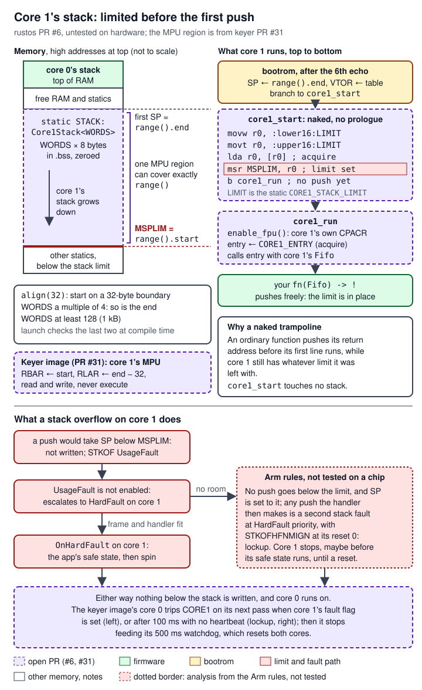

# 06 Multicore (rustos PR #6)

> The RP2350 chip on the Pico 2 has two processor cores. Out of every reset, the second one (core 1) sits idle in the chip's built-in boot code and waits for core 0 to start it. rustos PR #6 adds the code that starts it. A portable state machine in the `api` crate does the bootrom's six-word launch handshake without ever blocking, and is tested on a desktop against a model of core 1. A driver in the `pico2` crate builds on it. It starts core 1 on a stack of its own with a time limit, sets the stack limit before core 1's first push, turns on core 1's floating-point unit, and gives each core its end of the two inter-core FIFOs. It also tells code which core it is running on. The PR is **open, not on master, and untested on hardware**: every link to it below is at its head, `410dffa`. The one user is the one-Pico keyer image in cw-message-gateway PR #31 (draft), which runs the Morse decoder on core 1.

Status at the time of writing: rustos `master` is at `80bf599` (PRs #1-#5 merged). PR #6 (branch `claude/pico-decoder-u9bum5`, base `master`) holds three commits: `3d8af9c` (the handshake and the driver), `422320d` (32-byte alignment of core 1's stack for an MPU region) and `410dffa` (`Rp2350Usb::room()`, a USB addition the keyer image needs, covered on [05 Drivers: GPIO, USB, PWM, ADC, DMA](05-drivers-io.md) and [08 Changes made for cw-message-gateway](08-changes-for-cw-gateway.md)). The commit message of `3d8af9c` says the code was checked on a scratch application built for the RP2350 (the handshake words, `MSPLIM` set before any push, the FPU enabled first), and that it is "Untested on hardware". rustos has no CI.

Terms used on this page (the cw-message-gateway [17 Glossary][gw-17] has the radio terms):

| Term | Meaning here |
|---|---|
| core 0, core 1 | The RP2350's two Arm Cortex-M33 processors. Core 0 runs `main`; core 1 runs only what core 0 starts. |
| bootrom | The code built into the chip that runs first after every reset, on both cores. |
| SIO | The chip's "single-cycle I/O" block, at `0xd000_0000`. Each core sees its own copy of some registers there, such as `CPUID` and the FIFO registers. |
| FIFO (mailbox) | Two small hardware queues of 32-bit words in the SIO, one from core 0 to core 1 and one back. |
| `SEV` | The Arm "send event" instruction: wakes the other core if it is waiting for an event (`WFE`). |
| `VTOR` | The vector table offset register: where a core looks up its exception and interrupt handlers. Each core has its own. |
| `MSP`, `MSPLIM` | The main stack pointer and its limit register. A push that would take `MSP` below `MSPLIM` faults instead of writing. Each core has its own. |
| MPU | The memory protection unit: address ranges ("regions") with permissions. Each Cortex-M33 on the RP2350 has 8 Secure and 8 Non-secure regions ([`docs/extracted/rp2350-datasheet.md:2264-2265`](https://github.com/robinonsay/rustos/blob/80bf5998a60a41b3741041062ff7e9c59caf95b2/docs/extracted/rp2350-datasheet.md#L2264-L2265)). When it is enabled with the default memory map off (`PRIVDEFENA` = 0, as the keyer image sets it), an access outside every region faults. |
| `CPACR` | The register that turns coprocessors, the floating-point unit (FPU) among them, on and off. Each core has its own. |
| PPB | The Private Peripheral Bus: the Arm system registers from `0xe000_0000` (`CPACR`, `VTOR`, the MPU, SysTick and others). Each core sees its own. |
| privileged, unprivileged | Two levels of Arm code. Code outside exception handlers ("Thread mode") becomes unprivileged by setting `CONTROL.nPRIV`; unprivileged code cannot write the MPU or `MSPLIM`. Exception handlers always run privileged. |
| Secure, Non-secure | The two Security states of Arm TrustZone. Both cores run Secure here, as the bootrom leaves them, and the FIFOs used are the Secure SIO's. |
| `dsb`, `isb` | Barrier instructions. `dsb` waits until earlier memory writes have completed; `isb` makes the core fetch the following instructions again, so that they run under any configuration just written. |
| `Release`, `Acquire` | Rust atomic orderings. What a core wrote before a `Release` store is visible to a core that reads that store with an `Acquire` load. `lda` is the Arm load-acquire instruction. |
| Thumb bit | Bit 0 of an Arm code address. It must be 1 for a branch to a Cortex-M function; Rust function pointers already have it set. |
| naked function | A function with no compiler-made prologue: only the instructions written in it, so it touches no stack. |
| UsageFault, `STKOF` | UsageFault is an Arm fault exception; `STKOF` is its flag for a stack-limit violation. While UsageFault is not enabled (`SHCSR.USGFAULTENA` = 0), it escalates to HardFault. |
| HardFault, lockup | The fault handler of last resort. A fault that cannot be taken even at HardFault priority stops the core ("lockup") until a reset. |
| trip | In the keyer box: a latched stop. A tripped box keys nothing until it is power-cycled (cw-message-gateway's [17 Glossary][gw-17]). |

## Where it lives

Every path is at PR #6's head `410dffa`, except where marked.

| Path | What it holds | Lines |
|---|---|---|
| [`api/src/multicore.rs`](https://github.com/robinonsay/rustos/blob/410dffa091e247e6e7546c7f2ff465f0af499d5a/api/src/multicore.rs) | Portable: the `Mailbox` trait, `Launch` (the handshake state machine), `Step`, `QUIET_US`, `DRAIN_MAX`, and the host tests with a model of core 1. No register addresses. | 532 (lines 1-190 code and docs, 192-532 tests) |
| [`firmware/pico2/src/multicore.rs`](https://github.com/robinonsay/rustos/blob/410dffa091e247e6e7546c7f2ff465f0af499d5a/firmware/pico2/src/multicore.rs) | RP2350: `Rp2350Core1::launch`, `Core1Stack`, `Fifo`, `FifoErrors`, `LaunchError`, `Core`, `core()`, and the private core 1 entry code `core1_start` (naked) and `core1_run`. | 430 |
| [`api/src/lib.rs:74-78`](https://github.com/robinonsay/rustos/blob/410dffa091e247e6e7546c7f2ff465f0af499d5a/api/src/lib.rs#L74-L78), [`api/src/lib.rs:99`](https://github.com/robinonsay/rustos/blob/410dffa091e247e6e7546c7f2ff465f0af499d5a/api/src/lib.rs#L99) | `pub mod multicore;` and its line in the crate docs. | +6 |
| [`firmware/pico2/src/lib.rs:118`](https://github.com/robinonsay/rustos/blob/410dffa091e247e6e7546c7f2ff465f0af499d5a/firmware/pico2/src/lib.rs#L118), [`firmware/pico2/src/lib.rs:397-400`](https://github.com/robinonsay/rustos/blob/410dffa091e247e6e7546c7f2ff465f0af499d5a/firmware/pico2/src/lib.rs#L397-L400) | `pub mod multicore;`, and a note on `entry!` that the fault handlers and the safe state run on whichever core faulted. | +7 / -1 |
| [`firmware/pico2/src/common/board.rs:147`](https://github.com/robinonsay/rustos/blob/410dffa091e247e6e7546c7f2ff465f0af499d5a/firmware/pico2/src/common/board.rs#L147) | The board's new `core1: Rp2350Core1` device handle (and its docs at [`firmware/pico2/src/common/board.rs:33-35`](https://github.com/robinonsay/rustos/blob/410dffa091e247e6e7546c7f2ff465f0af499d5a/firmware/pico2/src/common/board.rs#L33-L35)). | +5 / -1 |
| [`firmware/pico2/src/usb/mod.rs:490-495`](https://github.com/robinonsay/rustos/blob/410dffa091e247e6e7546c7f2ff465f0af499d5a/firmware/pico2/src/usb/mod.rs#L490-L495) | `Rp2350Usb::room()`, not multicore; see [05 Drivers: GPIO, USB, PWM, ADC, DMA](05-drivers-io.md) and [08 Changes made for cw-message-gateway](08-changes-for-cw-gateway.md). | +15 |
| [`README.md:138-141`](https://github.com/robinonsay/rustos/blob/410dffa091e247e6e7546c7f2ff465f0af499d5a/README.md#L138-L141) | The driver list entry for `multicore` (linked), and changes to the overview paragraph ("starting the second core"), the `api` crate paragraph (its `multicore` module) and the `usb` entry ("the room left to write"). | +12 / -4 |

No other driver changed: `git diff 80bf599 410dffa` touches only the files above.

## How it works

### Where core 1 is before anything starts it

Both cores leave reset together and enter the bootrom. Core 1 "redirects very early in the boot sequence to a low-power state where it waits to be launched, after boot, by user software on core 0" (RP2350 datasheet §5.2, PDF page 365; [`docs/extracted/rp2350-datasheet.md:27062-27067`](https://github.com/robinonsay/rustos/blob/80bf5998a60a41b3741041062ff7e9c59caf95b2/docs/extracted/rp2350-datasheet.md#L27062-L27067)). The bootrom's "Core 1 Wait" step waits "for core 0 to provide an entry point through Secure SIO FIFO, using the protocol described in Section 5.3", and then "Set[s] Secure main sp and VTOR, then jump[s] into the entry point provided" ([`docs/extracted/rp2350-datasheet.md:27173-27179`](https://github.com/robinonsay/rustos/blob/80bf5998a60a41b3741041062ff7e9c59caf95b2/docs/extracted/rp2350-datasheet.md#L27173-L27179)).

Every reset that restarts core 1 puts it back there: power-on, the RUN pin, and a watchdog reset as rustos's watchdog driver sets it up, because that driver selects both processors in `PSM.WDSEL` ([`firmware/pico2/src/watchdog.rs:45-46`](https://github.com/robinonsay/rustos/blob/80bf5998a60a41b3741041062ff7e9c59caf95b2/firmware/pico2/src/watchdog.rs#L45-L46), on master). The driver's module docs say this at [`firmware/pico2/src/multicore.rs:26-42`](https://github.com/robinonsay/rustos/blob/410dffa091e247e6e7546c7f2ff465f0af499d5a/firmware/pico2/src/multicore.rs#L26-L42).

**What it does not provide.** Nothing in rustos resets core 1 by itself. The chip can (the power-on state machine's `FRCE_OFF` register has a `PROC1` bit, datasheet Table 530, [`docs/extracted/rp2350-datasheet.md:36329-36345`](https://github.com/robinonsay/rustos/blob/80bf5998a60a41b3741041062ff7e9c59caf95b2/docs/extracted/rp2350-datasheet.md#L36329-L36345)), and the Pico SDK's `multicore_reset_core1()` does, but PR #6 adds no such function. So core 1 can be launched only after a chip reset or a watchdog reset, and only once per boot. A debugger that restarts core 0 alone leaves core 1 running whatever it ran before. That core 1 does not answer the handshake, and `launch` returns `LaunchError::NoAnswer` when its time is up; the fix is to reset the chip ([`firmware/pico2/src/multicore.rs:39-42`](https://github.com/robinonsay/rustos/blob/410dffa091e247e6e7546c7f2ff465f0af499d5a/firmware/pico2/src/multicore.rs#L39-L42)).

### The launch handshake

Core 0 sends core 1 six words over the FIFO, one at a time: `0, 0, 1, vector table, stack pointer, entry point`. Core 1 echoes each word it takes. Core 0 sends the next word only after the echo of the last one comes back; any other answer starts the sequence again from the first `0`. Before each `0`, core 0 empties the FIFO from core 1 and wakes core 1 with `SEV`, because core 1 may be waiting for room to send an echo. After the sixth echo, core 1 loads its stack pointer and `VTOR` from words 5 and 4 and jumps to word 6 ([`api/src/multicore.rs:4-19`](https://github.com/robinonsay/rustos/blob/410dffa091e247e6e7546c7f2ff465f0af499d5a/api/src/multicore.rs#L4-L19)). This is the C listing in datasheet §5.3 "Launching Code On Processor Core 1" (PDF page 376; [`docs/extracted/rp2350-datasheet.md:27821-27873`](https://github.com/robinonsay/rustos/blob/80bf5998a60a41b3741041062ff7e9c59caf95b2/docs/extracted/rp2350-datasheet.md#L27821-L27873)), with two changes:

1. **It never blocks.** The listing waits on every FIFO read and write. Core 0 may already be feeding a hardware watchdog, so it cannot wait on core 1 without a bound. `Launch::step` does at most a bounded drain, one send and one receive per call, and returns `Step::Pending` until the last echo arrives; the caller decides how long to keep calling, by its own clock ([`api/src/multicore.rs:42-52`](https://github.com/robinonsay/rustos/blob/410dffa091e247e6e7546c7f2ff465f0af499d5a/api/src/multicore.rs#L42-L52)).
2. **It waits for a quiet FIFO before each `0`.** The FIFO from core 1 must stay empty for `QUIET_US` (100 µs), not just read empty once. Without this, an echo still on its way when the drain runs is taken as the answer to the next word, and core 0 stays one echo behind and starts over forever. The model of core 1 in the tests found this ([`api/src/multicore.rs:32-40`](https://github.com/robinonsay/rustos/blob/410dffa091e247e6e7546c7f2ff465f0af499d5a/api/src/multicore.rs#L32-L40)).


*Figure: the six words as `Rp2350Core1::launch` sends them. Notice the drain, wake and 100 µs quiet wait before each `0`, and the two boxes below: every step returns at once, and `launch` checks its time limit after every pending step.*

`Rp2350Core1::launch` fills in the three addresses: the vector table is rustos's `VECTOR_TABLE` (the same table core 0 uses), the stack pointer is the top of the `Core1Stack` it was given, and the entry point is rustos's private `core1_start`, not the application's function ([`firmware/pico2/src/multicore.rs:380-384`](https://github.com/robinonsay/rustos/blob/410dffa091e247e6e7546c7f2ff465f0af499d5a/firmware/pico2/src/multicore.rs#L380-L384)). On a core 1 waiting in the bootrom, the handshake takes about `2 * QUIET_US`, 200 µs ([`firmware/pico2/src/multicore.rs:341-345`](https://github.com/robinonsay/rustos/blob/410dffa091e247e6e7546c7f2ff465f0af499d5a/firmware/pico2/src/multicore.rs#L341-L345)). That figure comes from the host model; it has not been measured on a chip.

### Core 1's first instructions and its stack

Core 1's stack is a `static` of type `Core1Stack<WORDS>`: `WORDS` eight-byte words, aligned to 32 bytes, zeroed in `.bss` by core 0's reset handler like any other zero static ([`firmware/pico2/src/multicore.rs:248-272`](https://github.com/robinonsay/rustos/blob/410dffa091e247e6e7546c7f2ff465f0af499d5a/firmware/pico2/src/multicore.rs#L248-L272)). `launch` accepts only stacks of at least 128 words (1 kB) and a whole number of 32-byte blocks, checked at compile time ([`firmware/pico2/src/multicore.rs:357-366`](https://github.com/robinonsay/rustos/blob/410dffa091e247e6e7546c7f2ff465f0af499d5a/firmware/pico2/src/multicore.rs#L357-L366)). Because of the alignment, one Cortex-M33 MPU region can cover exactly this stack: a region's base is "bits [31:5] of the lower inclusive limit" and its limit is "postfixed with 0x1F" (datasheet Tables 234 and 235, PDF page 196; [`docs/extracted/rp2350-datasheet.md:14090-14130`](https://github.com/robinonsay/rustos/blob/80bf5998a60a41b3741041062ff7e9c59caf95b2/docs/extracted/rp2350-datasheet.md#L14090-L14130)). `range()` returns the stack's addresses for such a region ([`firmware/pico2/src/multicore.rs:293-296`](https://github.com/robinonsay/rustos/blob/410dffa091e247e6e7546c7f2ff465f0af499d5a/firmware/pico2/src/multicore.rs#L293-L296)).

Because `Core1Stack` lives in `.bss`, it counts against the linker script's check that the end of `.bss` leaves at least `_min_stack_size` (8 kB) below the top of RAM for core 0's stack; the link fails otherwise ([`firmware/pico2/link.ld:35`](https://github.com/robinonsay/rustos/blob/410dffa091e247e6e7546c7f2ff465f0af499d5a/firmware/pico2/link.ld#L35), [`firmware/pico2/link.ld:194-195`](https://github.com/robinonsay/rustos/blob/410dffa091e247e6e7546c7f2ff465f0af499d5a/firmware/pico2/link.ld#L194-L195); the code says so at [`firmware/pico2/src/multicore.rs:265-268`](https://github.com/robinonsay/rustos/blob/410dffa091e247e6e7546c7f2ff465f0af499d5a/firmware/pico2/src/multicore.rs#L265-L268)). So a large core 1 stack (64 kB in the keyer image) takes that much from the free RAM core 0's stack grows down into, and rustos sets no `MSPLIM` for core 0 (no other `MSPLIM` write in the code at `410dffa`). An application that wants core 0's stack bounded sets it itself, as the keyer image does (below); see [02 Boot and runtime](02-boot-runtime.md) for the memory layout.

The entry point the bootrom jumps to is `core1_start`, a naked function: it has no prologue, so it pushes nothing. It loads the stack's bottom address from the static `CORE1_STACK_LIMIT` with a load-acquire (`lda`), writes it to `MSPLIM`, and branches (without a call) to `core1_run` ([`firmware/pico2/src/multicore.rs:406-418`](https://github.com/robinonsay/rustos/blob/410dffa091e247e6e7546c7f2ff465f0af499d5a/firmware/pico2/src/multicore.rs#L406-L418)). The code's reason: an ordinary function would push its return address before its first line ran, and whatever limit core 1 was left with could fault that first push ([`firmware/pico2/src/multicore.rs:398-405`](https://github.com/robinonsay/rustos/blob/410dffa091e247e6e7546c7f2ff465f0af499d5a/firmware/pico2/src/multicore.rs#L398-L405)). `core1_run` then turns on core 1's own FPU (its `CPACR`, as rustos's reset handler does on core 0), reads the application's function from `CORE1_ENTRY`, and calls it with core 1's `Fifo` ([`firmware/pico2/src/multicore.rs:423-430`](https://github.com/robinonsay/rustos/blob/410dffa091e247e6e7546c7f2ff465f0af499d5a/firmware/pico2/src/multicore.rs#L423-L430)).



*Figure: top, memory on the left and what core 1 runs on the right; bottom, what a stack overflow does. Notice that `msr MSPLIM` runs before anything is pushed, and that an overflow is refused rather than written; the lockup branch is analysis from the Arm rules, not tested.*

`.data` and `.bss` are not set up again on core 1: core 0's `OnReset` did that before `main`, and both cores share them ([`firmware/pico2/src/multicore.rs:58-59`](https://github.com/robinonsay/rustos/blob/410dffa091e247e6e7546c7f2ff465f0af499d5a/firmware/pico2/src/multicore.rs#L58-L59)).

### The FIFOs after the launch

`launch` returns core 0's `Fifo`; core 1's function receives core 1's. Both are the same registers at the same addresses (SIO `FIFO_ST`, `FIFO_WR`, `FIFO_RD` at `0x050`-`0x058`, datasheet Table 16, [`docs/extracted/rp2350-datasheet.md:3678-3682`](https://github.com/robinonsay/rustos/blob/80bf5998a60a41b3741041062ff7e9c59caf95b2/docs/extracted/rp2350-datasheet.md#L3678-L3682)); each core reaches its own ends there ([`firmware/pico2/src/multicore.rs:70-82`](https://github.com/robinonsay/rustos/blob/410dffa091e247e6e7546c7f2ff465f0af499d5a/firmware/pico2/src/multicore.rs#L70-L82)). `Fifo` reads only when `FIFO_ST.VLD` says a word is there and writes only when `FIFO_ST.RDY` says there is room, so it never waits and never raises the chip's sticky error flags itself ([`firmware/pico2/src/multicore.rs:220-244`](https://github.com/robinonsay/rustos/blob/410dffa091e247e6e7546c7f2ff465f0af499d5a/firmware/pico2/src/multicore.rs#L220-L244)). The datasheet gives two depths: "four entries deep" in §3.1.5 ([`docs/extracted/rp2350-datasheet.md:2685-2688`](https://github.com/robinonsay/rustos/blob/80bf5998a60a41b3741041062ff7e9c59caf95b2/docs/extracted/rp2350-datasheet.md#L2685-L2688)) and "8 words deep" in the `FIFO_ST` description ([`docs/extracted/rp2350-datasheet.md:4514-4524`](https://github.com/robinonsay/rustos/blob/80bf5998a60a41b3741041062ff7e9c59caf95b2/docs/extracted/rp2350-datasheet.md#L4514-L4524)). Code should assume four.

The FIFOs are for a few words. For anything more, the module docs say to share memory with atomics: "the processors on RP2350 support standard atomic/exclusive access instructions which, in concert with the global exclusive monitor (Section 2.1.6), allow both cores to safely share variables in SRAM" (§3.1, [`docs/extracted/rp2350-datasheet.md:2661-2665`](https://github.com/robinonsay/rustos/blob/80bf5998a60a41b3741041062ff7e9c59caf95b2/docs/extracted/rp2350-datasheet.md#L2661-L2665)). The module never uses the SIO spinlocks, which erratum RP2350-E2 makes unreliable ([`docs/extracted/rp2350-datasheet.md:2676-2680`](https://github.com/robinonsay/rustos/blob/80bf5998a60a41b3741041062ff7e9c59caf95b2/docs/extracted/rp2350-datasheet.md#L2676-L2680); the erratum itself, "SIO SPINLOCK writes are mirrored at +0x80 offset", at [`docs/extracted/rp2350-datasheet.md:102485-102489`](https://github.com/robinonsay/rustos/blob/80bf5998a60a41b3741041062ff7e9c59caf95b2/docs/extracted/rp2350-datasheet.md#L102485-L102489)); the FIFO registers sit below the `0x180` offset that erratum concerns ([`firmware/pico2/src/multicore.rs:84-92`](https://github.com/robinonsay/rustos/blob/410dffa091e247e6e7546c7f2ff465f0af499d5a/firmware/pico2/src/multicore.rs#L84-L92)).

### Faults on core 1, and which core is running

Both cores use the same vector table, so a fault on either core runs the same handlers, `OnHardFault` and `DefaultHandler`, and with them the application's safe state from `entry!(main, safe_state = ...)`, on the core that faulted, while the other core carries on ([`firmware/pico2/src/multicore.rs:61-68`](https://github.com/robinonsay/rustos/blob/410dffa091e247e6e7546c7f2ff465f0af499d5a/firmware/pico2/src/multicore.rs#L61-L68); [`firmware/pico2/src/lib.rs:397-400`](https://github.com/robinonsay/rustos/blob/410dffa091e247e6e7546c7f2ff465f0af499d5a/firmware/pico2/src/lib.rs#L397-L400)). The interrupt controllers are per core, and core 1 starts with no interrupt enabled. `core()` reads SIO `CPUID`, which reads 0 on core 0 and 1 on core 1 at the same address (§3.1.2, [`docs/extracted/rp2350-datasheet.md:2453-2456`](https://github.com/robinonsay/rustos/blob/80bf5998a60a41b3741041062ff7e9c59caf95b2/docs/extracted/rp2350-datasheet.md#L2453-L2456)), so a handler can tell which core it is on ([`firmware/pico2/src/multicore.rs:161-166`](https://github.com/robinonsay/rustos/blob/410dffa091e247e6e7546c7f2ff465f0af499d5a/firmware/pico2/src/multicore.rs#L161-L166)).

### Panics on core 1

A panic is not a fault. It runs the application's `#[panic_handler]` on whichever core panicked, and does not reach `OnHardFault`. rustos defines no panic handler and does not call the safe state on a panic: every application supplies exactly one handler, and must call its safe state from it if outputs must be made safe on a panic. The template's handler only spins ([`templates/pico2/src/main.rs:26-36`](https://github.com/robinonsay/rustos/blob/410dffa091e247e6e7546c7f2ff465f0af499d5a/templates/pico2/src/main.rs#L26-L36)); see [02 Boot and runtime](02-boot-runtime.md). With a handler like that, a panic on core 1 leaves core 1 spinning with every output as it was, while core 0 runs on.

The keyer image (PR #31, draft, not on main) calls its `safe_state` first in its panic handler ([`firmware/pico2-keyer/src/main.rs:401-407`](https://github.com/robinonsay/cw-message-gateway/blob/bc5062ae4f56ae1f9949b3b067218c7e675d88f8/firmware/pico2-keyer/src/main.rs#L401-L407)). On its core 1, that function's first store, to SIO `GPIO_OUT_CLR`, is refused by core 1's MPU, so the panic becomes a fault. The fault runs `OnHardFault` at HardFault priority, where the keyer leaves `MPU_CTRL.HFNMIENA` = 0, so the MPU is off there and the same store opens the key ([`firmware/pico2-keyer/src/core1.rs:30-35`](https://github.com/robinonsay/cw-message-gateway/blob/bc5062ae4f56ae1f9949b3b067218c7e675d88f8/firmware/pico2-keyer/src/core1.rs#L30-L35), [`firmware/pico2-keyer/src/core1.rs:349-353`](https://github.com/robinonsay/cw-message-gateway/blob/bc5062ae4f56ae1f9949b3b067218c7e675d88f8/firmware/pico2-keyer/src/core1.rs#L349-L353); the design note `design/spec-pico-decoder.md` §7.3 rule 2, project files).

## How it connects


*Figure: who hands what to `pico2::multicore`. Notice that the application supplies everything core 1 starts with, that core 1's bootrom, not rustos, jumps to `core1_start`, and that cw-message-gateway's CI reads rustos's core 1 code by symbol name.*

The call outline below is the same in text, in the order things happen.

```text
application main (core 0)
  Rp2350::take()                         board.rs: one core1 handle per boot
  Rp2350Core1::new(board.core1)          consumes the handle; touches no hardware
  .launch(&STACK, core1_main, &timer, timeout_us)
      stores CORE1_ENTRY, CORE1_STACK_LIMIT (Release), dsb
      api::multicore::Launch::new(&VECTOR_TABLE, STACK top, core1_start)
      loop { Launch::step(&mut Fifo, timer.now()); check timer.elapsed_since(start) }
          Fifo (Mailbox): FIFO_ST / FIFO_WR / FIFO_RD, sev
  -> Ok(Fifo for core 0) | Err(LaunchError::NoAnswer)

core 1 bootrom ("Core 1 Wait") -- six echoed words --> SP, VTOR, branch
  core1_start (naked): MSPLIM <- CORE1_STACK_LIMIT (lda)
  core1_run: enable_fpu(); core1_main(Fifo for core 1)   never returns

fault on either core -> VECTOR_TABLE -> OnHardFault / DefaultHandler
  -> __rustos_safe_state() (the application's, via entry!) -> spin

panic on either core -> the application's #[panic_handler], on that core
  (rustos has none; the safe state runs only if that handler calls it)
```

| Neighbour | Direction | What passes | Where |
|---|---|---|---|
| `api::multicore` | `pico2::multicore` uses it | `Launch`, `Step`, `Mailbox`, `QUIET_US` | [`firmware/pico2/src/multicore.rs:103`](https://github.com/robinonsay/rustos/blob/410dffa091e247e6e7546c7f2ff465f0af499d5a/firmware/pico2/src/multicore.rs#L103) |
| Board definition (`define_board!`) | gives the application one `DeviceHandle<Rp2350Core1>` per boot | the right to launch once | [`firmware/pico2/src/common/board.rs:147`](https://github.com/robinonsay/rustos/blob/410dffa091e247e6e7546c7f2ff465f0af499d5a/firmware/pico2/src/common/board.rs#L147); handle type [`api/src/device/mod.rs:135-137`](https://github.com/robinonsay/rustos/blob/410dffa091e247e6e7546c7f2ff465f0af499d5a/api/src/device/mod.rs#L135-L137) |
| Timer driver (`Rp2350Timer`) | `launch` reads it | `now()` in microseconds, `elapsed_since()` for the time limit | [`firmware/pico2/src/timer.rs:207`](https://github.com/robinonsay/rustos/blob/80bf5998a60a41b3741041062ff7e9c59caf95b2/firmware/pico2/src/timer.rs#L207), [`firmware/pico2/src/timer.rs:228`](https://github.com/robinonsay/rustos/blob/80bf5998a60a41b3741041062ff7e9c59caf95b2/firmware/pico2/src/timer.rs#L228) (master); see [04 Drivers: core](04-drivers-core.md) |
| Runtime (`lib.rs`) | `launch` and core 1 use its private items | `VECTOR_TABLE` (word 4), `enable_fpu()` (in `core1_run`), the shared fault handlers and safe state | [`firmware/pico2/src/lib.rs:514`](https://github.com/robinonsay/rustos/blob/410dffa091e247e6e7546c7f2ff465f0af499d5a/firmware/pico2/src/lib.rs#L514), [`firmware/pico2/src/lib.rs:258-265`](https://github.com/robinonsay/rustos/blob/410dffa091e247e6e7546c7f2ff465f0af499d5a/firmware/pico2/src/lib.rs#L258-L265), [`firmware/pico2/src/lib.rs:460-475`](https://github.com/robinonsay/rustos/blob/410dffa091e247e6e7546c7f2ff465f0af499d5a/firmware/pico2/src/lib.rs#L460-L475); see [02 Boot and runtime](02-boot-runtime.md) |
| Watchdog driver | resets both cores, which puts core 1 back in the bootrom | `PSM.WDSEL` includes `PROC1` | [`firmware/pico2/src/watchdog.rs:45-46`](https://github.com/robinonsay/rustos/blob/80bf5998a60a41b3741041062ff7e9c59caf95b2/firmware/pico2/src/watchdog.rs#L45-L46) (master) |
| Core 1's bootrom | the other end of the handshake | six words and their echoes; then SP, VTOR, branch | datasheet §5.2, §5.3 |
| cw-message-gateway keyer image (PR #31, draft) | the only user | below | [`firmware/pico2-keyer/Cargo.toml:30-31`](https://github.com/robinonsay/cw-message-gateway/blob/bc5062ae4f56ae1f9949b3b067218c7e675d88f8/firmware/pico2-keyer/Cargo.toml#L30-L31) pins rustos at `410dffa` |

### What core 1 may use

`entry` is a plain `fn(Fifo) -> !`, not a closure, so it captures nothing: core 1 reaches only statics. Write everything core 1 needs into statics before calling `launch`; `launch`'s `Release` stores and its `dsb` come after them and before the first handshake word ([`firmware/pico2/src/multicore.rs:371-375`](https://github.com/robinonsay/rustos/blob/410dffa091e247e6e7546c7f2ff465f0af499d5a/firmware/pico2/src/multicore.rs#L371-L375)). The keyer image (PR #31, draft, not on main) does this twice: its timer is a `static mut TIMER: Option<Rp2350Timer>` filled once and shared as `&'static` ([`firmware/pico2-keyer/src/main.rs:259-263`](https://github.com/robinonsay/cw-message-gateway/blob/bc5062ae4f56ae1f9949b3b067218c7e675d88f8/firmware/pico2-keyer/src/main.rs#L259-L263)), and its other parts go through a `static mut PARTS` that `hand_over` fills on core 0 and core 1's `main` takes ([`firmware/pico2-keyer/src/core1.rs:145-159`](https://github.com/robinonsay/cw-message-gateway/blob/bc5062ae4f56ae1f9949b3b067218c7e675d88f8/firmware/pico2-keyer/src/core1.rs#L145-L159)).

| What | On core 1 | Where |
|---|---|---|
| `Rp2350Timer` | Can be shared: it is zero-sized and its methods take `&self` and only read the counter. Share one `&'static` as above. | [`firmware/pico2/src/timer.rs:169-174`](https://github.com/robinonsay/rustos/blob/80bf5998a60a41b3741041062ff7e9c59caf95b2/firmware/pico2/src/timer.rs#L169-L174) |
| `Rp2350SysTick` | Do not call it from core 1. It drives the SysTick of the core that calls it, and core 1's is never started. | [`firmware/pico2/src/systick.rs:41-43`](https://github.com/robinonsay/rustos/blob/80bf5998a60a41b3741041062ff7e9c59caf95b2/firmware/pico2/src/systick.rs#L41-L43); [04 Drivers: core](04-drivers-core.md), item K11 on [09 Work left and known issues](09-work-left-known-issues.md) |
| Every driver's constructor | Run them all on core 0, before the launch. The reset helpers update `RESETS` with a plain read-modify-write, which the other core can interrupt. Hand a finished driver over through a static, as the keyer image does with its ADC stream. | [`firmware/pico2/src/common/reset.rs:116-123`](https://github.com/robinonsay/rustos/blob/80bf5998a60a41b3741041062ff7e9c59caf95b2/firmware/pico2/src/common/reset.rs#L116-L123); K11 on [09](09-work-left-known-issues.md) |
| `Rp2350::take()` | Returns `None` on core 1, since core 0 took the board to launch it. | [`firmware/pico2/src/common/board.rs:38-48`](https://github.com/robinonsay/rustos/blob/410dffa091e247e6e7546c7f2ff465f0af499d5a/firmware/pico2/src/common/board.rs#L38-L48) |
| `ByteRing` | Never share one between the cores: it is not synchronised. | [`api/src/usb/ring.rs:18-19`](https://github.com/robinonsay/rustos/blob/80bf5998a60a41b3741041062ff7e9c59caf95b2/api/src/usb/ring.rs#L18-L19); [03 The api crate](03-api-crate.md), known issue 9 |
| `Fifo` | Core 1's own, given to `entry`. Keep it on core 1 (it is not `Send`). | [`firmware/pico2/src/multicore.rs:170-179`](https://github.com/robinonsay/rustos/blob/410dffa091e247e6e7546c7f2ff465f0af499d5a/firmware/pico2/src/multicore.rs#L170-L179) |
| Interrupts | The interrupt controller is core 1's own, and none is enabled. One that is enabled goes to `DefaultHandler` (safe state, then spin). | [`firmware/pico2/src/multicore.rs:61-68`](https://github.com/robinonsay/rustos/blob/410dffa091e247e6e7546c7f2ff465f0af499d5a/firmware/pico2/src/multicore.rs#L61-L68) |

### How the one-Pico keyer image uses it (cw-message-gateway PR #31, draft, not on main)

The keyer box is a Pico 2 that closes a radio's key line (the "key") to send Morse code (CW). PR #31 puts a Morse decoder on core 1 of the same Pico, listening to the radio's audio, while core 0 keeps running the keyer. The full design, the protocol and the safety case are on cw-message-gateway's handover page [11 Decoder box and the one-Pico image][gw-11]; the safety limits are on its page [13 Safety rules][gw-13]. What it takes from PR #6:

- **One static stack, 64 kB.** `pub static STACK: Core1Stack<8192>` ([`firmware/pico2-keyer/src/core1.rs:65`](https://github.com/robinonsay/cw-message-gateway/blob/bc5062ae4f56ae1f9949b3b067218c7e675d88f8/firmware/pico2-keyer/src/core1.rs#L65)); the decoder's state, about 11 kB, lives on it.
- **Launch last, with a time limit.** Core 0 sets up the key pin and the PTT pin (push-to-talk, the line that switches the radio to transmit), clocks, USB, the watchdog and the audio first, hands core 1 its parts, and then calls `launch(&core1::STACK, core1::main, timer, CORE1_LAUNCH_US)` ([`firmware/pico2-keyer/src/main.rs:287-311`](https://github.com/robinonsay/cw-message-gateway/blob/bc5062ae4f56ae1f9949b3b067218c7e675d88f8/firmware/pico2-keyer/src/main.rs#L287-L311)) with `CORE1_LAUNCH_US = 10_000` (10 ms) beside the 500 ms watchdog ([`firmware/pico2-keyer/src/main.rs:98-100`](https://github.com/robinonsay/cw-message-gateway/blob/bc5062ae4f56ae1f9949b3b067218c7e675d88f8/firmware/pico2-keyer/src/main.rs#L98-L100)). A failed launch only means no decoder: the box runs on and answers decoder requests with `ERR RX OFF`.
- **Core 1 unprivileged, behind its own MPU.** Core 1's `main` takes the parts core 0 handed over, then turns off every coprocessor but the FPU (the RP2350's GPIO coprocessor could drive pins with no store the MPU sees), then programs seven MPU regions and turns the MPU on with the default memory map off, then drops to unprivileged mode, so it cannot write the MPU or `MSPLIM` again ([`firmware/pico2-keyer/src/core1.rs:157-170`](https://github.com/robinonsay/cw-message-gateway/blob/bc5062ae4f56ae1f9949b3b067218c7e675d88f8/firmware/pico2-keyer/src/core1.rs#L157-L170), [`firmware/pico2-keyer/src/core1.rs:310-315`](https://github.com/robinonsay/cw-message-gateway/blob/bc5062ae4f56ae1f9949b3b067218c7e675d88f8/firmware/pico2-keyer/src/core1.rs#L310-L315)). One of the seven regions is `Region::new(STACK.range(), Access::ReadWrite, Memory::Sram)` ([`firmware/pico2-keyer/src/core1.rs:272`](https://github.com/robinonsay/cw-message-gateway/blob/bc5062ae4f56ae1f9949b3b067218c7e675d88f8/firmware/pico2-keyer/src/core1.rs#L272)): this is what the 32-byte alignment and `range()` are for. A region whose range is not on 32-byte boundaries gets no access at all ([`firmware/pico2-keyer/src/core1.rs:395-401`](https://github.com/robinonsay/cw-message-gateway/blob/bc5062ae4f56ae1f9949b3b067218c7e675d88f8/firmware/pico2-keyer/src/core1.rs#L395-L401)).
- **A heartbeat.** Every pass of core 1's loop stores an increasing counter ([`firmware/pico2-keyer/src/core1.rs:185-187`](https://github.com/robinonsay/cw-message-gateway/blob/bc5062ae4f56ae1f9949b3b067218c7e675d88f8/firmware/pico2-keyer/src/core1.rs#L185-L187)). Core 0 checks it every pass (`Core1Watch`, [`crates/keyer-core/src/control.rs:220-228`](https://github.com/robinonsay/cw-message-gateway/blob/bc5062ae4f56ae1f9949b3b067218c7e675d88f8/crates/keyer-core/src/control.rs#L220-L228)). If it has not moved for `CORE1_MS` = 100 ms ([`crates/keyer-core/src/lib.rs:110`](https://github.com/robinonsay/cw-message-gateway/blob/bc5062ae4f56ae1f9949b3b067218c7e675d88f8/crates/keyer-core/src/lib.rs#L110)), or core 1's fault flag is set, core 0 opens every output (key, PTT, and the tone off), trips the box (`CORE1`) and stops feeding the 500 ms watchdog ([`crates/keyer-core/src/lib.rs:65`](https://github.com/robinonsay/cw-message-gateway/blob/bc5062ae4f56ae1f9949b3b067218c7e675d88f8/crates/keyer-core/src/lib.rs#L65)), which resets both cores. These are never-loosen limits.
- **The shared fault path.** Because both cores share rustos's vector table, a fault on core 1 runs the keyer's `safe_state` on core 1: it opens the key and the PTT first, silences the tone, then sets the fault flag core 0 reads, so core 0 trips the box on its next pass ([`firmware/pico2-keyer/src/main.rs:347-355`](https://github.com/robinonsay/cw-message-gateway/blob/bc5062ae4f56ae1f9949b3b067218c7e675d88f8/firmware/pico2-keyer/src/main.rs#L347-L355)).
- **The FIFOs only for the launch.** The keyer image keeps neither `Fifo`: core 0 keeps only `launch(...).is_ok()` ([`firmware/pico2-keyer/src/main.rs:306-308`](https://github.com/robinonsay/cw-message-gateway/blob/bc5062ae4f56ae1f9949b3b067218c7e675d88f8/firmware/pico2-keyer/src/main.rs#L306-L308)) and core 1's `main` ignores `_fifo` ([`firmware/pico2-keyer/src/core1.rs:157`](https://github.com/robinonsay/cw-message-gateway/blob/bc5062ae4f56ae1f9949b3b067218c7e675d88f8/firmware/pico2-keyer/src/core1.rs#L157)); the design uses the FIFOs only for the launch (design note §7.2). Core 1's MPU has no region for the SIO ([`firmware/pico2-keyer/src/core1.rs:266-287`](https://github.com/robinonsay/cw-message-gateway/blob/bc5062ae4f56ae1f9949b3b067218c7e675d88f8/firmware/pico2-keyer/src/core1.rs#L266-L287)), so `Fifo`'s methods and `core()` would fault on its core 1 outside a HardFault handler.
- **A check in the built image.** `check_core1.py` follows core 1's code from rustos's `core1_start` and `core1_run` ([`firmware/pico2-keyer/check_core1.py:94`](https://github.com/robinonsay/cw-message-gateway/blob/bc5062ae4f56ae1f9949b3b067218c7e675d88f8/firmware/pico2-keyer/check_core1.py#L94)) and lets core 1's code store to rustos's `CORE1_ENTRY` and `CORE1_STACK_LIMIT` ([`firmware/pico2-keyer/check_core1.py:73-75`](https://github.com/robinonsay/cw-message-gateway/blob/bc5062ae4f56ae1f9949b3b067218c7e675d88f8/firmware/pico2-keyer/check_core1.py#L73-L75)). It finds them by their mangled symbol names, and it rejects several kinds of instruction in that code; see "Changing it".

Core 0's own `MSPLIM` is set by the keyer image itself (PR #31, draft, not on main), not by rustos ([`firmware/pico2-keyer/src/main.rs:363-371`](https://github.com/robinonsay/cw-message-gateway/blob/bc5062ae4f56ae1f9949b3b067218c7e675d88f8/firmware/pico2-keyer/src/main.rs#L363-L371)).

## Interfaces and APIs

### `api::multicore` (portable; at `410dffa`)

| Item | Signature or value | Meaning, units, errors | Defined |
|---|---|---|---|
| `Mailbox` | `pub trait Mailbox` | One core's end of the two FIFOs. Every method returns at once. | [`api/src/multicore.rs:60-73`](https://github.com/robinonsay/rustos/blob/410dffa091e247e6e7546c7f2ff465f0af499d5a/api/src/multicore.rs#L60-L73) |
| `Mailbox::try_send` | `fn try_send(&mut self, word: u32) -> bool` | `true` if sent; `false` if the FIFO was full and nothing was written. A sent word also wakes the other core, as `wake` does. | [`api/src/multicore.rs:65`](https://github.com/robinonsay/rustos/blob/410dffa091e247e6e7546c7f2ff465f0af499d5a/api/src/multicore.rs#L65) |
| `Mailbox::try_receive` | `fn try_receive(&mut self) -> Option<u32>` | The oldest word from the other core, if any. | [`api/src/multicore.rs:68`](https://github.com/robinonsay/rustos/blob/410dffa091e247e6e7546c7f2ff465f0af499d5a/api/src/multicore.rs#L68) |
| `Mailbox::wake` | `fn wake(&mut self)` | Wake the other core if it waits for an event, sending nothing (Arm `SEV` on the RP2350). | [`api/src/multicore.rs:72`](https://github.com/robinonsay/rustos/blob/410dffa091e247e6e7546c7f2ff465f0af499d5a/api/src/multicore.rs#L72) |
| `QUIET_US` | `pub const QUIET_US: u64 = 100` | Microseconds the FIFO from core 1 must stay empty before a `0` is sent. Adds 100 µs per `0`: 200 µs to a launch with no restart. | [`api/src/multicore.rs:79`](https://github.com/robinonsay/rustos/blob/410dffa091e247e6e7546c7f2ff465f0af499d5a/api/src/multicore.rs#L79) |
| `DRAIN_MAX` | `pub const DRAIN_MAX: usize = 16` | Most words one `step` reads while draining before a `0`. If all 16 reads returned a word, the step returns `Pending` without looking again, and the drain goes on at the next step. | [`api/src/multicore.rs:85`](https://github.com/robinonsay/rustos/blob/410dffa091e247e6e7546c7f2ff465f0af499d5a/api/src/multicore.rs#L85) |
| `Step` | `pub enum Step { Pending, Launched }` (`Clone, Copy, Debug, PartialEq, Eq`) | `Pending`: call `step` again. `Launched`: core 1 echoed the entry point. | [`api/src/multicore.rs:89-94`](https://github.com/robinonsay/rustos/blob/410dffa091e247e6e7546c7f2ff465f0af499d5a/api/src/multicore.rs#L89-L94) |
| `Launch` | `pub struct Launch` (`Debug`; fields private) | The handshake, one bounded step at a time. | [`api/src/multicore.rs:106-116`](https://github.com/robinonsay/rustos/blob/410dffa091e247e6e7546c7f2ff465f0af499d5a/api/src/multicore.rs#L106-L116) |
| `Launch::new` | `pub const fn new(vector_table: u32, stack_pointer: u32, entry: u32) -> Self` | The six words `[0, 0, 1, vector_table, stack_pointer, entry]`. `entry` must have the Thumb bit (bit 0) set. | [`api/src/multicore.rs:124-131`](https://github.com/robinonsay/rustos/blob/410dffa091e247e6e7546c7f2ff465f0af499d5a/api/src/multicore.rs#L124-L131) |
| `Launch::step` | `pub fn step(&mut self, mailbox: &mut impl Mailbox, now: u64) -> Step` | `now` in microseconds from any clock that counts up (compared with `wrapping_sub`). Never blocks. Returns `Launched` when the last echo arrives and on every later call. No error type: a core 1 that never answers just keeps it `Pending`. | [`api/src/multicore.rs:137-189`](https://github.com/robinonsay/rustos/blob/410dffa091e247e6e7546c7f2ff465f0af499d5a/api/src/multicore.rs#L137-L189) |

### `pico2::multicore` (RP2350; at `410dffa`)

| Item | Signature or value | Meaning, units, errors | Defined |
|---|---|---|---|
| `Rp2350Core1` | `pub struct Rp2350Core1` (private field) | The right to start core 1, once per boot. | [`firmware/pico2/src/multicore.rs:321-323`](https://github.com/robinonsay/rustos/blob/410dffa091e247e6e7546c7f2ff465f0af499d5a/firmware/pico2/src/multicore.rs#L321-L323) |
| `Rp2350Core1::new` | `pub fn new(_handle: DeviceHandle<Rp2350Core1>) -> Self` | Consumes the board's `core1` handle. Touches no hardware. | [`firmware/pico2/src/multicore.rs:334-336`](https://github.com/robinonsay/rustos/blob/410dffa091e247e6e7546c7f2ff465f0af499d5a/firmware/pico2/src/multicore.rs#L334-L336) |
| `Rp2350Core1::launch` | `pub fn launch<const WORDS: usize>(self, stack: &'static Core1Stack<WORDS>, entry: fn(Fifo) -> !, timer: &Rp2350Timer, timeout_us: u64) -> Result<Fifo, LaunchError>` | Starts core 1 running `entry` on `stack`. Waits at most about `timeout_us` microseconds of `timer` (checked between steps). Returns core 0's `Fifo`. Compile-time errors: "core 1's stack is too small" (`WORDS < 128`), "core 1's stack must be whole 32-byte blocks" (`WORDS % 4 != 0`). Consumes `self`: one attempt per boot. | [`firmware/pico2/src/multicore.rs:350-395`](https://github.com/robinonsay/rustos/blob/410dffa091e247e6e7546c7f2ff465f0af499d5a/firmware/pico2/src/multicore.rs#L350-L395) |
| `LaunchError` | `pub enum LaunchError { NoAnswer }` (`Clone, Copy, Debug, PartialEq, Eq`) | Core 1 had not echoed the whole handshake in time. It was not sent its entry point, or was sent it and had not echoed it; in the second case it can still start. | [`firmware/pico2/src/multicore.rs:308-315`](https://github.com/robinonsay/rustos/blob/410dffa091e247e6e7546c7f2ff465f0af499d5a/firmware/pico2/src/multicore.rs#L308-L315) |
| `Core1Stack<WORDS>` | `#[repr(C, align(32))] pub struct Core1Stack<const WORDS: usize>` | Memory for core 1's stack, `WORDS` × 8 bytes, 32-byte aligned. `Sync` by an `unsafe impl` (only core 1's stack pointer reaches the memory). Declare it as a `static`. | [`firmware/pico2/src/multicore.rs:269-277`](https://github.com/robinonsay/rustos/blob/410dffa091e247e6e7546c7f2ff465f0af499d5a/firmware/pico2/src/multicore.rs#L269-L277) |
| `Core1Stack::MIN_WORDS` | `pub const MIN_WORDS: usize = 128` | 1 kB, the smallest stack `launch` takes. | [`firmware/pico2/src/multicore.rs:281`](https://github.com/robinonsay/rustos/blob/410dffa091e247e6e7546c7f2ff465f0af499d5a/firmware/pico2/src/multicore.rs#L281) |
| `Core1Stack::new` | `pub const fn new() -> Self` | A zeroed stack (also `Default`). | [`firmware/pico2/src/multicore.rs:284-288`](https://github.com/robinonsay/rustos/blob/410dffa091e247e6e7546c7f2ff465f0af499d5a/firmware/pico2/src/multicore.rs#L284-L288), [`firmware/pico2/src/multicore.rs:299-303`](https://github.com/robinonsay/rustos/blob/410dffa091e247e6e7546c7f2ff465f0af499d5a/firmware/pico2/src/multicore.rs#L299-L303) |
| `Core1Stack::range` | `pub fn range(&self) -> Range<usize>` | `bottom..bottom + WORDS * 8`: the lowest byte (core 1's `MSPLIM`) to one past the highest (core 1's first `SP`). Both ends are multiples of 32 when `launch` accepts the type. Reads no memory. | [`firmware/pico2/src/multicore.rs:293-296`](https://github.com/robinonsay/rustos/blob/410dffa091e247e6e7546c7f2ff465f0af499d5a/firmware/pico2/src/multicore.rs#L293-L296) |
| `Fifo` | `pub struct Fifo` (holds `PhantomData<*mut ()>`, so neither `Send` nor `Sync`) | This core's ends of the two FIFOs. Only `launch` (core 0's) and core 1's entry (core 1's) create one; `Fifo::new` is private. Keep it on its core. No test and no user calls its methods (see the known bugs). | [`firmware/pico2/src/multicore.rs:177-179`](https://github.com/robinonsay/rustos/blob/410dffa091e247e6e7546c7f2ff465f0af499d5a/firmware/pico2/src/multicore.rs#L177-L179) |
| `impl Mailbox for Fifo` | `try_send`, `try_receive`, `wake` | `try_send`: returns `false` if `FIFO_ST.RDY` is 0; else writes `FIFO_WR`, then `SEV`. `try_receive`: `None` if `FIFO_ST.VLD` is 0; else reads `FIFO_RD`. `wake`: `SEV`. To call them, import `api::multicore::Mailbox`. | [`firmware/pico2/src/multicore.rs:220-244`](https://github.com/robinonsay/rustos/blob/410dffa091e247e6e7546c7f2ff465f0af499d5a/firmware/pico2/src/multicore.rs#L220-L244) |
| `Fifo::take_errors` | `pub fn take_errors(&mut self) -> FifoErrors` | Reads the sticky flags `WOF` and `ROE`, then clears the ones it saw by writing 1 to them. `Fifo`'s own methods never set them. | [`firmware/pico2/src/multicore.rs:207-217`](https://github.com/robinonsay/rustos/blob/410dffa091e247e6e7546c7f2ff465f0af499d5a/firmware/pico2/src/multicore.rs#L207-L217) |
| `FifoErrors` | `pub struct FifoErrors { pub written_when_full: bool, pub read_when_empty: bool }` (`Clone, Copy, Debug, Default, PartialEq, Eq`) | `WOF`: a word written to a full FIFO was lost. `ROE`: a read of an empty FIFO returned no real word. | [`firmware/pico2/src/multicore.rs:183-191`](https://github.com/robinonsay/rustos/blob/410dffa091e247e6e7546c7f2ff465f0af499d5a/firmware/pico2/src/multicore.rs#L183-L191) |
| `Core` | `pub enum Core { Core0, Core1 }` (`Clone, Copy, Debug, PartialEq, Eq`) | One of the two cores. | [`firmware/pico2/src/multicore.rs:151-156`](https://github.com/robinonsay/rustos/blob/410dffa091e247e6e7546c7f2ff465f0af499d5a/firmware/pico2/src/multicore.rs#L151-L156) |
| `core` | `pub fn core() -> Core` | One volatile load of SIO `CPUID`: 0 is `Core0`, anything else `Core1`. Safe in Rust terms anywhere, a fault handler included. It is a load from the SIO, so under an MPU with no SIO region (the keyer image's core 1) it faults, except in a HardFault handler where that MPU is off. | [`firmware/pico2/src/multicore.rs:161-166`](https://github.com/robinonsay/rustos/blob/410dffa091e247e6e7546c7f2ff465f0af499d5a/firmware/pico2/src/multicore.rs#L161-L166) |

### Private items that carry the algorithm

| Item | What it is | Defined |
|---|---|---|
| `CORE1_ENTRY: AtomicUsize` | The application's `fn(Fifo) -> !` as an address. Written by `launch` (`Release`) before the handshake, read by `core1_run` (`Acquire`). | [`firmware/pico2/src/multicore.rs:327`](https://github.com/robinonsay/rustos/blob/410dffa091e247e6e7546c7f2ff465f0af499d5a/firmware/pico2/src/multicore.rs#L327) |
| `CORE1_STACK_LIMIT: AtomicUsize` | The stack's lowest address. Written by `launch` (`Release`), read by `core1_start` with `lda`. | [`firmware/pico2/src/multicore.rs:329`](https://github.com/robinonsay/rustos/blob/410dffa091e247e6e7546c7f2ff465f0af499d5a/firmware/pico2/src/multicore.rs#L329) |
| `core1_start` | `#[unsafe(naked)] unsafe extern "C" fn core1_start() -> !`: `movw`/`movt r0` to the address of `CORE1_STACK_LIMIT`, `lda r0, [r0]`, `msr MSPLIM, r0`, `b core1_run`. Word 6 of the handshake. | [`firmware/pico2/src/multicore.rs:406-418`](https://github.com/robinonsay/rustos/blob/410dffa091e247e6e7546c7f2ff465f0af499d5a/firmware/pico2/src/multicore.rs#L406-L418) |
| `core1_run` | `extern "C" fn core1_run() -> !`: `enable_fpu()`, load `CORE1_ENTRY`, `transmute` it to `fn(Fifo) -> !`, call it with `Fifo::new()`. | [`firmware/pico2/src/multicore.rs:423-430`](https://github.com/robinonsay/rustos/blob/410dffa091e247e6e7546c7f2ff465f0af499d5a/firmware/pico2/src/multicore.rs#L423-L430) |
| `SioFifo`, `SIO_FIFO` | `#[repr(C)]` struct of `fifo_st`, `fifo_wr`, `fifo_rd` at SIO + `0x050`; a compile-time check that `fifo_rd` is at offset `0x08`. | [`firmware/pico2/src/multicore.rs:116-130`](https://github.com/robinonsay/rustos/blob/410dffa091e247e6e7546c7f2ff465f0af499d5a/firmware/pico2/src/multicore.rs#L116-L130) |
| `FIFO_ST_VLD`, `_RDY`, `_WOF`, `_ROE` | Bits 0, 1, 2, 3 of `FIFO_ST`. | [`firmware/pico2/src/multicore.rs:133-139`](https://github.com/robinonsay/rustos/blob/410dffa091e247e6e7546c7f2ff465f0af499d5a/firmware/pico2/src/multicore.rs#L133-L139) |
| `sev()` | Inline `sev` instruction. | [`firmware/pico2/src/multicore.rs:143-145`](https://github.com/robinonsay/rustos/blob/410dffa091e247e6e7546c7f2ff465f0af499d5a/firmware/pico2/src/multicore.rs#L143-L145) |
| `SIO_CPUID` | SIO base + `0x000`. | [`firmware/pico2/src/multicore.rs:112`](https://github.com/robinonsay/rustos/blob/410dffa091e247e6e7546c7f2ff465f0af499d5a/firmware/pico2/src/multicore.rs#L112) |

### Registers it touches

| Register | Address | Fields used | Datasheet |
|---|---|---|---|
| SIO `CPUID` | `0xd000_0000` | whole word: 0 on core 0, 1 on core 1 | §3.1.2; Table 16 (p55), Table 17 (p62) |
| SIO `FIFO_ST` | `0xd000_0050` | `VLD` bit 0 (RO), `RDY` bit 1 (RO), `WOF` bit 2 (write-clear), `ROE` bit 3 (write-clear) | Table 36 (p68); [`docs/extracted/rp2350-datasheet.md:4535-4552`](https://github.com/robinonsay/rustos/blob/80bf5998a60a41b3741041062ff7e9c59caf95b2/docs/extracted/rp2350-datasheet.md#L4535-L4552) |
| SIO `FIFO_WR` | `0xd000_0054` | "Write access to this core's TX FIFO" | Table 37 (p68) |
| SIO `FIFO_RD` | `0xd000_0058` | "Read access to this core's RX FIFO" | Table 38 (p68) |
| `MSPLIM` (core 1, Secure) | special register (`msr`) | bits 31:3 (bits 2:0 read as zero) | §3.7 (p135), [`docs/extracted/rp2350-datasheet.md:9429-9433`](https://github.com/robinonsay/rustos/blob/80bf5998a60a41b3741041062ff7e9c59caf95b2/docs/extracted/rp2350-datasheet.md#L9429-L9433); Arm ARM B3.21 |
| `CPACR` (core 1) | `0xe000_ed88` | `CP10`, `CP11` = `0b11` (read-modify-write, through rustos's `enable_fpu`) | [`firmware/pico2/src/lib.rs:223-232`](https://github.com/robinonsay/rustos/blob/410dffa091e247e6e7546c7f2ff465f0af499d5a/firmware/pico2/src/lib.rs#L223-L232) |
| `VTOR`, `SP` (core 1) | set by the bootrom from words 4 and 5 | | §5.3; "Core 1 Wait" |

Page numbers in the code are PDF page indices, one more than the number printed in the page footer ([`firmware/pico2/src/multicore.rs:94-95`](https://github.com/robinonsay/rustos/blob/410dffa091e247e6e7546c7f2ff465f0af499d5a/firmware/pico2/src/multicore.rs#L94-L95)). The PDF is `docs/rp2350-datasheet.pdf` in the rustos repository and its text is `docs/extracted/rp2350-datasheet.md`.

## Algorithms and processing

### `Launch::step`, case by case

`Launch` holds the six words, `next` (the index of the word being sent or echoed), `sent` (whether `words[next]` is out and its echo awaited) and `quiet_from` (since when the FIFO from core 1 has read empty at every look, before a `0`). One call does exactly one of these ([`api/src/multicore.rs:137-189`](https://github.com/robinonsay/rustos/blob/410dffa091e247e6e7546c7f2ff465f0af499d5a/api/src/multicore.rs#L137-L189)):

1. **Already done.** `next == 6`: return `Launched` ([`api/src/multicore.rs:138-140`](https://github.com/robinonsay/rustos/blob/410dffa091e247e6e7546c7f2ff465f0af499d5a/api/src/multicore.rs#L138-L140)).
2. **Waiting for an echo** (`sent` is true): `try_receive`. Nothing there: return `Pending`. A word: clear `sent` and `quiet_from`; if it equals the word sent, `next += 1`, else `next = 0` (start over from the first `0`). Return `Launched` if `next` reached 6, else `Pending` ([`api/src/multicore.rs:142-160`](https://github.com/robinonsay/rustos/blob/410dffa091e247e6e7546c7f2ff465f0af499d5a/api/src/multicore.rs#L142-L160)).
3. **About to send a `0`**: drain. Call `try_receive` up to `DRAIN_MAX` (16) times, stopping at the first that finds nothing; every word read clears `quiet_from`. If all 16 reads returned a word, return `Pending` without looking again; the drain goes on at the next step ([`api/src/multicore.rs:165-175`](https://github.com/robinonsay/rustos/blob/410dffa091e247e6e7546c7f2ff465f0af499d5a/api/src/multicore.rs#L165-L175)). If it read empty and `quiet_from` is not set, set it to `now`, call `wake()` (`SEV`) and return `Pending` ([`api/src/multicore.rs:176-180`](https://github.com/robinonsay/rustos/blob/410dffa091e247e6e7546c7f2ff465f0af499d5a/api/src/multicore.rs#L176-L180)). If `now - quiet_from < QUIET_US`, return `Pending` ([`api/src/multicore.rs:181-183`](https://github.com/robinonsay/rustos/blob/410dffa091e247e6e7546c7f2ff465f0af499d5a/api/src/multicore.rs#L181-L183)). Otherwise fall through to the send.
4. **Send**: `try_send(word)`. If the FIFO took it, set `sent`. Return `Pending` either way; a full FIFO means the same word is tried at the next step ([`api/src/multicore.rs:185-188`](https://github.com/robinonsay/rustos/blob/410dffa091e247e6e7546c7f2ff465f0af499d5a/api/src/multicore.rs#L185-L188)).

Consequences worth knowing:

- `wake()` is called once each time a quiet wait starts, so twice in a launch with no restart (the test at [`api/src/multicore.rs:353-354`](https://github.com/robinonsay/rustos/blob/410dffa091e247e6e7546c7f2ff465f0af499d5a/api/src/multicore.rs#L353-L354) checks this). `try_send` also wakes core 1 on every word it sends.
- Words 3 to 6 (`1` and the three addresses) are sent with no drain and no wait: only a `0` drains.
- A `step` makes at most `DRAIN_MAX` (16) FIFO reads and one write, so its time is bounded by register accesses alone.
- A wrong echo costs a full restart: drain, wake and 100 µs before each of the two zeros again.

### Why the quiet wait

The datasheet's listing drains the FIFO from core 1 once before each `0`. That drain catches only the words that have already arrived. If one more word from core 1 is still on its way (an echo of an earlier word, or, per the test model's notes, a `0` core 1 sends once it has emptied its FIFO), it arrives after the drain. Core 0 then "takes that late echo as the answer to its next word and is one echo behind from then on: every word it sends gets the previous one's echo, and the sequence starts over forever" ([`api/src/multicore.rs:32-40`](https://github.com/robinonsay/rustos/blob/410dffa091e247e6e7546c7f2ff465f0af499d5a/api/src/multicore.rs#L32-L40)). In one schedule the test model found worse: core 0 "would report a launch while core 1 is still waiting" ([`api/src/multicore.rs:372-383`](https://github.com/robinonsay/rustos/blob/410dffa091e247e6e7546c7f2ff465f0af499d5a/api/src/multicore.rs#L372-L383)). Waiting until the FIFO has stayed empty for 100 µs, far longer than core 1 takes to echo a word, closes that window. The module notes that on the chip core 1 answers within a few microseconds, so the datasheet's listing works in practice; the wait makes the handshake work whatever the timing.

### The time limit in `launch`

`launch` reads `timer.now()` once as `start`, then loops: `step` with the current time; if `Launched`, return `Ok(fifo)`; otherwise, if `timer.elapsed_since(start) > timeout_us`, return `Err(LaunchError::NoAnswer)` ([`firmware/pico2/src/multicore.rs:385-394`](https://github.com/robinonsay/rustos/blob/410dffa091e247e6e7546c7f2ff465f0af499d5a/firmware/pico2/src/multicore.rs#L385-L394)). The overshoot past `timeout_us` is at most one `step` and two timer reads (the `now()` passed to `step` and the one inside `elapsed_since`), plus any interrupt core 0 takes meanwhile. The code's guidance is to give a margin over 200 µs and keep the time short beside any watchdog already running; the keyer image uses 10 ms beside a 500 ms watchdog.

`NoAnswer` does not prove core 1 is idle. If the entry point went out and its echo did not come back before the deadline, core 1 may still start ([`firmware/pico2/src/multicore.rs:310-314`](https://github.com/robinonsay/rustos/blob/410dffa091e247e6e7546c7f2ff465f0af499d5a/firmware/pico2/src/multicore.rs#L310-L314)). Because `launch` consumed the `Rp2350Core1`, there is no second attempt, and the core 0 `Fifo` was not returned. A caller that cares must treat core 1 as possibly running. The keyer image (PR #31, draft, not on main) does: its heartbeat watch counts core 1 as running if it was launched "or its heartbeat has been seen to move" ([`crates/keyer-core/src/control.rs:194-199`](https://github.com/robinonsay/cw-message-gateway/blob/bc5062ae4f56ae1f9949b3b067218c7e675d88f8/crates/keyer-core/src/control.rs#L194-L199)).

### Handing data to core 1 before it starts

`launch` stores `CORE1_ENTRY` and `CORE1_STACK_LIMIT` with `Release` ordering, then runs `dsb` so that both stores reach memory before any handshake word leaves for core 1 ([`firmware/pico2/src/multicore.rs:371-375`](https://github.com/robinonsay/rustos/blob/410dffa091e247e6e7546c7f2ff465f0af499d5a/firmware/pico2/src/multicore.rs#L371-L375)). Core 1 reads them with acquire loads (`lda` in `core1_start`, `Ordering::Acquire` in `core1_run`). Anything else core 0 wants core 1 to see at start follows the same rule: write it before calling `launch`. The keyer image (PR #31, draft, not on main) hands over its parts this way and relies on that `dsb` ([`firmware/pico2-keyer/src/core1.rs:149-154`](https://github.com/robinonsay/cw-message-gateway/blob/bc5062ae4f56ae1f9949b3b067218c7e675d88f8/firmware/pico2-keyer/src/core1.rs#L149-L154)).

### Core 1's start, instruction by instruction

1. The bootrom takes the sixth word, sets core 1's Secure main stack pointer to `stack.range().end` and its `VTOR` to `VECTOR_TABLE`, and jumps to `core1_start` with the Thumb bit set.
2. `core1_start`: `movw r0, :lower16:CORE1_STACK_LIMIT`, `movt r0, :upper16:CORE1_STACK_LIMIT`, `lda r0, [r0]`, `msr MSPLIM, r0`, `b core1_run`. No instruction here moves `SP`.
3. `core1_run`: `enable_fpu()` (read-modify-write of `CPACR` setting `CP10` and `CP11` to full access, then `dsb` and `isb`; [`firmware/pico2/src/lib.rs:258-265`](https://github.com/robinonsay/rustos/blob/410dffa091e247e6e7546c7f2ff465f0af499d5a/firmware/pico2/src/lib.rs#L258-L265)), then the application's function with `Fifo::new()`. This is the first code that may push, and the limit is already in place.

Core 1 runs on its main stack pointer, which the bootrom set. Whether it is privileged is not stated in the datasheet text this page was written from; the keyer image's core 1 relies on starting privileged, because it writes its MPU registers before dropping privilege.

### A stack overflow on core 1

What the code states: a push below `MSPLIM` "faults on core 1 (a UsageFault with `STKOF` set, escalated to HardFault) instead of writing over whatever lies below the stack" ([`firmware/pico2/src/multicore.rs:46-52`](https://github.com/robinonsay/rustos/blob/410dffa091e247e6e7546c7f2ff465f0af499d5a/firmware/pico2/src/multicore.rs#L46-L52)). The Arm rules agree on the first part. "A stack can descend to its stack limit value. Any attempt to descend the stack further ... is a violation" (Armv8-M Architecture Reference Manual, rule `IKDPG`, [`docs/extracted/DDI0553B_z_armv8m_arm.md:5302`](https://github.com/robinonsay/rustos/blob/80bf5998a60a41b3741041062ff7e9c59caf95b2/docs/extracted/DDI0553B_z_armv8m_arm.md#L5302)), and the instruction that would move `SP` below the limit raises the fault ([`docs/extracted/DDI0553B_z_armv8m_arm.md:5361`](https://github.com/robinonsay/rustos/blob/80bf5998a60a41b3741041062ff7e9c59caf95b2/docs/extracted/DDI0553B_z_armv8m_arm.md#L5361)). rustos never enables the UsageFault exception (no write to `SHCSR` in the code at `410dffa`), so the fault escalates to HardFault, assuming the bootrom leaves core 1's `SHCSR` at its reset value (not verified) ([`docs/extracted/DDI0553B_z_armv8m_arm.md:88586`](https://github.com/robinonsay/rustos/blob/80bf5998a60a41b3741041062ff7e9c59caf95b2/docs/extracted/DDI0553B_z_armv8m_arm.md#L88586)). The HardFault handler is rustos's `OnHardFault`, on core 1, which runs the application's safe state and then spins.

What the Arm rules add, as analysis that has not been tested on a chip: entering the HardFault handler pushes an exception frame on the same stack. If the frame does not fit above the limit, no push below the limit is performed (whether the part above it is written is implementation defined), and the stack pointer is set to the limit value ([`docs/extracted/DDI0553B_z_armv8m_arm.md:5315-5328`](https://github.com/robinonsay/rustos/blob/80bf5998a60a41b3741041062ff7e9c59caf95b2/docs/extracted/DDI0553B_z_armv8m_arm.md#L5315-L5328)). If the handler then needs stack of its own, that is another violation, now at HardFault priority. rustos never sets `CCR.STKOFHFNMIGN`, so, assuming the bootrom leaves core 1's `CCR` at its reset value (not verified), it is 0, "Stack limit faults not ignored" ([`docs/extracted/DDI0553B_z_armv8m_arm.md:71868-71876`](https://github.com/robinonsay/rustos/blob/80bf5998a60a41b3741041062ff7e9c59caf95b2/docs/extracted/DDI0553B_z_armv8m_arm.md#L71868-L71876)). A fault that cannot be taken at HardFault priority puts the core in lockup ([`docs/extracted/DDI0553B_z_armv8m_arm.md:6713-6717`](https://github.com/robinonsay/rustos/blob/80bf5998a60a41b3741041062ff7e9c59caf95b2/docs/extracted/DDI0553B_z_armv8m_arm.md#L6713-L6717)): core 1 stops, possibly before its safe state has run, until a reset. rustos's own `entry!` docs already warn that a fault inside the safe state, from the HardFault handler, "locks the processor up" ([`firmware/pico2/src/lib.rs:390-395`](https://github.com/robinonsay/rustos/blob/410dffa091e247e6e7546c7f2ff465f0af499d5a/firmware/pico2/src/lib.rs#L390-L395)). In every case nothing below the stack is written, and core 0 carries on. The safety audit read core 0's case the same way: in the keyer image "a core 0 stack overflow locks up at MSPLIM (OnHardFault pushes first)" (`audit/report.md`, the PR #31 entry at `8d5fcf6`, project files). An application must therefore not rely on core 1's safe state alone. It must also watch core 1 from core 0. The keyer image (PR #31, draft, not on main) does this with its 100 ms heartbeat. cw-message-gateway's page [11 Decoder box and the one-Pico image][gw-11] lists "a push below `MSPLIM`" among the core 1 faults whose handler opens the key; by the reading above, such an overflow may instead lock core 1 up, and then the heartbeat is what trips the box.

### The host model of core 1 and the nine tests

The datasheet gives only core 0's side of the handshake. The tests model core 1 by the same rules: it takes one word at a time, empties its incoming FIFO when it takes a `0`, echoes every word, starts over on any word out of sequence (a `0` counts as the first of a new sequence), and launches with the three words after `0, 0, 1`. It may have words left for core 0 from before, or one still in flight ([`api/src/multicore.rs:228-305`](https://github.com/robinonsay/rustos/blob/410dffa091e247e6e7546c7f2ff465f0af499d5a/api/src/multicore.rs#L228-L305)). The FIFOs in the model hold four words. This model is an assumption about the bootrom, not something read from it. Each turn of the test scheduler is 1 µs ([`api/src/multicore.rs:325-344`](https://github.com/robinonsay/rustos/blob/410dffa091e247e6e7546c7f2ff465f0af499d5a/api/src/multicore.rs#L325-L344)).

| Test | What it shows | Lines |
|---|---|---|
| `core1_starts_with_the_three_words` | Launches with `[VTOR, SP, ENTRY]`, six words sent, two wakes, done in at least 200 and under 300 turns. | [`api/src/multicore.rs:347-357`](https://github.com/robinonsay/rustos/blob/410dffa091e247e6e7546c7f2ff465f0af499d5a/api/src/multicore.rs#L347-L357) |
| `what_core1_sent_before_is_drained_not_taken_as_an_answer` | Stale words `0, 1, VTOR, 0` waiting for core 0 are drained, not taken as echoes. | [`api/src/multicore.rs:360-369`](https://github.com/robinonsay/rustos/blob/410dffa091e247e6e7546c7f2ff465f0af499d5a/api/src/multicore.rs#L360-L369) |
| `a_late_word_from_core1_is_waited_out` | A `0` still in flight when core 0 first looks does not leave core 0 one echo behind. | [`api/src/multicore.rs:372-383`](https://github.com/robinonsay/rustos/blob/410dffa091e247e6e7546c7f2ff465f0af499d5a/api/src/multicore.rs#L372-L383) |
| `a_wrong_echo_starts_the_sequence_again` | A wrong echo sends core 0 back to the first `0`, with a fresh drain, wake and quiet wait. | [`api/src/multicore.rs:386-412`](https://github.com/robinonsay/rustos/blob/410dffa091e247e6e7546c7f2ff465f0af499d5a/api/src/multicore.rs#L386-L412) |
| `a_word_from_core1_restarts_the_quiet_wait` | A word arriving during the 100 µs wait restarts it. | [`api/src/multicore.rs:415-429`](https://github.com/robinonsay/rustos/blob/410dffa091e247e6e7546c7f2ff465f0af499d5a/api/src/multicore.rs#L415-L429) |
| `a_full_fifo_is_waited_out` | Refused sends are retried and nothing is skipped. | [`api/src/multicore.rs:432-464`](https://github.com/robinonsay/rustos/blob/410dffa091e247e6e7546c7f2ff465f0af499d5a/api/src/multicore.rs#L432-L464) |
| `no_answer_is_never_a_launch` | With core 1 silent for 100 000 steps, core 0 stays `Pending` and sends only the first `0`. | [`api/src/multicore.rs:467-474`](https://github.com/robinonsay/rustos/blob/410dffa091e247e6e7546c7f2ff465f0af499d5a/api/src/multicore.rs#L467-L474) |
| `a_core1_that_keeps_sending_does_not_hold_up_a_step` | An endless stream from core 1: each step returns after exactly `DRAIN_MAX` reads and never sends. | [`api/src/multicore.rs:477-497`](https://github.com/robinonsay/rustos/blob/410dffa091e247e6e7546c7f2ff465f0af499d5a/api/src/multicore.rs#L477-L497) |
| `core1_launches_whatever_the_interleaving` | 2000 pseudo-random schedules from a fixed seed (stale words, a late `0`, core 1 getting 1 turn in 2 to 5) all launch with six words sent. | [`api/src/multicore.rs:500-531`](https://github.com/robinonsay/rustos/blob/410dffa091e247e6e7546c7f2ff465f0af499d5a/api/src/multicore.rs#L500-L531) |

The commit message of `3d8af9c` says that removing the quiet wait, the drain, the start-over or the wake each makes one of these fail. That was not re-run for this page.

## Programming against it

### Depend on PR #6

Generate an application from the template with `cargo generate --git https://github.com/robinonsay/rustos templates/pico2` ([`templates/README.md:11-17`](https://github.com/robinonsay/rustos/blob/410dffa091e247e6e7546c7f2ff465f0af499d5a/templates/README.md#L11-L17)). The generated app carries the target and the `-Tlink.ld` linker flag in its own `.cargo/config.toml` ([`templates/pico2/.cargo/config.toml:4-12`](https://github.com/robinonsay/rustos/blob/410dffa091e247e6e7546c7f2ff465f0af499d5a/templates/pico2/.cargo/config.toml#L4-L12)), and depends on `api` and `pico2` from rustos's default branch, with no revision ([`templates/pico2/Cargo.toml.liquid:11-12`](https://github.com/robinonsay/rustos/blob/410dffa091e247e6e7546c7f2ff465f0af499d5a/templates/pico2/Cargo.toml.liquid#L11-L12), [`templates/README.md:39`](https://github.com/robinonsay/rustos/blob/410dffa091e247e6e7546c7f2ff465f0af499d5a/templates/README.md#L39)). The default branch is `master`, which has no `multicore` module, so there `use pico2::multicore` fails to resolve. Until PR #6 merges, pin both crates to its head, as the keyer image does ([`firmware/pico2-keyer/Cargo.toml:30-31`](https://github.com/robinonsay/cw-message-gateway/blob/bc5062ae4f56ae1f9949b3b067218c7e675d88f8/firmware/pico2-keyer/Cargo.toml#L30-L31), PR #31, draft, not on main):

```toml
[dependencies]
api = { git = "https://github.com/robinonsay/rustos", rev = "410dffa091e247e6e7546c7f2ff465f0af499d5a" }
pico2 = { git = "https://github.com/robinonsay/rustos", rev = "410dffa091e247e6e7546c7f2ff465f0af499d5a" }
```

Pin both to the same commit. After the merge, move both to master's merge commit.

### Start core 1

This mirrors the module's own example ([`firmware/pico2/src/multicore.rs:6-24`](https://github.com/robinonsay/rustos/blob/410dffa091e247e6e7546c7f2ff465f0af499d5a/firmware/pico2/src/multicore.rs#L6-L24)). The stack must be a `static`; its size is a const generic in eight-byte words.

```rust
#![no_std]
#![no_main]

use core::panic::PanicInfo;
use core::sync::atomic::{AtomicU32, Ordering};
use pico2::common::board::Rp2350;
use pico2::clocks::Rp2350Clocks;
use pico2::timer::Rp2350Timer;
use pico2::multicore::{Core1Stack, Fifo, LaunchError, Rp2350Core1};

// rustos supplies no panic handler. This one runs on whichever core panicked.
#[panic_handler]
fn panic(_info: &PanicInfo) -> ! {
    loop {}
}

pico2::entry!(main);

// 16 kB: 2048 eight-byte words (a multiple of 4, at least 128).
static CORE1_STACK: Core1Stack<2048> = Core1Stack::new();
static BEAT: AtomicU32 = AtomicU32::new(0);

fn main() -> ! {
    let board = Rp2350::take().unwrap();
    let clocks = Rp2350Clocks::new(board.clocks);
    let timer = Rp2350Timer::new(board.timer, &clocks);
    // Everything core 1 will read: put it in statics here, before launch.
    // core1_main cannot use `timer`, a local; see "What core 1 may use".
    match Rp2350Core1::new(board.core1).launch(&CORE1_STACK, core1_main, &timer, 10_000) {
        Ok(_fifo) => { /* core 1 is running */ }
        Err(LaunchError::NoAnswer) => { /* run without core 1; it may still start */ }
    }
    loop { /* core 0's work; read BEAT to see core 1 is alive */ }
}

fn core1_main(_fifo: Fifo) -> ! {
    let mut n = 0u32;
    loop {
        n = n.wrapping_add(1);
        BEAT.store(n, Ordering::Release);
    }
}
```

This is a whole `src/main.rs`; the two crate attributes and the panic handler are as in the template ([`templates/pico2/src/main.rs:15-16`](https://github.com/robinonsay/rustos/blob/410dffa091e247e6e7546c7f2ff465f0af499d5a/templates/pico2/src/main.rs#L15-L16), [`templates/pico2/src/main.rs:26-36`](https://github.com/robinonsay/rustos/blob/410dffa091e247e6e7546c7f2ff465f0af499d5a/templates/pico2/src/main.rs#L26-L36)). The type checks: `entry` must be `fn(Fifo) -> !`; a stack under 128 words or not a multiple of 4 fails to compile.

### Share data between the cores

Use statics with atomics (`AtomicU32`, `AtomicBool`, or your own lock-free ring built on them) for anything more than a few words. Do not use the SIO spinlocks (erratum RP2350-E2). Do not block one core on the other: the keyer image's rule is that core 0 never waits on core 1. To hand core 1 a driver or other state at start, fill a static before `launch`, as in "What core 1 may use" above. The keyer image's two single-producer, single-consumer byte rings are in cw-message-gateway's `keyer_core::cores` (PR #31, draft, not on main; see its page [11 Decoder box and the one-Pico image][gw-11]).

### Use the FIFO

`Fifo`'s methods come from the `Mailbox` trait, so import it:

```rust
use api::multicore::Mailbox;

fn poll(fifo: &mut pico2::multicore::Fifo) {
    if fifo.try_send(42) { /* sent, and the other core was woken */ }
    while let Some(word) = fifo.try_receive() { /* handle word */ let _ = word; }
    let errs = fifo.take_errors(); // both false unless other code touched the FIFO registers
    let _ = errs;
}
```

The application crate needs `api` as a dependency as well as `pico2`; the keyer image (PR #31, draft, not on main) pins both at the same rustos commit ([`firmware/pico2-keyer/Cargo.toml:30-31`](https://github.com/robinonsay/cw-message-gateway/blob/bc5062ae4f56ae1f9949b3b067218c7e675d88f8/firmware/pico2-keyer/Cargo.toml#L30-L31)). Nothing reads the FIFO for you after the launch, and no interrupt is set up for it.

### A safe state that knows its core

```rust
use pico2::multicore::{core, Core};

pico2::entry!(main, safe_state = safe_state);

fn safe_state() {
    // First: put outputs that drive the outside world in their safe level (one register write).
    match core() {
        Core::Core0 => { /* core 0 faulted; core 1 carries on */ }
        Core::Core1 => { /* core 1 faulted; tell core 0 through a static flag */ }
    }
}

// The fault handlers call safe_state; a panic does not reach them, so this
// application's one panic handler calls it too.
#[panic_handler]
fn panic(_info: &core::panic::PanicInfo) -> ! {
    safe_state();
    loop {}
}
```

The keyer image's handlers have this shape ([`firmware/pico2-keyer/src/main.rs:347-355`](https://github.com/robinonsay/cw-message-gateway/blob/bc5062ae4f56ae1f9949b3b067218c7e675d88f8/firmware/pico2-keyer/src/main.rs#L347-L355), [`firmware/pico2-keyer/src/main.rs:401-407`](https://github.com/robinonsay/cw-message-gateway/blob/bc5062ae4f56ae1f9949b3b067218c7e675d88f8/firmware/pico2-keyer/src/main.rs#L401-L407); PR #31, draft, not on main). Under an MPU that leaves out the outputs' registers, the safe state's first store faults when called from the panic handler; see "Panics on core 1". Keep it as small as the `entry!` docs ask: no locks, no allocation, no driver state ([`firmware/pico2/src/lib.rs:381-395`](https://github.com/robinonsay/rustos/blob/410dffa091e247e6e7546c7f2ff465f0af499d5a/firmware/pico2/src/lib.rs#L381-L395)). After a stack overflow it may not run at all (see above).

### Cover core 1's stack with an MPU region

`range()` gives the region's addresses. With the Armv8-M MPU, `MPU_RBAR` takes the start (bits 31:5) and `MPU_RLAR` the start of the last 32-byte block (`end - 32`, bits 31:5). rustos has no MPU driver; the keyer image (PR #31, draft, not on main) has one in its `core1.rs` ([`firmware/pico2-keyer/src/core1.rs:386-447`](https://github.com/robinonsay/cw-message-gateway/blob/bc5062ae4f56ae1f9949b3b067218c7e675d88f8/firmware/pico2-keyer/src/core1.rs#L386-L447)), used as `Region::new(STACK.range(), Access::ReadWrite, Memory::Sram)`.

### Build and test

From the rustos root (do this on your own machine):

```sh
cargo test -p api multicore     # the nine host tests; the workspace's default member is api
cargo pico2                     # builds the pico2 crate for thumbv8m.main-none-eabihf
```

The `pico2` alias is in `.cargo/config.toml`, and `default-members = ["api"]` in the workspace `Cargo.toml` makes a plain `cargo test` run the host tests. The README's "Host-side tests" section names a `cargo xtest` alias that is not in `.cargo/config.toml` at `410dffa` (see the known issues).

To check the start sequence after a change, disassemble a built application and read `core1_start` and `core1_run` (for example with `llvm-objdump -d`): `msr MSPLIM` must come before any `push`, `sub sp` or `str ..., [sp, ...]`.

## Changing it

| To change | Touch | Also update |
|---|---|---|
| The handshake (words, drain, quiet wait, retry) | [`api/src/multicore.rs`](https://github.com/robinonsay/rustos/blob/410dffa091e247e6e7546c7f2ff465f0af499d5a/api/src/multicore.rs) | Its tests and the core 1 model, if the bootrom's behaviour is better known. Keep every existing test passing; add one for the new case. [03 The api crate](03-api-crate.md) shows how to drive `Launch` from another chip. |
| The `Mailbox` trait | [`api/src/multicore.rs:54-73`](https://github.com/robinonsay/rustos/blob/410dffa091e247e6e7546c7f2ff465f0af499d5a/api/src/multicore.rs#L54-L73) | Every implementor: `Fifo` ([`firmware/pico2/src/multicore.rs:220-244`](https://github.com/robinonsay/rustos/blob/410dffa091e247e6e7546c7f2ff465f0af499d5a/firmware/pico2/src/multicore.rs#L220-L244)) and the test doubles `Chip`, `Busy` and `Flood` ([`api/src/multicore.rs:307-319`](https://github.com/robinonsay/rustos/blob/410dffa091e247e6e7546c7f2ff465f0af499d5a/api/src/multicore.rs#L307-L319), [`api/src/multicore.rs:435-450`](https://github.com/robinonsay/rustos/blob/410dffa091e247e6e7546c7f2ff465f0af499d5a/api/src/multicore.rs#L435-L450), [`api/src/multicore.rs:480-490`](https://github.com/robinonsay/rustos/blob/410dffa091e247e6e7546c7f2ff465f0af499d5a/api/src/multicore.rs#L480-L490)). Then the docs that repeat the API: [`README.md:138-141`](https://github.com/robinonsay/rustos/blob/410dffa091e247e6e7546c7f2ff465f0af499d5a/README.md#L138-L141), [`api/src/lib.rs:74-78`](https://github.com/robinonsay/rustos/blob/410dffa091e247e6e7546c7f2ff465f0af499d5a/api/src/lib.rs#L74-L78), and the API tables on [03 The api crate](03-api-crate.md) and [08 Changes made for cw-message-gateway](08-changes-for-cw-gateway.md). |
| `QUIET_US` | [`api/src/multicore.rs:79`](https://github.com/robinonsay/rustos/blob/410dffa091e247e6e7546c7f2ff465f0af499d5a/api/src/multicore.rs#L79) | The "about 200 µs" in `launch`'s docs ([`firmware/pico2/src/multicore.rs:343-344`](https://github.com/robinonsay/rustos/blob/410dffa091e247e6e7546c7f2ff465f0af499d5a/firmware/pico2/src/multicore.rs#L343-L344)) and in the keyer image ([`firmware/pico2-keyer/src/main.rs:98-100`](https://github.com/robinonsay/cw-message-gateway/blob/bc5062ae4f56ae1f9949b3b067218c7e675d88f8/firmware/pico2-keyer/src/main.rs#L98-L100)), and every caller's `timeout_us`. |
| The core 1 entry code | [`firmware/pico2/src/multicore.rs:398-430`](https://github.com/robinonsay/rustos/blob/410dffa091e247e6e7546c7f2ff465f0af499d5a/firmware/pico2/src/multicore.rs#L398-L430) | Re-check the disassembly. Check it against cw-message-gateway's `check_core1.py` (below). See the never-change list. |
| `Fifo` or the register map | [`firmware/pico2/src/multicore.rs:108-145`](https://github.com/robinonsay/rustos/blob/410dffa091e247e6e7546c7f2ff465f0af499d5a/firmware/pico2/src/multicore.rs#L108-L145), [`firmware/pico2/src/multicore.rs:168-244`](https://github.com/robinonsay/rustos/blob/410dffa091e247e6e7546c7f2ff465f0af499d5a/firmware/pico2/src/multicore.rs#L168-L244) | Datasheet citations next to each constant. |
| Stack rules (`MIN_WORDS`, alignment) | [`firmware/pico2/src/multicore.rs:246-303`](https://github.com/robinonsay/rustos/blob/410dffa091e247e6e7546c7f2ff465f0af499d5a/firmware/pico2/src/multicore.rs#L246-L303), [`firmware/pico2/src/multicore.rs:357-366`](https://github.com/robinonsay/rustos/blob/410dffa091e247e6e7546c7f2ff465f0af499d5a/firmware/pico2/src/multicore.rs#L357-L366) | The keyer image's MPU region depends on the alignment. |
| A per-core reset or a second launch | new code; `Rp2350Core1` would need to stop consuming itself | The `Sync` safety argument on `Core1Stack` ([`firmware/pico2/src/multicore.rs:274-277`](https://github.com/robinonsay/rustos/blob/410dffa091e247e6e7546c7f2ff465f0af499d5a/firmware/pico2/src/multicore.rs#L274-L277)) assumes one launch per boot. The chip's way is `FRCE_OFF.PROC1`; erratum RP2350-E19 says a reboot hangs if `FRCE_OFF` bits other than `PROC1` are set, so `PROC1` is the one bit it exempts ([`docs/extracted/rp2350-datasheet.md:101783-101794`](https://github.com/robinonsay/rustos/blob/80bf5998a60a41b3741041062ff7e9c59caf95b2/docs/extracted/rp2350-datasheet.md#L101783-L101794)). |

**Cross-repository coupling.** cw-message-gateway's CI runs `check_core1.py` on the keyer image's ELF, its self-test first ([`.github/workflows/ci.yml:201-204`](https://github.com/robinonsay/cw-message-gateway/blob/bc5062ae4f56ae1f9949b3b067218c7e675d88f8/.github/workflows/ci.yml#L201-L204); PR #31, draft, not on main). The script works out what every register can hold at every instruction reachable from rustos's `core1_start` and `core1_run` and the keyer's `core1::main` ([`firmware/pico2-keyer/check_core1.py:94`](https://github.com/robinonsay/cw-message-gateway/blob/bc5062ae4f56ae1f9949b3b067218c7e675d88f8/firmware/pico2-keyer/check_core1.py#L94)), and fails the build on any of these ([`firmware/pico2-keyer/check_core1.py:22-46`](https://github.com/robinonsay/cw-message-gateway/blob/bc5062ae4f56ae1f9949b3b067218c7e675d88f8/firmware/pico2-keyer/check_core1.py#L22-L46)):

- a store to a known address that is not core 1's own memory, rustos's `CORE1_ENTRY` or `CORE1_STACK_LIMIT`, core 1's `CPACR` or its MPU registers (besides two narrow cases: the ADC's `FCS`, and the `TEST CORE1 FAULT` store to `GPIO_OUT_CLR` that the MPU must refuse). These are found by symbol name or listed by address ([`firmware/pico2-keyer/check_core1.py:71-78`](https://github.com/robinonsay/cw-message-gateway/blob/bc5062ae4f56ae1f9949b3b067218c7e675d88f8/firmware/pico2-keyer/check_core1.py#L71-L78)). Any other Private Peripheral Bus register, `CCR` or `SHCSR` among them, fails;
- a store at an address it cannot work out into the Private Peripheral Bus or a watched peripheral block;
- a store to `CPACR` that is neither rustos's `enable_fpu` read-modify-write nor a known value with coprocessor 0 off ([`firmware/pico2-keyer/check_core1.py:201-203`](https://github.com/robinonsay/cw-message-gateway/blob/bc5062ae4f56ae1f9949b3b067218c7e675d88f8/firmware/pico2-keyer/check_core1.py#L201-L203));
- a load from a literal pool (`ldr rX, [pc, ...]`), which it does not follow ([`firmware/pico2-keyer/check_core1.py:244-245`](https://github.com/robinonsay/cw-message-gateway/blob/bc5062ae4f56ae1f9949b3b067218c7e675d88f8/firmware/pico2-keyer/check_core1.py#L244-L245)). `core1_start` builds its address with `movw`/`movt`; an `ldr r0, =CORE1_STACK_LIMIT` would put it in a literal pool;
- a coprocessor instruction other than the FPU's ([`firmware/pico2-keyer/check_core1.py:246-248`](https://github.com/robinonsay/cw-message-gateway/blob/bc5062ae4f56ae1f9949b3b067218c7e675d88f8/firmware/pico2-keyer/check_core1.py#L246-L248)).

It finds rustos's items by the ends of their mangled symbol names: `9multicore11core1_start`, `9multicore9core1_run`, `9multicore11CORE1_ENTRY`, `9multicore17CORE1_STACK_LIMIT` ([`firmware/pico2-keyer/check_core1.py:73-75`](https://github.com/robinonsay/cw-message-gateway/blob/bc5062ae4f56ae1f9949b3b067218c7e675d88f8/firmware/pico2-keyer/check_core1.py#L73-L75)). So renaming any of them or the `multicore` module, adding a store to `core1_start` or `core1_run`, loading an address from a literal pool there, or changing the shape of `enable_fpu` breaks the check once the keyer re-pins rustos, unless `check_core1.py` changes with it. A change to `check_core1.py` is a new keyer head and needs a fresh audit. Any rustos change reaches the keyer box only when the keyer image moves its rustos pin. That changes the firmware file, so it needs a fresh safety audit and a new hash before anything is flashed. Robin (the project owner) gives the go for every flash. See cw-message-gateway's page [14 Audit, bench and flashing][gw-14].

**Never change:**

- `core1_start` stays naked, and sets `MSPLIM` before anything touches the stack.
- `enable_fpu()` runs on core 1 before any floating-point instruction there.
- `Launch::step` and every `Fifo` method return at once. `launch` stays bounded by its time limit. Core 0 must be able to hold a hardware watchdog while it launches.
- `Core1Stack` stays 32-byte aligned with whole 32-byte blocks. Core 1's MPU region in the keyer image depends on it.
- Both cores keep one vector table, so a fault on core 1 runs the application's safe state. The keyer's audited fault path depends on it.
- `launch` consumes `Rp2350Core1`: core 1 is started at most once per boot.
- No SIO spinlocks (RP2350-E2).

## Known bugs, limits and flakes

- **Untested on hardware.** No part of PR #6 has run on a chip. The 200 µs launch time, the model of core 1's bootrom, and core 1 answering "within a few microseconds" are unmeasured. Core 1 launches on every boot of the one-Pico keyer image, so that image's first boot after it is flashed will be the first run; "Work left" lists the checks that follow.
- **A panic on core 1 runs no safe state unless the application's panic handler calls it.** rustos has no panic handler; see "Panics on core 1".
- **No reset of core 1 alone; one launch per boot.** A debugger that restarts only core 0 leaves core 1 unanswering. Reset the chip.
- **`NoAnswer` can hide a started core 1.** See "The time limit in `launch`".
- **A stack overflow may lock core 1 up before its safe state runs** (analysis from the Arm rules above, not tested). UsageFault is not enabled and `CCR.STKOFHFNMIGN` is 0, both assuming the bootrom leaves core 1's `SHCSR` and `CCR` at their reset values (not verified). No test overflows core 1's stack on a chip (not found in either repository at the commits above). Watch core 1 from core 0.
- **`take_errors` and the datasheet disagree on how the flags clear.** The code follows Table 36, where `WOF` and `ROE` are write-1-to-clear, and so claims a flag raised between its read and its write is kept ([`firmware/pico2/src/multicore.rs:204-206`](https://github.com/robinonsay/rustos/blob/410dffa091e247e6e7546c7f2ff465f0af499d5a/firmware/pico2/src/multicore.rs#L204-L206)). The datasheet defines a write-clear field as "Writing a 1 to a bit in a WC field will write that bit to 0" ([`docs/extracted/rp2350-datasheet.md:101210`](https://github.com/robinonsay/rustos/blob/80bf5998a60a41b3741041062ff7e9c59caf95b2/docs/extracted/rp2350-datasheet.md#L101210)). §3.1.5 says "To clear the ROE and WOF flags, write any value to FIFO_ST" ([`docs/extracted/rp2350-datasheet.md:2706-2708`](https://github.com/robinonsay/rustos/blob/80bf5998a60a41b3741041062ff7e9c59caf95b2/docs/extracted/rp2350-datasheet.md#L2706-L2708)). If §3.1.5 is right, the write (even of 0) clears both, and that flag is lost. This matters only to code that uses the flags; `Fifo`'s own methods never set them. Unverified.
- **Only `Launch` is tested.** `Fifo`'s methods, `take_errors` and `core()` have no host test and no user: the keyer image keeps neither `Fifo` after the launch. The FIFO half of the API has not run anywhere.
- **FIFO depth.** §3.1.5 says four words, the `FIFO_ST` description eight. `DRAIN_MAX` = 16 covers both.
- **Stale doc comment.** `enable_fpu`'s safety note says "Must be called exactly once, early in `OnReset`" ([`firmware/pico2/src/lib.rs:255-256`](https://github.com/robinonsay/rustos/blob/410dffa091e247e6e7546c7f2ff465f0af499d5a/firmware/pico2/src/lib.rs#L255-L256)), but `core1_run` calls it on core 1 too. That is correct, since `CPACR` is per core; only the comment is out of date.
- **Stale README.** "Host-side tests" names a `cargo xtest` alias that `.cargo/config.toml` does not define, and says the `api` suite "currently contains no unit tests" ([`README.md:338-346`](https://github.com/robinonsay/rustos/blob/410dffa091e247e6e7546c7f2ff465f0af499d5a/README.md#L338-L346)). It predates PR #6 and is unchanged by it. "Implemented today" lists neither the DMA and ADC drivers (merged) nor, on PR #6, `multicore` ([`README.md:371-375`](https://github.com/robinonsay/rustos/blob/410dffa091e247e6e7546c7f2ff465f0af499d5a/README.md#L371-L375)).
- **Polled only.** No FIFO interrupt (`SIO_IRQ_FIFO`) support, and only the Secure SIO FIFOs are used.
- **Every interrupt on core 1 goes to `DefaultHandler`** (safe state, then spin), as on core 0: rustos has no per-interrupt handlers. Core 1 starts with none enabled.

## Work left

1. Robin merges rustos #6 (it is open and waits on her review). The keyer image then moves its rustos pin from `410dffa` to master's merge commit. That is a new keyer head, so it needs a fresh audit and a new hash before anything is flashed ([`firmware/pico2-keyer/Cargo.toml:24-31`](https://github.com/robinonsay/cw-message-gateway/blob/bc5062ae4f56ae1f9949b3b067218c7e675d88f8/firmware/pico2-keyer/Cargo.toml#L24-L31)). PR #31 stays a draft while it changes; see cw-message-gateway's [16 Work left and known bugs][gw-16], "The merge order".
2. First run on a chip. The first boot of the one-Pico image after PR #31 merges and is flashed is the first time PR #6 runs; the flashing steps check it with `hfnode keyer check` twice, before anything keys ([`docs/keyer.md:141-150`](https://github.com/robinonsay/cw-message-gateway/blob/bc5062ae4f56ae1f9949b3b067218c7e675d88f8/docs/keyer.md#L141-L150)). Bring-up step 11 (`hfnode keyer core1test`, then `core1test --fault`; [`docs/keyer.md:321-330`](https://github.com/robinonsay/cw-message-gateway/blob/bc5062ae4f56ae1f9949b3b067218c7e675d88f8/docs/keyer.md#L321-L330)) is the first test of the core 1 hang and fault paths. It keys the radio, so it runs at the same stage and under the same conditions as `hangtest` under the audit's on-air bench ruling (`audit/req-on-air-bench-ruling.md` §3 and `audit/report.md`, the PR #31 entries, project files): for the UV-K1, bench stage 7 at Power LOW 1 on its own antenna, never coax. The project has no dummy load, so `docs/keyer.md`'s generic dummy-load wording does not apply to this bench; see [09 Work left and known issues](09-work-left-known-issues.md), "How it works". The audit also keeps a bench item: core 1's first heartbeat within 100 ms (`audit/report.md`, PR #31 entries, project files). Nothing reports the launch time today. Measuring it needs a debugger, or a new image that reports the timer around `launch`, and a new image needs a fresh audit.
3. Decide whether to test a core 1 stack overflow on a chip, and whether core 1's fault path should survive one, for example with a first store that needs no stack. `MSPLIM`'s bound stays: setting `CCR.STKOFHFNMIGN` would let the handler write below core 1's stack, and is not an option. Any change touches the keyer's audited fault path, must also pass cw-message-gateway's `check_core1.py` (see "Changing it"), and goes through the audit.
4. Fix the stale text (the `enable_fpu` note; the README's test section and its "Implemented today" list), add host tests for `Fifo` over a fake register block if wanted, and settle the `take_errors` clearing question on a chip.
5. Not planned, and not needed by the keyer image: a per-core reset of core 1, FIFO interrupts, an MPU driver in rustos. rustos's DMA driver leaves every channel Secure and Privileged, as at reset ([`firmware/pico2/src/dma.rs:42-44`](https://github.com/robinonsay/rustos/blob/80bf5998a60a41b3741041062ff7e9c59caf95b2/firmware/pico2/src/dma.rs#L42-L44)); the keyer image (PR #31, draft, not on main) makes channel 0 Secure Unprivileged and locks it itself ([`firmware/pico2-keyer/src/core1.rs:128-136`](https://github.com/robinonsay/cw-message-gateway/blob/bc5062ae4f56ae1f9949b3b067218c7e675d88f8/firmware/pico2-keyer/src/core1.rs#L128-L136)). A rustos option for a channel's security level is not in the code at `410dffa` and is not needed by the keyer image; [09 Work left and known issues](09-work-left-known-issues.md) tracks it as optional (W7).

The rustos work list as a whole is on [09 Work left and known issues](09-work-left-known-issues.md); what rustos gained for cw-message-gateway is on [08 Changes made for cw-message-gateway](08-changes-for-cw-gateway.md).

## Sources

- rustos at PR #6 head `410dffa091e247e6e7546c7f2ff465f0af499d5a`: `api/src/multicore.rs`, `firmware/pico2/src/multicore.rs`, `firmware/pico2/src/lib.rs`, `firmware/pico2/src/common/board.rs`, `firmware/pico2/link.ld`, `api/src/lib.rs`, `api/src/device/mod.rs`, `README.md`, `.cargo/config.toml`, `Cargo.toml`, `templates/README.md`, `templates/pico2/` (`main.rs`, `Cargo.toml.liquid`, `.cargo/config.toml`); `git diff 80bf599 410dffa`; the commit messages of `3d8af9c`, `422320d`, `410dffa`.
- rustos at master `80bf5998a60a41b3741041062ff7e9c59caf95b2`: `firmware/pico2/src/timer.rs`, `firmware/pico2/src/systick.rs`, `firmware/pico2/src/watchdog.rs`, `firmware/pico2/src/dma.rs`, `firmware/pico2/src/common/reset.rs`, `api/src/usb/ring.rs`, `docs/extracted/rp2350-datasheet.md` (§3, §3.1, §3.1.2, §3.1.5, Tables 16 and 36-38, §3.7, Tables 234-235, §5.2, Core 1 Wait, §5.3, Table 530, the register field types, errata RP2350-E2 and RP2350-E19), `docs/extracted/DDI0553B_z_armv8m_arm.md` (B3.21 stack limit checks, B3.31, B3.33, `CCR`, `SHCSR`), `docs/extracted/raspberry-pi-pico-c-sdk.md` (`multicore_reset_core1`).
- cw-message-gateway at PR #31 head `bc5062ae4f56ae1f9949b3b067218c7e675d88f8`: `firmware/pico2-keyer/src/core1.rs`, `firmware/pico2-keyer/src/main.rs`, `firmware/pico2-keyer/check_core1.py`, `firmware/pico2-keyer/Cargo.toml`, `crates/keyer-core/src/lib.rs`, `crates/keyer-core/src/control.rs`, `.github/workflows/ci.yml`, `docs/keyer.md` (flashing and bring-up).
- Project files: the design note `design/spec-pico-decoder.md` §7 (the core split and fault rules); the safety audit's `audit/report.md` (the PR #31 entries) and `audit/req-on-air-bench-ruling.md` §3; the project notes `pico-decoder-prs.md` and `one-pico-keyer-audit.md`.
- Sibling pages: [02 Boot and runtime](02-boot-runtime.md), [03 The api crate](03-api-crate.md), [04 Drivers: core](04-drivers-core.md), [05 Drivers: GPIO, USB, PWM, ADC, DMA](05-drivers-io.md), [07 Writing a driver](07-writing-a-driver.md), [08 Changes made for cw-message-gateway](08-changes-for-cw-gateway.md), [09 Work left and known issues](09-work-left-known-issues.md); cw-message-gateway's [11 Decoder box and the one-Pico image][gw-11], [13 Safety rules][gw-13], [14 Audit, bench and flashing][gw-14], [16 Work left and known bugs][gw-16] and [17 Glossary][gw-17].

[gw-11]: https://github.com/robinonsay/cw-message-gateway/blob/claude/handover-docs-us00cn/docs/handover/11-decoder-box-one-pico.md
[gw-13]: https://github.com/robinonsay/cw-message-gateway/blob/claude/handover-docs-us00cn/docs/handover/13-safety-rules.md
[gw-14]: https://github.com/robinonsay/cw-message-gateway/blob/claude/handover-docs-us00cn/docs/handover/14-audit-bench-flashing.md
[gw-16]: https://github.com/robinonsay/cw-message-gateway/blob/claude/handover-docs-us00cn/docs/handover/16-work-left-known-bugs.md
[gw-17]: https://github.com/robinonsay/cw-message-gateway/blob/claude/handover-docs-us00cn/docs/handover/17-glossary.md
