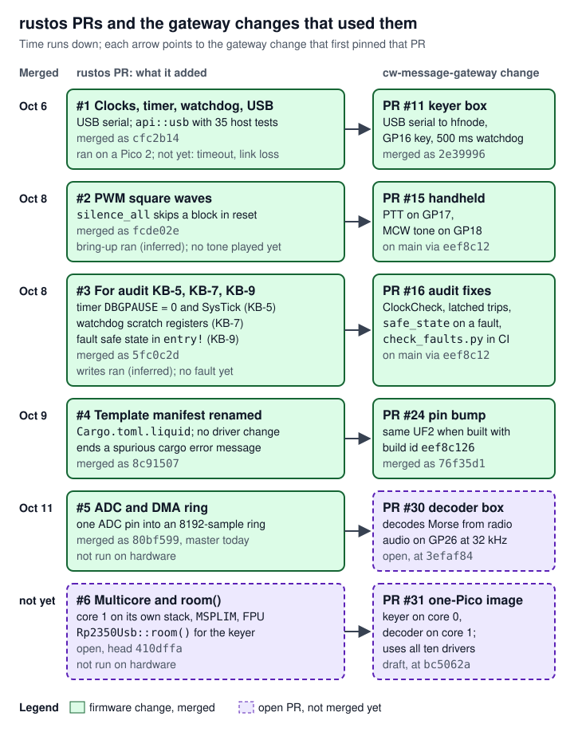

# 08 Changes made for cw-message-gateway

> Every driver in rustos except GPIO was written for cw-message-gateway, the project whose keyer box and decoder box are Pico 2 boards running rustos firmware. Six rustos pull requests carry that work. #1 to #5 are merged on `master` (`80bf599`); #6 (multicore and `Rp2350Usb::room()`) is open at `410dffa`. This page tells, PR by PR, what each added and why the gateway's firmware needed it; which firmware image uses which driver; what has and has not run on a real Pico 2; how the gateway pins rustos by commit and why moving that pin is a firmware change; and which rustos behaviours the keyer's safety depends on. It describes a set of changes rather than one subsystem, so it adapts the page shape: "How it works" is the story of the six PRs, "How it connects" maps drivers to firmware images and explains the pin, "Interfaces and APIs" is one table of the items each PR added and the page that owns each, "Algorithms and processing" keeps only the limits and the fault sequence that run across rustos and the gateway, and "Programming against it" points to the owning pages' examples. Each item's full description is on [02 Boot and runtime](02-boot-runtime.md), [03 The api crate](03-api-crate.md), [04 Drivers: core](04-drivers-core.md), [05 Drivers: GPIO, USB, PWM, ADC, DMA](05-drivers-io.md) and [06 Multicore](06-multicore.md).

Terms used on this page, in plain words (the shared glossary is [17 Glossary][gw-17] in the cw-message-gateway handover; the chip terms are also on [01 Overview](01-overview.md)):

- **Keyer box**: a Pico 2 that turns a radio's transmitter on and off for the gateway's host program `hfnode`, by closing the radio's **key line** through a switch ("key down" = transmitting). It also drives an FM handheld radio's **PTT** (push-to-talk) line and plays **MCW** (Morse sent as an audio tone into the handheld's microphone). **Decoder box**: a separate Pico 2 that listens to a radio's audio and decodes the Morse (cw-message-gateway PR #30, open). **One-Pico image**: one firmware image that runs the keyer on core 0 and the decoder on core 1 of the same Pico 2 (PR #31, draft).
- **Firmware image**, **UF2**: the file flashed onto the board. **Build id**: the first eight characters of the commit CI built from, compiled into the image and reported by the box, so `hfnode` can check it runs the cleared file.
- **Safety audit**: a separate review that clears one exact UF2, by its SHA-256 hash, before it may be flashed or used to key a radio. Its keyer-box findings are numbered KB-1 to KB-14.
- **Pin** (of a dependency): the `rev = "<commit>"` in the firmware's `Cargo.toml` that fixes which rustos commit it builds against.
- **Safe state**: the state of every output that cannot key a radio: key and PTT open, tone off. The keyer reaches it by driving GP16 (key) and GP17 (PTT) low, and low means open only because of the box's wiring: each pin drives an inverting switch (a PC817 optocoupler, or one transistor), and a required external 4.7 kΩ pull-down from the pin to ground holds it low while nothing drives it. A bare Pico pin wired straight to a radio's key contact is graded NO-GO by the safety audit, because every safe state of the box would then key the radio ([`docs/keyer.md:966-976`](https://github.com/robinonsay/cw-message-gateway/blob/44185fa9a00369c379d9d8af40ca307e3867e860/docs/keyer.md#L966-L976), [`docs/keyer.md:981-985`](https://github.com/robinonsay/cw-message-gateway/blob/44185fa9a00369c379d9d8af40ca307e3867e860/docs/keyer.md#L981-L985)). **Never loosen** either part ([13 Safety rules][gw-13]).
- **Watchdog**: a hardware timer that resets the chip unless the program "feeds" it in time. **Scratch registers**: watchdog registers whose contents survive a watchdog reset but not a power-up. **Bootrom**: the chip's built-in first-stage code, which runs before the application after every reset.
- **PWM slice**: one of the RP2350's twelve square-wave generators; `TOP` sets its period and `CC` (compare) the point in each period where the output goes low.
- **DMA ring**: a buffer in RAM that the DMA block fills in a circle without the processor. **Sentinel**: a value the hardware never writes, used to mark a slot as read.
- **SIO**: the RP2350's single-cycle I/O block; its `GPIO_OUT_CLR` register drives any set of pins low with one store. **Pad bits**: each pin's pad has `ISO`, an isolation latch that holds the pin's state; its `IO_BANK0` control register has `OUTOVER`, an override that can force the output low.
- **PLL**, **VCO**: a phase-locked loop multiplies the crystal's frequency up; the VCO is its internal oscillator, which is then divided down.
- **HardFault**, **lockup**: the fault handler of last resort, and the stopped state a core enters when even that handler faults; only a reset ends a lockup. **Secure Privileged**, **Secure Unprivileged**: Arm security and privilege levels; a register that requires a higher level than the code reading it answers with a bus fault.
- **Erratum**: a documented chip bug, numbered in the RP2350 datasheet's errata list (E9 and E12 appear below). **`hangtest`**, **`stucktest`**, **`linktest`**: the gateway's bench tests that make a box hang, hold its key, or lose its host on purpose ([14 Audit, bench and flashing][gw-14]).
- **`MSPLIM`**, **MPU**: a core's stack-limit register and its memory protection unit; see [06 Multicore](06-multicore.md).

## Where it lives

All six PRs have base `master`. GitHub merged #1 to #5 with merge commits, and for each of them the merge commit's tree is identical to the PR head's tree (checked with `git rev-parse <commit>^{tree}`), so the head and the merge hold the same sources. #6 is open at `410dffa`.

| PR | Title | Branch | State and commits | Files added (A) or changed (C) | Diff |
|---|---|---|---|---|---|
| #1 | Pico 2: clocks, timer, watchdog and USB serial drivers | `claude/any-radio-key-jack-wijoc6` | merged 2026-10-06 as `cfc2b14`; head `5bb9199` | A: `api/src/usb/{mod,setup,descriptor,cdc_acm,control,ring}.rs`, `firmware/pico2/src/{clocks,timer,watchdog}.rs`, `firmware/pico2/src/usb/{mod,hw}.rs`. C: `common/{board,reg,reset}.rs`, both crates' `lib.rs`, `README.md` | 17 files, +4,881 −15 |
| #2 | pico2: add PWM square-wave outputs | `claude/any-radio-key-jack-wijoc6` | merged 2026-10-08 as `fcde02e`; head `c1c82c9` | A: `firmware/pico2/src/pwm.rs`. C: `common/{board,reg,reset}.rs`, `gpio/mod.rs`, `lib.rs`, `README.md` | 7 files, +959 −11 |
| #3 | pico2: a timer no debugger pauses, SysTick, app scratch registers, a fault safe state | `claude/keyer-unattended-d05o6i` | merged 2026-10-08 as `5fc0c2d`; head `c985211` | A: `firmware/pico2/src/systick.rs`. C: `timer.rs`, `watchdog.rs`, `lib.rs`, `common/board.rs`, `README.md` | 6 files, +256 −25 |
| #4 | templates: name the pico2 template's manifest Cargo.toml.liquid | `claude/project-thread-ask7sb` | merged 2026-10-09 as `8c91507`; head `6b02215` | renamed `templates/pico2/Cargo.toml` to `Cargo.toml.liquid`; C: `templates/README.md` | 2 files, +7 −1 |
| #5 | pico2 adc, dma: sample an analog pin endlessly into a DMA ring | `claude/pico-decoder-u9bum5` | merged 2026-10-11 as `80bf599` (master); head `e3d8369` | A: `firmware/pico2/src/{adc,dma}.rs`. C: `clocks.rs`, `common/{board,reg}.rs`, `lib.rs`, `README.md` | 7 files, +1,133 −15 |
| #6 | pico2 multicore: start core 1 on its own stack (and usb room) | `claude/pico-decoder-u9bum5` | **open**; commits `3d8af9c`, `422320d`, `410dffa` (head) | A: `api/src/multicore.rs`, `firmware/pico2/src/multicore.rs`. C: `usb/mod.rs`, `common/board.rs`, both crates' `lib.rs`, `README.md` | 7 files, +1,007 −6 |

The modules the six PRs added (`clocks`, `timer`, `systick`, `watchdog`, `usb`, `pwm`, `dma`, `adc`) are declared at [`firmware/pico2/src/lib.rs:110-117`](https://github.com/robinonsay/rustos/blob/80bf5998a60a41b3741041062ff7e9c59caf95b2/firmware/pico2/src/lib.rs#L110-L117) (master) and [`firmware/pico2/src/lib.rs:118`](https://github.com/robinonsay/rustos/blob/410dffa091e247e6e7546c7f2ff465f0af499d5a/firmware/pico2/src/lib.rs#L118) (`multicore`, PR #6 only). The board's device handles they added sit in the `devices` block at [`firmware/pico2/src/common/board.rs:136-143`](https://github.com/robinonsay/rustos/blob/80bf5998a60a41b3741041062ff7e9c59caf95b2/firmware/pico2/src/common/board.rs#L136-L143); PR #6 adds `core1` at [`firmware/pico2/src/common/board.rs:147`](https://github.com/robinonsay/rustos/blob/410dffa091e247e6e7546c7f2ff465f0af499d5a/firmware/pico2/src/common/board.rs#L147). GPIO (`firmware/pico2/src/gpio/`) was written on 2026-08-29 and 2026-08-30, before this project. Its only change since is PR #2's commit `a123f90` (2026-10-07), which made the GPIO register types `IoBank`, `PadsBank` and `GpioRegs` `pub(crate)` for the PWM driver. It is described here only where the gateway relies on it.

## How it works

The gateway's firmware grew in steps, and each step needed something rustos did not yet have. Each rustos PR was opened from the gateway thread that needed it, and the gateway's firmware was pinned to that PR's head and then to master's merge of it. The figure shows the order.



*Figure: time runs down. Each rustos PR is on the left and the gateway change that first pinned it is on the right; dashed purple marks PRs that are still open.*

### #1: clocks, timer, watchdog and USB serial (for the keyer box, gateway PR #11)

The first keyer box (gateway PR #11, "Any radio: key jack keyer box (Pico 2) and headphone audio", merged 2026-10-07) is a Pico 2 that takes text lines from `hfnode` over a USB serial port and keys a radio's key line on GP16. rustos then had only GPIO, so PR #1 added what such a box needs:

- **Clocks** (`clocks.rs`): the 12 MHz crystal, `PLL_SYS` at 150 MHz for the processors and `PLL_USB` at 48 MHz for USB, with every frequency a compile-time constant checked by `const` assertions ([`firmware/pico2/src/clocks.rs:91-118`](https://github.com/robinonsay/rustos/blob/80bf5998a60a41b3741041062ff7e9c59caf95b2/firmware/pico2/src/clocks.rs#L91-L118), [`firmware/pico2/src/clocks.rs:177-187`](https://github.com/robinonsay/rustos/blob/80bf5998a60a41b3741041062ff7e9c59caf95b2/firmware/pico2/src/clocks.rs#L177-L187)). `Rp2350Clocks` is a zero-sized proof that this ran; every driver that needs a frequency takes `&Rp2350Clocks` ([`firmware/pico2/src/clocks.rs:363-372`](https://github.com/robinonsay/rustos/blob/80bf5998a60a41b3741041062ff7e9c59caf95b2/firmware/pico2/src/clocks.rs#L363-L372)).
- **Timer** (`timer.rs`): `TIMER0` counting 1 µs ticks from the crystal, read without a race between its two halves ([`firmware/pico2/src/timer.rs:207-224`](https://github.com/robinonsay/rustos/blob/80bf5998a60a41b3741041062ff7e9c59caf95b2/firmware/pico2/src/timer.rs#L207-L224)). The keyer's software time limits (key-down, run, PTT, link, rest and the duty budget) are all measured on it ([`crates/keyer-core/src/lib.rs:44-101`](https://github.com/robinonsay/cw-message-gateway/blob/44185fa9a00369c379d9d8af40ca307e3867e860/crates/keyer-core/src/lib.rs#L44-L101)); the 500 ms watchdog counts in the watchdog block itself, and the clock check compares the timer with SysTick ([`crates/keyer-core/src/control.rs:86-137`](https://github.com/robinonsay/cw-message-gateway/blob/44185fa9a00369c379d9d8af40ca307e3867e860/crates/keyer-core/src/control.rs#L86-L137)).
- **Watchdog** (`watchdog.rs`): start, feed and force a reset, with a reset scope that resets everything but the oscillators ([`firmware/pico2/src/watchdog.rs:26-63`](https://github.com/robinonsay/rustos/blob/80bf5998a60a41b3741041062ff7e9c59caf95b2/firmware/pico2/src/watchdog.rs#L26-L63)), its debugger pause bits cleared, and a decoded reason for the last reset ([`firmware/pico2/src/watchdog.rs:65-127`](https://github.com/robinonsay/rustos/blob/80bf5998a60a41b3741041062ff7e9c59caf95b2/firmware/pico2/src/watchdog.rs#L65-L127)). The keyer runs it at 500 ms.
- **USB serial** (`usb/`, and `api::usb`): a polled USB CDC-ACM device (the serial-port class that computers open without a driver install). The chip-independent half (SETUP parsing, descriptors, the endpoint-0 state machine, CDC line coding, a byte ring) is in the `api` crate with 35 host unit tests; the register half is `pico2::usb` ([`api/src/usb/mod.rs:98-102`](https://github.com/robinonsay/rustos/blob/80bf5998a60a41b3741041062ff7e9c59caf95b2/api/src/usb/mod.rs#L98-L102)). It reports link loss as an epoch counter, which the keyer uses to end a run the moment USB goes away ([`firmware/pico2/src/usb/mod.rs:164-194`](https://github.com/robinonsay/rustos/blob/80bf5998a60a41b3741041062ff7e9c59caf95b2/firmware/pico2/src/usb/mod.rs#L164-L194)). That path has not run on a chip: bench `linktest` has not run, an unplug is reported as `Suspended` because the board cannot sense VBUS, and whether `SIE_STATUS.CONNECTED` ever falls is unverified ([`firmware/pico2/src/usb/mod.rs:177-190`](https://github.com/robinonsay/rustos/blob/80bf5998a60a41b3741041062ff7e9c59caf95b2/firmware/pico2/src/usb/mod.rs#L177-L190)).
- **Support**: `common::reset::cycle_reset`, which puts a block through a full reset so a driver starts from reset values even after a debugger restarted only the processors ([`firmware/pico2/src/common/reset.rs:230-251`](https://github.com/robinonsay/rustos/blob/80bf5998a60a41b3741041062ff7e9c59caf95b2/firmware/pico2/src/common/reset.rs#L230-L251)); and the register addresses in `RegAddr` ([`firmware/pico2/src/common/reg.rs:57-155`](https://github.com/robinonsay/rustos/blob/80bf5998a60a41b3741041062ff7e9c59caf95b2/firmware/pico2/src/common/reg.rs#L57-L155)).

### #2: PWM square waves (for the handheld's MCW tone, gateway PR #15)

Gateway PR #15 ("Keyer box: drive the UV-K1 handheld through its K-plug (PTT, MCW tone, PTT line)") keys an FM handheld by holding its PTT on GP17 and playing a 700 Hz tone on GP18 into its microphone. PR #2 added the PWM driver for that tone: a fixed-frequency 50 % square wave per pin, switched on and off with `Write<bool>` ([`firmware/pico2/src/pwm.rs:774-804`](https://github.com/robinonsay/rustos/blob/80bf5998a60a41b3741041062ff7e9c59caf95b2/firmware/pico2/src/pwm.rs#L774-L804)). Its three commits show the safety thinking: `a123f90` the driver; `0073788` turned tones off on `Drop` and added `silence_all` for panic and fault handlers, the `NoWrap` error, and disconnecting pins a previous run left on the PWM; `c1c82c9` made `silence_all` write nothing while the PWM block is held in reset ([`firmware/pico2/src/pwm.rs:709-713`](https://github.com/robinonsay/rustos/blob/80bf5998a60a41b3741041062ff7e9c59caf95b2/firmware/pico2/src/pwm.rs#L709-L713)). It also added `common::reset::is_reset_done` ([`firmware/pico2/src/common/reset.rs:211-228`](https://github.com/robinonsay/rustos/blob/80bf5998a60a41b3741041062ff7e9c59caf95b2/firmware/pico2/src/common/reset.rs#L211-L228)) and made the GPIO register structs `pub(crate)` so the PWM driver can route a pin the same way the GPIO driver does.

### #3: a timer no debugger pauses, SysTick, scratch registers, a fault safe state (for the audit's KB-5, KB-7 and KB-9, gateway PR #16)

The safety audit's keyer-box review (project file `audit/req-keyer-box-fixes.md`) found three gaps that needed rustos changes. Gateway PR #16 fixed them on the firmware side, and rustos PR #3 (commit `02b762b`, whose message names "the hardware safety audit's KB-5, KB-7 and KB-9"; the gateway repository was then called `ic-7300-hf-server`) supplied the parts:

| Audit item | The gap | What rustos #3 added | What the gateway firmware does with it |
|---|---|---|---|
| KB-5, "One clock for every limit" | `TIMER0` paused while a debugger halted either core (reset value `0b110`), so halting core 1 froze every keyer limit while core 0 ran on and fed the watchdog. And every time source counted the same tick, so nothing could notice it stopping. | `Rp2350Timer::new` writes `DBGPAUSE` = 0 ([`firmware/pico2/src/timer.rs:194`](https://github.com/robinonsay/rustos/blob/80bf5998a60a41b3741041062ff7e9c59caf95b2/firmware/pico2/src/timer.rs#L194)); a new `Rp2350SysTick`, the core's 24-bit counter run free on the 150 MHz processor clock, a path apart from the tick ([`firmware/pico2/src/systick.rs:1-46`](https://github.com/robinonsay/rustos/blob/80bf5998a60a41b3741041062ff7e9c59caf95b2/firmware/pico2/src/systick.rs#L1-L46)). | `ClockCheck` compares the two every 50 ms and trips the box (`CLOCK`) if they disagree ([`crates/keyer-core/src/control.rs:86-137`](https://github.com/robinonsay/cw-message-gateway/blob/44185fa9a00369c379d9d8af40ca307e3867e860/crates/keyer-core/src/control.rs#L86-L137)). |
| KB-7, "Restarts and trips are not latched" | A trip lived in RAM, so a watchdog reset cleared it. | `Scratch`, `scratch()` and `set_scratch()` for `SCRATCH0` and `SCRATCH1`, the two scratch registers the bootrom does not use ([`firmware/pico2/src/watchdog.rs:129-149`](https://github.com/robinonsay/rustos/blob/80bf5998a60a41b3741041062ff7e9c59caf95b2/firmware/pico2/src/watchdog.rs#L129-L149)). | Every pass saves the trip, whether the transmitter was keyed, and the duty budget there ([`crates/keyer-core/src/keyer.rs:222-239`](https://github.com/robinonsay/cw-message-gateway/blob/44185fa9a00369c379d9d8af40ca307e3867e860/crates/keyer-core/src/keyer.rs#L222-L239)); a watchdog boot comes up tripped ([`crates/keyer-core/src/keyer.rs:406-409`](https://github.com/robinonsay/cw-message-gateway/blob/44185fa9a00369c379d9d8af40ca307e3867e860/crates/keyer-core/src/keyer.rs#L406-L409)). |
| KB-9, "Fault handlers do not open the key" | `OnHardFault` and `DefaultHandler` were `loop {}`, leaving the key as it was until the watchdog reset the chip. | `entry!(main, safe_state = f)`: both handlers call `f` first ([`firmware/pico2/src/lib.rs:380-394`](https://github.com/robinonsay/rustos/blob/80bf5998a60a41b3741041062ff7e9c59caf95b2/firmware/pico2/src/lib.rs#L380-L394)); `entry!(main)` alone names `no_safe_state`, which does nothing. | `safe_state` opens key and PTT with one store, then `silence_all`, then holds the tone pin low; `check_faults.py` checks the order in the built image ([`firmware/pico2-keyer/src/main.rs:236-252`](https://github.com/robinonsay/cw-message-gateway/blob/44185fa9a00369c379d9d8af40ca307e3867e860/firmware/pico2-keyer/src/main.rs#L236-L252)). |

The commit message of `02b762b` says "Nothing here has run on a Pico 2". PR #3's branch merged PR #2's branch in twice (`aab6a5d`, `c985211`), so its head `c985211` holds #1, #2 and #3, which is why the keyer image could pin `c985211` before either PR was merged.

### #4: the template's manifest renamed (for every firmware build, gateway PR #24)

cargo reads every `Cargo.toml` in a git dependency's repository. rustos's application template had one with `name = "{{project-name}}"`, so every firmware build printed `invalid character '{' in package name` at error level and then built fine. PR #4 renamed it `Cargo.toml.liquid`, which cargo-generate 0.23.4 or later turns back into `Cargo.toml` when it generates an application ([`templates/README.md:31-35`](https://github.com/robinonsay/rustos/blob/80bf5998a60a41b3741041062ff7e9c59caf95b2/templates/README.md#L31-L35), [`templates/README.md:8-9`](https://github.com/robinonsay/rustos/blob/80bf5998a60a41b3741041062ff7e9c59caf95b2/templates/README.md#L8-L9)). Nothing in `api` or `pico2` changed: the audit recorded that "rustos c9852112..8c91507 changes only `templates/`" (project file `audit/report.md` §3). Gateway PR #24 moved the keyer's pin to `8c91507`; that move is where the lesson in [Moving the pin can change the UF2](#moving-the-pin-can-change-the-uf2) was learned.

### #5: ADC and DMA (for the decoder box, gateway PR #30)

The decoder box listens to a radio's audio on GP26 at 32,000 samples per second ([`crates/decoder-core/src/lib.rs:39-40`](https://github.com/robinonsay/cw-message-gateway/blob/3efaf842e1aab75354e5e19d0384a703d4d786be/crates/decoder-core/src/lib.rs#L39-L40)). The ADC's own FIFO holds eight results, 250 µs at that rate, far too little to poll beside USB. PR #5 added a DMA driver that resets the DMA block and hands out its sixteen channels as owned tokens, and an ADC driver that runs one channel endlessly from the ADC FIFO into a 16 kB ring of 8192 samples (256 ms at 32 kHz), with overrun detection by sentinel ([`firmware/pico2/src/adc.rs:45-88`](https://github.com/robinonsay/rustos/blob/80bf5998a60a41b3741041062ff7e9c59caf95b2/firmware/pico2/src/adc.rs#L45-L88)). It added `CLK_ADC_HZ` and `start_clk_adc` to the clocks module, leaving `Rp2350Clocks::new` unchanged so that an image without the ADC runs the same clock sequence ([`firmware/pico2/src/clocks.rs:109-112`](https://github.com/robinonsay/rustos/blob/80bf5998a60a41b3741041062ff7e9c59caf95b2/firmware/pico2/src/clocks.rs#L109-L112), [`firmware/pico2/src/clocks.rs:427-443`](https://github.com/robinonsay/rustos/blob/80bf5998a60a41b3741041062ff7e9c59caf95b2/firmware/pico2/src/clocks.rs#L427-L443)). The audit classified it with no separate hardware review: "It is reviewed with whichever firmware image pins it" (project file `audit/report.md` §3). The commit message of `5123db5` says the ring logic was checked in a model (400 seeds × 20,000 reads) and is "Untested on hardware".

### #6: multicore and `Rp2350Usb::room()` (for the one-Pico image, gateway PR #31; open)

Robin (the project owner) chose on 2026-10-11 to run the decoder on core 1 of the keyer box's own Pico 2. PR #6 adds the code that starts core 1: a portable, never-blocking launch handshake in `api::multicore` with nine host tests, and `pico2::multicore`, which starts core 1 on a static stack with a time limit, sets core 1's stack limit before its first push, and turns on its floating-point unit ([`firmware/pico2/src/multicore.rs:44-68`](https://github.com/robinonsay/rustos/blob/410dffa091e247e6e7546c7f2ff465f0af499d5a/firmware/pico2/src/multicore.rs#L44-L68)). Its second commit aligns core 1's stack to 32 bytes so one MPU region can cover it exactly; its third adds `Rp2350Usb::room()`, which the keyer needs to forward a decoder line only when a whole keyer reply still fits behind it ([`firmware/pico2/src/usb/mod.rs:482-495`](https://github.com/robinonsay/rustos/blob/410dffa091e247e6e7546c7f2ff465f0af499d5a/firmware/pico2/src/usb/mod.rs#L482-L495)). The commit message of `3d8af9c` says "Untested on hardware". Full description: [06 Multicore](06-multicore.md).

### What has run on a Pico 2

The only hardware run on record is the audited keyer image, build id `eef8c126` (gateway `eef8c12`, which pins rustos `c985211`, PR #3's head: its `api` and `pico2` sources are those of master's merges of #3 and #4). Before it, at 16:08Z on 2026-10-09, an unchecked UF2 was copied to the bare Pico 2, possibly the unaudited build `7f91ed67`; at 16:10Z it was replaced with the audited file (SHA-256 `f548596b…`) before anything was wired (project file `bench/quansheng.md`, log of 2026-10-09). On 2026-10-09 Robin flashed that UF2 onto a bare Pico 2 with no radio attached. `hfnode devices` listed it as `USB 2E8A:0009 hfnode, PICO2-KEYER, 1`, and `hfnode keyer check` reported "all ok; nothing was keyed": protocol 4, the limits as audited, build `eef8c126`, up 151 s, last started by POWER, key up, PTT up, idle, PTT line high (project file `bench/quansheng.md`, stage 2 and its log). The cw-message-gateway side of that run is on [14 Audit, bench and flashing][gw-14].

| rustos code | Status on hardware | Evidence or reason |
|---|---|---|
| #1 clocks, timer, USB enumeration and serial | **Ran** | The box enumerated with its configured strings and answered `keyer check`. `Rp2350Usb::new` waits on the timer ([`firmware/pico2/src/usb/mod.rs:402-403`](https://github.com/robinonsay/rustos/blob/80bf5998a60a41b3741041062ff7e9c59caf95b2/firmware/pico2/src/usb/mod.rs#L402-L403)), which waits on the clocks. |
| #1 watchdog start and feed | **Ran** | Started at [`firmware/pico2-keyer/src/main.rs:216`](https://github.com/robinonsay/cw-message-gateway/blob/44185fa9a00369c379d9d8af40ca307e3867e860/firmware/pico2-keyer/src/main.rs#L216); the box stayed up 151 s and still reported POWER as its last start, so it was fed and did not reset. |
| #1 watchdog timeout reset, reset reason after a timeout | Not yet | Exercised by `hangtest` in bench stage 7, which has not run. |
| #1 USB link loss (`link_epoch` on unplug, suspend, bus reset) | Not yet | Bench `linktest` (stage 7) has not run. An unplug is reported as `Suspended`, and whether `CONNECTED` ever falls with VBUS forced is unverified ([`firmware/pico2/src/usb/mod.rs:177-190`](https://github.com/robinonsay/rustos/blob/80bf5998a60a41b3741041062ff7e9c59caf95b2/firmware/pico2/src/usb/mod.rs#L177-L190)). |
| #2 PWM bring-up (`Rp2350Pwm::new`, `square_from_handle`) | **Ran** (inferred) | The keyer unwraps `square_from_handle` at [`firmware/pico2-keyer/src/main.rs:191`](https://github.com/robinonsay/cw-message-gateway/blob/44185fa9a00369c379d9d8af40ca307e3867e860/firmware/pico2-keyer/src/main.rs#L191), before USB starts at line 204; a `NoWrap` error would have panicked before the box could enumerate. |
| #2 a tone actually playing, `silence_all` | Not yet | No MCW keying has run; no fault has been triggered on a chip. |
| #3 `DBGPAUSE` = 0, SysTick | **Ran** (the writes; inferred) | Both constructors run before USB ([`firmware/pico2-keyer/src/main.rs:194-195`](https://github.com/robinonsay/cw-message-gateway/blob/44185fa9a00369c379d9d8af40ca307e3867e860/firmware/pico2-keyer/src/main.rs#L194-L195)). The record lists no trip. Nothing tested a debugger halt or a stopped tick. |
| #3 scratch registers | Write path ran | `set_scratch` runs every pass. Reading them back after a watchdog reset waits for `hangtest` (stage 7). |
| #3 fault safe state | Not on a chip | Checked in the built ELF by `check_faults.py` in CI ([`firmware/pico2-keyer/check_faults.py:1-29`](https://github.com/robinonsay/cw-message-gateway/blob/44185fa9a00369c379d9d8af40ca307e3867e860/firmware/pico2-keyer/check_faults.py#L1-L29)); no fault has been raised on a chip. |
| #4 template | Not code | |
| #5 ADC and DMA | **No** | The decoder box image (gateway PR #30 at `3efaf842`, SHA-256 `9970b5f5…`) is cleared to flash on a plain Pico 2, but no record of it being flashed was found in the project files read for this page. |
| #6 multicore, `room()` | **No** | "Untested on hardware" (commit `3d8af9c`). The one-Pico image (PR #31 at `bc5062ae`, SHA-256 `9ea00c58…51a7`) is cleared to flash only after PR #31 merges. |

## How it connects

rustos has no wire format; what crosses the boundary is the crate API, the linker script and the template ([01 Overview](01-overview.md) covers those). The gateway's three firmware images are its only users.

### Which image uses which driver


*Figure: a filled dot means the image constructs that driver. The two right-hand columns, and the multicore row, are on open PRs.*

Where each image constructs each driver (an empty cell: not used):

| Driver (added by) | Keyer box, gateway main `44185fa`, rustos `8c91507` | Decoder box, gateway PR #30 at `3efaf84` (open), rustos `80bf599` | One-Pico image, gateway PR #31 at `bc5062a` (draft), rustos `410dffa` |
|---|---|---|---|
| `gpio` (before this project) | [`firmware/pico2-keyer/src/main.rs:176-186`](https://github.com/robinonsay/cw-message-gateway/blob/44185fa9a00369c379d9d8af40ca307e3867e860/firmware/pico2-keyer/src/main.rs#L176-L186) | [`firmware/pico2-decoder/src/main.rs:144-150`](https://github.com/robinonsay/cw-message-gateway/blob/3efaf842e1aab75354e5e19d0384a703d4d786be/firmware/pico2-decoder/src/main.rs#L144-L150) | [`firmware/pico2-keyer/src/main.rs:240-251`](https://github.com/robinonsay/cw-message-gateway/blob/bc5062ae4f56ae1f9949b3b067218c7e675d88f8/firmware/pico2-keyer/src/main.rs#L240-L251) |
| `clocks` (#1; `CLK_ADC_HZ` #5) | [`firmware/pico2-keyer/src/main.rs:188`](https://github.com/robinonsay/cw-message-gateway/blob/44185fa9a00369c379d9d8af40ca307e3867e860/firmware/pico2-keyer/src/main.rs#L188) | [`firmware/pico2-decoder/src/main.rs:154`](https://github.com/robinonsay/cw-message-gateway/blob/3efaf842e1aab75354e5e19d0384a703d4d786be/firmware/pico2-decoder/src/main.rs#L154) | [`firmware/pico2-keyer/src/main.rs:253`](https://github.com/robinonsay/cw-message-gateway/blob/bc5062ae4f56ae1f9949b3b067218c7e675d88f8/firmware/pico2-keyer/src/main.rs#L253) |
| `timer` (#1; `DBGPAUSE` #3) | [`firmware/pico2-keyer/src/main.rs:194`](https://github.com/robinonsay/cw-message-gateway/blob/44185fa9a00369c379d9d8af40ca307e3867e860/firmware/pico2-keyer/src/main.rs#L194) | [`firmware/pico2-decoder/src/main.rs:155`](https://github.com/robinonsay/cw-message-gateway/blob/3efaf842e1aab75354e5e19d0384a703d4d786be/firmware/pico2-decoder/src/main.rs#L155) | [`firmware/pico2-keyer/src/main.rs:259-263`](https://github.com/robinonsay/cw-message-gateway/blob/bc5062ae4f56ae1f9949b3b067218c7e675d88f8/firmware/pico2-keyer/src/main.rs#L259-L263), shared with core 1 as `&'static` |
| `systick` (#3) | [`firmware/pico2-keyer/src/main.rs:195`](https://github.com/robinonsay/cw-message-gateway/blob/44185fa9a00369c379d9d8af40ca307e3867e860/firmware/pico2-keyer/src/main.rs#L195) | | [`firmware/pico2-keyer/src/main.rs:264`](https://github.com/robinonsay/cw-message-gateway/blob/bc5062ae4f56ae1f9949b3b067218c7e675d88f8/firmware/pico2-keyer/src/main.rs#L264) |
| `watchdog` (#1; scratch #3) | [`firmware/pico2-keyer/src/main.rs:196-216`](https://github.com/robinonsay/cw-message-gateway/blob/44185fa9a00369c379d9d8af40ca307e3867e860/firmware/pico2-keyer/src/main.rs#L196-L216), scratch read at 198-201 and written at [`firmware/pico2-keyer/src/main.rs:127-130`](https://github.com/robinonsay/cw-message-gateway/blob/44185fa9a00369c379d9d8af40ca307e3867e860/firmware/pico2-keyer/src/main.rs#L127-L130) | [`firmware/pico2-decoder/src/main.rs:156-169`](https://github.com/robinonsay/cw-message-gateway/blob/3efaf842e1aab75354e5e19d0384a703d4d786be/firmware/pico2-decoder/src/main.rs#L156-L169), no scratch | [`firmware/pico2-keyer/src/main.rs:265-285`](https://github.com/robinonsay/cw-message-gateway/blob/bc5062ae4f56ae1f9949b3b067218c7e675d88f8/firmware/pico2-keyer/src/main.rs#L265-L285), scratch as on main |
| `usb` (#1; `room()` #6) | [`firmware/pico2-keyer/src/main.rs:204`](https://github.com/robinonsay/cw-message-gateway/blob/44185fa9a00369c379d9d8af40ca307e3867e860/firmware/pico2-keyer/src/main.rs#L204) | [`firmware/pico2-decoder/src/main.rs:182`](https://github.com/robinonsay/cw-message-gateway/blob/3efaf842e1aab75354e5e19d0384a703d4d786be/firmware/pico2-decoder/src/main.rs#L182) | [`firmware/pico2-keyer/src/main.rs:273`](https://github.com/robinonsay/cw-message-gateway/blob/bc5062ae4f56ae1f9949b3b067218c7e675d88f8/firmware/pico2-keyer/src/main.rs#L273); `room()` at [`firmware/pico2-keyer/src/main.rs:197-199`](https://github.com/robinonsay/cw-message-gateway/blob/bc5062ae4f56ae1f9949b3b067218c7e675d88f8/firmware/pico2-keyer/src/main.rs#L197-L199) |
| `pwm` (#2) | [`firmware/pico2-keyer/src/main.rs:190-192`](https://github.com/robinonsay/cw-message-gateway/blob/44185fa9a00369c379d9d8af40ca307e3867e860/firmware/pico2-keyer/src/main.rs#L190-L192); `silence_all` at [`firmware/pico2-keyer/src/main.rs:250`](https://github.com/robinonsay/cw-message-gateway/blob/44185fa9a00369c379d9d8af40ca307e3867e860/firmware/pico2-keyer/src/main.rs#L250) | | [`firmware/pico2-keyer/src/main.rs:255-257`](https://github.com/robinonsay/cw-message-gateway/blob/bc5062ae4f56ae1f9949b3b067218c7e675d88f8/firmware/pico2-keyer/src/main.rs#L255-L257); `silence_all` at [`firmware/pico2-keyer/src/main.rs:352`](https://github.com/robinonsay/cw-message-gateway/blob/bc5062ae4f56ae1f9949b3b067218c7e675d88f8/firmware/pico2-keyer/src/main.rs#L352) |
| `dma` (#5) | | [`firmware/pico2-decoder/src/main.rs:170`](https://github.com/robinonsay/cw-message-gateway/blob/3efaf842e1aab75354e5e19d0384a703d4d786be/firmware/pico2-decoder/src/main.rs#L170) | [`firmware/pico2-keyer/src/main.rs:291`](https://github.com/robinonsay/cw-message-gateway/blob/bc5062ae4f56ae1f9949b3b067218c7e675d88f8/firmware/pico2-keyer/src/main.rs#L291) |
| `adc` (#5) | | [`firmware/pico2-decoder/src/main.rs:171-179`](https://github.com/robinonsay/cw-message-gateway/blob/3efaf842e1aab75354e5e19d0384a703d4d786be/firmware/pico2-decoder/src/main.rs#L171-L179) | [`firmware/pico2-keyer/src/main.rs:292-294`](https://github.com/robinonsay/cw-message-gateway/blob/bc5062ae4f56ae1f9949b3b067218c7e675d88f8/firmware/pico2-keyer/src/main.rs#L292-L294), through [`firmware/pico2-keyer/src/core1.rs:88-102`](https://github.com/robinonsay/cw-message-gateway/blob/bc5062ae4f56ae1f9949b3b067218c7e675d88f8/firmware/pico2-keyer/src/core1.rs#L88-L102) |
| `multicore` (#6) | | | [`firmware/pico2-keyer/src/main.rs:306-308`](https://github.com/robinonsay/cw-message-gateway/blob/bc5062ae4f56ae1f9949b3b067218c7e675d88f8/firmware/pico2-keyer/src/main.rs#L306-L308); core 1's stack at [`firmware/pico2-keyer/src/core1.rs:64-65`](https://github.com/robinonsay/cw-message-gateway/blob/bc5062ae4f56ae1f9949b3b067218c7e675d88f8/firmware/pico2-keyer/src/core1.rs#L64-L65) |

All three name a safe state in `entry!` ([`firmware/pico2-keyer/src/main.rs:60`](https://github.com/robinonsay/cw-message-gateway/blob/44185fa9a00369c379d9d8af40ca307e3867e860/firmware/pico2-keyer/src/main.rs#L60), [`firmware/pico2-decoder/src/main.rs:45`](https://github.com/robinonsay/cw-message-gateway/blob/3efaf842e1aab75354e5e19d0384a703d4d786be/firmware/pico2-decoder/src/main.rs#L45), [`firmware/pico2-keyer/src/main.rs:75`](https://github.com/robinonsay/cw-message-gateway/blob/bc5062ae4f56ae1f9949b3b067218c7e675d88f8/firmware/pico2-keyer/src/main.rs#L75)). How each image uses its drivers is on the cw-message-gateway pages [08 Keyer box: firmware and protocol][gw-08] and [11 Decoder box and the one-Pico image][gw-11].

After start-up, every rustos call the keyer makes goes through one trait, `keyer_core::Hardware`, which the firmware's `Board` implements: `now_ms` is `timer.now() / 1000`, `cpu_cycles` is `systick.cycles()`, `save` is two `set_scratch` calls, `usb_poll`, `link_epoch`, `usb_read` and `usb_write` are the `Rp2350Usb` methods `poll`, `link_epoch`, `read` and `write`, `set_tone` is `Rp2350PwmSquare::write`, and `feed_watchdog` is `feed` ([`firmware/pico2-keyer/src/main.rs:116-172`](https://github.com/robinonsay/cw-message-gateway/blob/44185fa9a00369c379d9d8af40ca307e3867e860/firmware/pico2-keyer/src/main.rs#L116-L172)). The method-by-method table is on [08 Keyer box: firmware and protocol][gw-08]; the one-Pico image adds `usb_room`, which is `room()` (PR #31, draft; see [11 Decoder box and the one-Pico image][gw-11]).

### How the firmware pins rustos

Each firmware crate depends on `api` and `pico2` as git dependencies pinned by `rev`. The keyer's pin was set once and moved five times as rustos grew; the decoder crate (PR #30) started at `80bf599`:

| Gateway commit | Date | Gateway PR | Manifest | rustos pin | What that pin is |
|---|---|---|---|---|---|
| `7b5723c` | 2026-10-05 | #11 (branch) | [`firmware/pico2-keyer/Cargo.toml:23-24`](https://github.com/robinonsay/cw-message-gateway/blob/7b5723c7f63e0764406a8fb99f7fabafddf57471/firmware/pico2-keyer/Cargo.toml#L23-L24) | `5bb9199` | head of rustos #1, before it merged |
| `cf81687` | 2026-10-06 | #11 (head; merged 2026-10-07 as `2e39996`) | [`firmware/pico2-keyer/Cargo.toml:24-25`](https://github.com/robinonsay/cw-message-gateway/blob/cf81687a684aa831c9af53a12d8e9b97c7075cd2/firmware/pico2-keyer/Cargo.toml#L24-L25) | `cfc2b14` | master's merge of #1 |
| `5a77cee` | 2026-10-08 | #15 (first PWM use) | [`firmware/pico2-keyer/Cargo.toml:24-25`](https://github.com/robinonsay/cw-message-gateway/blob/5a77ceedbeba81feca36a7815a2955e0010fba74/firmware/pico2-keyer/Cargo.toml#L24-L25) | `c1c82c9` | head of rustos #2 |
| `7188469` | 2026-10-08 | #16 | [`firmware/pico2-keyer/Cargo.toml:27-28`](https://github.com/robinonsay/cw-message-gateway/blob/7188469468d1d94ea368ac9598a9c82199c3b458/firmware/pico2-keyer/Cargo.toml#L27-L28) | `c985211` | head of rustos #3 (holds #1-#3) |
| `9dcd7b1` | 2026-10-09 | #24 (merged 2026-10-09 as `76f35d1`) | [`firmware/pico2-keyer/Cargo.toml:30-31`](https://github.com/robinonsay/cw-message-gateway/blob/9dcd7b18ad6e6ef4ba28026e1ea3ae05a77974f7/firmware/pico2-keyer/Cargo.toml#L30-L31) | `8c91507` | master's merge of #4; on main today ([`firmware/pico2-keyer/Cargo.toml:21-31`](https://github.com/robinonsay/cw-message-gateway/blob/44185fa9a00369c379d9d8af40ca307e3867e860/firmware/pico2-keyer/Cargo.toml#L21-L31)) |
| `76c60ef` | 2026-10-11 | #30 (decoder crate, new) | [`firmware/pico2-decoder/Cargo.toml:24-25`](https://github.com/robinonsay/cw-message-gateway/blob/76c60eff93c0b434371b8337400fc4b493b4ab3a/firmware/pico2-decoder/Cargo.toml#L24-L25) | `80bf599` | master's merge of #5; unchanged at PR #30's head ([`firmware/pico2-decoder/Cargo.toml:21-25`](https://github.com/robinonsay/cw-message-gateway/blob/3efaf842e1aab75354e5e19d0384a703d4d786be/firmware/pico2-decoder/Cargo.toml#L21-L25)) |
| `b570317` | 2026-10-11 | #31 (keyer crate) | [`firmware/pico2-keyer/Cargo.toml:30-31`](https://github.com/robinonsay/cw-message-gateway/blob/b570317eedba55f6632a07b930b9f35e2797e37d/firmware/pico2-keyer/Cargo.toml#L30-L31) | `410dffa` | head of rustos #6, open; "To be moved to master's merge of rustos #6 once it is merged" ([`firmware/pico2-keyer/Cargo.toml:24-31`](https://github.com/robinonsay/cw-message-gateway/blob/bc5062ae4f56ae1f9949b3b067218c7e675d88f8/firmware/pico2-keyer/Cargo.toml#L24-L31)) |

Gateway PRs #12 to #16 were merged within one minute on 2026-10-08 (12:38:56Z to 12:39:18Z, by GitHub's merge times). #13's commits reached `main` through `62cde5f`, PR #12's merge (#12's branch had merged #13's head `bf03b4b`); #15's and #16's reached it through `eef8c12`, PR #14's merge. `eef8c12` is the commit the audited keyer image `eef8c126` was built from, so the image on the bench pins `c985211`.

A rustos merge changes nothing in the gateway until someone moves a pin. An application generated from the template is different: it follows rustos's default branch unpinned ([`templates/pico2/Cargo.toml.liquid:10-12`](https://github.com/robinonsay/rustos/blob/80bf5998a60a41b3741041062ff7e9c59caf95b2/templates/pico2/Cargo.toml.liquid#L10-L12)).

### Moving the pin can change the UF2

The keyer's manifest says it in its own words: "Moving this pin can change the UF2 with no source change, since cargo mixes the commit into the crate hashes that order the code. This one does not: built with the same build id, the UF2 is byte for byte the audited one" ([`firmware/pico2-keyer/Cargo.toml:27-29`](https://github.com/robinonsay/cw-message-gateway/blob/44185fa9a00369c379d9d8af40ca307e3867e860/firmware/pico2-keyer/Cargo.toml#L27-L29)). What was found when the pin moved to rustos #4:

- **The commit alone can move code.** cargo hashes a git dependency's commit into the crate's metadata hash, which goes into every symbol name, and the linker lays code out in an order that follows those names. Pinning `6b02215`, PR #4's head, whose tree is identical to `8c91507`, moved 46,030 bytes of the UF2 (`rust_begin_unwind` moved before `main`); pinning `8c91507` moved none (project note `rustos-template-cargo-error.md`). The same mechanism is why `build.sh` builds at one fixed path: a dependency outside the firmware's workspace has its absolute path hashed the same way ([`firmware/pico2-keyer/build.sh:7-14`](https://github.com/robinonsay/cw-message-gateway/blob/44185fa9a00369c379d9d8af40ca307e3867e860/firmware/pico2-keyer/build.sh#L7-L14)).
- **The build id moves bytes too.** `build.sh` compiles the commit's first eight characters into the image ([`firmware/pico2-keyer/build.sh:22`](https://github.com/robinonsay/cw-message-gateway/blob/44185fa9a00369c379d9d8af40ca307e3867e860/firmware/pico2-keyer/build.sh#L22), [`firmware/pico2-keyer/build.sh:34`](https://github.com/robinonsay/cw-message-gateway/blob/44185fa9a00369c379d9d8af40ca307e3867e860/firmware/pico2-keyer/build.sh#L34)). The audit built main `76f35d1` (pin `8c91507`) both ways: with build id `eef8c126` it gave the audited UF2, SHA-256 `f548596b…`, byte for byte; with main's own id `76f35d1e` it gave `36488b57…`, which differs in 28 bytes of layout and is not cleared for flashing (project file `audit/report.md` §3, PR #24 entry). The box therefore still runs `eef8c126`.
- **The lesson.** Never assume either way. Rebuild at the audited build id and compare byte for byte. Any pin move is a new head of the firmware, and the UF2 from that head needs a fresh audit and a new hash before it is flashed. The audit says the same of PR #31: "The rustos #6 re-pin needs a new hash" (project file `audit/report.md` §3).

## Interfaces and APIs

This page does not repeat the API reference. The table lists what the six PRs made public, the PR that added each item, the page that owns its full reference (signatures, units, ranges, errors and the algorithm, each with permalinks), and one line on what it is for the gateway. Master is `80bf599`; PR #6 items are at `410dffa` and are **not on master**. Constructors take the board's `DeviceHandle<T>` by value, so each runs at most once per boot (the ownership model is on [01 Overview](01-overview.md)). Which firmware image constructs which driver is under [Which image uses which driver](#which-image-uses-which-driver).

| Item | PR | Owning page | One-line summary |
|---|---|---|---|
| `pico2::clocks`: `Rp2350Clocks::new`, `PllConfig`, `PLL_SYS_CONFIG`, `PLL_USB_CONFIG`, `XOSC_HZ`, `CLK_REF_HZ`, `CLK_SYS_HZ`, `CLK_PERI_HZ`, `CLK_USB_HZ`, `PLL_SYS_VCO_HZ`, `PLL_USB_VCO_HZ` ([`firmware/pico2/src/clocks.rs:91-187`](https://github.com/robinonsay/rustos/blob/80bf5998a60a41b3741041062ff7e9c59caf95b2/firmware/pico2/src/clocks.rs#L91-L187), [`firmware/pico2/src/clocks.rs:370-386`](https://github.com/robinonsay/rustos/blob/80bf5998a60a41b3741041062ff7e9c59caf95b2/firmware/pico2/src/clocks.rs#L370-L386)) | #1 | [04 Drivers: core](04-drivers-core.md) | The 12 MHz crystal, `clk_sys` at 150 MHz and `clk_usb` at 48 MHz, every frequency checked by `const` assertions (erratum E12 among them); `Rp2350Clocks` is the zero-sized proof every timed driver takes. |
| `clocks::CLK_ADC_HZ`, `clocks::start_clk_adc` (`pub(crate)`) ([`firmware/pico2/src/clocks.rs:109-112`](https://github.com/robinonsay/rustos/blob/80bf5998a60a41b3741041062ff7e9c59caf95b2/firmware/pico2/src/clocks.rs#L109-L112), [`firmware/pico2/src/clocks.rs:427-443`](https://github.com/robinonsay/rustos/blob/80bf5998a60a41b3741041062ff7e9c59caf95b2/firmware/pico2/src/clocks.rs#L427-L443)) | #5 | [04 Drivers: core](04-drivers-core.md) | `clk_adc` at 48 MHz from `PLL_USB`, started only by `Rp2350Adc::new`, so an image without the ADC runs the same clock sequence as before. |
| `pico2::timer`: `Rp2350Timer::new`, `now`, `elapsed_since`, `delay_us`, `delay_ms`, `TICK_CYCLES` ([`firmware/pico2/src/timer.rs:68`](https://github.com/robinonsay/rustos/blob/80bf5998a60a41b3741041062ff7e9c59caf95b2/firmware/pico2/src/timer.rs#L68), [`firmware/pico2/src/timer.rs:172-252`](https://github.com/robinonsay/rustos/blob/80bf5998a60a41b3741041062ff7e9c59caf95b2/firmware/pico2/src/timer.rs#L172-L252)) | #1 | [04 Drivers: core](04-drivers-core.md) | Microseconds since `new`, read without a race from either core; the keyer measures its software limits (key-down, run, PTT, link, rest, duty budget) on it ([`crates/keyer-core/src/lib.rs:44-101`](https://github.com/robinonsay/cw-message-gateway/blob/44185fa9a00369c379d9d8af40ca307e3867e860/crates/keyer-core/src/lib.rs#L44-L101)). |
| `Rp2350Timer::new` writes `DBGPAUSE` = 0 ([`firmware/pico2/src/timer.rs:194`](https://github.com/robinonsay/rustos/blob/80bf5998a60a41b3741041062ff7e9c59caf95b2/firmware/pico2/src/timer.rs#L194)) | #3 | [04 Drivers: core](04-drivers-core.md) | Audit KB-5: a debugger that halts one core no longer freezes the time the other core reads. **Never loosen:** do not restore the pause bits. |
| `pico2::systick`: `Rp2350SysTick::new`, `cycles`, `CYCLES_MASK`, `CYCLES_PER_MS` ([`firmware/pico2/src/systick.rs:77-117`](https://github.com/robinonsay/rustos/blob/80bf5998a60a41b3741041062ff7e9c59caf95b2/firmware/pico2/src/systick.rs#L77-L117)) | #3 | [04 Drivers: core](04-drivers-core.md) | A 24-bit count of the 150 MHz processor clock, a path apart from the 1 µs tick; the keyer's `ClockCheck` compares it with the timer once either has run 50 ms and trips `CLOCK` if they disagree ([`crates/keyer-core/src/control.rs:86-137`](https://github.com/robinonsay/cw-message-gateway/blob/44185fa9a00369c379d9d8af40ca307e3867e860/crates/keyer-core/src/control.rs#L86-L137)). |
| `pico2::watchdog`: `Rp2350Watchdog::new`, `start`, `feed`, `force_reset`, `reset_reason`, `reset_snapshot`, `time_remaining_us`, `is_running`; `ResetReason`, `ForcedBy`, `ChipResetCause`, `ResetSnapshot`, `MAX_TIMEOUT_US`, `SCRATCH_MARKER` ([`firmware/pico2/src/watchdog.rs:213-217`](https://github.com/robinonsay/rustos/blob/80bf5998a60a41b3741041062ff7e9c59caf95b2/firmware/pico2/src/watchdog.rs#L213-L217), [`firmware/pico2/src/watchdog.rs:364-427`](https://github.com/robinonsay/rustos/blob/80bf5998a60a41b3741041062ff7e9c59caf95b2/firmware/pico2/src/watchdog.rs#L364-L427), [`firmware/pico2/src/watchdog.rs:482-611`](https://github.com/robinonsay/rustos/blob/80bf5998a60a41b3741041062ff7e9c59caf95b2/firmware/pico2/src/watchdog.rs#L482-L611)) | #1 | [04 Drivers: core](04-drivers-core.md) | Start, feed and force a reset, with a reset scope that spares only the oscillators, the pause bits cleared, and the reason for the last reset told apart by a marker in `SCRATCH4`. The keyer starts it at 500 ms ([`firmware/pico2-keyer/src/main.rs:216`](https://github.com/robinonsay/cw-message-gateway/blob/44185fa9a00369c379d9d8af40ca307e3867e860/firmware/pico2-keyer/src/main.rs#L216)); a watchdog boot comes up tripped. |
| `Scratch`, `scratch`, `set_scratch` ([`firmware/pico2/src/watchdog.rs:354-362`](https://github.com/robinonsay/rustos/blob/80bf5998a60a41b3741041062ff7e9c59caf95b2/firmware/pico2/src/watchdog.rs#L354-L362), [`firmware/pico2/src/watchdog.rs:564-576`](https://github.com/robinonsay/rustos/blob/80bf5998a60a41b3741041062ff7e9c59caf95b2/firmware/pico2/src/watchdog.rs#L564-L576)) | #3 | [04 Drivers: core](04-drivers-core.md) | Audit KB-7: `SCRATCH0` and `SCRATCH1` survive a watchdog reset, so the keyer's saved state does too: a restart keeps any trip and does not refill the duty budget ([`crates/keyer-core/src/keyer.rs:398-435`](https://github.com/robinonsay/cw-message-gateway/blob/44185fa9a00369c379d9d8af40ca307e3867e860/crates/keyer-core/src/keyer.rs#L398-L435); the encoding is on [08 Keyer box: firmware and protocol][gw-08]). |
| `pico2::usb`: `Rp2350Usb::new`, `poll`, `read`, `write`, `is_configured`, `is_suspended`, `link_up`, `link_epoch`, `last_link_event`, `line_coding`, `dtr`, `rts`, `impl Read<u8>` and `Write<u8>`; `LinkEvent`, `UsbError`, `RX_BUFFER_SIZE` and `TX_BUFFER_SIZE` (512 each) ([`firmware/pico2/src/usb/mod.rs:248-304`](https://github.com/robinonsay/rustos/blob/80bf5998a60a41b3741041062ff7e9c59caf95b2/firmware/pico2/src/usb/mod.rs#L248-L304), [`firmware/pico2/src/usb/mod.rs:352-531`](https://github.com/robinonsay/rustos/blob/80bf5998a60a41b3741041062ff7e9c59caf95b2/firmware/pico2/src/usb/mod.rs#L352-L531)) | #1 | [05 Drivers: GPIO, USB, PWM, ADC, DMA](05-drivers-io.md) | A polled USB serial port (CDC-ACM) that never waits for the host. `link_epoch` lets the keyer end a run the moment the link goes; whether an unplug is seen has not been checked on a chip (see [What has run on a Pico 2](#what-has-run-on-a-pico-2)). |
| `api::usb::{setup, descriptor, cdc_acm, control, ring}`, `control_in_needs_zlp`, `bulk_in_needs_zlp`, `UsbDeviceConfig` ([`api/src/usb/mod.rs:98-102`](https://github.com/robinonsay/rustos/blob/80bf5998a60a41b3741041062ff7e9c59caf95b2/api/src/usb/mod.rs#L98-L102)) | #1 | [03 The api crate](03-api-crate.md) | The chip-independent half of the USB device (SETUP parsing, descriptors, the endpoint-0 state machine, CDC line coding, a byte ring), with 35 host unit tests. |
| `Rp2350Usb::room()` ([`firmware/pico2/src/usb/mod.rs:482-495`](https://github.com/robinonsay/rustos/blob/410dffa091e247e6e7546c7f2ff465f0af499d5a/firmware/pico2/src/usb/mod.rs#L482-L495), PR #6 only) | #6 | [05 Drivers: GPIO, USB, PWM, ADC, DMA](05-drivers-io.md) | How many bytes `write` would take now, 0 while not configured. The one-Pico keyer forwards a decoder line only when the line, its newline and a whole keyer reply all fit, so a reply is never cut short ([`crates/keyer-core/src/control.rs:641`](https://github.com/robinonsay/cw-message-gateway/blob/bc5062ae4f56ae1f9949b3b067218c7e675d88f8/crates/keyer-core/src/control.rs#L641), PR #31, draft). |
| `common::reset::cycle_reset` (#1), `common::reset::is_reset_done` (#2), the new `RegAddr` variants, the board handles `clocks`, `timer`, `watchdog`, `usb` (#1), `pwm` (#2), `systick` (#3), `dma`, `adc` (#5) and `core1` (#6) ([`firmware/pico2/src/common/reset.rs:211-251`](https://github.com/robinonsay/rustos/blob/80bf5998a60a41b3741041062ff7e9c59caf95b2/firmware/pico2/src/common/reset.rs#L211-L251), [`firmware/pico2/src/common/reg.rs:57-155`](https://github.com/robinonsay/rustos/blob/80bf5998a60a41b3741041062ff7e9c59caf95b2/firmware/pico2/src/common/reg.rs#L57-L155), [`firmware/pico2/src/common/board.rs:136-143`](https://github.com/robinonsay/rustos/blob/80bf5998a60a41b3741041062ff7e9c59caf95b2/firmware/pico2/src/common/board.rs#L136-L143), [`firmware/pico2/src/common/board.rs:147`](https://github.com/robinonsay/rustos/blob/410dffa091e247e6e7546c7f2ff465f0af499d5a/firmware/pico2/src/common/board.rs#L147)) | #1, #2, #3, #5, #6 | [04 Drivers: core](04-drivers-core.md) | A full block reset so each driver starts from reset values even after a processor-only restart; a one-read reset check that `silence_all` uses; the register addresses; one handle per driver, each taken once per boot. |
| `pico2::pwm`: `Rp2350Pwm::new`, `square_from_handle`, `Rp2350PwmSquare` (`impl Write<bool>`, `Drop`, `frequency_hz`), `SquareConfig`, `Channel`, `gpio_to_slice`, `gpio_to_channel`, `PwmError`, `MIN_FREQUENCY_HZ`, `MAX_FREQUENCY_HZ` ([`firmware/pico2/src/pwm.rs:210-214`](https://github.com/robinonsay/rustos/blob/80bf5998a60a41b3741041062ff7e9c59caf95b2/firmware/pico2/src/pwm.rs#L210-L214), [`firmware/pico2/src/pwm.rs:323-811`](https://github.com/robinonsay/rustos/blob/80bf5998a60a41b3741041062ff7e9c59caf95b2/firmware/pico2/src/pwm.rs#L323-L811)) | #2 | [05 Drivers: GPIO, USB, PWM, ADC, DMA](05-drivers-io.md) | A 50 % square wave per pin, 100 to 20,000 Hz, for the handheld's 700 Hz MCW tone. Off is `CC` = 0 with the slice left running, taking effect at the next wrap; `Drop` turns the tone off. |
| `Rp2350Pwm::silence_all()` (`pub unsafe fn`) ([`firmware/pico2/src/pwm.rs:697-728`](https://github.com/robinonsay/rustos/blob/80bf5998a60a41b3741041062ff7e9c59caf95b2/firmware/pico2/src/pwm.rs#L697-L728)) | #2 | [05 Drivers: GPIO, USB, PWM, ADC, DMA](05-drivers-io.md) | `CC` = 0 on every slice, for fault and panic handlers; writes nothing while the PWM block is held in reset. **Never loosen:** call it after the key and PTT are open, never before, and keep the `RESET_DONE` guard. |
| `entry!(main, safe_state = f)`, `entry!(main)`, `no_safe_state`, `__rustos_safe_state`, `OnHardFault`, `DefaultHandler` ([`firmware/pico2/src/lib.rs:395-418`](https://github.com/robinonsay/rustos/blob/80bf5998a60a41b3741041062ff7e9c59caf95b2/firmware/pico2/src/lib.rs#L395-L418), [`firmware/pico2/src/lib.rs:447-469`](https://github.com/robinonsay/rustos/blob/80bf5998a60a41b3741041062ff7e9c59caf95b2/firmware/pico2/src/lib.rs#L447-L469)) | #3 | [02 Boot and runtime](02-boot-runtime.md) | Audit KB-9: both handlers call the application's safe state first, then spin. **Never loosen:** the first store of every handler opens the key and PTT together (see [The fault safe state](#the-fault-safe-state)). |
| [`templates/pico2/Cargo.toml.liquid`](https://github.com/robinonsay/rustos/blob/80bf5998a60a41b3741041062ff7e9c59caf95b2/templates/pico2/Cargo.toml.liquid) | #4 | [01 Overview](01-overview.md) | No API. The template's manifest renamed so cargo no longer reports `{{project-name}}` as an invalid package name in every downstream build. |
| `pico2::dma`: `Rp2350Dma::new`, `Rp2350Dma { ch0 … ch15 }`, `Rp2350DmaChannel<C>` ([`firmware/pico2/src/dma.rs:170-263`](https://github.com/robinonsay/rustos/blob/80bf5998a60a41b3741041062ff7e9c59caf95b2/firmware/pico2/src/dma.rs#L170-L263)) | #5 | [05 Drivers: GPIO, USB, PWM, ADC, DMA](05-drivers-io.md) | Resets the DMA block and hands out its sixteen channels as owned tokens. There is no API for a channel's security level (see [Known bugs, limits and flakes](#known-bugs-limits-and-flakes)). |
| `pico2::adc`: `Rp2350Adc::new`, `stream_from_handle`, `AdcRing`, `Rp2350AdcStream` (`read`, `rate_hz`, `Drop`), `RateConfig`, `AdcError`, `MIN_RATE_HZ`, `MAX_RATE_HZ`, `RING_SAMPLES`, `GUARD_SAMPLES`, `SAMPLE_ERROR`, `SAMPLE_VALUE` ([`firmware/pico2/src/adc.rs:158-192`](https://github.com/robinonsay/rustos/blob/80bf5998a60a41b3741041062ff7e9c59caf95b2/firmware/pico2/src/adc.rs#L158-L192), [`firmware/pico2/src/adc.rs:299-689`](https://github.com/robinonsay/rustos/blob/80bf5998a60a41b3741041062ff7e9c59caf95b2/firmware/pico2/src/adc.rs#L299-L689)) | #5 | [05 Drivers: GPIO, USB, PWM, ADC, DMA](05-drivers-io.md) | One analog pin (26-29) sampled endlessly by one DMA channel into a 16 kB-aligned ring of 8192 samples; a sentinel shows an overrun once reading lags 7,680 samples (240 ms at the decoder's 32 kHz). |
| `api::multicore`: `Mailbox`, `Launch`, `Step`, `QUIET_US`, `DRAIN_MAX` ([`api/src/multicore.rs:54-189`](https://github.com/robinonsay/rustos/blob/410dffa091e247e6e7546c7f2ff465f0af499d5a/api/src/multicore.rs#L54-L189), PR #6 only) | #6 | [06 Multicore](06-multicore.md), [03 The api crate](03-api-crate.md) | The core 1 launch handshake (six words, each echoed) as a portable, never-blocking state machine, with nine host tests. |
| `pico2::multicore`: `Rp2350Core1::new`, `launch`, `Core1Stack`, `Fifo`, `FifoErrors`, `LaunchError`, `Core`, `core()` ([`firmware/pico2/src/multicore.rs:149-396`](https://github.com/robinonsay/rustos/blob/410dffa091e247e6e7546c7f2ff465f0af499d5a/firmware/pico2/src/multicore.rs#L149-L396), PR #6 only) | #6 | [06 Multicore](06-multicore.md) | Starts core 1 on a static, 32-byte-aligned stack within a time limit, sets its `MSPLIM` (stack limit) before the first push and turns on its floating-point unit. The one-Pico image uses `Core1Stack<8192>`, 64 kB ([`firmware/pico2-keyer/src/core1.rs:64-65`](https://github.com/robinonsay/cw-message-gateway/blob/bc5062ae4f56ae1f9949b3b067218c7e675d88f8/firmware/pico2-keyer/src/core1.rs#L64-L65), PR #31, draft). |

## Algorithms and processing

Each algorithm is described step by step on its owning page: the fault path on [02 Boot and runtime](02-boot-runtime.md); clock bring-up, timer reads, SysTick arithmetic, the watchdog and the reset-reason classification on [04 Drivers: core](04-drivers-core.md); the USB poll, the PWM divider and silencing, the ADC ring and the DMA abort on [05 Drivers: GPIO, USB, PWM, ADC, DMA](05-drivers-io.md); the launch handshake, core 1's start and a stack overflow on core 1 on [06 Multicore](06-multicore.md). This page keeps the limits that touch rustos and the one sequence that runs across rustos and the gateway's keyer image.

The never-loosen limits themselves are tabled on [13 Safety rules][gw-13]; the ones that touch rustos are the 500 ms watchdog ([`crates/keyer-core/src/lib.rs:61-62`](https://github.com/robinonsay/cw-message-gateway/blob/44185fa9a00369c379d9d8af40ca307e3867e860/crates/keyer-core/src/lib.rs#L61-L62)), the 1 s key-down limit ([`crates/keyer-core/src/lib.rs:45-48`](https://github.com/robinonsay/cw-message-gateway/blob/44185fa9a00369c379d9d8af40ca307e3867e860/crates/keyer-core/src/lib.rs#L45-L48)) and the 50 ms clock check ([`crates/keyer-core/src/lib.rs:89-94`](https://github.com/robinonsay/cw-message-gateway/blob/44185fa9a00369c379d9d8af40ca307e3867e860/crates/keyer-core/src/lib.rs#L89-L94)). **Never loosen any of them, and never weaken a rustos behaviour in the table above that they rely on.**

### The fault safe state


*Figure: steps 1 to 3 run on every fault or panic, in that order; notice that only the watchdog, once started, resets the chip, and that a stack overflow may stop a core before step 1.*

A fault on either core runs rustos's `OnHardFault` or `DefaultHandler`, which calls the image's `safe_state()`; the keyer's panic handler calls the same function. It opens the key and PTT with one store of bits 16 and 17 to SIO `GPIO_OUT_CLR` (`0xd000_0020`), then calls `silence_all`, then holds the tone pin GP18 low with its `OUTOVER` override ([`firmware/pico2-keyer/src/main.rs:236-277`](https://github.com/robinonsay/cw-message-gateway/blob/44185fa9a00369c379d9d8af40ca307e3867e860/firmware/pico2-keyer/src/main.rs#L236-L277)). The one-Pico image then sets a fault flag, so that if core 1 faulted, core 0 trips `CORE1`, keeps every output open and stops feeding the watchdog ([`firmware/pico2-keyer/src/main.rs:332-355`](https://github.com/robinonsay/cw-message-gateway/blob/bc5062ae4f56ae1f9949b3b067218c7e675d88f8/firmware/pico2-keyer/src/main.rs#L332-L355), PR #31, draft). Once the watchdog has started it resets the chip within 500 ms of the last feed; a fault before `watchdog.start` leaves the core spinning with the outputs open until the board is unplugged ([`firmware/pico2-keyer/src/main.rs:279-288`](https://github.com/robinonsay/cw-message-gateway/blob/44185fa9a00369c379d9d8af40ca307e3867e860/firmware/pico2-keyer/src/main.rs#L279-L288)). `check_faults.py` passes the built image only if the first store each handler makes, other than to the stack, opens the key and PTT ([`firmware/pico2-keyer/check_faults.py:1-41`](https://github.com/robinonsay/cw-message-gateway/blob/44185fa9a00369c379d9d8af40ca307e3867e860/firmware/pico2-keyer/check_faults.py#L1-L41)). The rustos side is on [02 Boot and runtime](02-boot-runtime.md); the keyer side, step by step, is on [08 Keyer box: firmware and protocol][gw-08].

**Never loosen:** the first store of every handler opens the key and PTT together, and `silence_all` comes after it. The required external 4.7 kΩ pull-downs from GP16 and GP17 to ground, which hold both lines low while the chip starts, resets or is unplugged (erratum RP2350-E9 can leave an undriven pad near 2 V), and the inverting switch between each pin and the radio are part of the box's wiring; no rustos code can stand in for them ([`docs/keyer.md:54-65`](https://github.com/robinonsay/cw-message-gateway/blob/44185fa9a00369c379d9d8af40ca307e3867e860/docs/keyer.md#L54-L65), [13 Safety rules][gw-13]).

## Programming against it

The worked examples are on the owning pages: naming a safe state ("Adding a safe state" on [02 Boot and runtime](02-boot-runtime.md)), keeping state across a watchdog reset ("Watchdog with state kept across a reset" on [04 Drivers: core](04-drivers-core.md)), a tone that a fault turns off, a USB port that writes whole messages with `room()`, and an audio stream into the ADC ring ("A tone, and turning it off in a fault", "A USB serial port" and "An audio stream" on [05 Drivers: GPIO, USB, PWM, ADC, DMA](05-drivers-io.md)), and starting core 1 ("Start core 1" on [06 Multicore](06-multicore.md)). How the gateway's images use the drivers is on [08 Keyer box: firmware and protocol][gw-08] and [11 Decoder box and the one-Pico image][gw-11]. One task crosses the two repositories and stays here.

### Build against a rustos branch or a local checkout

Pin a `rev` in the application's `Cargo.toml` as the gateway does ([`firmware/pico2-keyer/Cargo.toml:30-31`](https://github.com/robinonsay/cw-message-gateway/blob/44185fa9a00369c379d9d8af40ca307e3867e860/firmware/pico2-keyer/Cargo.toml#L30-L31)), or use the `[patch]` section described on [01 Overview](01-overview.md) to build against a local checkout. Remember that every pin move gives a new UF2.

The keyer firmware is its own Cargo workspace and takes the patch on the command line, from `firmware/pico2-keyer` with rustos checked out beside cw-message-gateway ([`firmware/pico2-keyer/README.md:67-73`](https://github.com/robinonsay/cw-message-gateway/blob/44185fa9a00369c379d9d8af40ca307e3867e860/firmware/pico2-keyer/README.md#L67-L73)):

```sh
cargo build --release \
  --config 'patch."https://github.com/robinonsay/rustos".api.path="../../../rustos/api"' \
  --config 'patch."https://github.com/robinonsay/rustos".pico2.path="../../../rustos/firmware/pico2"'
```

That is a build check only. Never flash what it gives, and do not edit the gateway's pin to try a change on hardware ([01 Overview](01-overview.md)): only a UF2 the audit has cleared by its hash is flashed.

## Changing it

| To change | Touch | Then |
|---|---|---|
| Any driver the keyer uses (clocks, timer, SysTick, watchdog, USB, GPIO, PWM) | its module under `firmware/pico2/src/` | Nothing reaches the box until the gateway moves its pin; when it does, the new UF2 needs a fresh audit and a new hash ([14 Audit, bench and flashing][gw-14]). Run `cargo test` and `cargo pico2` in rustos, and build the keyer image against your checkout with the command in [Build against a rustos branch or a local checkout](#build-against-a-rustos-branch-or-a-local-checkout) (a build check only). |
| The PWM driver | `pwm.rs` | Keep: off by `CC` = 0 with the slice running; `Drop` turning the tone off; `silence_all`'s `RESET_DONE` guard; the safe-start order with `ISO` cleared last; `new` disconnecting stale PWM pins before the reset. Keep the `const` frequency checks passing. |
| The runtime's fault handlers | `lib.rs` | Keep: the safe state called first, before anything else, in both handlers; `entry!` type-checking it. Rebuild the keyer and run its `check_faults.py`. |
| The timer | `timer.rs` | Keep `DBGPAUSE` = 0 and the race-free `now()`. Core 1's MPU in the one-Pico image allows only reads of `TIMER0` from `0x400b_0020` to `0x400b_003f`, so `now()` must keep using `TIMERAWH`/`TIMERAWL` ([`firmware/pico2-keyer/src/core1.rs:260-263`](https://github.com/robinonsay/cw-message-gateway/blob/bc5062ae4f56ae1f9949b3b067218c7e675d88f8/firmware/pico2-keyer/src/core1.rs#L260-L263)). |
| The watchdog | `watchdog.rs` | Keep: pause bits cleared, the reset scope, the marker in `SCRATCH4`, `Scratch` limited to `SCRATCH0`/`SCRATCH1`. `keyer_core::keyer::Saved` depends on the two words surviving a watchdog reset. |
| The ADC or DMA | `adc.rs`, `dma.rs` | Keep the sentinel's value outside every possible sample, the ring's alignment, and the pin's digital side off. Core 1's MPU in the one-Pico image allows `read` to touch only `ADC` registers `0x400a_0000`-`0x400a_001f` and DMA channel 0's first 32 bytes ([`firmware/pico2-keyer/src/core1.rs:253-259`](https://github.com/robinonsay/cw-message-gateway/blob/bc5062ae4f56ae1f9949b3b067218c7e675d88f8/firmware/pico2-keyer/src/core1.rs#L253-L259)); a new register access in `read` faults there. The image's own `SECCFG_CH0` write (see [Known bugs, limits and flakes](#known-bugs-limits-and-flakes)) relies on `Rp2350Dma::new` resetting the whole DMA block, and on no rustos code writing channel 0's control registers between that reset and the image's `SECCFG` write, which it makes just before `stream_from_handle`: a control write locks `SECCFG` at Secure Privileged, and the image would then start no core 1 ([`firmware/pico2-keyer/src/core1.rs:123-136`](https://github.com/robinonsay/cw-message-gateway/blob/bc5062ae4f56ae1f9949b3b067218c7e675d88f8/firmware/pico2-keyer/src/core1.rs#L123-L136)). |
| Multicore, `room()` | `multicore.rs`, `api/src/multicore.rs`, `usb/mod.rs` (PR #6) | See [06 Multicore](06-multicore.md). Merging #6 means the one-Pico image re-pins to master's merge: a new head and a new hash. |
| The template | `templates/pico2/` | Keep the manifest named `Cargo.toml.liquid` (#4), or every downstream build prints an error again. |
| Fault handler names, `enable_fpu`, the `pico2::multicore` statics, or how drivers form register addresses | `lib.rs`, `multicore.rs`, any driver | The gateway's CI reads the built images by symbol name and by instruction shape, so a rename or refactor that is fine inside rustos can fail those checks the moment a pin moves. `check_faults.py` finds `OnHardFault` and `DefaultHandler` by name ([`firmware/pico2-keyer/check_faults.py:41`](https://github.com/robinonsay/cw-message-gateway/blob/44185fa9a00369c379d9d8af40ca307e3867e860/firmware/pico2-keyer/check_faults.py#L41)). `check_pins.py` (decoder box, PR #30) needs every handler's first store to drive GP16-GP18 low through `GPIO_OUT_CLR` (rule 5), accepts a `CPACR` store only as `enable_fpu`'s straight-line load, `orr` and store (rule 7), and assumes rustos drivers keep register addresses as constants, never loaded from memory ([`firmware/pico2-decoder/check_pins.py:26-62`](https://github.com/robinonsay/cw-message-gateway/blob/3efaf842e1aab75354e5e19d0384a703d4d786be/firmware/pico2-decoder/check_pins.py#L26-L62)). `check_core1.py` (PR #31, draft) finds `CORE1_ENTRY` and `CORE1_STACK_LIMIT` by mangled name, walks core 1's code from `core1_start` and `core1_run`, names `__rustos_main`, and watches stores into `TIMER0` and the DMA ([`firmware/pico2-keyer/check_core1.py:71-96`](https://github.com/robinonsay/cw-message-gateway/blob/bc5062ae4f56ae1f9949b3b067218c7e675d88f8/firmware/pico2-keyer/check_core1.py#L71-L96)). CI runs all three ([`.github/workflows/ci.yml:195-204`](https://github.com/robinonsay/cw-message-gateway/blob/bc5062ae4f56ae1f9949b3b067218c7e675d88f8/.github/workflows/ci.yml#L195-L204), [`.github/workflows/ci.yml:278-279`](https://github.com/robinonsay/cw-message-gateway/blob/bc5062ae4f56ae1f9949b3b067218c7e675d88f8/.github/workflows/ci.yml#L278-L279), PR #31's tree). Rename or reshape any of these and the gateway PR that moves the pin must update the check in the same PR; the audit then re-checks the new image. |

**Before you move a gateway pin.** Build the image with `build.sh` at the commit, then rebuild with the currently audited build id and compare byte for byte, so you know whether the pin move alone changed the file. Either way the new head goes to the safety audit; the box keeps running the cleared file until a new hash is cleared. Never describe or use a way around that.

## Known bugs, limits and flakes

- **Untested on hardware:** the ADC and DMA drivers (#5), multicore and `room()` (#6), the fault safe state and `silence_all` on a real fault, a tone actually playing, the watchdog timeout path with its scratch carry-over, and USB link-loss detection (unplug, suspend). See [What has run on a Pico 2](#what-has-run-on-a-pico-2), and K2 on [09 Work left and known issues](09-work-left-known-issues.md) for the other USB points the code marks as unverified.
- **A stack overflow may lock a core up before its safe state runs** (analysis, untested): exception entry pushes a frame on the same stack, and rustos leaves `CCR.STKOFHFNMIGN` at 0 (core 1 on [06 Multicore](06-multicore.md), core 0 on [02 Boot and runtime](02-boot-runtime.md)). The audit read core 0 in the one-Pico image the same way: "a core 0 stack overflow locks up at MSPLIM (OnHardFault pushes first) and the watchdog opens the key within 0.5 s" (project file `audit/report.md` §3, PR #31 entry). The 500 ms watchdog, or core 0's 100 ms watch of core 1's heartbeat in the one-Pico image (`CORE1_MS` at [`crates/keyer-core/src/lib.rs:110`](https://github.com/robinonsay/cw-message-gateway/blob/bc5062ae4f56ae1f9949b3b067218c7e675d88f8/crates/keyer-core/src/lib.rs#L110), PR #31, draft), is then what opens the key, not the safe state.
- **No API for a DMA channel's security level.** Every channel resets Secure Privileged, and only a reset of the whole block clears its lock ([`firmware/pico2/src/dma.rs:29-51`](https://github.com/robinonsay/rustos/blob/80bf5998a60a41b3741041062ff7e9c59caf95b2/firmware/pico2/src/dma.rs#L29-L51)). Core 1 in the one-Pico image runs unprivileged and reads channel 0's registers. The audit found, by reading the code of the first audited version of PR #31 (`8d5fcf6`, never flashed), that this would bus-fault on core 1's first decoder pass and reset the box about every 0.5 s, with the key and PTT open throughout (project file `audit/report.md` §3, PR #31 entry). The image now writes `SECCFG_CH0` directly (`0x5000_0480`, Secure Unprivileged, then locked, read back) after `Rp2350Dma::new` and before the stream starts, and starts no core 1 unless it reads back so ([`firmware/pico2-keyer/src/core1.rs:104-136`](https://github.com/robinonsay/cw-message-gateway/blob/bc5062ae4f56ae1f9949b3b067218c7e675d88f8/firmware/pico2-keyer/src/core1.rs#L104-L136)). The audit cleared that fix by reading (`bc5062a`); it has not run on hardware. It is a raw register write outside rustos that depends on `Rp2350Dma::new` having just reset the block.
- **The bootrom and `SCRATCH4`.** The watchdog's marker assumes the bootrom clears `SCRATCH4` only for a valid boot-vector request; one sentence of the datasheet speaks of "the bootrom clearing SCRATCH4 each boot", which would make every timeout read as `WatchdogForced(Reboot)`. Unverified on hardware ([`firmware/pico2/src/watchdog.rs:104-110`](https://github.com/robinonsay/rustos/blob/80bf5998a60a41b3741041062ff7e9c59caf95b2/firmware/pico2/src/watchdog.rs#L104-L110)). Also unverified: any side effect of leaving `POWMAN` on the low-power oscillator after `start` ([`firmware/pico2/src/watchdog.rs:60-63`](https://github.com/robinonsay/rustos/blob/80bf5998a60a41b3741041062ff7e9c59caf95b2/firmware/pico2/src/watchdog.rs#L60-L63)), and whether the watchdog counts once per tick on this chip ([`firmware/pico2/src/timer.rs:30-40`](https://github.com/robinonsay/rustos/blob/80bf5998a60a41b3741041062ff7e9c59caf95b2/firmware/pico2/src/timer.rs#L30-L40)).
- **Pads across a watchdog reset** depend on a reading of the datasheet that has not been checked on hardware ([`firmware/pico2/src/watchdog.rs:175-183`](https://github.com/robinonsay/rustos/blob/80bf5998a60a41b3741041062ff7e9c59caf95b2/firmware/pico2/src/watchdog.rs#L175-L183)). The rule that makes it not matter: drive every output that can key a radio to its safe level first thing after boot, and have the external circuit treat a floating pin as off.
- **Unbounded waits.** `Rp2350AdcStream`'s `Drop` waits on `CS.READY` without a limit (at most 96 `clk_adc` cycles by the datasheet), and `dma::abort` polls `CHAN_ABORT` without a limit ([`firmware/pico2/src/adc.rs:670-689`](https://github.com/robinonsay/rustos/blob/80bf5998a60a41b3741041062ff7e9c59caf95b2/firmware/pico2/src/adc.rs#L670-L689), [`firmware/pico2/src/dma.rs:278-295`](https://github.com/robinonsay/rustos/blob/80bf5998a60a41b3741041062ff7e9c59caf95b2/firmware/pico2/src/dma.rs#L278-L295)). `Rp2350Clocks::new` waits forever if the crystal never starts ([`firmware/pico2/src/clocks.rs:374-382`](https://github.com/robinonsay/rustos/blob/80bf5998a60a41b3741041062ff7e9c59caf95b2/firmware/pico2/src/clocks.rs#L374-L382)). None runs in the keyer's loop.
- **`AdcError::NotReady` leaves the ADC powered** ([`firmware/pico2/src/adc.rs:395-397`](https://github.com/robinonsay/rustos/blob/80bf5998a60a41b3741041062ff7e9c59caf95b2/firmware/pico2/src/adc.rs#L395-L397)). The one-Pico image then runs without a decoder.
- **One ADC stream and one launch per boot**, by construction: `stream_from_handle` and `launch` consume their drivers.
- **A processor clock that stops** cannot be detected by any software on the chip; the clock check covers a stopped tick only.
- **No CI in rustos**, so none of this is checked automatically there; the gateway's CI builds the images and runs `check_faults.py`, `check_core1.py` (PR #31) and `check_pins.py` (PR #30) on them, which tie rustos's symbol names and code shape to the gateway (see [Changing it](#changing-it)).

No flaky tests are known in the code described here.

## Work left

1. **Merge rustos #6**, then move PR #31's pin from `410dffa` to master's merge. That is a new keyer head: the audit re-checks it and posts a new hash before anything is flashed ([`firmware/pico2-keyer/Cargo.toml:24-31`](https://github.com/robinonsay/cw-message-gateway/blob/bc5062ae4f56ae1f9949b3b067218c7e675d88f8/firmware/pico2-keyer/Cargo.toml#L24-L31)). PR #31's tree also keeps the decoder crate pinned at `80bf599` ([`firmware/pico2-decoder/Cargo.toml:24-25`](https://github.com/robinonsay/cw-message-gateway/blob/bc5062ae4f56ae1f9949b3b067218c7e675d88f8/firmware/pico2-decoder/Cargo.toml#L24-L25)); moving that pin too is a separate decision, and any move gives a new UF2 that needs its own audit hash.
2. **First hardware runs**, each through the gateway's bench and audit steps: the decoder box image (PR #30), and the one-Pico image after PR #31 merges. Both exercise #5 for the first time. The one-Pico image's first boot is the first launch of core 1 on a chip; its bring-up step 11 (`core1test`, then `core1test --fault`) tests core 1's hang and fault paths ([`docs/keyer.md:321-330`](https://github.com/robinonsay/cw-message-gateway/blob/bc5062ae4f56ae1f9949b3b067218c7e675d88f8/docs/keyer.md#L321-L330), PR #31).
3. **The keyer's stage 7** (`hangtest`, `stucktest`, `linktest`) exercises the watchdog timeout, the reset reason and the scratch carry-over on a chip for the first time.
4. **Optional:** a DMA channel security option in rustos, so the one-Pico image need not write `SECCFG` itself. Not needed now; any change to that path is a change to an audited image.
5. **CI for rustos** (at least `cargo test` and `cargo pico2`).
6. **Optional:** set core 0's `MSPLIM` in rustos's `OnReset`, so every image gets a fault rather than silent corruption when core 0's stack overflows ([02 Boot and runtime](02-boot-runtime.md); K7 on [09 Work left and known issues](09-work-left-known-issues.md)). The one-Pico image sets it itself today ([`firmware/pico2-keyer/src/main.rs:357-371`](https://github.com/robinonsay/cw-message-gateway/blob/bc5062ae4f56ae1f9949b3b067218c7e675d88f8/firmware/pico2-keyer/src/main.rs#L357-L371)). Any change to that path changes every audited image that pins it.

The whole rustos list is on [09 Work left and known issues](09-work-left-known-issues.md); the gateway's is [16 Work left and known bugs][gw-16].

## Sources

- rustos at `80bf599` (master): `firmware/pico2/src/{lib,clocks,timer,systick,watchdog,pwm,dma,adc}.rs`, `firmware/pico2/src/usb/mod.rs`, `firmware/pico2/src/common/{board,reg,reset}.rs`, `api/src/usb/{mod,descriptor,ring}.rs`, `templates/README.md`, `templates/pico2/Cargo.toml.liquid`; `git log`, `git diff --stat` and commit messages for each PR's merge and commits (`02b762b`, `5123db5`, `c985211`); tree comparisons of each PR head with its merge.
- rustos PR #6 at `410dffa`: `api/src/multicore.rs`, `firmware/pico2/src/multicore.rs`, `firmware/pico2/src/usb/mod.rs`, `firmware/pico2/src/common/board.rs`, `firmware/pico2/src/lib.rs`; commit messages of `3d8af9c`, `422320d`, `410dffa`.
- GitHub pull request metadata (state, branch, head, merge time, merge commit) for rustos #1-#6 and cw-message-gateway #11-#16, #24, #30, #31; `git merge-base --is-ancestor` for which merge carried each gateway PR's head to `main`.
- cw-message-gateway at `44185fa` (main): `firmware/pico2-keyer/{Cargo.toml,build.sh,check_faults.py,README.md,src/main.rs}`, `crates/keyer-core/src/{lib,control,keyer}.rs`, `docs/keyer.md` (wiring, the 4.7 kΩ pull-downs, what not to wire); at `3efaf84` (PR #30): `firmware/pico2-decoder/{Cargo.toml,check_pins.py,src/main.rs}`, `crates/decoder-core/src/lib.rs`; at `bc5062a` (PR #31): `firmware/pico2-keyer/{Cargo.toml,check_core1.py,src/main.rs,src/core1.rs}`, `firmware/pico2-decoder/Cargo.toml`, `crates/keyer-core/src/{lib,control}.rs`, `docs/keyer.md` (bring-up step 11), `.github/workflows/ci.yml`; the keyer manifest at each pin commit in the pin history table.
- Project files: `audit/report.md` (§3: PR #16, #24, #5, #30, #31 entries), `audit/req-keyer-box-fixes.md` (KB-5, KB-7, KB-9), `bench/quansheng.md` (stage 2 and its log, 16:00Z-16:19Z on 2026-10-09).
- Project notes: `MEMORY.md`, `rustos-template-cargo-error.md`, `keyer-unattended-pr.md`, `pico-decoder-prs.md`, `one-pico-keyer-audit.md`, `flash-files.md` (each checked against the code and the files above).
- The other pages of this handover, which own each item's full reference: [01 Overview](01-overview.md), [02 Boot and runtime](02-boot-runtime.md), [03 The api crate](03-api-crate.md), [04 Drivers: core](04-drivers-core.md), [05 Drivers: GPIO, USB, PWM, ADC, DMA](05-drivers-io.md), [06 Multicore](06-multicore.md), [09 Work left and known issues](09-work-left-known-issues.md).

[gw-08]: https://github.com/robinonsay/cw-message-gateway/blob/main/docs/handover/08-keyer-box-firmware.md
[gw-11]: https://github.com/robinonsay/cw-message-gateway/blob/main/docs/handover/11-decoder-box-one-pico.md
[gw-13]: https://github.com/robinonsay/cw-message-gateway/blob/main/docs/handover/13-safety-rules.md
[gw-14]: https://github.com/robinonsay/cw-message-gateway/blob/main/docs/handover/14-audit-bench-flashing.md
[gw-16]: https://github.com/robinonsay/cw-message-gateway/blob/main/docs/handover/16-work-left-known-bugs.md
[gw-17]: https://github.com/robinonsay/cw-message-gateway/blob/main/docs/handover/17-glossary.md
