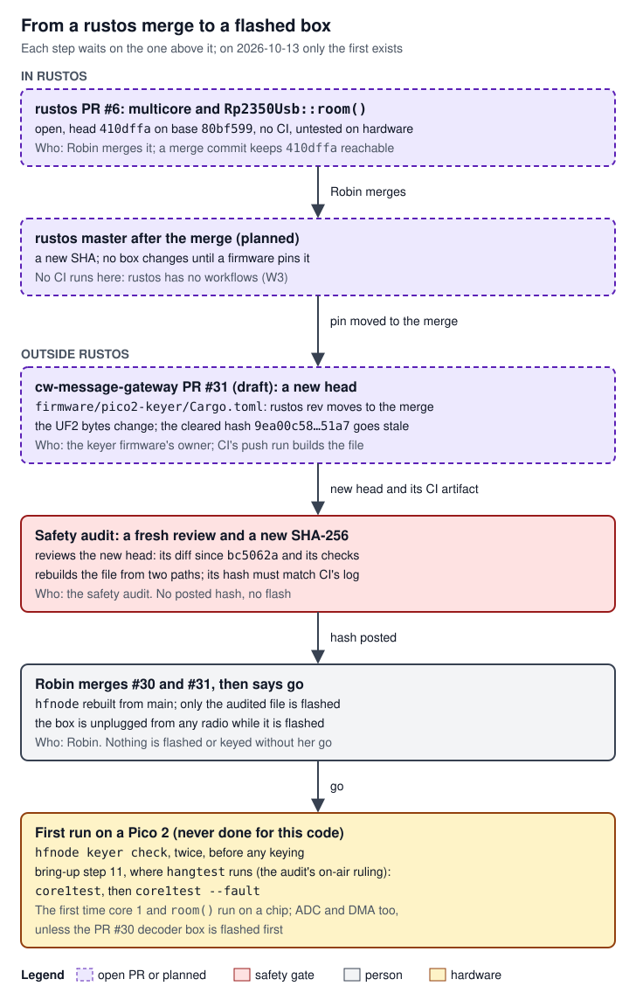

# 09 Work left and known issues

> Where rustos stands on 2026-10-13 and everything left to do in it, as one list. rustos master's code is `80bf599` (rustos PRs #1 to #5 merged; these handover docs, rustos #7, merged on 2026-10-14). One code PR is open: rustos #6 (multicore and `Rp2350Usb::room()`), head `410dffa`, which waits on Robin (the project owner) to merge it (rustos #7, a draft, carries these docs). After that merge, cw-message-gateway's one-Pico keyer image (PR #31) moves its rustos pin to master's merge commit; that is a new firmware file, so it needs a fresh safety audit and a new hash before anything is flashed. rustos has no CI. Several drivers this project added have never run on a chip (DMA, ADC, multicore), and others have run only through one bench check. The README and some doc comments describe a layout that no longer exists. The Juno flight-software modules in `docs/` are plans with no code. Each item below has its evidence, what it blocks, and who decides.

This page is a work list, not a subsystem, so it adapts the page shape: "How it works" is how a rustos change reaches a radio, "Interfaces and APIs" lists the interfaces the open work touches, "Programming against it" is how to check each item yourself, and "Algorithms and processing" is left out (this page has none; the algorithms of the open code are on [05 Drivers: GPIO, USB, PWM, ADC, DMA](05-drivers-io.md) and [06 Multicore](06-multicore.md)).

Terms: a **Pico 2** is Raspberry Pi's board with the **RP2350** microcontroller. **CW** is Morse code sent by keying a radio on and off. The **keyer box** is a Pico 2 running firmware from cw-message-gateway that closes a radio's key line; it is the one product built on rustos today. **PTT** (push-to-talk) is the line that switches a radio to transmit. A **UF2** is the firmware file copied onto the board to flash it. **hfnode** is cw-message-gateway's host program; `hfnode keyer ...` commands talk to the keyer box over USB. The **safety audit** is a separate review, in project files, that must clear the exact firmware file (by its SHA-256 hash) before anything is flashed or keyed. A **thread** is one of the project's named work streams, each run as a Claude session in Robin's project (the decoder thread, the keyer-image thread); each owns some PRs (see "Who decides" under Work left), and who takes over a thread's role after the handover is Robin's decision.

Embedded terms: **DMA** (direct memory access) copies data between memory and a peripheral without the processor. The **ADC** (analog-to-digital converter) turns a pin's voltage into numbers. **PWM** (pulse-width modulation) here makes a square-wave tone. The **watchdog** resets the chip unless the program feeds it in time. **SysTick** is the Arm core's own cycle counter, one per core. The **safe state** is the function an application names in `entry!`, which rustos's fault handlers call first ([02 Boot and runtime](02-boot-runtime.md)). **MSPLIM** is the Cortex-M33 register that sets the lowest address the main stack may reach; a push below it faults. **Secure/Non-secure** and **Privileged/Unprivileged** are the Arm security and privilege levels an access is made at. A USB host **enumerates** a device by sending it **SETUP** requests on endpoint 0. **Bring-up** is the numbered first power-on checks of a build in cw-message-gateway's `docs/keyer.md`. A **trip** is the keyer box latching its key and PTT open after a broken limit or a fault; it refuses to key until it is power-cycled. More terms: the cw-message-gateway [glossary][gw-17].

## Where it lives

The facts on this page come from these places. The table says where to look when an item changes.

| Where | What it holds about the work left | Read it at |
|---|---|---|
| rustos PR #6 on GitHub | The open multicore PR: description, head, base, merge state | `gh pr view 6 -R robinonsay/rustos` |
| rustos at `80bf599` and `410dffa` | The code and docs; "Unverified on hardware" notes in the module docs | the permalinks below |
| cw-message-gateway `firmware/*/Cargo.toml` | Which rustos commit each firmware image pins | [`firmware/pico2-keyer/Cargo.toml:24-31`](https://github.com/robinonsay/cw-message-gateway/blob/bc5062ae4f56ae1f9949b3b067218c7e675d88f8/firmware/pico2-keyer/Cargo.toml#L24-L31) (PR #31) |
| Project file `audit/report.md` (§1 keyer box, §3 the #30 and #31 entries) and `audit/req-on-air-bench-ruling.md` | The audit's notes that concern rustos, the cleared hashes, where the keyed bring-up steps run | project files only (not public) |
| Project file `bench/quansheng.md` | The one recorded bench run of a rustos-based image on a real Pico 2 | project files only |
| Memory notes `pico-decoder-prs.md`, `one-pico-keyer-audit.md`, `any-radio-keyer.md`, `rustos-template-cargo-error.md`, `flash-files.md` | Who owns what, order of merges, the pin history | Claude's project memory (not in the repositories or the project files); the facts used are restated on this page |
| [01 Overview](01-overview.md), [02 Boot and runtime](02-boot-runtime.md), [03 The api crate](03-api-crate.md), [04 Drivers: core](04-drivers-core.md), [05 Drivers: GPIO, USB, PWM, ADC, DMA](05-drivers-io.md), [06 Multicore](06-multicore.md), [07 Writing a driver](07-writing-a-driver.md), [08 Changes made for cw-message-gateway](08-changes-for-cw-gateway.md) | Each page's own "Known bugs" and "Work left"; this page collects them | sibling pages |

## How it works

### How a rustos change reaches a radio

rustos is a library. Nothing in it runs until an application pins a rustos commit as a git dependency and is built into a UF2. The application that matters here is cw-message-gateway's keyer box firmware. So a rustos merge changes nothing on any box by itself. It reaches a radio only through four more steps, each with its own owner:

1. **Robin merges the rustos PR.** Only Robin merges, in both repositories.
2. **A firmware PR moves its rustos pin** to the merge commit. Moving the pin can change the UF2 even when no rustos source the firmware uses has changed, because cargo mixes the git revision into the crate hashes that order the code. rustos PR #4's description records both outcomes: pinned at that PR's branch commit `6b02215`, 46,030 of the keyer image's 124,928 bytes moved; pinned at the merge commit `8c91507`, the UF2 was the audited one byte for byte (also the memory note `rustos-template-cargo-error.md`). So every pin move is treated as a new file.
3. **The safety audit reviews the new head** (its diff since the last cleared head, its checks, a rebuild from two checkout paths, a byte-for-byte match with the CI push run's artifact) and posts a new SHA-256. Until it does, the file is not cleared, and the previous hash for that PR is stale.
4. **Robin says go** once the audit's conditions are met (for PR #31: PRs #30 and #31 merged, hfnode rebuilt from main), and the exact audited file (CI's artifact, never a local build) is flashed, with the box unplugged from any radio, followed by the bring-up checks the audit lists.



*Figure: each step waits on the one above it. Only the first two boxes are in rustos; the pin move, the audit, Robin's merges and go, and the bench happen outside it, and nothing is flashed until the audit posts the new hash and Robin says go.*

The rules in steps 3 and 4 of the list (the audit's hash and Robin's go) are the project's safety rules, never to be worked around: nothing is flashed, keyed or transmitted until the audit has posted the file's hash and Robin has said go, and the flashed file must be byte-identical to that hash. The canonical list of limits and gates is cw-message-gateway's [13 Safety rules][gw-13]; the audit and bench process is its [14 Audit, bench and flashing][gw-14].

The first keyed checks of the one-Pico image, bring-up step 11 (`hfnode keyer core1test`, then `core1test --fault`, [`docs/keyer.md:321-330`](https://github.com/robinonsay/cw-message-gateway/blob/bc5062ae4f56ae1f9949b3b067218c7e675d88f8/docs/keyer.md#L321-L330), PR #31), run where `hangtest` runs under the audit's on-air ruling (`audit/report.md` §3, the PR #31 entries; `audit/req-on-air-bench-ruling.md`, project files). That ruling records Robin's decision to bench on the air with no dummy load; `docs/keyer.md`'s generic wording about a dummy load does not apply to this bench.

### What rustos PR #6 waits on, and what waits on it

- **State on 2026-10-13** (GitHub API): open, not a draft, assigned to Robin, base `80bf599`, head `410dffa`, mergeable with no conflicts, no checks (rustos has no CI). The project's notes list it as ready ("rustos #6 multicore (head 410dffa with Rp2350Usb::room(), untested on hardware; ready)", `MEMORY.md`).
- **It waits on** Robin's merge, nothing else. Its own description lists what was checked by hand: `cargo test -p api` (44 tests, 9 new), clippy on `api` clean, `cargo pico2` builds, a scratch application's disassembly, "Untested on hardware".
- **Merge it with a merge commit**, as PRs #1 to #5 were (master `80bf599` is "Merge pull request #5"). PR #31 pins `410dffa` by hash; a merge commit keeps that commit reachable from master. The same reasoning is written in rustos PR #3's description for the pin `c9852112` ("with merge commits that stays reachable from master").
- **What waits on it:** cw-message-gateway PR #31's pin move. Its manifest says so: "To be moved to master's merge of rustos #6 once it is merged" ([`firmware/pico2-keyer/Cargo.toml:24-31`](https://github.com/robinonsay/cw-message-gateway/blob/bc5062ae4f56ae1f9949b3b067218c7e675d88f8/firmware/pico2-keyer/Cargo.toml#L24-L31), PR #31, draft, not on main). The audit cleared PR #31 at `bc5062a` with rustos at `410dffa` (file `pico2-keyer.uf2`, SHA-256 `9ea00c58…51a7`, build `bc5062ae`). Both of its PR #31 entries say the re-pin needs a new hash: "The rustos #6 re-pin is a new head and needs a new hash" (at `8d5fcf6`) and "The rustos #6 re-pin needs a new hash" (at `bc5062a`; `audit/report.md` §3). The pin move is the job of the keyer firmware's owner (today the keyer-image thread); the audit then reviews the new head (its diff since `bc5062a`, its checks and a rebuild from two paths) and posts the new hash.
- **What does not wait on it:** the keyer image on main pins rustos `8c91507` ([`firmware/pico2-keyer/Cargo.toml:21-31`](https://github.com/robinonsay/cw-message-gateway/blob/44185fa9a00369c379d9d8af40ca307e3867e860/firmware/pico2-keyer/Cargo.toml#L21-L31)), and the decoder box (PR #30) pins master `80bf599` ([`firmware/pico2-decoder/Cargo.toml:21-25`](https://github.com/robinonsay/cw-message-gateway/blob/3efaf842e1aab75354e5e19d0384a703d4d786be/firmware/pico2-decoder/Cargo.toml#L21-L25), PR #30, open). Neither uses multicore, so neither needs to move.

## How it connects

Who depends on rustos, and at which commit. A rustos change affects a product only when that product moves its pin.

| Dependant | rustos commit pinned | Uses | Status |
|---|---|---|---|
| Keyer box firmware on cw-message-gateway main | `8c91507` (same `api` and `pico2` sources as `c9852112`) | GPIO, clocks, PWM, timer, SysTick, watchdog, USB, `entry!` with a safe state | the flashed file `eef8c126` came from this source; [`firmware/pico2-keyer/Cargo.toml:21-31`](https://github.com/robinonsay/cw-message-gateway/blob/44185fa9a00369c379d9d8af40ca307e3867e860/firmware/pico2-keyer/Cargo.toml#L21-L31) |
| Decoder box firmware (cw-message-gateway PR #30, open) | `80bf599` | adds ADC and DMA | audit-cleared at `3efaf84` to flash on a plain Pico 2 with nothing plugged into a radio; [`firmware/pico2-decoder/Cargo.toml:21-25`](https://github.com/robinonsay/cw-message-gateway/blob/3efaf842e1aab75354e5e19d0384a703d4d786be/firmware/pico2-decoder/Cargo.toml#L21-L25) |
| One-Pico keyer image (cw-message-gateway PR #31, draft, stacked on #30) | `410dffa` (PR #6 head) | adds multicore and `Rp2350Usb::room()`; ADC and DMA set up and started by core 0 after its watchdog starts, read by core 1 ([`firmware/pico2-keyer/src/main.rs:285-294`](https://github.com/robinonsay/cw-message-gateway/blob/bc5062ae4f56ae1f9949b3b067218c7e675d88f8/firmware/pico2-keyer/src/main.rs#L285-L294)) | audit-cleared at `bc5062a`; re-pin pending; [`firmware/pico2-keyer/Cargo.toml:24-31`](https://github.com/robinonsay/cw-message-gateway/blob/bc5062ae4f56ae1f9949b3b067218c7e675d88f8/firmware/pico2-keyer/Cargo.toml#L24-L31) |
| Apps generated from `templates/pico2` | rustos's default branch, whatever it is when the app's `Cargo.lock` is made | whatever the app uses | [`templates/pico2/Cargo.toml.liquid:10-12`](https://github.com/robinonsay/rustos/blob/80bf5998a60a41b3741041062ff7e9c59caf95b2/templates/pico2/Cargo.toml.liquid#L10-L12) |

Two checks in cw-message-gateway find rustos code by symbol name, so renaming these items in rustos breaks the gateway's CI at its next pin move:

- `check_faults.py`, on main and run in CI ([`firmware/pico2-keyer/check_faults.py:41`](https://github.com/robinonsay/cw-message-gateway/blob/44185fa9a00369c379d9d8af40ca307e3867e860/firmware/pico2-keyer/check_faults.py#L41), [`.github/workflows/ci.yml:186`](https://github.com/robinonsay/cw-message-gateway/blob/44185fa9a00369c379d9d8af40ca307e3867e860/.github/workflows/ci.yml#L186)), finds `OnHardFault` and `DefaultHandler` and requires that the first store each one makes opens the key and the PTT. rustos's handlers do that by calling the safe state first ([`firmware/pico2/src/lib.rs:453-469`](https://github.com/robinonsay/rustos/blob/80bf5998a60a41b3741041062ff7e9c59caf95b2/firmware/pico2/src/lib.rs#L453-L469)).
- `check_core1.py` (PR #31, draft, not on main) finds `pico2::multicore::{core1_start, core1_run, CORE1_ENTRY, CORE1_STACK_LIMIT}` and `__rustos_main` ([`firmware/pico2-keyer/check_core1.py:73-75`](https://github.com/robinonsay/cw-message-gateway/blob/bc5062ae4f56ae1f9949b3b067218c7e675d88f8/firmware/pico2-keyer/check_core1.py#L73-L75), [`check_core1.py:94-96`](https://github.com/robinonsay/cw-message-gateway/blob/bc5062ae4f56ae1f9949b3b067218c7e675d88f8/firmware/pico2-keyer/check_core1.py#L94-L96)). [06 Multicore](06-multicore.md) lists the names.

## Interfaces and APIs

This page defines no interface. These are the interfaces the open work adds or touches; their full reference is on the linked pages.

| Interface | Where | Open point | Detail |
|---|---|---|---|
| `api::multicore::Launch`; `Launch::new(vector_table: u32, stack_pointer: u32, entry: u32) -> Self`; `Launch::step(&mut self, mailbox: &mut impl Mailbox, now: u64) -> Step` | [`api/src/multicore.rs:106`](https://github.com/robinonsay/rustos/blob/410dffa091e247e6e7546c7f2ff465f0af499d5a/api/src/multicore.rs#L106), [`:124`](https://github.com/robinonsay/rustos/blob/410dffa091e247e6e7546c7f2ff465f0af499d5a/api/src/multicore.rs#L124), [`:137`](https://github.com/robinonsay/rustos/blob/410dffa091e247e6e7546c7f2ff465f0af499d5a/api/src/multicore.rs#L137) (PR #6, not on master) | host-tested only | [06 Multicore](06-multicore.md) |
| `api::multicore::Mailbox` (`try_send(&mut self, word: u32) -> bool`, `try_receive(&mut self) -> Option<u32>`, `wake(&mut self)`); `Step::{Pending, Launched}`; `QUIET_US: u64 = 100` (µs) | [`api/src/multicore.rs:60-73`](https://github.com/robinonsay/rustos/blob/410dffa091e247e6e7546c7f2ff465f0af499d5a/api/src/multicore.rs#L60-L73), [`:89-94`](https://github.com/robinonsay/rustos/blob/410dffa091e247e6e7546c7f2ff465f0af499d5a/api/src/multicore.rs#L89-L94), [`:79`](https://github.com/robinonsay/rustos/blob/410dffa091e247e6e7546c7f2ff465f0af499d5a/api/src/multicore.rs#L79) (PR #6) | host-tested only | [06 Multicore](06-multicore.md) |
| `Rp2350.core1: Rp2350Core1`, a new board field every `Rp2350::take()` user sees | [`firmware/pico2/src/common/board.rs:147`](https://github.com/robinonsay/rustos/blob/410dffa091e247e6e7546c7f2ff465f0af499d5a/firmware/pico2/src/common/board.rs#L147) (PR #6) | never run on a chip | [06 Multicore](06-multicore.md) |
| `Rp2350Core1::new(DeviceHandle<Rp2350Core1>) -> Self`; `Rp2350Core1::launch<const WORDS: usize>(self, stack: &'static Core1Stack<WORDS>, entry: fn(Fifo) -> !, timer: &Rp2350Timer, timeout_us: u64) -> Result<Fifo, LaunchError>`; `LaunchError::NoAnswer` | [`firmware/pico2/src/multicore.rs:334`](https://github.com/robinonsay/rustos/blob/410dffa091e247e6e7546c7f2ff465f0af499d5a/firmware/pico2/src/multicore.rs#L334), [`:350-356`](https://github.com/robinonsay/rustos/blob/410dffa091e247e6e7546c7f2ff465f0af499d5a/firmware/pico2/src/multicore.rs#L350-L356), [`:309-315`](https://github.com/robinonsay/rustos/blob/410dffa091e247e6e7546c7f2ff465f0af499d5a/firmware/pico2/src/multicore.rs#L309-L315) (PR #6) | never run on a chip; `NoAnswer` can hide a started core 1 (K15) | [06 Multicore](06-multicore.md) |
| `Core1Stack`, `Fifo`, `core()` | [`firmware/pico2/src/multicore.rs:270`](https://github.com/robinonsay/rustos/blob/410dffa091e247e6e7546c7f2ff465f0af499d5a/firmware/pico2/src/multicore.rs#L270), [`:177`](https://github.com/robinonsay/rustos/blob/410dffa091e247e6e7546c7f2ff465f0af499d5a/firmware/pico2/src/multicore.rs#L177), [`:161`](https://github.com/robinonsay/rustos/blob/410dffa091e247e6e7546c7f2ff465f0af499d5a/firmware/pico2/src/multicore.rs#L161) (PR #6) | never run on a chip; `Fifo` has no host test (K8) | [06 Multicore](06-multicore.md) |
| `Rp2350Usb::room() -> usize` | [`firmware/pico2/src/usb/mod.rs:482-495`](https://github.com/robinonsay/rustos/blob/410dffa091e247e6e7546c7f2ff465f0af499d5a/firmware/pico2/src/usb/mod.rs#L482-L495) (PR #6) | never run on a chip; reads driver state only | [05 Drivers: GPIO, USB, PWM, ADC, DMA](05-drivers-io.md) |
| `Rp2350Dma::new(DeviceHandle<Rp2350Dma>) -> Self`; `Rp2350DmaChannel<const C: usize>` (only `number()`) | [`firmware/pico2/src/dma.rs:243-244`](https://github.com/robinonsay/rustos/blob/80bf5998a60a41b3741041062ff7e9c59caf95b2/firmware/pico2/src/dma.rs#L243-L244), [`dma.rs:178-197`](https://github.com/robinonsay/rustos/blob/80bf5998a60a41b3741041062ff7e9c59caf95b2/firmware/pico2/src/dma.rs#L178-L197) | never run on a chip; no API for a channel's security level ([`dma.rs:42-51`](https://github.com/robinonsay/rustos/blob/80bf5998a60a41b3741041062ff7e9c59caf95b2/firmware/pico2/src/dma.rs#L42-L51) leaves every channel Secure Privileged); the keyer image writes the register itself | item W7 below; [05 Drivers: GPIO, USB, PWM, ADC, DMA](05-drivers-io.md) |
| `pub unsafe fn is_reset_done(mask: u32) -> bool` | [`firmware/pico2/src/common/reset.rs:221`](https://github.com/robinonsay/rustos/blob/80bf5998a60a41b3741041062ff7e9c59caf95b2/firmware/pico2/src/common/reset.rs#L221) | the guard W6 asks drivers to use | [04 Drivers: core](04-drivers-core.md) |
| `common::reset` module docs | [`firmware/pico2/src/common/reset.rs:13-17`](https://github.com/robinonsay/rustos/blob/80bf5998a60a41b3741041062ff7e9c59caf95b2/firmware/pico2/src/common/reset.rs#L13-L17), [`:153-155`](https://github.com/robinonsay/rustos/blob/80bf5998a60a41b3741041062ff7e9c59caf95b2/firmware/pico2/src/common/reset.rs#L153-L155) | an uncited claim the audit flagged | item W6 below; [04 Drivers: core](04-drivers-core.md) |
| `Rp2350Pwm::silence_all` | [`firmware/pico2/src/pwm.rs:697-728`](https://github.com/robinonsay/rustos/blob/80bf5998a60a41b3741041062ff7e9c59caf95b2/firmware/pico2/src/pwm.rs#L697-L728) | the answer to that audit note; tone path never measured on a chip | [05 Drivers: GPIO, USB, PWM, ADC, DMA](05-drivers-io.md) |
| `api::gpio::Pull` and its documentation | [`api/src/gpio/mod.rs:52-54`](https://github.com/robinonsay/rustos/blob/80bf5998a60a41b3741041062ff7e9c59caf95b2/api/src/gpio/mod.rs#L52-L54), [`:64-72`](https://github.com/robinonsay/rustos/blob/80bf5998a60a41b3741041062ff7e9c59caf95b2/api/src/gpio/mod.rs#L64-L72) | recommends `Pull::Down` with no warning about erratum E9 (K12); no derives (K10) | item W13 below; [05 Drivers: GPIO, USB, PWM, ADC, DMA](05-drivers-io.md) |

## Programming against it

These commands let you check each item yourself instead of trusting this page. Run them from a clone of rustos (and of cw-message-gateway where noted).

```sh
# Is PR #6 still open? What is master?
gh pr view 6 -R robinonsay/rustos --json state,isDraft,mergeable,headRefOid,baseRefOid
git ls-remote https://github.com/robinonsay/rustos master

# Which rustos commit does each firmware pin? (in a cw-message-gateway clone)
git grep -n 'robinonsay/rustos' <commit> -- 'firmware/*/Cargo.toml'

# TODO, FIXME and unimplemented markers in the code (none at 80bf599 or 410dffa)
git grep -n -E 'TODO|FIXME|XXX|HACK|unimplemented!|todo!' 80bf599 -- ':!docs'

# What the code itself says has not been checked on hardware (12 lines at 80bf599)
git grep -n -i -E 'unverified|not verified on hardware|not been checked on hardware' 80bf599 -- firmware

# Is there CI? (no .github directory at 80bf599 or 410dffa)
git ls-tree --name-only 80bf599

# The host tests: the workspace's default member is api, so plain cargo test runs it
cargo test --locked

# The chip build of the library (needs the target once)
rustup target add thumbv8m.main-none-eabihf
cargo pico2 --locked
```

`cargo test` at the root runs only `api` because `default-members = ["api"]` ([`Cargo.toml:3-7`](https://github.com/robinonsay/rustos/blob/80bf5998a60a41b3741041062ff7e9c59caf95b2/Cargo.toml#L3-L7)), and `cargo pico2` is the alias `build -p pico2 --target thumbv8m.main-none-eabihf` ([`.cargo/config.toml:1-7`](https://github.com/robinonsay/rustos/blob/80bf5998a60a41b3741041062ff7e9c59caf95b2/.cargo/config.toml#L1-L7)). `pico2` is a library, so `cargo pico2` never runs the linker: `link.ld` and its `ASSERT`s are exercised only when an application links (the template, or the firmware in cw-message-gateway).

## Changing it

How to close items on this page without breaking anything downstream:

- **Any rustos commit is a new firmware for the box once it is pinned.** That includes formatting, doc comments and CI files. Nothing reaches a box until a firmware PR moves its pin and the audit clears the new file. Never move a firmware's rustos pin as a side effect of another change; the keyer firmware's owner (today the keyer-image thread) moves the keyer's pin, and every pin move goes to the audit.
- **Keep the gateway's symbol checks true** (see "How it connects"). Keep the names `OnHardFault`, `DefaultHandler` and `__rustos_main`, and keep the safe-state call as each handler's first action ([`firmware/pico2/src/lib.rs:453-469`](https://github.com/robinonsay/rustos/blob/80bf5998a60a41b3741041062ff7e9c59caf95b2/firmware/pico2/src/lib.rs#L453-L469)), or `check_faults.py` fails. Keep core 1's launch bounded, `Core1Stack` 32-byte aligned, one vector table for both cores, and the multicore symbol names as they are, or `check_core1.py` fails once the keyer re-pins ([06 Multicore](06-multicore.md), "Changing it").
- **Never loosen anything the keyer relies on through rustos:** its 0.5 s watchdog ([`crates/keyer-core/src/lib.rs:62`](https://github.com/robinonsay/cw-message-gateway/blob/44185fa9a00369c379d9d8af40ca307e3867e860/crates/keyer-core/src/lib.rs#L62)), the fault handlers calling the safe state first ([`firmware/pico2/src/lib.rs:453-469`](https://github.com/robinonsay/rustos/blob/80bf5998a60a41b3741041062ff7e9c59caf95b2/firmware/pico2/src/lib.rs#L453-L469)), `silence_all` writing nothing while PWM is in reset ([`firmware/pico2/src/pwm.rs:721-725`](https://github.com/robinonsay/rustos/blob/80bf5998a60a41b3741041062ff7e9c59caf95b2/firmware/pico2/src/pwm.rs#L721-L725)), and the watchdog and `TIMER0` never paused by a debugger (`start` clears `PAUSE_DBG0`, `PAUSE_DBG1` and `PAUSE_JTAG`, [`firmware/pico2/src/watchdog.rs:65-72`](https://github.com/robinonsay/rustos/blob/80bf5998a60a41b3741041062ff7e9c59caf95b2/firmware/pico2/src/watchdog.rs#L65-L72) and [`watchdog.rs:534-548`](https://github.com/robinonsay/rustos/blob/80bf5998a60a41b3741041062ff7e9c59caf95b2/firmware/pico2/src/watchdog.rs#L534-L548); `Rp2350Timer::new` writes `DBGPAUSE` = 0, [`firmware/pico2/src/timer.rs:194`](https://github.com/robinonsay/rustos/blob/80bf5998a60a41b3741041062ff7e9c59caf95b2/firmware/pico2/src/timer.rs#L194)). These are limits and gates under cw-message-gateway's [13 Safety rules][gw-13].
- **Doc-only fixes** (items W5 and W6) touch no behaviour. Do them in their own PR so the audit's diff for the next pin move is easy to read.
- **Tests:** `api` changes need host tests in the module's `#[cfg(test)]` block; `pico2` has no host tests, so a driver change is checked by building it, by a scratch application, and on the bench. [07 Writing a driver](07-writing-a-driver.md) has the full recipe.

The files each item touches:

| Item | Files in rustos | Files in cw-message-gateway that move with it |
|---|---|---|
| W3 CI | a new `.github/workflows/*.yml`; a root `rust-toolchain.toml` (W10) | none |
| W5 stale docs | `README.md`, the doc comments in the W5 table, `docs/tutorials/rp2350_baremetal/`, `.vscode/settings.json` | none |
| W6 `reset.rs` claim | `firmware/pico2/src/common/reset.rs` (doc only) | none |
| W7 DMA security | `firmware/pico2/src/dma.rs` | `firmware/pico2-keyer/src/core1.rs` (`unprivileged_channel`), `check_core1.py` and its self-test |
| W11 SETUP parsers | `api/src/usb/setup.rs`, `control.rs`, `cdc_acm.rs`, `descriptor.rs` and their tests, if the review asks for fixes | none |
| W12 hardening | `firmware/pico2/src/lib.rs`, `firmware/pico2/link.ld`, `common/reset.rs`, `clocks.rs`, `watchdog.rs` | `check_faults.py` must still pass |
| W13 API fixes | `api/src/gpio/mod.rs`, `api/src/device/mod.rs`, `firmware/pico2/src/gpio/gpio.rs`, `adc.rs` | none unless the keyer or the decoder uses the change (an `OUTOVER` output type would replace the decoder's `Overridden` pins) |
| W14 multicore | `firmware/pico2/src/multicore.rs`, `firmware/pico2/src/lib.rs`, `api/src/multicore.rs` | `core1.rs` and `check_core1.py` if core 1's fault path changes |

## Known bugs, limits and flakes

No flaky tests are known: rustos's only tests are `api`'s deterministic tests (35 unit tests and 2 doctests at `80bf599`, 44 tests at `410dffa`, by the PR descriptions and a count of `#[test]` attributes). No TODO, FIXME, `todo!` or `unimplemented!` exists in the code at either commit (grep above). Open points are recorded instead as "Unverified on hardware" notes in module docs, collected in K2. K1 to K11 keep their numbers because cw-message-gateway's [16 Work left and known bugs][gw-16] cites them; K12 to K17 collect the sibling pages' remaining items.

| # | Issue | Evidence | Effect | Work item (who decides) | Detail |
|---|---|---|---|---|---|
| K1 | **The README describes a layout that no longer exists** | see W5 | misleads a newcomer on build, flash and test | W5 (Robin) | [01 Overview](01-overview.md) |
| K2 | **Points the code marks as unverified on hardware** | the 1 µs watchdog count ([`firmware/pico2/src/timer.rs:30-40`](https://github.com/robinonsay/rustos/blob/80bf5998a60a41b3741041062ff7e9c59caf95b2/firmware/pico2/src/timer.rs#L30-L40)); USB clear-alias on write-1-to-clear flags ([`usb/hw.rs:112-119`](https://github.com/robinonsay/rustos/blob/80bf5998a60a41b3741041062ff7e9c59caf95b2/firmware/pico2/src/usb/hw.rs#L112-L119)), `SOFTCON` ([`usb/hw.rs:167-171`](https://github.com/robinonsay/rustos/blob/80bf5998a60a41b3741041062ff7e9c59caf95b2/firmware/pico2/src/usb/hw.rs#L167-L171)), the 10 ms disconnect pulse ([`usb/mod.rs:82-88`](https://github.com/robinonsay/rustos/blob/80bf5998a60a41b3741041062ff7e9c59caf95b2/firmware/pico2/src/usb/mod.rs#L82-L88)), the `EP_ABORT_DONE` time-out path ([`usb/mod.rs:120-126`](https://github.com/robinonsay/rustos/blob/80bf5998a60a41b3741041062ff7e9c59caf95b2/firmware/pico2/src/usb/mod.rs#L120-L126)), a stale IN packet on a new SETUP ([`usb/mod.rs:154-158`](https://github.com/robinonsay/rustos/blob/80bf5998a60a41b3741041062ff7e9c59caf95b2/firmware/pico2/src/usb/mod.rs#L154-L158)), whether `CONNECTED` ever falls with VBUS forced ([`usb/mod.rs:180-190`](https://github.com/robinonsay/rustos/blob/80bf5998a60a41b3741041062ff7e9c59caf95b2/firmware/pico2/src/usb/mod.rs#L180-L190)); POWMAN left on the low-power oscillator ([`watchdog.rs:53-63`](https://github.com/robinonsay/rustos/blob/80bf5998a60a41b3741041062ff7e9c59caf95b2/firmware/pico2/src/watchdog.rs#L53-L63)), `SCRATCH4` surviving the bootrom ([`watchdog.rs:100-110`](https://github.com/robinonsay/rustos/blob/80bf5998a60a41b3741041062ff7e9c59caf95b2/firmware/pico2/src/watchdog.rs#L100-L110)), the bootrom reboot's `REASON` bit ([`watchdog.rs:122-127`](https://github.com/robinonsay/rustos/blob/80bf5998a60a41b3741041062ff7e9c59caf95b2/firmware/pico2/src/watchdog.rs#L122-L127)), pad state after a watchdog reset ([`watchdog.rs:172-177`](https://github.com/robinonsay/rustos/blob/80bf5998a60a41b3741041062ff7e9c59caf95b2/firmware/pico2/src/watchdog.rs#L172-L177)), the POWMAN switch delay ([`watchdog.rs:345-349`](https://github.com/robinonsay/rustos/blob/80bf5998a60a41b3741041062ff7e9c59caf95b2/firmware/pico2/src/watchdog.rs#L345-L349)) | each is a datasheet gap; the code chose the reading least likely to be wrong | W4, W15 (Robin's go; the audit's bench steps) | [04 Drivers: core](04-drivers-core.md), [05 Drivers: GPIO, USB, PWM, ADC, DMA](05-drivers-io.md) |
| K3 | **Implicit panics in the USB SETUP parsers were never audited** | `audit/report.md` §1, "Open items that need hardware (or missing documents)", written at cw-message-gateway `2e39996`: "Not audited: implicit panics in the USB SETUP parsers (rustos/api/src/usb/control.rs and others). A host-triggered panic opens the key, but it also reboots the box and clears a trip." No later entry closes it. A quick read for this page found size guards in the parsers (`SetupPacket::from_bytes` takes `[u8; 8]`, [`api/src/usb/setup.rs:76`](https://github.com/robinonsay/rustos/blob/80bf5998a60a41b3741041062ff7e9c59caf95b2/api/src/usb/setup.rs#L76); `LineCoding::from_bytes` checks the length, [`api/src/usb/cdc_acm.rs:104-107`](https://github.com/robinonsay/rustos/blob/80bf5998a60a41b3741041062ff7e9c59caf95b2/api/src/usb/cdc_acm.rs#L104-L107); replies are clipped, [`api/src/usb/control.rs:293-298`](https://github.com/robinonsay/rustos/blob/80bf5998a60a41b3741041062ff7e9c59caf95b2/api/src/usb/control.rs#L293-L298)), but that is not an audit | a computer on the USB cable could reset the box. At cw-message-gateway main the box then comes back tripped (`WATCHDOG`) and keeps any earlier trip ([`firmware/pico2-keyer/src/main.rs:33-38`](https://github.com/robinonsay/cw-message-gateway/blob/44185fa9a00369c379d9d8af40ca307e3867e860/firmware/pico2-keyer/src/main.rs#L33-L38), [`crates/keyer-core/src/keyer.rs:398-435`](https://github.com/robinonsay/cw-message-gateway/blob/44185fa9a00369c379d9d8af40ca307e3867e860/crates/keyer-core/src/keyer.rs#L398-L435)), so the audit's "clears a trip", written before the KB-7 fix, no longer describes the code (the reset reason and the scratch registers are not yet checked on a chip: W15) | W11 (Robin asks; the audit reviews) | [03 The api crate](03-api-crate.md) |
| K4 | **`cargo fmt --check` fails** | rustfmt 1.9.0 (stable, edition 2024, default settings), run with `--check` for this page, reports changes in 19 files at both `80bf599` and `410dffa` (most in `api/src/usb/control.rs`, `firmware/pico2/src/gpio/gpio.rs`, `gpio/mod.rs`, `usb/mod.rs` and `common/reset.rs`); `adc.rs`, `dma.rs`, `pwm.rs` and both `multicore.rs` files are clean | a CI fmt step fails until one `cargo fmt --all` commit | W3 (Robin) | [07 Writing a driver](07-writing-a-driver.md) |
| K5 | **13 clippy findings in `pico2`** | rustos PR #1 ("The 13 clippy warnings on `pico2` are the existing ones in gpio and lib.rs") and PR #3 (the same 13, in `gpio.rs`, `lib.rs` and `gpio/mod.rs`). PR #6 reports no clippy findings in its new code ("the clippy findings left are in files this PR doesn't touch"); PR #5 reports only that `cargo pico2` builds with no new warnings, with no clippy run recorded. Not re-counted for this page (no builds were run) | a CI clippy step with `-D warnings` fails on `pico2` until they are fixed | W3 (Robin) | [07 Writing a driver](07-writing-a-driver.md) |
| K6 | **Unbounded waits** | `wait_for_reset_done` ([`common/reset.rs:200-208`](https://github.com/robinonsay/rustos/blob/80bf5998a60a41b3741041062ff7e9c59caf95b2/firmware/pico2/src/common/reset.rs#L200-L208)); the crystal, PLL and clock-switch waits in `Rp2350Clocks::new` ([`clocks.rs:458`](https://github.com/robinonsay/rustos/blob/80bf5998a60a41b3741041062ff7e9c59caf95b2/firmware/pico2/src/clocks.rs#L458), [`:483`](https://github.com/robinonsay/rustos/blob/80bf5998a60a41b3741041062ff7e9c59caf95b2/firmware/pico2/src/clocks.rs#L483), [`:497`](https://github.com/robinonsay/rustos/blob/80bf5998a60a41b3741041062ff7e9c59caf95b2/firmware/pico2/src/clocks.rs#L497), [`:545`](https://github.com/robinonsay/rustos/blob/80bf5998a60a41b3741041062ff7e9c59caf95b2/firmware/pico2/src/clocks.rs#L545), [`:551`](https://github.com/robinonsay/rustos/blob/80bf5998a60a41b3741041062ff7e9c59caf95b2/firmware/pico2/src/clocks.rs#L551)); the ADC stream's `Drop` ([`adc.rs:670-689`](https://github.com/robinonsay/rustos/blob/80bf5998a60a41b3741041062ff7e9c59caf95b2/firmware/pico2/src/adc.rs#L670-L689)) and `dma::abort`, which only that `Drop` calls ([`dma.rs:286-295`](https://github.com/robinonsay/rustos/blob/80bf5998a60a41b3741041062ff7e9c59caf95b2/firmware/pico2/src/dma.rs#L286-L295)); each is documented where it is | a hardware fault there hangs the caller. On main's keyer, `Rp2350Gpio::new`'s reset wait ([`gpio.rs:132-136`](https://github.com/robinonsay/rustos/blob/80bf5998a60a41b3741041062ff7e9c59caf95b2/firmware/pico2/src/gpio/gpio.rs#L132-L136)) runs first, before any pin is configured: a hang there leaves the pads at their reset state, with the key pin held low (key open) by the required external 4.7 kΩ pull-down. The clock waits and the other reset waits run after the key and PTT are driven low and before the watchdog starts ([`main.rs:174-216`](https://github.com/robinonsay/cw-message-gateway/blob/44185fa9a00369c379d9d8af40ca307e3867e860/firmware/pico2-keyer/src/main.rs#L174-L216)), so a hang there leaves the box silent and unkeyed, not reset. On PR #31 the DMA and ADC bring-up waits run after the watchdog starts ([`main.rs:285-294`](https://github.com/robinonsay/cw-message-gateway/blob/bc5062ae4f56ae1f9949b3b067218c7e675d88f8/firmware/pico2-keyer/src/main.rs#L285-L294), draft), so a hang there ends in a watchdog reset. The ADC and DMA stop waits run only when a stream is dropped | W12 (Robin; the audit for any image that pins the change) | [04 Drivers: core](04-drivers-core.md), [07 Writing a driver](07-writing-a-driver.md) |
| K7 | **Boot and fault-path limits**: no stack limit on core 0, configurable faults not enabled, handlers that look alike in a release build, the safe state not called on a panic, a fault inside the safe state locks the core up ([`lib.rs:392-394`](https://github.com/robinonsay/rustos/blob/80bf5998a60a41b3741041062ff7e9c59caf95b2/firmware/pico2/src/lib.rs#L392-L394)), no `cpsid i` at the top of `OnReset`, debug builds can panic inside `OnReset` before `.bss` is zeroed, and `link.ld` lacks a `.boot_info` size check, an orphan-section guard and a `__sidata` alignment check (its `ASSERT`s are [`link.ld:186-195`](https://github.com/robinonsay/rustos/blob/80bf5998a60a41b3741041062ff7e9c59caf95b2/firmware/pico2/link.ld#L186-L195)) | [02 Boot and runtime](02-boot-runtime.md) | an overflow on core 0 corrupts memory instead of faulting (PR #31 sets core 0's `MSPLIM` itself); a fault's cause cannot be told from the handler that ran | W12 (Robin) | [02 Boot and runtime](02-boot-runtime.md) |
| K8 | **Multicore points**: `Fifo::take_errors` and the datasheet disagree on how the FIFO error flags clear; `enable_fpu`'s "exactly once" note is stale now that core 1 calls it; no reset of core 1 alone; `Fifo` has no host test | [`firmware/pico2/src/multicore.rs:207`](https://github.com/robinonsay/rustos/blob/410dffa091e247e6e7546c7f2ff465f0af499d5a/firmware/pico2/src/multicore.rs#L207), [`firmware/pico2/src/lib.rs:255-256`](https://github.com/robinonsay/rustos/blob/410dffa091e247e6e7546c7f2ff465f0af499d5a/firmware/pico2/src/lib.rs#L255-L256) (PR #6) | matters only to code that uses the flags; the keyer image keeps neither `Fifo` after the launch | W14 (Robin; the audit for the keyer's fault path) | [06 Multicore](06-multicore.md) |
| K9 | **GPIO pin-range asserts check nothing**, `GpioError::PinOOB` unreachable, `define_board!` needs `Acquire` in scope and allows one board per module | the `_VALID` assert is never referenced ([`firmware/pico2/src/gpio/gpio.rs:233-239`](https://github.com/robinonsay/rustos/blob/80bf5998a60a41b3741041062ff7e9c59caf95b2/firmware/pico2/src/gpio/gpio.rs#L233-L239)); `PinOOB` ([`gpio.rs:45-75`](https://github.com/robinonsay/rustos/blob/80bf5998a60a41b3741041062ff7e9c59caf95b2/firmware/pico2/src/gpio/gpio.rs#L45-L75)); [`api/src/device/mod.rs:233-238`](https://github.com/robinonsay/rustos/blob/80bf5998a60a41b3741041062ff7e9c59caf95b2/api/src/device/mod.rs#L233-L238) | none today; the board only declares pins 0 to 29 | W13 (Robin) | [01 Overview](01-overview.md), [07 Writing a driver](07-writing-a-driver.md) |
| K10 | **`api` crate points** | `define_board!` does not reject a pin listed twice (one field per entry, no check: [`api/src/device/mod.rs:258-260`](https://github.com/robinonsay/rustos/blob/80bf5998a60a41b3741041062ff7e9c59caf95b2/api/src/device/mod.rs#L258-L260), [`:275-280`](https://github.com/robinonsay/rustos/blob/80bf5998a60a41b3741041062ff7e9c59caf95b2/api/src/device/mod.rs#L275-L280)); CDC class requests are not gated on the Configured state (the dispatch, [`api/src/usb/control.rs:266`](https://github.com/robinonsay/rustos/blob/80bf5998a60a41b3741041062ff7e9c59caf95b2/api/src/usb/control.rs#L266), and the check, [`control.rs:467-470`](https://github.com/robinonsay/rustos/blob/80bf5998a60a41b3741041062ff7e9c59caf95b2/api/src/usb/control.rs#L467-L470)); `ByteRing` is not synchronised ([`api/src/usb/ring.rs:18-19`](https://github.com/robinonsay/rustos/blob/80bf5998a60a41b3741041062ff7e9c59caf95b2/api/src/usb/ring.rs#L18-L19)); `Pull` has no derives ([`api/src/gpio/mod.rs:64-72`](https://github.com/robinonsay/rustos/blob/80bf5998a60a41b3741041062ff7e9c59caf95b2/api/src/gpio/mod.rs#L64-L72)); `define_board!`'s generated `new()` is a safe, module-private `const fn`, so code in the invoking module can call it without `unsafe` and get a second set of handles ([`api/src/device/mod.rs:270-280`](https://github.com/robinonsay/rustos/blob/80bf5998a60a41b3741041062ff7e9c59caf95b2/api/src/device/mod.rs#L270-L280)); `take()` needs an atomic compare-and-swap ([`api/src/device/mod.rs:314-319`](https://github.com/robinonsay/rustos/blob/80bf5998a60a41b3741041062ff7e9c59caf95b2/api/src/device/mod.rs#L314-L319)); `common`, `device` and `gpio` have no host tests | a duplicated pin, or a call to `new()` beside the invocation, would give two handles to one pin (`pico2`'s `common/board.rs` holds only the invocation, so nothing there can call it); a chip without compare-and-swap, such as the RP2040's Armv6-M core, would need another claim (not tried, [03 The api crate](03-api-crate.md)); a `ByteRing` shared between two cores (possible once PR #6 lets core 1 run) would race, but nothing shares one today: the keyer image's cross-core link uses keyer-core's own ring ([`crates/keyer-core/src/cores.rs:122-137`](https://github.com/robinonsay/cw-message-gateway/blob/bc5062ae4f56ae1f9949b3b067218c7e675d88f8/crates/keyer-core/src/cores.rs#L122-L137), PR #31); the rest is harmless today | W13 (Robin) | [03 The api crate](03-api-crate.md) |
| K11 | **Core driver points** | `clr_reset_reg` and `set_reset_reg` read, modify and write `RESETS` though an atomic alias exists (the code's own note, [`common/reset.rs:116-123`](https://github.com/robinonsay/rustos/blob/80bf5998a60a41b3741041062ff7e9c59caf95b2/firmware/pico2/src/common/reset.rs#L116-L123)); `Rp2350SysTick`'s only field is `()`, so it is automatically `Send` and `Sync`, yet it drives the calling core's own SysTick: core 1 calling `cycles()` would read its never-started one ([`systick.rs:41-43`](https://github.com/robinonsay/rustos/blob/80bf5998a60a41b3741041062ff7e9c59caf95b2/firmware/pico2/src/systick.rs#L41-L43), [`:89-93`](https://github.com/robinonsay/rustos/blob/80bf5998a60a41b3741041062ff7e9c59caf95b2/firmware/pico2/src/systick.rs#L89-L93)); `delay_us` does not feed the watchdog ([`timer.rs:236-238`](https://github.com/robinonsay/rustos/blob/80bf5998a60a41b3741041062ff7e9c59caf95b2/firmware/pico2/src/timer.rs#L236-L238)), and `delay_us(u64::MAX)` never returns, because the loop's `<=` test is always true for it ([`timer.rs:243`](https://github.com/robinonsay/rustos/blob/80bf5998a60a41b3741041062ff7e9c59caf95b2/firmware/pico2/src/timer.rs#L243)); `start(0)` is clamped to 1 µs and `feed()` before `start()` does nothing ([`watchdog.rs:535`](https://github.com/robinonsay/rustos/blob/80bf5998a60a41b3741041062ff7e9c59caf95b2/firmware/pico2/src/watchdog.rs#L535), [`:557-559`](https://github.com/robinonsay/rustos/blob/80bf5998a60a41b3741041062ff7e9c59caf95b2/firmware/pico2/src/watchdog.rs#L557-L559)); `AdcError::NotReady` leaves the ADC powered ([`adc.rs:393-396`](https://github.com/robinonsay/rustos/blob/80bf5998a60a41b3741041062ff7e9c59caf95b2/firmware/pico2/src/adc.rs#L393-L396)) | safe today: only core 0 calls the reset helpers, during bring-up, and no code uses SysTick from core 1; a long delay resets the chip (`delay_ms` cannot reach `u64::MAX`) | W12 (Robin) | [04 Drivers: core](04-drivers-core.md) |
| K12 | **`Pull::Down` is unreliable on an undriven input (RP2350-E9), and the `Pull` documentation recommends it without a warning** | the doc's "Button to VCC" advice ([`api/src/gpio/mod.rs:52-54`](https://github.com/robinonsay/rustos/blob/80bf5998a60a41b3741041062ff7e9c59caf95b2/api/src/gpio/mod.rs#L52-L54)); the input path sets `IE` with every pull ([`firmware/pico2/src/gpio/gpio.rs:388-403`](https://github.com/robinonsay/rustos/blob/80bf5998a60a41b3741041062ff7e9c59caf95b2/firmware/pico2/src/gpio/gpio.rs#L388-L403)); E9 lists "Relying on the internal pull-down resistor" as an affected circuit ([`docs/extracted/rp2350-datasheet.md:102152-102155`](https://github.com/robinonsay/rustos/blob/80bf5998a60a41b3741041062ff7e9c59caf95b2/docs/extracted/rp2350-datasheet.md#L102152-L102155)) | a reader who trusts the internal pull-down can get a floating input that reads high. The keyer reads GP19 with `Pull::Up`, which E9 does not affect, and its key line needs the external 4.7 kΩ pull-down, a never-loosen rule (cw-message-gateway [13 Safety rules][gw-13]) | W13 (Robin; the audit for the image that pins the fix) | [05 Drivers: GPIO, USB, PWM, ADC, DMA](05-drivers-io.md) |
| K13 | **Other GPIO limits** | outputs keep the internal pull-down, and drive strength, slew and Schmitt stay at reset values ([`gpio.rs:443-451`](https://github.com/robinonsay/rustos/blob/80bf5998a60a41b3741041062ff7e9c59caf95b2/firmware/pico2/src/gpio/gpio.rs#L443-L451)); no way to release or reconfigure a pin and no GPIO32-47 ([`gpio.rs:212-216`](https://github.com/robinonsay/rustos/blob/80bf5998a60a41b3741041062ff7e9c59caf95b2/firmware/pico2/src/gpio/gpio.rs#L212-L216)); an output cannot be read back, though its doc says `Read::read` can report the pad level ([`gpio.rs:425-427`](https://github.com/robinonsay/rustos/blob/80bf5998a60a41b3741041062ff7e9c59caf95b2/firmware/pico2/src/gpio/gpio.rs#L425-L427)) | none needed by the keyer or decoder today | W13; W9 for an RP2350B board (Robin) | [05 Drivers: GPIO, USB, PWM, ADC, DMA](05-drivers-io.md) |
| K14 | **ADC, DMA and USB limits** | `Rp2350Adc::new` consumes its handle even when it fails, so there is no retry in the same boot, and `NotReady` leaves the ADC powered ([`adc.rs:393-396`](https://github.com/robinonsay/rustos/blob/80bf5998a60a41b3741041062ff7e9c59caf95b2/firmware/pico2/src/adc.rs#L393-L396)); one stream per boot; a ring-doc sentence is looser than the code ([`adc.rs:80-85`](https://github.com/robinonsay/rustos/blob/80bf5998a60a41b3741041062ff7e9c59caf95b2/firmware/pico2/src/adc.rs#L80-L85)); no suspend current reduction ([`usb/mod.rs:216-219`](https://github.com/robinonsay/rustos/blob/80bf5998a60a41b3741041062ff7e9c59caf95b2/firmware/pico2/src/usb/mod.rs#L216-L219)); an unplug looks like a suspend without VBUS detection ([`usb/mod.rs:178-189`](https://github.com/robinonsay/rustos/blob/80bf5998a60a41b3741041062ff7e9c59caf95b2/firmware/pico2/src/usb/mod.rs#L178-L189)); the CDC notification endpoint never sends ([`api/src/usb/descriptor.rs:39-46`](https://github.com/robinonsay/rustos/blob/80bf5998a60a41b3741041062ff7e9c59caf95b2/api/src/usb/descriptor.rs#L39-L46)); no remote wakeup ([`api/src/usb/control.rs:381-383`](https://github.com/robinonsay/rustos/blob/80bf5998a60a41b3741041062ff7e9c59caf95b2/api/src/usb/control.rs#L381-L383), [`:459-461`](https://github.com/robinonsay/rustos/blob/80bf5998a60a41b3741041062ff7e9c59caf95b2/api/src/usb/control.rs#L459-L461)); a string descriptor cut at 126 units can split a surrogate pair ([`api/src/usb/descriptor.rs:228-230`](https://github.com/robinonsay/rustos/blob/80bf5998a60a41b3741041062ff7e9c59caf95b2/api/src/usb/descriptor.rs#L228-L230)) | if the ADC does not start, the one-Pico image runs without a decoder; the rest is harmless for the keyer | W13 (Robin); W5 for the ring sentence | [03 The api crate](03-api-crate.md), [05 Drivers: GPIO, USB, PWM, ADC, DMA](05-drivers-io.md) |
| K15 | **Multicore launch and overflow** | `LaunchError::NoAnswer` can hide a core 1 that did start: it may have been sent its entry point without echoing it ([`firmware/pico2/src/multicore.rs:309-315`](https://github.com/robinonsay/rustos/blob/410dffa091e247e6e7546c7f2ff465f0af499d5a/firmware/pico2/src/multicore.rs#L309-L315), PR #6); a core 1 stack overflow may lock core 1 up before its safe state runs (analysis on [06 Multicore](06-multicore.md), not tested); the FIFO depth is quoted from the datasheet as both four and eight words, and `DRAIN_MAX` = 16 covers both ([`api/src/multicore.rs:81-85`](https://github.com/robinonsay/rustos/blob/410dffa091e247e6e7546c7f2ff465f0af499d5a/api/src/multicore.rs#L81-L85)) | a launch reported as failed may still have started core 1; the keyer image watches core 1 from core 0 (its heartbeat) | W14 (Robin; the audit for the keyer's fault path) | [06 Multicore](06-multicore.md) |
| K16 | **Core driver open questions** | whether the watchdog's `CTRL.ENABLE` is still set when the program restarts after a watchdog reset is not stated: the block is reset only by chip-level resets ([`docs/extracted/rp2350-datasheet.md:89710-89715`](https://github.com/robinonsay/rustos/blob/80bf5998a60a41b3741041062ff7e9c59caf95b2/docs/extracted/rp2350-datasheet.md#L89710-L89715)) and `new` does not stop it; seven private `unsafe fn`s have no `# Safety` section (in `clocks.rs` from [`clocks.rs:389-390`](https://github.com/robinonsay/rustos/blob/80bf5998a60a41b3741041062ff7e9c59caf95b2/firmware/pico2/src/clocks.rs#L389-L390), and [`watchdog.rs:614-617`](https://github.com/robinonsay/rustos/blob/80bf5998a60a41b3741041062ff7e9c59caf95b2/firmware/pico2/src/watchdog.rs#L614-L617)); `Rp2350Timer` only reads the counter, with no alarms or interrupts | if `ENABLE` survived, the time from boot to `start` would matter (USB alone blocks about 10 ms) | W15 for the bench question; W12 for `# Safety`; W9 for alarms (Robin) | [04 Drivers: core](04-drivers-core.md) |
| K17 | **Doc and citation slips** | the `/* RP2350-E25 */` comments in `link.ld` overstate that erratum ([`link.ld:73`](https://github.com/robinonsay/rustos/blob/80bf5998a60a41b3741041062ff7e9c59caf95b2/firmware/pico2/link.ld#L73), [`:107`](https://github.com/robinonsay/rustos/blob/80bf5998a60a41b3741041062ff7e9c59caf95b2/firmware/pico2/link.ld#L107), [`:124`](https://github.com/robinonsay/rustos/blob/80bf5998a60a41b3741041062ff7e9c59caf95b2/firmware/pico2/link.ld#L124); see 02); "p26" where the PDF page is p27 ([`gpio/mod.rs:51`](https://github.com/robinonsay/rustos/blob/80bf5998a60a41b3741041062ff7e9c59caf95b2/firmware/pico2/src/gpio/mod.rs#L51)); a `FUNCSEL` slot list that is not the RP2350's ([`gpio/mod.rs:129-132`](https://github.com/robinonsay/rustos/blob/80bf5998a60a41b3741041062ff7e9c59caf95b2/firmware/pico2/src/gpio/mod.rs#L129-L132)); "within two periods" in three PWM docs ([`pwm.rs:568`](https://github.com/robinonsay/rustos/blob/80bf5998a60a41b3741041062ff7e9c59caf95b2/firmware/pico2/src/pwm.rs#L568), [`:651-652`](https://github.com/robinonsay/rustos/blob/80bf5998a60a41b3741041062ff7e9c59caf95b2/firmware/pico2/src/pwm.rs#L651-L652), [`:815-816`](https://github.com/robinonsay/rustos/blob/80bf5998a60a41b3741041062ff7e9c59caf95b2/firmware/pico2/src/pwm.rs#L815-L816)); the tutorial's `BOARD_CREATED`, which the code calls `BOARD_TAKEN` ([`api/src/device/mod.rs:253`](https://github.com/robinonsay/rustos/blob/80bf5998a60a41b3741041062ff7e9c59caf95b2/api/src/device/mod.rs#L253)) | misleading only; the code is right | W5 (Robin) | [02 Boot and runtime](02-boot-runtime.md), [05 Drivers: GPIO, USB, PWM, ADC, DMA](05-drivers-io.md), [07 Writing a driver](07-writing-a-driver.md) |

## Work left

Each item: what it is, the evidence, what it blocks, and who decides. "Who decides" names the people and roles the project's notes record today: Robin (the project owner) merges every PR and gives every go to flash or key; the safety audit clears each firmware file; the project's work threads own their files (the decoder thread owns rustos #6, the keyer-image thread owns cw-message-gateway PR #31 and the keyer's rustos pin, per `pico-decoder-prs.md`). The threads are Claude sessions in Robin's project; after the handover, Robin decides who holds each role (for example, the engineer who owns the keyer firmware moves its rustos pin).

### Summary

| # | Item | Blocks | Who decides |
|---|---|---|---|
| W1 | Merge rustos PR #6 | W2; any app on master using multicore or `room()` | Robin |
| W2 | Re-pin PR #31 at master's merge of #6, then a fresh audit and a new hash | flashing the one-Pico image built from the new head | the keyer firmware's owner (today the keyer-image thread) moves the pin; the audit clears; Robin merges and says go |
| W3 | Add CI to rustos | nothing hard; today every check is by hand | Robin |
| W4 | Run the untested drivers on a chip | trusting DMA, ADC and multicore on the box; parts of unattended use | Robin's go for each flash and bench stage; the audit gates every flash |
| W5 | Fix the stale README and doc comments | nothing functional; misleads newcomers | Robin |
| W6 | Settle `common/reset.rs`'s uncited claim | nothing in the keyer path (guarded since rustos #2) | Robin; the audit if a firmware relies on it |
| W7 | Optional: a DMA channel security option in rustos | nothing now | Robin; the audit for the image that uses it |
| W8 | The Juno modules (planned, no code) | nothing in this project | Robin |
| W9 | Drivers rustos does not have, a board for the RP2350B, a portable time and watchdog trait in `api` | any app that needs UART, SPI, I2C, PIO, interrupts, timer alarms or GPIO32-47; Juno (W8) | Robin |
| W10 | Repository housekeeping: no licence file, a diverged `cwht/develop` branch, no toolchain file | contributors' clarity | Robin |
| W11 | Have the audit review the USB SETUP parsers for implicit panics | closing the audit's §1 open item before unattended use | Robin asks; the audit reviews |
| W12 | Runtime hardening: bounded waits, atomic reset helpers, core 0 `MSPLIM`, identifiable faults, `OnReset` order, `link.ld` checks, `# Safety` sections | nothing on the keyer today; any app that needs identifiable faults or runs these waits after its watchdog starts | Robin; the audit for any image that pins it |
| W13 | API and GPIO fixes: the E9 warning, duplicate pins, the board's callable `new()`, `Read` for outputs, `Pull` derives, effective pin-range asserts, pin release and drive strength, an output type driven through `OUTOVER`, an ADC retry, host tests for `common`, `device` and `gpio` | nothing in the keyer today | Robin; the audit for any image that pins it |
| W14 | Multicore follow-ups: core 1 stack overflow, `take_errors` on a chip, stale notes, `Fifo` tests | trusting core 1's fault path against an overflow | Robin and the audit (the keyer's fault path) |
| W15 | Watchdog and timer bench checks | the audit's bench evidence for unattended use | Robin's go; the audit's bench steps |

### W1. Merge rustos PR #6

- **Evidence:** PR #6 open on GitHub (head `410dffa`, base `80bf599`, mergeable); description says "Untested on hardware"; `MEMORY.md` lists it as ready.
- **Blocks:** W2. Also anything on master that would use `Rp2350Core1`, `Fifo`, `Core1Stack` or `Rp2350Usb::room()`; none exists outside PR #31.
- **Who decides:** Robin. Merge with a merge commit so `410dffa` stays reachable from master (see "How it works").

### W2. Re-pin PR #31 at master's merge, then audit and hash

- **Evidence:** [`firmware/pico2-keyer/Cargo.toml:24-31`](https://github.com/robinonsay/cw-message-gateway/blob/bc5062ae4f56ae1f9949b3b067218c7e675d88f8/firmware/pico2-keyer/Cargo.toml#L24-L31) (PR #31, draft) pins `410dffa` and says it moves to master's merge; the audit's PR #31 clearance at `bc5062a` ends "The rustos #6 re-pin needs a new hash" (`audit/report.md` §3); `flash-files.md`: "Any new head on #31 (e.g. re-pinning rustos after rustos #6 merges) needs a fresh audit and a new hash; this entry is stale until the audit posts it." After #30 merges, PR #31's base moves from `claude/pico-decoder-u9bum5` to main. #31 stays a draft while it changes; see cw-message-gateway [16 Work left and known bugs][gw-16], "The merge order" (the re-pinned head gets the audit's new hash in step 4, and #31 is marked ready and merges in step 5).
- **Blocks:** flashing a one-Pico image built from the re-pinned head. The cleared file `9ea00c58…51a7` (build `bc5062ae`) is flashable only after cw-message-gateway PRs #30 and #31 merge and hfnode is rebuilt from main, followed by `hfnode keyer check` twice before any keying (the audit's conditions). After the re-pin, only the new hash counts.
- **Who decides:** the keyer firmware's owner (today the keyer-image thread) makes the commit and moves the base, keeping PR #31 a draft while it changes. If the base move adds a commit too, that is another new head; the audit clears the last head before anything is flashed, reviewing it and posting its hash. Robin merges #30 then #31 and gives the go to flash. The decoder box (PR #30) and main's keyer stay where they are.

### W3. Add CI to rustos

- **Evidence:** no `.github/` directory at `80bf599` or `410dffa` (`git ls-tree`); the GitHub API lists 0 workflows and 0 check runs on PR #6. Every PR description lists its checks as run by hand. cw-message-gateway's CI builds the firmware against a pinned rustos, but cargo does not lint git dependencies, so rustos's own clippy findings never show there.
- **What a job should run**, from what the code supports today. This is a proposal, not a file in either repository:

  | Step | Command | Passes today? |
  |---|---|---|
  | Format | `cargo fmt --all --check` | no: 19 files (K4); run `cargo fmt --all` once first, in its own PR |
  | Host tests of `api` | `cargo test --locked` | yes by the PR descriptions (35 unit tests and 2 doctests at #1; 44 tests at #6) |
  | Lint `api` | `cargo clippy -p api --all-targets --locked -- -D warnings` | yes at `410dffa` by PR #6's description |
  | Chip build | `rustup target add thumbv8m.main-none-eabihf`, then `cargo pico2 --locked` and `cargo pico2 --release --locked` | yes: `cargo pico2` builds by PRs #1, #5 and #6 (PR #1 also the release build); PR #2 reports a thumbv8m build and PR #3 a clippy run only |
  | Lint `pico2` | `cargo clippy -p pico2 --target thumbv8m.main-none-eabihf --locked` | 13 findings (K5); add `-- -D warnings` once fixed |
  | Docs | `RUSTDOCFLAGS="-D warnings" cargo doc -p pico2 --target thumbv8m.main-none-eabihf --no-deps --locked` | PRs #1 and #2 report no rustdoc warnings in the files they touched; not run for this page |
  | Link check | generate an app from `templates/pico2` ([`templates/README.md:11-23`](https://github.com/robinonsay/rustos/blob/80bf5998a60a41b3741041062ff7e9c59caf95b2/templates/README.md#L11-L23)), point it at the checkout with the `[patch]` section in [`templates/README.md:37-46`](https://github.com/robinonsay/rustos/blob/80bf5998a60a41b3741041062ff7e9c59caf95b2/templates/README.md#L37-L46), and `cargo build --release` it | the only step that runs `link.ld`'s `ASSERT`s; not run for this page |

  Toolchain: rustos has no `rust-toolchain.toml`. The README says "Verified with `rustc 1.98.0`" ([`README.md:270-273`](https://github.com/robinonsay/rustos/blob/80bf5998a60a41b3741041062ff7e9c59caf95b2/README.md#L270-L273)); the keyer firmware builds rustos with its pinned 1.97.0 ([`firmware/pico2-keyer/rust-toolchain.toml:5-7`](https://github.com/robinonsay/cw-message-gateway/blob/44185fa9a00369c379d9d8af40ca307e3867e860/firmware/pico2-keyer/rust-toolchain.toml#L5-L7)); cw-message-gateway's host jobs use stable ([`.github/workflows/ci.yml:20`](https://github.com/robinonsay/cw-message-gateway/blob/44185fa9a00369c379d9d8af40ca307e3867e860/.github/workflows/ci.yml#L20)). Running the chip build on both 1.97.0 and stable would catch both.
- **Blocks:** nothing hard. Without it, a rustos PR's checks depend on the author, and problems surface only when a firmware re-pins.
- **Who decides:** Robin. The formatting commit and any clippy fixes are new rustos commits; land them in their own PRs, after the W2 re-pin, so the audit's next diff stays small.

### W4. Run the untested drivers on a chip

In this project's records, one audited rustos-based image has run on a real Pico 2 (the tutorial's blinky predates this project; see [02 Boot and runtime](02-boot-runtime.md)): the keyer box file `eef8c126` (rustos `c9852112` sources), flashed on 2026-10-09 with nothing wired to a radio. Before it, at 16:08Z that day, an unchecked UF2, possibly the unaudited build `7f91ed67` with the same rustos pin, was copied to the bare board; at 16:10Z it was replaced with the audited file, and nothing was wired to a radio (project file `bench/quansheng.md`, log 2026-10-09; [08 Changes made for cw-message-gateway](08-changes-for-cw-gateway.md)). `hfnode devices` on a macOS host listed it as USB `2E8A:0009` (`/dev/cu.usbmodem11`), and `hfnode keyer check` reported "all ok; nothing was keyed": build `eef8c126`, "up 151 s, last started by POWER, key up, PTT up, idle, last run NONE, PTT line high (ok)" (project file `bench/quansheng.md`, log 2026-10-09 16:17Z for `hfnode devices` and 16:19Z for `keyer check`). No later bench stage that keys or resets the box has run yet. The keyer's start-up order shows which drivers that exercised ([`firmware/pico2-keyer/src/main.rs:174-216`](https://github.com/robinonsay/cw-message-gateway/blob/44185fa9a00369c379d9d8af40ca307e3867e860/firmware/pico2-keyer/src/main.rs#L174-L216); the firmware source is unchanged from the flashed build to main).

| Driver (rustos PR) | Run on a Pico 2? | Evidence | Not exercised yet |
|---|---|---|---|
| Boot: `BOOT_INFO`, vector table, `OnReset`, `link.ld` | yes | the box booted and answered | a real fault reaching the safe state ([02 Boot and runtime](02-boot-runtime.md)) |
| GPIO | yes | key and PTT outputs held low; GP19 input with pull-up read "PTT line high" | |
| Clocks (#1) | yes, without `clk_adc` | USB needs `clk_usb` at 48 MHz from `PLL_USB`, and it enumerated | `start_clk_adc` (#5) |
| Timer (#1, #3) | yes | "up 151 s" | a debugger halt (`DBGPAUSE`); the 1 µs watchdog count (K2) |
| SysTick (#3) | ran | the keyer's clock cross-check reads it every pass; the check reported no fault (inference) | crystal stop |
| Watchdog (#1, #3) | started and fed; power-on reason decoded; scratch write path ran | stayed up 151 s with the keyer's 0.5 s watchdog ([`crates/keyer-core/src/lib.rs:62`](https://github.com/robinonsay/cw-message-gateway/blob/44185fa9a00369c379d9d8af40ca307e3867e860/crates/keyer-core/src/lib.rs#L62)); "last started by POWER"; `set_scratch` runs every pass ([`crates/keyer-core/src/control.rs:424`](https://github.com/robinonsay/cw-message-gateway/blob/44185fa9a00369c379d9d8af40ca307e3867e860/crates/keyer-core/src/control.rs#L424), [`firmware/pico2-keyer/src/main.rs:127-130`](https://github.com/robinonsay/cw-message-gateway/blob/44185fa9a00369c379d9d8af40ca307e3867e860/firmware/pico2-keyer/src/main.rs#L127-L130)) | a timeout reset, its `WatchdogTimeout` reason, `SCRATCH0/1` read back across it, pad state after it (bench stage 7: `hangtest`, `stucktest`); W15 |
| USB (#1) | yes, on macOS | enumerated and exchanged lines with hfnode | suspend and unplug detection (bench `linktest`), Linux and Windows hosts, K2's USB points, K3 |
| PWM (#2) | bring-up only | `square_from_handle(GP18)` returned `Ok` (its `.unwrap()` runs before USB starts, [`main.rs:190-191`](https://github.com/robinonsay/cw-message-gateway/blob/44185fa9a00369c379d9d8af40ca307e3867e860/firmware/pico2-keyer/src/main.rs#L190-L191)) | the tone itself; PR #2's suggested scope checks (on and off at 100 Hz and 20 kHz, a watchdog reset with a tone on); `silence_all` from a real fault |
| DMA (#5) | no | no record of the decoder box (PR #30) or the one-Pico image (PR #31) being flashed in the notes or bench files | everything; the decoder box image, cleared to flash on a plain Pico 2 with nothing plugged into a radio, or the one-Pico image would be its first run |
| ADC (#5) | no | as DMA | everything, including the overrun recovery on a chip |
| Multicore, `room()` (#6) | no | PR #6: "Untested on hardware" | everything; the launch time; K8, K15 |

The same evidence, driver by driver with the keyer's call sites, is on [08 Changes made for cw-message-gateway](08-changes-for-cw-gateway.md).

- **Blocks:** trusting DMA, ADC and multicore on the box (the one-Pico image's bring-up step 11, `hfnode keyer core1test` and `core1test --fault`, run where `hangtest` runs under the audit's on-air ruling, is the first test of multicore on a chip); the audit's open BENCH item that core 1's first heartbeat arrives within 100 ms ([`crates/keyer-core/src/lib.rs:110`](https://github.com/robinonsay/cw-message-gateway/blob/bc5062ae4f56ae1f9949b3b067218c7e675d88f8/crates/keyer-core/src/lib.rs#L110), PR #31). The watchdog and USB link-loss paths feed the bench records the audit needs before unattended use (cw-message-gateway [16 Work left and known bugs][gw-16]).
- **Who decides:** Robin gives the go for every flash and every bench stage; the audit has cleared the files and set the steps (`audit/report.md` §3; [14 Audit, bench and flashing][gw-14]). Nothing here is run without both.

### W5. Fix the stale README and doc comments

The demo crate moved out on 2026-08-30 (commit `8502402`, "Move demo app out"; the blinky now lives in `templates/pico2/src/main.rs`), and the docs were not all updated. Other doc comments are loose or cite the wrong page. None of this changes behaviour.

| Stale statement | Where | What is true at `80bf599` |
|---|---|---|
| A three-crate workspace with a `demo/` binary, and `blinky.elf` / `blinky.uf2` "committed at the repository root"; "The blinky in `demo/src/main.rs` is the whole pattern" and "the demo" | [`README.md:64-77`](https://github.com/robinonsay/rustos/blob/80bf5998a60a41b3741041062ff7e9c59caf95b2/README.md#L64-L77), [`README.md:137-144`](https://github.com/robinonsay/rustos/blob/80bf5998a60a41b3741041062ff7e9c59caf95b2/README.md#L137-L144), [`README.md:238-256`](https://github.com/robinonsay/rustos/blob/80bf5998a60a41b3741041062ff7e9c59caf95b2/README.md#L238-L256), [`README.md:326-328`](https://github.com/robinonsay/rustos/blob/80bf5998a60a41b3741041062ff7e9c59caf95b2/README.md#L326-L328) | two members, `api` and `firmware/pico2` ([`Cargo.toml:3`](https://github.com/robinonsay/rustos/blob/80bf5998a60a41b3741041062ff7e9c59caf95b2/Cargo.toml#L3)); no `blinky.*` file is in any commit, and `.gitignore` excludes them ([`.gitignore:4-6`](https://github.com/robinonsay/rustos/blob/80bf5998a60a41b3741041062ff7e9c59caf95b2/.gitignore#L4-L6)); the blinky is the template's `src/main.rs` |
| `cargo build --release` builds the image; a memory report "attributed to `demo`"; flash `target/.../release/demo` | [`README.md:286-324`](https://github.com/robinonsay/rustos/blob/80bf5998a60a41b3741041062ff7e9c59caf95b2/README.md#L286-L324) | the root config sets no target ([`.cargo/config.toml:1-7`](https://github.com/robinonsay/rustos/blob/80bf5998a60a41b3741041062ff7e9c59caf95b2/.cargo/config.toml#L1-L7)); a root build builds `api` for the host; images come from an application |
| `cargo xtest` runs the host tests, and `api` has none | [`README.md:330-338`](https://github.com/robinonsay/rustos/blob/80bf5998a60a41b3741041062ff7e9c59caf95b2/README.md#L330-L338) (unchanged by PR #6: [`README.md:338-346`](https://github.com/robinonsay/rustos/blob/410dffa091e247e6e7546c7f2ff465f0af499d5a/README.md#L338-L346)) | no `xtest` alias exists; `cargo test` runs 35 `api` unit tests and 2 doctests |
| "Implemented today" omits DMA and ADC, and names "the blinky demo" | [`README.md:363-367`](https://github.com/robinonsay/rustos/blob/80bf5998a60a41b3741041062ff7e9c59caf95b2/README.md#L363-L367) (PR #6 also omits multicore: [`README.md:371-375`](https://github.com/robinonsay/rustos/blob/410dffa091e247e6e7546c7f2ff465f0af499d5a/README.md#L371-L375)) | the README's own driver list above it names them |
| Doc comments point at "the `demo` crate" or `demo/src/main.rs` | [`api/src/lib.rs:51-54`](https://github.com/robinonsay/rustos/blob/80bf5998a60a41b3741041062ff7e9c59caf95b2/api/src/lib.rs#L51-L54), [`api/src/gpio/mod.rs:31`](https://github.com/robinonsay/rustos/blob/80bf5998a60a41b3741041062ff7e9c59caf95b2/api/src/gpio/mod.rs#L31), [`firmware/pico2/src/lib.rs:11`](https://github.com/robinonsay/rustos/blob/80bf5998a60a41b3741041062ff7e9c59caf95b2/firmware/pico2/src/lib.rs#L11), [`firmware/pico2/src/lib.rs:99-102`](https://github.com/robinonsay/rustos/blob/80bf5998a60a41b3741041062ff7e9c59caf95b2/firmware/pico2/src/lib.rs#L99-L102), [`firmware/pico2/src/gpio/gpio.rs:28-30`](https://github.com/robinonsay/rustos/blob/80bf5998a60a41b3741041062ff7e9c59caf95b2/firmware/pico2/src/gpio/gpio.rs#L28-L30), [`firmware/pico2/build.rs:9-10`](https://github.com/robinonsay/rustos/blob/80bf5998a60a41b3741041062ff7e9c59caf95b2/firmware/pico2/build.rs#L9-L10), [`docs/design/index.md:3-7`](https://github.com/robinonsay/rustos/blob/80bf5998a60a41b3741041062ff7e9c59caf95b2/docs/design/index.md#L3-L7) | the template's `src/main.rs`, or "the application" |
| "In this workspace `.cargo/config.toml` supplies both" the target and `-Tlink.ld` | [`firmware/pico2/src/lib.rs:40-46`](https://github.com/robinonsay/rustos/blob/80bf5998a60a41b3741041062ff7e9c59caf95b2/firmware/pico2/src/lib.rs#L40-L46) | only the template's config does ([`templates/pico2/.cargo/config.toml:4-13`](https://github.com/robinonsay/rustos/blob/80bf5998a60a41b3741041062ff7e9c59caf95b2/templates/pico2/.cargo/config.toml#L4-L13)) |
| The workspace "defaults to thumbv8m.main-none-eabihf" and tests run "via `cargo xtest`" | [`.vscode/settings.json:2-6`](https://github.com/robinonsay/rustos/blob/80bf5998a60a41b3741041062ff7e9c59caf95b2/.vscode/settings.json#L2-L6) | the setting is still useful; the comment is stale |
| "There is no configured timer yet" in the blinky template | [`templates/pico2/src/main.rs:54-55`](https://github.com/robinonsay/rustos/blob/80bf5998a60a41b3741041062ff7e9c59caf95b2/templates/pico2/src/main.rs#L54-L55) | `pico2` has had `Rp2350Timer` since rustos #1 ([`firmware/pico2/src/lib.rs:108-117`](https://github.com/robinonsay/rustos/blob/80bf5998a60a41b3741041062ff7e9c59caf95b2/firmware/pico2/src/lib.rs#L108-L117) lists `timer`) |
| `common::reset` has "three functions" | [`firmware/pico2/src/common/reset.rs:3-5`](https://github.com/robinonsay/rustos/blob/80bf5998a60a41b3741041062ff7e9c59caf95b2/firmware/pico2/src/common/reset.rs#L3-L5) | five: `clr_reset_reg`, `set_reset_reg`, `wait_for_reset_done`, `is_reset_done`, `cycle_reset` ([`:129`](https://github.com/robinonsay/rustos/blob/80bf5998a60a41b3741041062ff7e9c59caf95b2/firmware/pico2/src/common/reset.rs#L129), [`:170`](https://github.com/robinonsay/rustos/blob/80bf5998a60a41b3741041062ff7e9c59caf95b2/firmware/pico2/src/common/reset.rs#L170), [`:200`](https://github.com/robinonsay/rustos/blob/80bf5998a60a41b3741041062ff7e9c59caf95b2/firmware/pico2/src/common/reset.rs#L200), [`:221`](https://github.com/robinonsay/rustos/blob/80bf5998a60a41b3741041062ff7e9c59caf95b2/firmware/pico2/src/common/reset.rs#L221), [`:245`](https://github.com/robinonsay/rustos/blob/80bf5998a60a41b3741041062ff7e9c59caf95b2/firmware/pico2/src/common/reset.rs#L245)) |
| A "struct-literal hole" in `Rp2350Gpio` | [`firmware/pico2/src/gpio/gpio.rs:279-282`](https://github.com/robinonsay/rustos/blob/80bf5998a60a41b3741041062ff7e9c59caf95b2/firmware/pico2/src/gpio/gpio.rs#L279-L282) | the `_private` field closes it ([`gpio.rs:98-105`](https://github.com/robinonsay/rustos/blob/80bf5998a60a41b3741041062ff7e9c59caf95b2/firmware/pico2/src/gpio/gpio.rs#L98-L105)) |
| `enable_fpu` "Must be called exactly once, early in `OnReset`" (PR #6) | [`firmware/pico2/src/lib.rs:255-256`](https://github.com/robinonsay/rustos/blob/410dffa091e247e6e7546c7f2ff465f0af499d5a/firmware/pico2/src/lib.rs#L255-L256) | `core1_run` calls it on core 1 too, which is correct because `CPACR` is per core ([06 Multicore](06-multicore.md)) |
| The output path sets `IE` "so [`Read::read`] can report the level actually on the pad" | [`firmware/pico2/src/gpio/gpio.rs:425-427`](https://github.com/robinonsay/rustos/blob/80bf5998a60a41b3741041062ff7e9c59caf95b2/firmware/pico2/src/gpio/gpio.rs#L425-L427) | `Rp2350GpioOut` implements only `Write<bool>`; implement `Read` (W13) or fix the sentence |
| `FUNCSEL` slots "0 JTAG ... 9 XIP, 10 USB" | [`firmware/pico2/src/gpio/mod.rs:129-132`](https://github.com/robinonsay/rustos/blob/80bf5998a60a41b3741041062ff7e9c59caf95b2/firmware/pico2/src/gpio/mod.rs#L129-L132) | the RP2350's function table differs (HSTX in F0, no JTAG; a second UART function in F11), [`docs/extracted/rp2350-datasheet.md:43097-43140`](https://github.com/robinonsay/rustos/blob/80bf5998a60a41b3741041062ff7e9c59caf95b2/docs/extracted/rp2350-datasheet.md#L43097-L43140); the values the code uses are right ([05 Drivers: GPIO, USB, PWM, ADC, DMA](05-drivers-io.md)) |
| "§2.1.3, p26" | [`firmware/pico2/src/gpio/mod.rs:51`](https://github.com/robinonsay/rustos/blob/80bf5998a60a41b3741041062ff7e9c59caf95b2/firmware/pico2/src/gpio/mod.rs#L51) | p27 as a PDF page index, as [`gpio/mod.rs:77`](https://github.com/robinonsay/rustos/blob/80bf5998a60a41b3741041062ff7e9c59caf95b2/firmware/pico2/src/gpio/mod.rs#L77) and [`common/reg.rs:32`](https://github.com/robinonsay/rustos/blob/80bf5998a60a41b3741041062ff7e9c59caf95b2/firmware/pico2/src/common/reg.rs#L32) say |
| After an overrun "no slot ahead of the channel keeps a sample" | [`firmware/pico2/src/adc.rs:80-85`](https://github.com/robinonsay/rustos/blob/80bf5998a60a41b3741041062ff7e9c59caf95b2/firmware/pico2/src/adc.rs#L80-L85) | the 512 guard slots `resync` leaves alone can still hold old samples; harmless, because `read` never reaches them ([05 Drivers: GPIO, USB, PWM, ADC, DMA](05-drivers-io.md)) |
| The slice "did not wrap within two periods" | [`firmware/pico2/src/pwm.rs:568`](https://github.com/robinonsay/rustos/blob/80bf5998a60a41b3741041062ff7e9c59caf95b2/firmware/pico2/src/pwm.rs#L568), [`:651-652`](https://github.com/robinonsay/rustos/blob/80bf5998a60a41b3741041062ff7e9c59caf95b2/firmware/pico2/src/pwm.rs#L651-L652), [`:815-816`](https://github.com/robinonsay/rustos/blob/80bf5998a60a41b3741041062ff7e9c59caf95b2/firmware/pico2/src/pwm.rs#L815-L816) | the code waits at least two periods and may wait longer, as its module doc says ([07 Writing a driver](07-writing-a-driver.md)) |
| `/* RP2350-E25 */` on `link.ld`'s `ALIGN(4)`s | [`firmware/pico2/link.ld:73`](https://github.com/robinonsay/rustos/blob/80bf5998a60a41b3741041062ff7e9c59caf95b2/firmware/pico2/link.ld#L73), [`:107`](https://github.com/robinonsay/rustos/blob/80bf5998a60a41b3741041062ff7e9c59caf95b2/firmware/pico2/link.ld#L107), [`:124`](https://github.com/robinonsay/rustos/blob/80bf5998a60a41b3741041062ff7e9c59caf95b2/firmware/pico2/link.ld#L124) | good practice, not an E25 workaround ([02 Boot and runtime](02-boot-runtime.md)) |
| The bare-metal tutorial builds the old three-crate layout, and calls the board flag `BOARD_CREATED` | `docs/tutorials/rp2350_baremetal/` (chapters 01, 04 to 09 and the index mention `demo`) | the README already says the tree wins over a tutorial listing ([`README.md:345-349`](https://github.com/robinonsay/rustos/blob/80bf5998a60a41b3741041062ff7e9c59caf95b2/README.md#L345-L349)); the flag is `BOARD_TAKEN` ([`api/src/device/mod.rs:253`](https://github.com/robinonsay/rustos/blob/80bf5998a60a41b3741041062ff7e9c59caf95b2/api/src/device/mod.rs#L253)); [01 Overview](01-overview.md) lists the lines |

- **Blocks:** nothing functional. It sends a newcomer to build, flash and test commands that do not work.
- **Who decides:** Robin merges the fix. Do it after W2 (see "Changing it").

### W6. Settle the uncited claim in `common/reset.rs`

- **Evidence:** the audit's review of rustos #2 at `0073788` (GitHub review on that PR) noted that `silence_all`'s doc relied on [`common/reset.rs:13-17`](https://github.com/robinonsay/rustos/blob/80bf5998a60a41b3741041062ff7e9c59caf95b2/firmware/pico2/src/common/reset.rs#L13-L17) ("Reads and writes to a held peripheral do not fault; they just do nothing useful"), which cites no datasheet page, and asked that a fault handler open the key or PTT before calling `silence_all`. Commit `c1c82c9` answered it in `pwm.rs`: `silence_all` now reads `RESET_DONE` first and writes nothing while PWM is in reset, and its doc says "the datasheet does not say what a write to a block held in reset does" ([`firmware/pico2/src/pwm.rs:697-728`](https://github.com/robinonsay/rustos/blob/80bf5998a60a41b3741041062ff7e9c59caf95b2/firmware/pico2/src/pwm.rs#L697-L728)). The audit then wrote "my note is answered". But `reset.rs` still states the claim, uncited, in two places ([`:13-17`](https://github.com/robinonsay/rustos/blob/80bf5998a60a41b3741041062ff7e9c59caf95b2/firmware/pico2/src/common/reset.rs#L13-L17) and [`:153-155`](https://github.com/robinonsay/rustos/blob/80bf5998a60a41b3741041062ff7e9c59caf95b2/firmware/pico2/src/common/reset.rs#L153-L155), "reads and writes are accepted by the bus and discarded"), so the two modules now disagree.
- **What to do:** find a datasheet citation for the claim, or reword `reset.rs` to say it is unverified, as `pwm.rs` does. A driver that must work before its block is out of reset should guard with `is_reset_done` ([`common/reset.rs:221`](https://github.com/robinonsay/rustos/blob/80bf5998a60a41b3741041062ff7e9c59caf95b2/firmware/pico2/src/common/reset.rs#L221)), as `silence_all` does.
- **Blocks:** nothing in the keyer path, which no longer relies on the claim. A future driver that trusted it would rely on an unverified statement.
- **Who decides:** Robin (a doc-only change). If a firmware ever relies on the behaviour, the audit reviews that image.

### W7. Optional: a DMA channel security option in rustos

- **Evidence:** rustos leaves every DMA channel at its reset level, Secure Privileged, and has no API to change it ([`firmware/pico2/src/dma.rs:42-51`](https://github.com/robinonsay/rustos/blob/80bf5998a60a41b3741041062ff7e9c59caf95b2/firmware/pico2/src/dma.rs#L42-L51)). The audit found at PR #31 head `8d5fcf6` that unprivileged core 1 reading channel 0 would bus-fault and reset the box about every 0.5 s (`audit/report.md` §3). PR #31 fixed it in the firmware, not in rustos: core 0 writes `SECCFG_CH0` to Secure Unprivileged, then locks it, reads it back, and starts no core 1 unless it reads `0b110` ([`firmware/pico2-keyer/src/core1.rs:74-82`](https://github.com/robinonsay/cw-message-gateway/blob/bc5062ae4f56ae1f9949b3b067218c7e675d88f8/firmware/pico2-keyer/src/core1.rs#L74-L82), [`core1.rs:128-136`](https://github.com/robinonsay/cw-message-gateway/blob/bc5062ae4f56ae1f9949b3b067218c7e675d88f8/firmware/pico2-keyer/src/core1.rs#L128-L136), PR #31). The audit cleared that at `bc5062a`. A rustos option is optional later work and not needed now ([06 Multicore](06-multicore.md), [08 Changes made for cw-message-gateway](08-changes-for-cw-gateway.md)); no plan for it is recorded in the repositories, the project files or the notes.
- **What it would be:** a way for the owner of an `Rp2350DmaChannel` to set the channel's security level and lock it before the channel is first written. `SECCFG_CHn` is at the DMA's base `0x5000_0000` + `0x480` + 4n, with `P` = bit 0, `S` = bit 1 and `LOCK` = bit 2; it is writable only from Secure Privileged code and only until `LOCK` is set, and a write to the channel's control registers (`CTRL`, `READ_ADDR`, `WRITE_ADDR`, `TRANS_COUNT`) sets `LOCK` too (Table 1183, [`docs/extracted/rp2350-datasheet.md:85497-85552`](https://github.com/robinonsay/rustos/blob/80bf5998a60a41b3741041062ff7e9c59caf95b2/docs/extracted/rp2350-datasheet.md#L85497-L85552); the audit's PR #31 re-check notes the same, and the keyer's comment says starting the channel locks it, [`core1.rs:123-127`](https://github.com/robinonsay/cw-message-gateway/blob/bc5062ae4f56ae1f9949b3b067218c7e675d88f8/firmware/pico2-keyer/src/core1.rs#L123-L127)). Only a reset of the whole DMA block clears `LOCK`, and `Rp2350Dma::new` does that ([`firmware/pico2/src/dma.rs:243-244`](https://github.com/robinonsay/rustos/blob/80bf5998a60a41b3741041062ff7e9c59caf95b2/firmware/pico2/src/dma.rs#L243-L244)). The natural home is a method on `Rp2350DmaChannel<C>` ([`dma.rs:178-197`](https://github.com/robinonsay/rustos/blob/80bf5998a60a41b3741041062ff7e9c59caf95b2/firmware/pico2/src/dma.rs#L178-L197), which today has only `number()`) that sets the level, sets `LOCK` and returns what reads back; it must run before the channel is handed to `stream_from_handle`.
- **Blocks:** nothing. If made, the keyer would drop its own register write, which is a new image: fresh audit and hash, and the read-back check that keeps core 1 stopped must stay. Files: `dma.rs` in rustos; in cw-message-gateway, `core1.rs` (`unprivileged_channel`, [`core1.rs:104-136`](https://github.com/robinonsay/cw-message-gateway/blob/bc5062ae4f56ae1f9949b3b067218c7e675d88f8/firmware/pico2-keyer/src/core1.rs#L104-L136)), `check_core1.py` and its self-tests.
- **Who decides:** Robin; the audit for the image.

### W8. The Juno modules: planned, not implemented

- **Evidence:** the README says the docs describe "a planned flight software system named 'Juno'" whose modules "are **not yet implemented in code**" ([`README.md:56-62`](https://github.com/robinonsay/rustos/blob/80bf5998a60a41b3741041062ff7e9c59caf95b2/README.md#L56-L62)), and lists every planning folder ([`README.md:369-380`](https://github.com/robinonsay/rustos/blob/80bf5998a60a41b3741041062ff7e9c59caf95b2/README.md#L369-L380)). The design index counts 27 module designs: 15 libraries, 8 applications and 4 simulation modules ([`docs/design/index.md:18-62`](https://github.com/robinonsay/rustos/blob/80bf5998a60a41b3741041062ff7e9c59caf95b2/docs/design/index.md#L18-L62)):

  | Group | Modules |
  |---|---|
  | Libraries | `gps_lib`, `nmea_lib`, `device_lib`, `kmat_lib`, `log_lib`, `sch_lib`, `time_lib`, `imu_lib`, `baro_lib`, `lora_lib`, `sd_lib`, `nav_lib`, `afm_lib`, `telem_lib`, `mlog_lib` |
  | Applications | `gps_app`, `imu_app`, `baro_app`, `nav_app`, `afm_app`, `telem_app`, `mlog_app`, `sys_app` |
  | Simulation | `sim_dynamics`, `sim_sensors`, `sim_scenario`, `sim_harness` |

  The `tools/*.py` scripts those documents name (traceability, Markdown rendering) are not in the repository ([`docs/design/index.md:3-7`](https://github.com/robinonsay/rustos/blob/80bf5998a60a41b3741041062ff7e9c59caf95b2/docs/design/index.md#L3-L7), [`docs/REVIEW.md:2`](https://github.com/robinonsay/rustos/blob/80bf5998a60a41b3741041062ff7e9c59caf95b2/docs/REVIEW.md#L2)). Read the `docs/sprints/` records with care: they are marked "CLOSED" and describe C++ work (a header-only `kmat_lib` on "LibJuno", gtest) that is not in this repository ([`docs/sprints/SPRINT-IMPL-01_kmat_lib.md:1-17`](https://github.com/robinonsay/rustos/blob/80bf5998a60a41b3741041062ff7e9c59caf95b2/docs/sprints/SPRINT-IMPL-01_kmat_lib.md#L1-L17)); no such code was found at `80bf599`. Of the interface notes under `docs/icd/`, only `rp2350/clocks/`, `rp2350/gpio/` and `pico2_pinout/` describe code that exists; `rp2350/uart/`, `spi/` and `i2c/` are register references for drivers not yet written (W9). Juno's bus plan uses UART0, UART1, I2C0 and SPI0 ([`docs/icd/avionics.md:16-20`](https://github.com/robinonsay/rustos/blob/80bf5998a60a41b3741041062ff7e9c59caf95b2/docs/icd/avionics.md#L16-L20)), so Juno waits on W9. That plan puts SPI0 on GP16 to GP19, the pins the keyer box uses for its key, PTT, tone and PTT sense, so the two pin plans cannot share one Pico.
- **Blocks:** nothing in cw-message-gateway, which uses none of it. No Juno work was done in this project.
- **Who decides:** Robin, whether Juno continues in this repository.

### W9. Drivers rustos does not have

- **Evidence:** the module list at master is `common`, `gpio`, `clocks`, `timer`, `systick`, `watchdog`, `usb`, `pwm`, `dma`, `adc` ([`firmware/pico2/src/lib.rs:108-117`](https://github.com/robinonsay/rustos/blob/80bf5998a60a41b3741041062ff7e9c59caf95b2/firmware/pico2/src/lib.rs#L108-L117)), plus `multicore` on PR #6. There is no UART, SPI, I2C or PIO driver, no timer alarms (K16), and no interrupt support: every exception and interrupt other than reset and HardFault goes to `DefaultHandler`, which runs the safe state and spins ([`firmware/pico2/src/lib.rs:447-457`](https://github.com/robinonsay/rustos/blob/80bf5998a60a41b3741041062ff7e9c59caf95b2/firmware/pico2/src/lib.rs#L447-L457)). The USB driver is polled for that reason. There is no board for the 48-GPIO RP2350B, whose GPIO32-47 rustos cannot reach (K13; [01 Overview](01-overview.md)), and nothing in `api` describes time or a watchdog, so more boards would want a portable time and watchdog trait there ([04 Drivers: core](04-drivers-core.md)). Boot hardening is W12.
- **Where to start:** the register references in `docs/icd/rp2350/uart/`, `spi/` and `i2c/`, and [07 Writing a driver](07-writing-a-driver.md). The unreviewed `cwht/develop` branch (W10) has an interrupt layer (an `irq` module, vector table entries and a critical section) to compare against.
- **Blocks:** any application that needs those peripherals, interrupts or an RP2350B's extra pins, including Juno (W8). The keyer and decoder need none.
- **Who decides:** Robin.

### W10. Repository housekeeping

- **No licence file** at `80bf599` or `410dffa` (`git ls-tree`), in a public repository. Who decides: Robin.
- **A diverged branch, `cwht/develop`**, found on GitHub on 2026-10-13: head `00d5383`, 18 commits from 2026-09-27 to 2026-09-29 that branch from `c54d35a` (2026-08-30), 19 commits behind master. Its commit messages name a separate "cwht" effort; it reworks `clocks`, `timer`, `pwm`, `gpio`, `common/reset.rs` and `link.ld`, adds interrupt vectors, a critical section and host tests, and adds an MIT licence. It is not part of this project's work, none of the project's notes mention it, and it was not reviewed for these docs. Anyone merging it must reconcile it with the drivers rustos #1 to #6 added, and any result a firmware pins goes to the audit. Who decides: Robin.
- **No toolchain file** in rustos (see W3). Who decides: Robin.

### W11. Have the audit review the USB SETUP parsers for implicit panics

- **Evidence:** `audit/report.md` §1, "Open items that need hardware (or missing documents)": "Not audited: implicit panics in the USB SETUP parsers (rustos/api/src/usb/control.rs and others)" (K3). The size guards K3 lists ([`api/src/usb/setup.rs:76`](https://github.com/robinonsay/rustos/blob/80bf5998a60a41b3741041062ff7e9c59caf95b2/api/src/usb/setup.rs#L76), [`api/src/usb/cdc_acm.rs:104-107`](https://github.com/robinonsay/rustos/blob/80bf5998a60a41b3741041062ff7e9c59caf95b2/api/src/usb/cdc_acm.rs#L104-L107), [`api/src/usb/control.rs:293-298`](https://github.com/robinonsay/rustos/blob/80bf5998a60a41b3741041062ff7e9c59caf95b2/api/src/usb/control.rs#L293-L298)) are where a review would start. cw-message-gateway's [16 Work left and known bugs][gw-16] names the audit as the decider for this item.
- **What to do:** the audit reads `api::usb` (`setup.rs`, `control.rs`, `cdc_acm.rs`, `descriptor.rs`) at the rustos commit the keyer pins, for index, slice and arithmetic panics a host can cause with a SETUP packet or OUT data. Any fix is a new rustos commit, with host tests in `api` for the inputs it rejects.
- **Blocks:** closing the audit's §1 open item before unattended use. Until then, a request sent by the computer on the USB cable could panic the box; the panic opens the key and resets the box, and the audit wrote that this clears a trip; the code at cw-message-gateway main keeps the trip and comes back tripped (see K3).
- **Who decides:** Robin asks the audit; the audit reviews. A fix reaches the box only through a re-pin and a fresh audit of that image.

### W12. Runtime hardening

- **Evidence:** K6 (unbounded waits), K7 (boot and fault path), K11 (non-atomic reset helpers, `delay_us(u64::MAX)`), K16 (missing `# Safety` sections); the work lists on [02 Boot and runtime](02-boot-runtime.md) and [04 Drivers: core](04-drivers-core.md).
- **What it would be:** time limits on the reset, crystal, PLL and clock-switch waits, with an error path that leaves outputs safe; `clr_reset_reg` and `set_reset_reg` as single stores through the `RESETS` clear and set aliases, as the code's own note suggests ([`common/reset.rs:116-123`](https://github.com/robinonsay/rustos/blob/80bf5998a60a41b3741041062ff7e9c59caf95b2/firmware/pico2/src/common/reset.rs#L116-L123)); a `delay_us` that returns for every argument; core 0's `MSPLIM` set in `OnReset`, so every application gets an overflow fault and not only the keyer; the configurable faults enabled in `SHCSR`, or handlers with distinct bodies, so a release build does not fold them; `cpsid i` first in `OnReset`, with `enable_fpu` after `reset_vtor`; the missing `link.ld` checks (K7); `# Safety` sections on the seven private `unsafe fn`s.
- **Blocks:** nothing on the keyer today (PR #31 sets core 0's `MSPLIM` itself, and the keyer's clock and reset waits run before its watchdog with the key open). It matters to any application that needs a fault to be identifiable, or that runs these waits after its watchdog starts.
- **Who decides:** Robin. Each change touches the bring-up or fault path the keyer relies on, so the image that pins it goes to the audit, and `check_faults.py` (and `check_core1.py` once PR #31 merges) must still pass.

### W13. API and GPIO fixes

- **Evidence:** K9, K10, K12, K13, K14; the work lists on [01 Overview](01-overview.md) and [03 The api crate](03-api-crate.md).
- **What it would be:** name erratum E9 in the `Pull` documentation and warn against `Pull::Down` on an input nothing drives (a doc fix in `api/src/gpio/mod.rs`); implement `Read<bool>` for `Rp2350GpioOut`, or correct its doc; derive `Clone`, `Copy`, `Debug` and `PartialEq` on `Pull`; decide whether `define_board!` should reject a pin listed twice (no plan for it was found); stop code beside a `define_board!` invocation calling the board's `new()` without `unsafe` (until then, invoke the macro in a module of its own, as `pico2` does); make the `_VALID` pin-range asserts effective by referencing them, as the PWM's are, or remove them; releasing pins, and drive strength and slew on outputs; an output pin type driven through the pad's `OUTOVER`, so that the decoder image (PR #30, open) need not bypass the board to drive its LED and regulator pin ([`firmware/pico2-decoder/src/main.rs:215-250`](https://github.com/robinonsay/cw-message-gateway/blob/3efaf842e1aab75354e5e19d0384a703d4d786be/firmware/pico2-decoder/src/main.rs#L215-L250); not started); a retry path for `Rp2350Adc::new`; host tests for `common`, `device` and `gpio`, starting with a `define_board!` test (03's "Add a test").
- **Blocks:** nothing in the keyer or decoder today. A new application that trusts `Pull::Down` on a floating input can read a false high, which is why the keyer box requires the external 4.7 kΩ pull-down on its key pin.
- **Who decides:** Robin. Each is a new rustos commit; the audit clears the image that pins it.

### W14. Multicore follow-ups

- **Evidence:** K8, K15; items 3 and 4 of the work list on [06 Multicore](06-multicore.md).
- **What it would be:** decide whether to test a core 1 stack overflow on a chip, and whether core 1's fault path should survive one (06 records that setting `CCR.STKOFHFNMIGN` is not an option); settle on a chip how `take_errors` clears the FIFO flags; fix the `enable_fpu` note (W5); host tests for `Fifo` over a fake register block, if wanted.
- **Blocks:** trusting core 1's fault path against a stack overflow. Nothing else waits on it.
- **Who decides:** Robin, and the audit: a change touches the keyer's audited fault path and must pass `check_core1.py`.

### W15. Watchdog and timer bench checks

- **Evidence:** K2's watchdog points, K16's `CTRL.ENABLE` question; the work list on [04 Drivers: core](04-drivers-core.md); the audit's open hardware item B4, "B4: whether the watchdog reset opens the key, and whether SCRATCH4 survives the bootrom (WATCHDOG or OTHER)" (`audit/report.md` §1).
- **What to check:** that a timeout restarts both cores; that `REASON`, `SCRATCH0`/`1` and the marker survive and `reset_reason()` reports `WatchdogTimeout`; that a `picotool reboot` reports `WatchdogForced(Reboot)`; that the key pin stays low (with the 4.7 kΩ pull-down) through the reset; whether `CTRL.ENABLE` survives the reset; that `DBGPAUSE` = 0 keeps `TIMER0` running under a debugger halt. The keyer's bench stage 7 (`hangtest`, `stucktest`, `linktest`) covers part of this (W4).
- **Blocks:** the bench evidence the audit needs before unattended use.
- **Who decides:** Robin gives the go for each bench session; the audit sets the bench steps. Nothing here runs without both.

## Sources

- rustos at master `80bf5998a60a41b3741041062ff7e9c59caf95b2`: `README.md`, `Cargo.toml`, `.cargo/config.toml`, `.gitignore`, `.vscode/settings.json`, `templates/README.md`, `templates/pico2/` (all files), `api/src/` (all files; `#[test]` counts and the two doctests in `api/src/usb/mod.rs`), `firmware/pico2/build.rs`, `firmware/pico2/link.ld`, `firmware/pico2/src/lib.rs`, `common/reset.rs`, `dma.rs`, `adc.rs`, `pwm.rs`, `gpio/gpio.rs`, `gpio/mod.rs`, `clocks.rs` (the waits), `systick.rs`, `timer.rs`, `usb/mod.rs`, `usb/hw.rs`, `watchdog.rs`; `docs/extracted/rp2350-datasheet.md` (E9, §12.9.1, Table 1183); `docs/design/index.md`, `docs/requirements/index.md`, `docs/REVIEW.md`, `docs/sprints/SPRINT-IMPL-01_kmat_lib.md`, `docs/icd/` (listing) and `docs/icd/avionics.md`; `git log` for `8502402`; `git grep` for TODO, FIXME, `unimplemented!` and "unverified"; `rustfmt --check` (1.9.0) over both crates.
- rustos at PR #6 head `410dffa091e247e6e7546c7f2ff465f0af499d5a`: `git diff 80bf599 410dffa`, `README.md`, `api/src/multicore.rs`, `firmware/pico2/src/multicore.rs`, `firmware/pico2/src/common/board.rs`, `firmware/pico2/src/lib.rs`, `firmware/pico2/src/usb/mod.rs`; the commit messages of `3d8af9c`, `422320d`, `410dffa`.
- GitHub (REST API, 2026-10-13 and 2026-10-14): rustos PRs #1 to #6 (descriptions, comments, reviews), PR #6's merge state, the open PR list (PR #7, a draft carrying these docs), the workflow list, the branch list and the `master...cwht/develop` comparison; cw-message-gateway PRs #30 and #31 (descriptions, comments).
- cw-message-gateway at main `44185fa9a00369c379d9d8af40ca307e3867e860`: `firmware/pico2-keyer/Cargo.toml`, `firmware/pico2-keyer/rust-toolchain.toml`, `firmware/pico2-keyer/src/main.rs`, `firmware/pico2-keyer/check_faults.py`, `crates/keyer-core/src/lib.rs`, `crates/keyer-core/src/control.rs`, `crates/keyer-core/src/keyer.rs` (`Keyer::new` and `restore`), `.github/workflows/ci.yml`; at PR #30 `3efaf842e1aab75354e5e19d0384a703d4d786be`: `firmware/pico2-decoder/Cargo.toml`, `firmware/pico2-decoder/src/main.rs`; at PR #31 `bc5062ae4f56ae1f9949b3b067218c7e675d88f8`: `firmware/pico2-keyer/Cargo.toml`, `firmware/pico2-keyer/src/main.rs`, `firmware/pico2-keyer/src/core1.rs`, `firmware/pico2-keyer/check_core1.py`, `crates/keyer-core/src/lib.rs`, `crates/keyer-core/src/cores.rs`, `docs/keyer.md`.
- Project files: `audit/report.md` (§1 "Open items that need hardware" and KB-7, §3 the PR #5, #30 and #31 entries); `audit/req-on-air-bench-ruling.md`; `bench/quansheng.md` (status table, log of 2026-10-09); `design/spec-pico-decoder.md` §7.4.
- Project memory notes: `MEMORY.md`, `pico-decoder-prs.md`, `any-radio-keyer.md`, `one-pico-keyer-audit.md`, `rustos-template-cargo-error.md`, `flash-files.md`, `quansheng-bench.md`. `MEMORY.md` also has #31 retargeted to main and marked ready once #30 merges; this page follows the merge order on cw-message-gateway's page 16 instead (W2).
- Sibling pages: [01 Overview](01-overview.md), [02 Boot and runtime](02-boot-runtime.md), [03 The api crate](03-api-crate.md), [04 Drivers: core](04-drivers-core.md), [05 Drivers: GPIO, USB, PWM, ADC, DMA](05-drivers-io.md), [06 Multicore](06-multicore.md), [07 Writing a driver](07-writing-a-driver.md), [08 Changes made for cw-message-gateway](08-changes-for-cw-gateway.md); cw-message-gateway [16 Work left and known bugs][gw-16] and [17 Glossary][gw-17].

[gw-13]: https://github.com/robinonsay/cw-message-gateway/blob/main/docs/handover/13-safety-rules.md
[gw-14]: https://github.com/robinonsay/cw-message-gateway/blob/main/docs/handover/14-audit-bench-flashing.md
[gw-16]: https://github.com/robinonsay/cw-message-gateway/blob/main/docs/handover/16-work-left-known-bugs.md
[gw-17]: https://github.com/robinonsay/cw-message-gateway/blob/main/docs/handover/17-glossary.md
