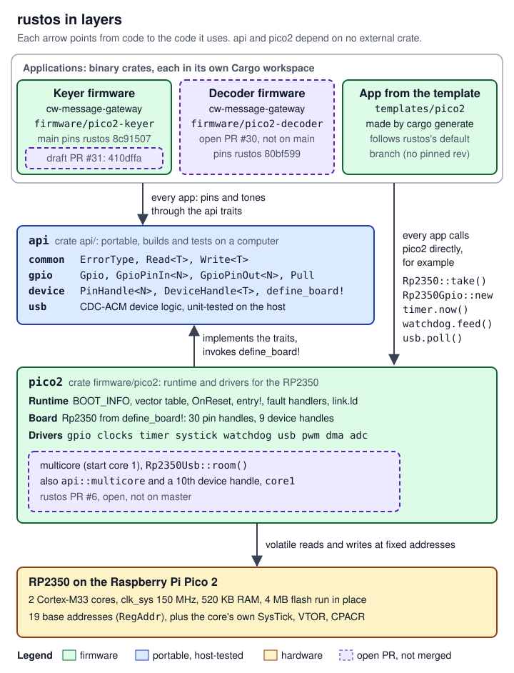

# rustos handover

rustos is a bare-metal Rust runtime and driver set for the Raspberry Pi Pico 2 board and its RP2350 microcontroller. Robin (the project owner) started it to move hardware-ownership rules into Rust's type system wherever the language can express them, and to enforce the rest with constructors that succeed at most once per boot ([`README.md:3-18`](https://github.com/robinonsay/rustos/blob/80bf5998a60a41b3741041062ff7e9c59caf95b2/README.md#L3-L18)). It is not an operating system in the scheduler sense: it has no threads, no heap ([`firmware/pico2/src/lib.rs:34-37`](https://github.com/robinonsay/rustos/blob/80bf5998a60a41b3741041062ff7e9c59caf95b2/firmware/pico2/src/lib.rs#L34-L37)) and no interrupt handlers (every exception and interrupt other than reset and HardFault goes to one catch-all handler, [`firmware/pico2/src/lib.rs:447-457`](https://github.com/robinonsay/rustos/blob/80bf5998a60a41b3741041062ff7e9c59caf95b2/firmware/pico2/src/lib.rs#L447-L457)). Each application is one polled loop, and with rustos PR #6 a second loop on the second core. The only code in the repository is the RP2350 runtime and drivers, in two crates, `api` (the portable traits and ownership types) and `firmware/pico2` (the boot code, the Pico 2 board and the drivers), plus an application template ([`Cargo.toml:3`](https://github.com/robinonsay/rustos/blob/80bf5998a60a41b3741041062ff7e9c59caf95b2/Cargo.toml#L3)). Most of the rest of `docs/` is the planning baseline of "Juno", a flight-software system for a rocket flight test: those documents are plans, and none of the modules they describe has code here ([`README.md:56-62`](https://github.com/robinonsay/rustos/blob/80bf5998a60a41b3741041062ff7e9c59caf95b2/README.md#L56-L62), [`README.md:369-380`](https://github.com/robinonsay/rustos/blob/80bf5998a60a41b3741041062ff7e9c59caf95b2/README.md#L369-L380)). Every driver except GPIO was written for the cw-message-gateway project, whose keyer box and decoder box firmware are the only users of rustos today.

These pages are for the engineers Robin is bringing onto the project: experienced software engineers who know Rust but may not know the RP2350, bare-metal Arm Cortex-M code or amateur radio. Each numbered page covers one part or one topic: what it is, how it works and connects to the rest, every public interface with a permalink to its definition, the algorithms, how to program against it and change it, and its known bugs and work left. This page is the index, so it does not follow the subsystem page shape the numbered pages share. Embedded and Rust terms are in the [Glossary](#glossary) below; radio terms are in the cw-message-gateway [17 Glossary][gw-17].

## Start here

| If you are | Read | Then, as needed |
|---|---|---|
| Anyone new to rustos | [01 Overview](01-overview.md): the layers, the ownership model, how processing is done, the template. [08 Changes made for cw-message-gateway](08-changes-for-cw-gateway.md): the six rustos PRs, which firmware uses which driver, what has run on a chip, and why moving the rustos pin is a firmware change. [09 Work left and known issues](09-work-left-known-issues.md): the state of the repository and every open item. | The cw-message-gateway [13 Safety rules][gw-13] before touching anything the keyer box uses |
| Working on boot, memory or faults | [02 Boot and runtime](02-boot-runtime.md): power-on to `main`, the vector table, `OnReset`, `entry!` and the safe state, the fault path, `link.ld` and the memory map | [06 Multicore](06-multicore.md) for core 1's start and its own stack (rustos PR #6); the watchdog section of [04 Drivers: core](04-drivers-core.md) for what survives a watchdog reset |
| Writing application code | [03 The api crate](03-api-crate.md) (traits, handles, the USB serial logic), [04 Drivers: core](04-drivers-core.md) (board, clocks, timer, SysTick, watchdog), [05 Drivers: GPIO, USB, PWM, ADC, DMA](05-drivers-io.md) (GPIO, USB, PWM, ADC, DMA), [06 Multicore](06-multicore.md) (PR #6 only) | "Programming against it" in [01 Overview](01-overview.md) for the template and a USB serial echo; "Adding a safe state" in [02 Boot and runtime](02-boot-runtime.md) if any pin drives hardware outside the chip |
| Adding or changing a driver | [07 Writing a driver](07-writing-a-driver.md): the anatomy of a driver, the PWM driver's history as a worked example, the checklist, the commands to run, and how cw-message-gateway picks up a change | [04 Drivers: core](04-drivers-core.md) for `RegAddr`, the atomic register aliases and the reset helpers every driver uses; [03 The api crate](03-api-crate.md) for the traits a driver implements |

## The pages

| Page | What it covers | Figures |
|---|---|---|
| [01 Overview](01-overview.md) | The map: what is code and what is only planned, the `docs/` folder, the layers, the once-per-boot ownership model, the board and every `pico2` module, the build configuration, a first application. | 2 |
| [02 Boot and runtime](02-boot-runtime.md) | Power-on to `main`: `BOOT_INFO`, the vector table, `OnReset`, `entry!` and the safe state, the fault handlers, the linker script and the memory map, and core 1's stack on PR #6. | 3 |
| [03 The api crate](03-api-crate.md) | The portable crate: `ErrorType`, `Read`, `Write`, the GPIO traits, `PinHandle`, `DeviceHandle`, `define_board!`, the host-tested USB CDC-ACM logic, and PR #6's core 1 launch state machine. | 4 |
| [04 Drivers: core](04-drivers-core.md) | The board, register addresses and atomic aliases, the reset helpers, and the clocks, timer, SysTick and watchdog drivers, with how the keyer firmware uses each. | 3 |
| [05 Drivers: GPIO, USB, PWM, ADC, DMA](05-drivers-io.md) | GPIO, the polled USB serial port, PWM square waves, and ADC sampling into a DMA ring; what has run on a chip and what has not. | 4 |
| [06 Multicore](06-multicore.md) | rustos PR #6 (open, not on master): starting core 1 on its own stack, the launch handshake, the inter-core FIFOs, faults on core 1, and how the one-Pico keyer image uses it. | 3 |
| [07 Writing a driver](07-writing-a-driver.md) | How a rustos driver is written and cited, the PWM driver as a worked example, a checklist, the local checks (rustos has no CI), and how a change reaches the firmware. | 2 |
| [08 Changes made for cw-message-gateway](08-changes-for-cw-gateway.md) | rustos PRs #1 to #6 one by one, which firmware image uses which driver, what has run on a Pico 2, the history of the firmware's rustos pin, and the behaviours the keyer's safety depends on. | 3 |
| [09 Work left and known issues](09-work-left-known-issues.md) | Status, how a rustos change reaches a radio, known issues K1 to K17 and work items W1 to W15, each with its evidence, what it blocks and who decides. | 1 |

The figures are hand-written SVG files in [`diagrams/`](diagrams/), each named after the page that owns it (`NN-name.svg`); some pages also embed a figure from a sibling page.

## The layers

*Figure: `api` depends on nothing and `pico2` depends only on `api`. Applications live outside the rustos workspace: the keyer and decoder firmware each pin one rustos commit, while an app generated from the template follows the default branch. Dashed purple marks code still on open PRs.*

Details of each layer: [01 Overview](01-overview.md) (the whole picture), [03 The api crate](03-api-crate.md), and [02](02-boot-runtime.md), [04](04-drivers-core.md), [05](05-drivers-io.md) and [06](06-multicore.md) for the `pico2` crate.

## How these docs cite the code

**Every claim about code is a permalink** to the exact lines at a fixed commit. The link text is the repository-relative path and line numbers; the URL carries the full 40-character SHA, so the link always shows the code the sentence was written from, even after the file changes. The pages never link `blob/master` or `blob/main`. For example, the place where the board is claimed once per boot is [`api/src/device/mod.rs:314-319`](https://github.com/robinonsay/rustos/blob/80bf5998a60a41b3741041062ff7e9c59caf95b2/api/src/device/mod.rs#L314-L319).

The commits the pages cite:

| Repository | Commit | Full SHA | What it is |
|---|---|---|---|
| rustos | `80bf599` | `80bf5998a60a41b3741041062ff7e9c59caf95b2` | `master`: rustos PRs #1 to #5 merged (the merge of #5). Every rustos link unless marked. |
| rustos | `410dffa` | `410dffa091e247e6e7546c7f2ff465f0af499d5a` | Head of rustos PR #6 (open, not on master): multicore and `Rp2350Usb::room()`. Branch `claude/pico-decoder-u9bum5`. |
| cw-message-gateway | `44185fa` | `44185fa9a00369c379d9d8af40ca307e3867e860` | That project's `main`. Every cw-message-gateway link unless marked. |
| cw-message-gateway | `3efaf84` | `3efaf842e1aab75354e5e19d0384a703d4d786be` | Head of PR #30, the decoder box (open, not on main). |
| cw-message-gateway | `bc5062a` | `bc5062ae4f56ae1f9949b3b067218c7e675d88f8` | Head of PR #31, the one-Pico keyer image (draft, not on main). |

Page 08's history of the firmware's rustos pin also cites the earlier cw-message-gateway commits where each pin move was made.

Rules the pages follow:

- **Code that exists only on an open PR is labelled in the sentence**, for example "(rustos PR #6, open, not on master)", and cited at that PR's head.
- **Project files are not public.** The safety audit, the bench records and the design notes live in Robin's project files, not in either repository. The pages name them in plain text, for example "`audit/report.md` §3 (project files)", and restate what they say.
- **Some "Sources" sections name project memory notes** (`MEMORY.md` and others). Those are working notes of the Claude sessions that did the cw-message-gateway work; they are not in either repository, so the pages restate what they took from them, and where a note and the code disagree the code wins.
- **Links to the other repository's handover set** use its default branch, cw-message-gateway `main`, where that set merged; the one moving link allowed.
- **Pages link sibling pages, not headings on them**, because headings may change.

**Diagram colours.** Every figure in this set and in the cw-message-gateway set uses the same colours, and each figure with more than one colour has its own legend:

| Colour | Fill and border | Means |
|---|---|---|
| Green | `#dcfce7`, `#166534` | Firmware: rustos's `api` and `pico2` crates and application code compiled into a chip image (`api` also builds and runs its tests on a computer) |
| Blue | `#dbeafe`, `#1e40af` | Host code: code that runs only on a computer. In this set, the host test runs (07's driver-anatomy figure) |
| Amber | `#fef3c7`, `#92400e` | Hardware: the chip, its bootrom and memory, the board, a radio |
| Red | `#fee2e2`, `#991b1b` | A safety limit, gate or rule (never loosened) |
| Grey | `#f3f4f6`, `#374151` | Outside rustos: the host computer, a person, a build tool |
| Purple, dashed border | `#ede9fe`, `#5b21b6` | Not on `master` or `main` yet: rustos PR #6, cw-message-gateway PRs #30 and #31, planned steps |

White boxes with a grey border are notes or unused space. A few figures add a mark of their own (a dotted border for an analysis not tested on hardware, the sentinel slots in the ADC ring) and explain it in their legend.

## Where rustos is used

rustos's only users are the firmware images of [cw-message-gateway][gw-readme], a home-station node (host program `hfnode`) that sends texts, email and weather forecasts over Morse code on HF (shortwave) radio. Its USB keyer box is a Pico 2 that keys a radio's transmitter by closing the radio's key line, or by holding a handheld radio's PTT (push-to-talk) line while it plays a tone; its decoder box is a Pico 2 that listens to the radio's audio and decodes the Morse. Each firmware crate is its own Cargo workspace and depends on `api` and `pico2` as git dependencies pinned by revision:

| Firmware image | In cw-message-gateway | rustos pinned | Status |
|---|---|---|---|
| Keyer box | `firmware/pico2-keyer` on main | `8c91507`, master's merge of rustos #4 ([`firmware/pico2-keyer/Cargo.toml:30-31`](https://github.com/robinonsay/cw-message-gateway/blob/44185fa9a00369c379d9d8af40ca307e3867e860/firmware/pico2-keyer/Cargo.toml#L30-L31)) | The audited build `eef8c126`, which the audit reproduced byte for byte from this pin, is the only rustos-based image that has run on a Pico 2 ([08](08-changes-for-cw-gateway.md)) |
| Decoder box | `firmware/pico2-decoder`, PR #30 (open, not on main) | `80bf599`, master's merge of rustos #5 ([`firmware/pico2-decoder/Cargo.toml:24-25`](https://github.com/robinonsay/cw-message-gateway/blob/3efaf842e1aab75354e5e19d0384a703d4d786be/firmware/pico2-decoder/Cargo.toml#L24-L25)) | Audit-cleared to flash on a plain Pico 2 with nothing plugged into a radio; no record of it being flashed |
| One-Pico keyer image (keyer on core 0, decoder on core 1) | `firmware/pico2-keyer`, PR #31 (draft, stacked on #30) | `410dffa`, the head of rustos PR #6, "to be moved to master's merge of rustos #6 once it is merged" ([`firmware/pico2-keyer/Cargo.toml:24-31`](https://github.com/robinonsay/cw-message-gateway/blob/bc5062ae4f56ae1f9949b3b067218c7e675d88f8/firmware/pico2-keyer/Cargo.toml#L24-L31)) | Audit-cleared at `bc5062a`; the re-pin is a new head that needs a new hash |

**A rustos change reaches a radio only through that project's safety audit.** A rustos merge changes nothing on a box until a firmware PR moves its pin, and moving the pin is a firmware change even with no source change: the keyer's manifest records that it "can change the UF2 with no source change, since cargo mixes the commit into the crate hashes that order the code" ([`firmware/pico2-keyer/Cargo.toml:27-29`](https://github.com/robinonsay/cw-message-gateway/blob/44185fa9a00369c379d9d8af40ca307e3867e860/firmware/pico2-keyer/Cargo.toml#L27-L29)). So any rustos change a firmware image picks up goes back through cw-message-gateway's safety audit, which reviews the new head and posts the SHA-256 of the one file that may be flashed. Nothing is flashed, keyed or transmitted until the audit has posted that hash and Robin has said go, and the flashed file must be byte-identical to it. Never work around this. The process is on cw-message-gateway's [14 Audit, bench and flashing][gw-14] and, from the rustos side, on [09 Work left and known issues](09-work-left-known-issues.md).

**What rustos must keep doing for the keyer box (never loosen).** The keyer's safety relies on these rustos behaviours. Do not weaken any of them; the canonical list of the box's limits and gates is cw-message-gateway's [13 Safety rules][gw-13].

| Behaviour | Where |
|---|---|
| `Rp2350Gpio::new` needs no clocks, so the keyer drives its key and PTT pins low before anything else starts | [`firmware/pico2/src/gpio/gpio.rs:132-139`](https://github.com/robinonsay/rustos/blob/80bf5998a60a41b3741041062ff7e9c59caf95b2/firmware/pico2/src/gpio/gpio.rs#L132-L139) |
| An output pin is driven low before its driver is enabled | [`firmware/pico2/src/gpio/gpio.rs:438-442`](https://github.com/robinonsay/rustos/blob/80bf5998a60a41b3741041062ff7e9c59caf95b2/firmware/pico2/src/gpio/gpio.rs#L438-L442) |
| `OnHardFault` and `DefaultHandler` call the application's safe state first, then spin | [`firmware/pico2/src/lib.rs:453-469`](https://github.com/robinonsay/rustos/blob/80bf5998a60a41b3741041062ff7e9c59caf95b2/firmware/pico2/src/lib.rs#L453-L469) |
| `Rp2350Pwm::silence_all` writes nothing while the PWM block is held in reset | [`firmware/pico2/src/pwm.rs:721-728`](https://github.com/robinonsay/rustos/blob/80bf5998a60a41b3741041062ff7e9c59caf95b2/firmware/pico2/src/pwm.rs#L721-L728) |
| `TIMER0` is never paused by a debugger (`DBGPAUSE` = 0) | [`firmware/pico2/src/timer.rs:194`](https://github.com/robinonsay/rustos/blob/80bf5998a60a41b3741041062ff7e9c59caf95b2/firmware/pico2/src/timer.rs#L194) |
| The watchdog's debugger pause bits are cleared when it starts | [`firmware/pico2/src/watchdog.rs:65-72`](https://github.com/robinonsay/rustos/blob/80bf5998a60a41b3741041062ff7e9c59caf95b2/firmware/pico2/src/watchdog.rs#L65-L72), [`firmware/pico2/src/watchdog.rs:534-548`](https://github.com/robinonsay/rustos/blob/80bf5998a60a41b3741041062ff7e9c59caf95b2/firmware/pico2/src/watchdog.rs#L534-L548) |
| The keyer's hardware watchdog, `WATCHDOG_MS` = 500 (0.5 s), runs on this driver | [`crates/keyer-core/src/lib.rs:62`](https://github.com/robinonsay/cw-message-gateway/blob/44185fa9a00369c379d9d8af40ca307e3867e860/crates/keyer-core/src/lib.rs#L62) (cw-message-gateway) |

Two rules of the box's wiring are not in rustos's code, and rustos cannot replace either. The key pin needs the external 4.7 kΩ pull-down, because erratum RP2350-E9 can leave an undriven pad near 2 V even with the chip's own pull-down on ([`docs/keyer.md:59-65`](https://github.com/robinonsay/cw-message-gateway/blob/44185fa9a00369c379d9d8af40ca307e3867e860/docs/keyer.md#L59-L65)). And the key switch inverts: the box's key pin low means key open, so a bare Pico 2 pin must never drive a radio that keys on a low line (the audit's NO-GO, [`docs/keyer.md:966-976`](https://github.com/robinonsay/cw-message-gateway/blob/44185fa9a00369c379d9d8af40ca307e3867e860/docs/keyer.md#L966-L976)). Both are never-loosen rules.

cw-message-gateway's CI also finds rustos code by symbol name: `check_faults.py` looks up `OnHardFault` and `DefaultHandler` and checks that the first store each makes opens the key and the PTT ([`firmware/pico2-keyer/check_faults.py:41`](https://github.com/robinonsay/cw-message-gateway/blob/44185fa9a00369c379d9d8af40ca307e3867e860/firmware/pico2-keyer/check_faults.py#L41), [`.github/workflows/ci.yml:186`](https://github.com/robinonsay/cw-message-gateway/blob/44185fa9a00369c379d9d8af40ca307e3867e860/.github/workflows/ci.yml#L186)), and PR #31's `check_core1.py` (draft, not on main) looks up `pico2::multicore`'s symbols ([`firmware/pico2-keyer/check_core1.py:73-75`](https://github.com/robinonsay/cw-message-gateway/blob/bc5062ae4f56ae1f9949b3b067218c7e675d88f8/firmware/pico2-keyer/check_core1.py#L73-L75)). Renaming those items breaks that CI at the next pin move ([09](09-work-left-known-issues.md)).

The cw-message-gateway side of all this is in its own handover set: start at its [index][gw-readme], then [08 Keyer box: firmware and protocol][gw-08] and [11 Decoder box and the one-Pico image][gw-11].

## Glossary

Short definitions of the embedded and Rust terms these pages use; the "See" column names the page that explains each in full. Radio and project terms (CW, key line, PTT, MCW, keyer box, trip, the safety audit, a hash, `hfnode`) are in the cw-message-gateway [17 Glossary][gw-17].

**The chip and the board**

| Term | Meaning | See |
|---|---|---|
| RP2350, Pico 2 | The microcontroller: two Arm Cortex-M33 cores, 520 KB of on-chip RAM, a boot ROM, no on-chip program flash. The Pico 2 is Raspberry Pi's board that carries it, with 4 MB of external flash. | [01](01-overview.md), [02](02-boot-runtime.md) |
| Core 0, core 1 | The two processors. Core 0 runs `main`; core 1 waits in the bootrom until core 0 starts it, which only rustos PR #6 does. | [06](06-multicore.md) |
| Bare metal | The program is the only software on the chip and sets up the hardware itself. | [01](01-overview.md) |
| Register, block | A register is a 32-bit word at a fixed address that controls a block, one hardware unit such as the timer or the USB controller. | [04](04-drivers-core.md), [07](07-writing-a-driver.md) |
| Atomic aliases | Most blocks' registers appear three more times, at +`0x1000` (XOR), +`0x2000` (set bits) and +`0x3000` (clear bits), so one write changes only the bits given. The SIO and the core's own registers have none. | [04](04-drivers-core.md) |
| Block reset | Most blocks start held in reset and do nothing until a driver releases them through the reset controller (`RESETS`; `RESET_DONE` shows which are out). "Reset" can also mean a reset of the whole chip. | [04](04-drivers-core.md) |
| Bootrom | The chip's built-in code that runs first after every reset, on both cores, and starts the program in flash. | [02](02-boot-runtime.md) |
| BOOTSEL, UF2, ELF, picotool | Holding the BOOTSEL button while plugging in USB makes the bootrom appear as a USB drive that accepts a UF2 file. The linker writes an ELF; picotool is Raspberry Pi's tool that converts and loads images. | [01](01-overview.md) |
| `IMAGE_DEF` | The five-word block (`BOOT_INFO` in rustos) the bootrom must find in the first 4 kB of flash before it runs an image. | [02](02-boot-runtime.md) |
| XIP | Execute in place: the external flash is readable as memory from `0x1000_0000`, so the cores fetch code straight from it. | [02](02-boot-runtime.md) |
| Vector table, `VTOR` | The array of handler addresses a core uses on reset, faults and interrupts (word 0 is the initial stack pointer, word 1 the reset handler); `VTOR` holds its address, one per core. | [02](02-boot-runtime.md) |
| HardFault, UsageFault, lockup | Arm fault exceptions. UsageFault reports errors such as an undefined instruction or a stack-limit violation, and escalates to HardFault, the catch-all, while it is not enabled. A fault the core cannot take even at HardFault priority stops it in lockup until a reset. | [02](02-boot-runtime.md), [06](06-multicore.md) |
| `MSP`, `MSPLIM`, `STKOF` | The main stack pointer and its limit register: a push below `MSPLIM` faults (UsageFault flag `STKOF`) instead of writing. One per core. | [02](02-boot-runtime.md), [06](06-multicore.md) |
| `CPACR`, FPU | `CPACR` switches coprocessors on, among them the floating-point unit, which is off at reset; `OnReset` turns it on first. | [02](02-boot-runtime.md) |
| NVIC | Each core's interrupt controller. rustos never writes it: no driver uses an interrupt. | [01](01-overview.md), [02](02-boot-runtime.md) |
| MPU | Memory protection unit: address regions with permissions, one per core. The one-Pico image uses it to fence core 1. | [06](06-multicore.md) |
| Secure, Non-secure; privileged, unprivileged | Arm TrustZone security states and privilege levels. Both cores run Secure here. A block can refuse an access below the level it requires, which the core takes as a bus fault. | [05](05-drivers-io.md), [06](06-multicore.md) |
| SIO | The single-cycle I/O block at `0xd000_0000`: the GPIO set, clear and read registers, and the inter-core FIFOs. | [05](05-drivers-io.md), [06](06-multicore.md) |
| FIFO, `SEV` | The two small queues of 32-bit words between the cores, one each way; `SEV` is the Arm instruction that wakes the other core. | [06](06-multicore.md) |
| GPIO, pad, `FUNCSEL` | A GPIO is a pin software drives or reads. `IO_BANK0` picks the block that drives it (`FUNCSEL`); `PADS_BANK0` sets its pad, the electrical driver and input buffer (`IE`, `OD`, pulls, and the `ISO` isolation latch); SIO holds the level. | [05](05-drivers-io.md) |
| Pull-up, pull-down | A weak resistor in the pad that holds an undriven pin high or low. | [05](05-drivers-io.md) |
| Erratum RP2350-E9 | A documented chip defect: an undriven input pad can float between the logic levels, where the internal pull-down cannot hold it low. The reason for the keyer box's required external pull-down (see [Where rustos is used](#where-rustos-is-used)). | [05](05-drivers-io.md), [09](09-work-left-known-issues.md) |
| XOSC, ROSC, PLL, VCO | The 12 MHz crystal oscillator (accurate); the ring oscillator inside the chip (drifts); a phase-locked loop, which multiplies a reference up in its voltage-controlled oscillator (VCO) and divides it down. | [04](04-drivers-core.md) |
| `clk_ref`, `clk_sys`, `clk_peri`, `clk_usb`, `clk_adc` | The chip's named clocks. rustos runs `clk_ref` at 12 MHz, `clk_sys` and `clk_peri` at 150 MHz, and `clk_usb` and `clk_adc` at 48 MHz. | [04](04-drivers-core.md) |
| Tick, `TIMER0` | The `TICKS` block divides `clk_ref` into ticks for each timer and the watchdog, one per microsecond as rustos sets it; `TIMER0` counts those ticks in 64 bits (`Rp2350Timer`). | [04](04-drivers-core.md) |
| SysTick | Each core's own 24-bit down-counter. rustos runs it free on `clk_sys`, a second count apart from the tick, so software can notice the tick stopping. | [04](04-drivers-core.md) |
| Watchdog, feed, scratch registers | A countdown that resets the chip unless the program feeds (reloads) it in time; scratch registers keep their values through a watchdog reset but not a power-up. | [04](04-drivers-core.md) |
| POWMAN, PSM | The power manager, which records the cause of the last chip-level reset; the power-on state machine, which brings the chip up stage by stage. | [04](04-drivers-core.md) |
| CDC-ACM, endpoint, SETUP, enumeration | CDC-ACM is the USB serial-port class computers open without a driver install. An endpoint is a numbered USB channel; endpoint 0 carries control requests, each opened by an 8-byte SETUP packet. Enumeration is the host reading the device's descriptors and configuring it. | [03](03-api-crate.md), [05](05-drivers-io.md) |
| NAK, STALL, ZLP, DPRAM | The device's "not now, try again" and "refused" answers; a zero-length packet that ends a transfer whose last packet was full; the USB controller's 4 kB packet-buffer RAM. | [03](03-api-crate.md), [05](05-drivers-io.md) |
| VBUS, VSYS, SMPS | The 5 V on the USB cable; the Pico 2's main input rail; the board regulator that makes 3.3 V from VSYS. | [05](05-drivers-io.md) |
| PWM slice, `TOP`, `CC` | One of twelve counters, each with a divider and two outputs. It counts from 0 to `TOP` and wraps; an output is high while the count is below its compare value `CC`, so `CC` = 0 is always low. | [05](05-drivers-io.md), [07](07-writing-a-driver.md) |
| ADC, DMA, DREQ | The 12-bit analog-to-digital converter; the block that copies data without the processor; the request line a peripheral uses to pace a DMA channel. | [05](05-drivers-io.md) |
| Ring, sentinel | A buffer the DMA fills round and round; a value the ADC never writes (`0xFFFF`), used to mark a slot as already read. | [05](05-drivers-io.md) |

**Rust and the build**

| Term | Meaning | See |
|---|---|---|
| `#![no_std]`, `#![no_main]` | The crate links only Rust's `core` library (no operating system, no `println!`, no heap) and has no ordinary `fn main`: the runtime reaches the application through a symbol that `entry!` defines. | [02](02-boot-runtime.md) |
| `#[panic_handler]`, `panic = "abort"` | The function a panic calls, which every application supplies; and the profile setting that means there is no unwinding. | [02](02-boot-runtime.md) |
| `entry!`, safe state | `pico2::entry!(main, safe_state = f)` names the application's `main` and, optionally, a function that puts outputs driving hardware outside the chip into their safe level. The fault handlers call it first; a panic does not, unless the panic handler calls it. | [02](02-boot-runtime.md) |
| `thumbv8m.main-none-eabihf` | The target triple: Armv8-M Mainline, no operating system, hardware floating point. `cargo pico2` builds the `pico2` library for it. | [01](01-overview.md) |
| Zero-sized type, handle | A struct with no data, which costs nothing at run time. `PinHandle<N>` and `DeviceHandle<T>` are zero-sized and neither `Copy` nor `Clone`: holding one is owning that pin or peripheral. | [01](01-overview.md), [03](03-api-crate.md) |
| `define_board!`, `take()` | The macro that declares a board's pins and peripherals; the generated `Rp2350::take()` returns `Some` once per boot, through one atomic `compare_exchange`. | [01](01-overview.md), [03](03-api-crate.md) |
| Move, E0382 | Passing a handle by value moves it, so a second use is the compiler error "use of moved value". This is how a pin is configured at most once. | [01](01-overview.md) |
| Const generic | A `const N: usize` type parameter: a pin's number is part of its type, as in `Rp2350GpioOut<25>`. | [01](01-overview.md), [03](03-api-crate.md) |
| Trait, associated type, GAT | A trait is a set of method signatures a type opts into; an associated type is a type member each implementation chooses; a generic associated type (GAT) takes parameters, here a pin number. | [03](03-api-crate.md) |
| Build-time `const` assertion | A `const` assert inside a generic function, checked for each use when the crate is built (after monomorphisation). `cargo build` reports it; `cargo check` and the editor may not. | [01](01-overview.md), [07](07-writing-a-driver.md) |
| Volatile access | A register read or write the compiler may not remove, merge or reorder; drivers use it through raw pointers to `#[repr(C)]` register layouts. | [04](04-drivers-core.md), [07](07-writing-a-driver.md) |
| `Acquire`, `Release` | Rust atomic orderings: what one core wrote before a `Release` store is visible to a core that reads that store with an `Acquire` load. | [06](06-multicore.md) |
| `link.ld`, LMA, VMA, `.data`, `.bss` | The linker script places every section in flash or RAM. A section's LMA is where its bytes are stored in the image, its VMA where code expects them at run time. `OnReset` copies `.data` from flash to RAM and zeroes `.bss`. | [02](02-boot-runtime.md) |
| Naked function, Thumb bit | A function with no compiler-made prologue, so it touches no stack; bit 0 of an Arm code address, which must be 1 for a Cortex-M branch target. | [06](06-multicore.md) |
| Pin (of a dependency), `rev` | The `rev = "<commit>"` in a firmware's `Cargo.toml` that fixes which rustos commit it builds against. Moving it is a firmware change. | [08](08-changes-for-cw-gateway.md) |
| `[patch]` | A manifest section that builds an application against a local rustos checkout instead of the pinned commit. | [01](01-overview.md), [07](07-writing-a-driver.md) |
| cargo-generate, template | The tool and the `templates/pico2` template that start a new rustos application; the template's manifest is `Cargo.toml.liquid`. | [01](01-overview.md) |
| Build id | The first eight characters of the commit CI built a firmware from, compiled into the image so the host can check it runs the cleared file. | [08](08-changes-for-cw-gateway.md) |

## Status at the time of writing

As of 2026-10-14, from [09 Work left and known issues](09-work-left-known-issues.md) (the PR state and `master` were checked again on GitHub that day for this page):

- **`master` is `80bf599`**, the merge of rustos PR #5; PRs #1 to #5 are merged.
- **rustos PR #6 is open** at `410dffa` (multicore and `Rp2350Usb::room()`): not a draft, mergeable, untested on hardware. It waits only on Robin's merge, which should be a merge commit so that `410dffa` stays reachable from `master` (W1).
- **After that merge**, cw-message-gateway PR #31 moves its rustos pin to the merge commit. That is a new firmware file, so the safety audit reviews it and posts a new hash before anything is flashed (W2). The keyer on cw-message-gateway main and the decoder box (PR #30) do not use multicore and do not need to move.
- **rustos has no CI** (W3). Every check is run by hand: `cargo test` (the `api` crate's tests), `cargo pico2` (the chip build), and a build of an application against the checkout.
- **What has run on a chip:** one rustos-based image, the keyer box build `eef8c126` (rustos `c985211` sources), flashed on a bare Pico 2 on 2026-10-09 with nothing wired to a radio. It booted, enumerated over USB on macOS and answered `hfnode keyer check`, which exercised the boot code and the GPIO, clocks, timer, SysTick, watchdog (start and feed), USB and PWM bring-up. DMA, ADC, multicore and `room()` have never run on a chip, and neither has a tone, `silence_all`, a watchdog timeout reset, a USB link loss or a real fault reaching the safe state (W4, W15).
- **An open audit item:** the USB SETUP parsers in `api::usb` have not been audited for implicit panics, which a computer on the USB cable could trigger; the audit lists it as open, to be closed before unattended use (K3, W11).
- **The repository's README and several doc comments are stale:** they describe a `demo` crate and build commands from before the demo moved into the template (K1, W5).
- **The Juno modules are plans with no code** (W8).
- **No flaky tests are known.** Page 09 lists all 17 known issues (K1 to K17) and 15 work items (W1 to W15), each with what it blocks and who decides; cw-message-gateway's [16 Work left and known bugs][gw-16] covers the firmware side.

## Keeping these docs right

- **When the code changes, update the citations with it.** A permalink never breaks, because it points at a fixed commit, so a stale one goes unnoticed: it keeps showing the old lines. When a PR changes a file the pages cite, re-read the sentences that cite it, move their links to the new commit (full 40-character SHA, line numbers checked at that commit), and update the commit table above. `git diff 80bf599 <new> -- <path>` shows what moved.
- **When rustos PR #6 merges**, re-cite its items at master's merge commit and drop the "open, not on master" labels on pages 01 to 09; in the figures, PR #6 items change from dashed purple to their merged colour. Do the same for cw-message-gateway PRs #30 and #31 when they merge.
- **When a figure's subject changes, update the figure.** Edit the SVG in `diagrams/` by hand, keep the colours above and the house style (a white background rectangle drawn first, a `<title>` that matches the alt text, text no smaller than 13 px), then render it and look at it until it reads well.
- **Safety numbers follow the code exactly.** A limit, gate or rule in these pages changes only when the code changes, is cited at the line that states it, and is never loosened. The canonical list is cw-message-gateway's [13 Safety rules][gw-13].
- **Keep the house rules.** Robin is "she" and "her" everywhere; no personal details; no time estimates, only the work and what it waits on; anything not checked on hardware is labelled as such.

The two tools are in [`tools/`](tools/). Run both from the repository root.

| Tool | Command | What it does |
|---|---|---|
| `citecheck.py` | `python3 docs/handover/tools/citecheck.py docs/handover/*.md` (add `--quiet` to see only problems) | Checks every link. For each permalink it checks that the commit, the file and the line range exist and prints the cited lines, so you can compare them with the sentence. It flags links to `blob/master` or `blob/main` and missing relative targets and anchors. It needs the cited commits in your clones (a commit only an open PR holds may need `git fetch origin <full-sha>`) and a cw-message-gateway clone beside this one, or `CW_GATEWAY_DIR` set. Exit status 1 if anything is broken. |
| `svgcheck.cjs` | `node docs/handover/tools/svgcheck.cjs docs/handover/diagrams/NN-name.svg` | Renders the SVG the way GitHub shows it, at desktop width (light and dark page) and at phone width, cuts zoom tiles, and lints the layout (text outside the canvas, overlapping text, text under 13 px, lines through text, a missing background). It writes PNGs to `docs/handover/.render/`, which git ignores, and a JSON report. Needs Node 18 or later and Playwright with Chromium. Fix every error, then look at every PNG: the lint does not catch everything that reads badly. |

## Sources

- The nine pages of this set, `01-overview.md` to `09-work-left-known-issues.md`, and the figure `diagrams/01-layers.svg`.
- rustos at `80bf599`: `README.md`, `Cargo.toml`, `api/src/device/mod.rs`, `firmware/pico2/src/lib.rs`, `gpio/gpio.rs`, `pwm.rs`, `timer.rs`, `watchdog.rs`, `clocks.rs` (clock constants), `adc.rs` (the sentinel), `templates/pico2/Cargo.toml.liquid`, `docs/design/index.md`; rustos at `410dffa`: `firmware/pico2/src/lib.rs`.
- cw-message-gateway at `44185fa`: `firmware/pico2-keyer/Cargo.toml`, `src/main.rs`, `check_faults.py`, `crates/keyer-core/src/lib.rs`, `docs/keyer.md`, `.github/workflows/ci.yml`; at `3efaf84`: `firmware/pico2-decoder/Cargo.toml`; at `bc5062a`: `firmware/pico2-keyer/Cargo.toml`, `check_core1.py`.
- GitHub REST API on 2026-10-14: rustos PR #6 (open, head `410dffa`, base `80bf599`, mergeable) and `master` (`80bf599`); cw-message-gateway's open PRs (#30 at `3efaf84`, #31 draft at `bc5062a`).
- `docs/handover/tools/citecheck.py` and `svgcheck.cjs` (their usage notes), and the writers' brief for this handover set.
- The cw-message-gateway handover set on its `main` branch: [13 Safety rules][gw-13], [14 Audit, bench and flashing][gw-14], [16 Work left and known bugs][gw-16], [17 Glossary][gw-17].

[gw-readme]: https://github.com/robinonsay/cw-message-gateway/blob/main/docs/handover/README.md
[gw-08]: https://github.com/robinonsay/cw-message-gateway/blob/main/docs/handover/08-keyer-box-firmware.md
[gw-11]: https://github.com/robinonsay/cw-message-gateway/blob/main/docs/handover/11-decoder-box-one-pico.md
[gw-13]: https://github.com/robinonsay/cw-message-gateway/blob/main/docs/handover/13-safety-rules.md
[gw-14]: https://github.com/robinonsay/cw-message-gateway/blob/main/docs/handover/14-audit-bench-flashing.md
[gw-16]: https://github.com/robinonsay/cw-message-gateway/blob/main/docs/handover/16-work-left-known-bugs.md
[gw-17]: https://github.com/robinonsay/cw-message-gateway/blob/main/docs/handover/17-glossary.md
